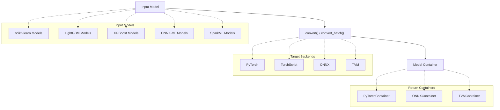
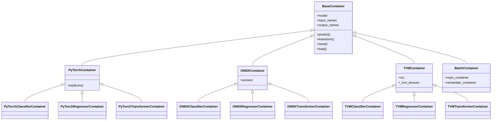
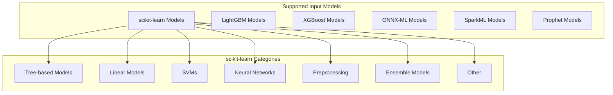
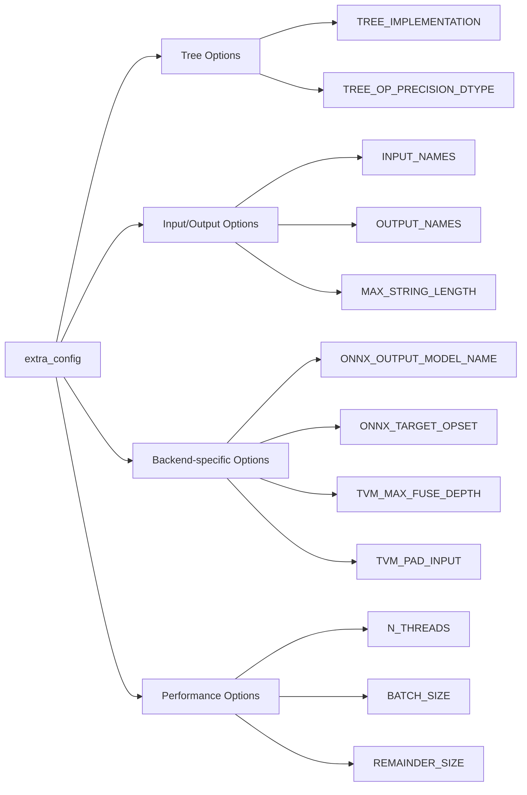

<!-- source: DeepWiki mcp.deepwiki.com · repo microsoft/hummingbird · page 5 API Reference · fetched 2026-10-26 -->

# API Reference

<details>
<summary>Relevant source files</summary>

The following files were used as context for generating this wiki page:

- [hummingbird/ml/_utils.py](hummingbird/ml/_utils.py)
- [hummingbird/ml/containers/sklearn/onnx_containers.py](hummingbird/ml/containers/sklearn/onnx_containers.py)
- [hummingbird/ml/containers/sklearn/pytorch_containers.py](hummingbird/ml/containers/sklearn/pytorch_containers.py)
- [hummingbird/ml/containers/sklearn/tvm_containers.py](hummingbird/ml/containers/sklearn/tvm_containers.py)
- [hummingbird/ml/convert.py](hummingbird/ml/convert.py)
- [hummingbird/ml/operator_converters/__init__.py](hummingbird/ml/operator_converters/__init__.py)
- [hummingbird/ml/supported.py](hummingbird/ml/supported.py)
- [tests/test_backends.py](tests/test_backends.py)
- [tests/test_extra_conf.py](tests/test_extra_conf.py)
- [tests/test_onnxml_one_hot_encoder_converter.py](tests/test_onnxml_one_hot_encoder_converter.py)

</details>


This page provides a comprehensive reference for Hummingbird's public API. It covers the main conversion functions, model containers, supported models/backends, and configuration options. For installation instructions, see [Installation and Setup](#2). For architectural details, see [Architecture](#3).

## Conversion API

The conversion API is the primary entry point for using Hummingbird.



Sources: [hummingbird/ml/convert.py:408-444](), [hummingbird/ml/convert.py:447-481]()

### convert()

The main function for converting machine learning models to target backends.

```python
convert(model, backend, test_input=None, device="cpu", extra_config={})
```

**Parameters:**

| Parameter | Type | Description |
|-----------|------|-------------|
| model | object | The model to convert (from scikit-learn, LightGBM, XGBoost, ONNX-ML, or SparkML) |
| backend | string | Target backend ("torch", "torch.jit", "onnx", or "tvm") |
| test_input | array-like, optional | Test data used to trace execution for TorchScript/TVM or to generate inputs for ONNX conversion |
| device | string, optional | Target device ("cpu" or "cuda") for PyTorch models |
| extra_config | dict, optional | Extra configuration options (see configuration section) |

**Returns:**

A model container implementing the appropriate API based on the input model type and target backend.

**Examples:**

```python
# Convert a scikit-learn model to PyTorch
pytorch_model = convert(sklearn_model, 'torch')

# Convert a XGBoost model to TorchScript with test input
torchscript_model = convert(xgb_model, 'torch.jit', X_test)
```

Sources: [hummingbird/ml/convert.py:408-444]()

### convert_batch()

A variant of the conversion function for batch prediction use cases, particularly useful for TVM backend.

```python
convert_batch(model, backend, test_input, remainder_size=0, device="cpu", extra_config={})
```

This function creates models that can handle inputs whose number of rows is `test_input.shape[0] * k + remainder_size`, where `k` is any integer. This is particularly useful for the TVM backend which normally requires fixed input shapes.

**Parameters:**

| Parameter | Type | Description |
|-----------|------|-------------|
| model | object | The model to convert |
| backend | string | Target backend ("torch", "torch.jit", "onnx", or "tvm") |
| test_input | array-like | Sample input used to trace model execution |
| remainder_size | int, optional | The size of test data that can be predicted beyond batch_size multiples |
| device | string, optional | Target device ("cpu" or "cuda") for PyTorch models |
| extra_config | dict, optional | Extra configuration options |

**Returns:**

A `BatchContainer` object that wraps one or two containers to handle batch prediction.

**Examples:**

```python
# Convert model with batch size 100 and support for 50 remaining samples
batch_model = convert_batch(sklearn_model, 'tvm', X[:100], remainder_size=50)
```

Sources: [hummingbird/ml/convert.py:447-481]()

## Container API

Hummingbird wraps all converted models in containers that provide a standardized API similar to scikit-learn.



Sources: [hummingbird/ml/containers/sklearn/pytorch_containers.py:36-196](), [hummingbird/ml/containers/sklearn/onnx_containers.py:34-196](), [hummingbird/ml/containers/sklearn/tvm_containers.py:35-197]()

### Common Container Methods

All containers provide the following common methods:

| Method | Description |
|--------|-------------|
| predict() | Returns model predictions (for classifiers and regressors) |
| predict_proba() | Returns probability estimates (for classifiers) |
| transform() | Returns transformed data (for transformers) |
| save(location) | Saves the model to the specified location |

Additionally, specialized container types provide additional methods:

- **Anomaly Detection Containers:** `decision_function()`, `score_samples()`
- **PyTorch Containers:** `to(device)` for moving the model between CPU and GPU

### Loading Models

Models can be loaded using the specific container class or the generic `load` function:

```python
# Load using specific container type
model = hummingbird.ml.TorchContainer.load("model_path.zip")

# Load using generic function (auto-detects container type)
model = hummingbird.ml.load("model_path.zip")
```

Model loading supports model integrity verification:

```python
# Save model and get digest
digest = model.save("model.zip")

# Load with integrity verification
loaded_model = hummingbird.ml.load("model.zip", digest=digest)
```

Sources: [hummingbird/ml/_utils.py:244-304](), [hummingbird/ml/containers/sklearn/pytorch_containers.py:107-191](), [hummingbird/ml/containers/sklearn/onnx_containers.py:109-196](), [hummingbird/ml/containers/sklearn/tvm_containers.py:131-225]()

## Supported Models and Backends

Hummingbird supports various input model types and target backends.

### Supported Models



Sources: [hummingbird/ml/supported.py:11-107](), [hummingbird/ml/supported.py:123-304]()

#### scikit-learn Models

Hummingbird supports a wide range of scikit-learn models including:

- **Tree-based Models:** `DecisionTree`, `RandomForest`, `GradientBoosting`, `HistGradientBoosting`, `IsolationForest`, etc.
- **Linear Models:** `LinearRegression`, `LogisticRegression`, `SGDClassifier`, etc.
- **SVMs:** `LinearSVC`, `LinearSVR`, etc.
- **Neural Networks:** `MLPClassifier`, `MLPRegressor`
- **Preprocessing:** `StandardScaler`, `MinMaxScaler`, `OneHotEncoder`, etc.
- **Other:** `KNeighborsClassifier`, `KMeans`, `PCA`, etc.

#### Other Frameworks

- **LightGBM:** `LGBMClassifier`, `LGBMRegressor`, `LGBMRanker`
- **XGBoost:** `XGBClassifier`, `XGBRegressor`, `XGBRanker`
- **ONNX-ML:** Operators like `TreeEnsembleClassifier`, `LinearClassifier`, etc.
- **SparkML:** Limited support including `LogisticRegressionModel`, `Bucketizer`, `VectorAssembler`
- **Prophet:** `Prophet` forecasting model

Sources: [hummingbird/ml/supported.py:11-107](), [hummingbird/ml/supported.py:289-459]()

### Supported Backends

Hummingbird supports converting models to the following backends:

| Backend | Description |
|---------|-------------|
| PyTorch (`'torch'`) | PyTorch models (default) |
| TorchScript (`'torch.jit'`) | TorchScript models for production deployment |
| ONNX (`'onnx'`) | ONNX format for cross-platform deployment |
| TVM (`'tvm'`) | Apache TVM for compiled models |

Each backend has specific requirements:
- `torch.jit` and `tvm` require test input
- `onnx` works best with test input but can generate some automatically

Sources: [hummingbird/ml/supported.py:387-412](), [hummingbird/ml/convert.py:92-98]()

## Configuration Options

Hummingbird supports various configuration options that can be passed to the `convert()` or `convert_batch()` functions via the `extra_config` parameter.



Sources: [hummingbird/ml/supported.py:524-569](), [tests/test_extra_conf.py:41-227]()

### Common Configuration Options

| Option | Type | Description |
|--------|------|-------------|
| `TREE_IMPLEMENTATION` | string | Tree implementation technique: "gemm", "tree_trav", or "perf_tree_trav" |
| `N_THREADS` | int | Number of threads to use for inference (intra-op parallelism) |
| `INPUT_NAMES` | list | Custom names for the model inputs |
| `OUTPUT_NAMES` | list | Custom names for the model outputs |
| `BATCH_SIZE` | int | Size for batch processing |

### Backend-Specific Options

| Option | Backend | Description |
|--------|---------|-------------|
| `ONNX_OUTPUT_MODEL_NAME` | ONNX | Sets the name of the output ONNX model |
| `ONNX_TARGET_OPSET` | ONNX | Target ONNX opset version (default: 11) |
| `TVM_MAX_FUSE_DEPTH` | TVM | Maximum operation fusion depth (default: 50) |
| `TVM_PAD_INPUT` | TVM | Whether to pad inputs on batch dimension (may impact performance) |

### Example Usage

```python
# Configure a tree model to use tree traversal and 4 threads
extra_config = {
    constants.TREE_IMPLEMENTATION: "tree_trav",
    constants.N_THREADS: 4
}
model = convert(gbdt_model, "torch", extra_config=extra_config)

# Configure TVM conversion with padding for variable batch sizes
extra_config = {
    constants.TVM_PAD_INPUT: True,
    constants.TVM_MAX_FUSE_DEPTH: 30
}
model = convert(sklearn_model, "tvm", X_test, extra_config=extra_config)
```

Sources: [hummingbird/ml/supported.py:524-569](), [tests/test_extra_conf.py:41-227]()

## Advanced Usage

### Model Serialization

All Hummingbird containers support saving and loading models:

```python
# Save model
model = convert(sklearn_model, "torch")
digest = model.save("model.zip")  # Returns a digest for integrity verification

# Load model with integrity check
loaded_model = hummingbird.ml.load("model.zip", digest=digest)

# Load without verification (not recommended for untrusted sources)
loaded_model = hummingbird.ml.load("model.zip", override_flag=True)
```

The save method creates a zip archive containing the model and metadata. Loading can be done with either the specific container type or the generic `load()` function, which auto-detects the container type.

Sources: [hummingbird/ml/containers/sklearn/pytorch_containers.py:41-105](), [hummingbird/ml/_utils.py:244-304]()

### Handling Variable Batch Sizes

For backends like TVM that compile models for specific input shapes, `convert_batch()` provides a solution for handling variable batch sizes:

```python
batch_size = 32
remainder_size = 16  # For handling batches not divisible by batch_size
model = hummingbird.ml.convert_batch(
    sklearn_model, 
    "tvm", 
    X[:batch_size], 
    remainder_size=remainder_size
)

# Can now predict on any input size = batch_size * k + remainder_size
# where k is any non-negative integer
predictions = model.predict(X)  # X can have any compatible size
```

This creates a model that can handle input data in batches, with a special path for handling the remainder.

Sources: [hummingbird/ml/convert.py:447-481](), [tests/test_extra_conf.py:425-618]()

### Input Types

Hummingbird supports various input types:

- NumPy arrays
- Pandas DataFrames
- Spark DataFrames
- Lists
- Tuples of arrays (for multiple inputs)

When using Pandas or Spark DataFrames, Hummingbird extracts column information automatically:

```python
# Convert with a pandas DataFrame as test input
import pandas as pd
X_df = pd.DataFrame(X, columns=["feature1", "feature2", "feature3"])
model = convert(sklearn_pipeline, "torch", X_df)

# Later predict with the same DataFrame structure
predictions = model.predict(new_df)
```

Sources: [hummingbird/ml/convert.py:295-380](), [tests/test_extra_conf.py:620-718]()

## Error Handling

Hummingbird provides specific exceptions for common conversion issues:

- `MissingConverter`: Raised when a converter for the input model type is not available
- `MissingBackend`: Raised when the requested backend is not supported
- `RuntimeError`: Raised for various conversion issues, including missing test input for backends that require it

Examples:

```python
try:
    model = convert(custom_model, "torch")
except MissingConverter:
    print("This model type is not supported by Hummingbird")
    
try:
    model = convert(sklearn_model, "torch.jit")
except RuntimeError as e:
    if "requires test inputs" in str(e):
        # Provide test input and try again
        model = convert(sklearn_model, "torch.jit", X_test)
```

Sources: [hummingbird/ml/convert.py:60-98](), [hummingbird/ml/supported.py:461-474]()

---

