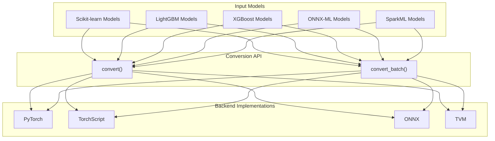
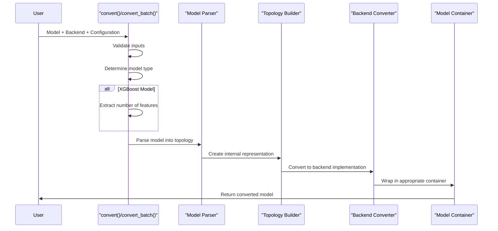
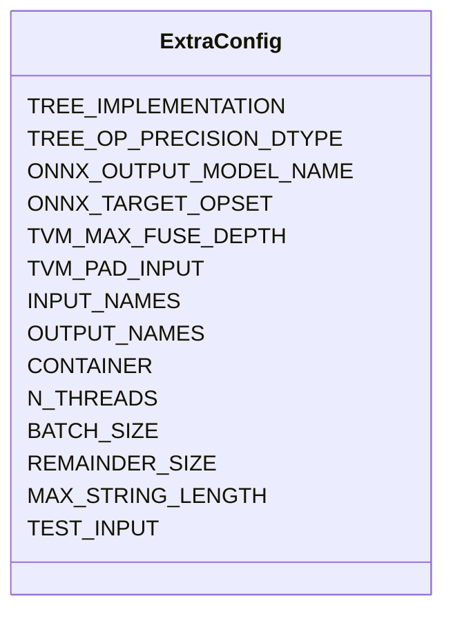
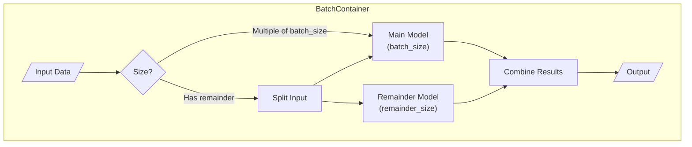

<!-- source: DeepWiki mcp.deepwiki.com · repo microsoft/hummingbird · page 5.1 Conversion API · fetched 2026-10-26 -->

# Conversion API

<details>
<summary>Relevant source files</summary>

The following files were used as context for generating this wiki page:

- [hummingbird/ml/convert.py](hummingbird/ml/convert.py)
- [hummingbird/ml/operator_converters/__init__.py](hummingbird/ml/operator_converters/__init__.py)
- [hummingbird/ml/supported.py](hummingbird/ml/supported.py)
- [tests/test_extra_conf.py](tests/test_extra_conf.py)
- [tests/test_onnxml_one_hot_encoder_converter.py](tests/test_onnxml_one_hot_encoder_converter.py)

</details>


The Conversion API is the primary interface for transforming traditional machine learning models into tensor computation frameworks in Hummingbird. This page documents the main conversion functions and their parameters, supporting you in converting models from frameworks like scikit-learn, LightGBM, and XGBoost to backends such as PyTorch, TorchScript, ONNX, and TVM.

For information about using the converted models, see [Container API](#5.2).

## Overview of the Conversion Process

Hummingbird's conversion process transforms trained ML models into tensor-based implementations that can execute more efficiently on modern hardware accelerators.



Sources: [hummingbird/ml/convert.py:408-444](), [hummingbird/ml/convert.py:447-481](), [hummingbird/ml/supported.py:386-411]()

## Main Conversion Functions

### convert()

The primary function for converting ML models to tensor-based backends.

```python
def convert(model, backend, test_input=None, device="cpu", extra_config={}):
    """
    Convert a model from its original framework to the specified backend.
    """
```

#### Parameters:

| Parameter | Type | Description |
|-----------|------|-------------|
| `model` | object | The input model to convert (scikit-learn, LightGBM, XGBoost, ONNX, or SparkML) |
| `backend` | string | Target backend ("torch", "torch.jit", "onnx", or "tvm") |
| `test_input` | array-like, optional | Input data used to trace model execution. Required for "torch.jit" and "tvm". Can be tuple for multiple inputs. |
| `device` | string, default="cpu" | Target device for model execution ("cpu" or "cuda") |
| `extra_config` | dict, default={} | Additional configuration options |

#### Returns:

A model implemented in the specified backend, equivalent to the input model.

Sources: [hummingbird/ml/convert.py:408-444]()

### convert_batch()

A specialized function for batch-by-batch prediction use cases, particularly useful for TVM backend where container has strict input shape requirements.

```python
def convert_batch(model, backend, test_input, remainder_size=0, device="cpu", extra_config={}):
    """
    Converts a model and returns a container that supports batch-by-batch prediction.
    """
```

#### Parameters:
Same as `convert()` with one additional parameter:

| Parameter | Type | Description |
|-----------|------|-------------|
| `remainder_size` | int, default=0 | Determines size of additional inputs the model can accept beyond multiples of the batch size |

#### Returns:

A `BatchContainer` object that wraps one or two models created by `convert()`.

Sources: [hummingbird/ml/convert.py:447-481]()

## Detailed Conversion Process

When you call `convert()` or `convert_batch()`, Hummingbird performs a series of operations to transform your model.



Sources: [hummingbird/ml/convert.py:95-154](), [hummingbird/ml/convert.py:156-274](), [hummingbird/ml/convert.py:277-292](), [hummingbird/ml/convert.py:295-405]()

## Supported Models and Backends

### Input Model Types

Hummingbird can convert models from various ML frameworks:

1. **scikit-learn models**:
   - Tree-based models (Random Forest, Gradient Boosting, etc.)
   - Linear models (Linear/Logistic Regression, SGD, etc.)
   - Support Vector Machines
   - Preprocessing operators (Scalers, Encoders, etc.)
   - And many more

2. **LightGBM models**:
   - LGBMClassifier
   - LGBMRegressor
   - LGBMRanker
   - Booster

3. **XGBoost models**:
   - XGBClassifier
   - XGBRegressor
   - XGBRanker

4. **ONNX-ML models**:
   - Various ONNX operators

5. **SparkML models**:
   - Limited operators including LogisticRegressionModel, Bucketizer, VectorAssembler

For the complete and up-to-date list, refer to [hummingbird/ml/supported.py:16-106]().

### Target Backends

Hummingbird currently supports conversion to:

| Backend | Identifier | Description |
|---------|------------|-------------|
| PyTorch | "torch" | Standard PyTorch model |
| TorchScript | "torch.jit" or "torchscript" | Serialized and optimized PyTorch model |
| ONNX | "onnx" | Open Neural Network Exchange format |
| TVM | "tvm" | Apache TVM (Tensor Virtual Machine) |

Sources: [hummingbird/ml/supported.py:10-14](), [hummingbird/ml/supported.py:387-411]()

## Extra Configuration Options

You can customize the conversion process using the `extra_config` parameter:



| Configuration Option | Description |
|----------------------|-------------|
| `TREE_IMPLEMENTATION` | Tree implementation type: "gemm", "tree_trav", or "perf_tree_trav" |
| `TREE_OP_PRECISION_DTYPE` | Data type for tree nodes: "float32" or "float64" |
| `ONNX_OUTPUT_MODEL_NAME` | Name for the output ONNX model |
| `ONNX_TARGET_OPSET` | Target opset for ONNX models (default: 11) |
| `TVM_MAX_FUSE_DEPTH` | Maximum fusion depth for TVM operations (default: 50) |
| `TVM_PAD_INPUT` | Whether to pad inputs on batch dimension in TVM |
| `INPUT_NAMES` | Names for model inputs |
| `OUTPUT_NAMES` | Names for model outputs |
| `CONTAINER` | Whether to return model in a container (default: True) |
| `N_THREADS` | Number of threads for scoring (default: physical core count) |
| `BATCH_SIZE` | Whether to partition input dataset for inference |
| `REMAINDER_SIZE` | Rows that an auxiliary remainder model can accept |
| `MAX_STRING_LENGTH` | Maximum expected length for string features |
| `TEST_INPUT` | Test input data for tracing model execution |

Sources: [hummingbird/ml/supported.py:524-569](), [tests/test_extra_conf.py]()

## Batch Conversion Mechanism

The `convert_batch()` function creates models that can handle inputs of varying batch sizes, which is particularly useful for the TVM backend that otherwise requires fixed input shapes.



When using `convert_batch()`:
1. You provide the batch size through `test_input.shape[0]`
2. You specify the remainder size with the `remainder_size` parameter
3. The function creates:
   - A main model that handles inputs in multiples of the batch size
   - A remainder model that handles the extra rows (if any)
4. At prediction time, the input is appropriately split and processed by both models

Sources: [hummingbird/ml/convert.py:447-481](), [tests/test_extra_conf.py:136-618]()

## Usage Examples

### Basic Model Conversion

Converting a scikit-learn RandomForestClassifier to PyTorch:

```python
from sklearn.ensemble import RandomForestClassifier
import hummingbird.ml

# Train a model
rf = RandomForestClassifier(n_estimators=10)
rf.fit(X_train, y_train)

# Convert to PyTorch
pytorch_model = hummingbird.ml.convert(rf, 'torch')

# Make predictions
predictions = pytorch_model.predict(X_test)
```

### Converting to TorchScript with Test Input

```python
import numpy as np
import hummingbird.ml

# Convert to TorchScript (requires test_input)
test_input = np.array(X_test[:100], dtype=np.float32)
torchscript_model = hummingbird.ml.convert(
    sklearn_model, 
    'torch.jit', 
    test_input
)

# Save the model
torchscript_model.save('model.pt')
```

### Using Batch Conversion for TVM

```python
import hummingbird.ml
import numpy as np

# Define batch size and remainder
batch_size = 10  # Will use X_test[:10] for tracing
remainder_size = X_test.shape[0] % batch_size

# Convert with batch support
tvm_model = hummingbird.ml.convert_batch(
    sklearn_model,
    'tvm',
    X_test[:batch_size],
    remainder_size=remainder_size
)

# Can now predict on arbitrary sized inputs
predictions = tvm_model.predict(X_test)
```

### Configuring Tree Implementation

```python
import hummingbird.ml
from hummingbird.ml import constants

# Use GEMM implementation for tree-based models
pytorch_model = hummingbird.ml.convert(
    tree_model,
    'torch',
    extra_config={constants.TREE_IMPLEMENTATION: 'gemm'}
)
```

Sources: [tests/test_extra_conf.py]()

## Troubleshooting

Common issues when using the Conversion API:

1. **Missing test_input**: The `torch.jit` and `tvm` backends require test inputs for tracing.

2. **Unsupported model types**: Check if your model type is in the supported list. You can extend Hummingbird by adding new converters.

3. **TVM input size requirements**: TVM compiled models expect specific input shapes. Use `convert_batch()` or set `extra_config={constants.TVM_PAD_INPUT: True}` to handle different input sizes.

4. **String features in ONNX**: For models with string features, you may need to specify the `MAX_STRING_LENGTH` configuration.

Sources: [hummingbird/ml/convert.py:60-92](), [tests/test_onnxml_one_hot_encoder_converter.py:138-152]()

---

