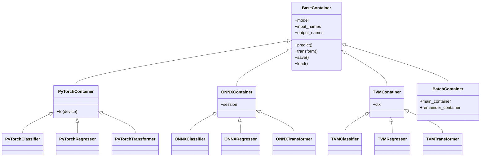
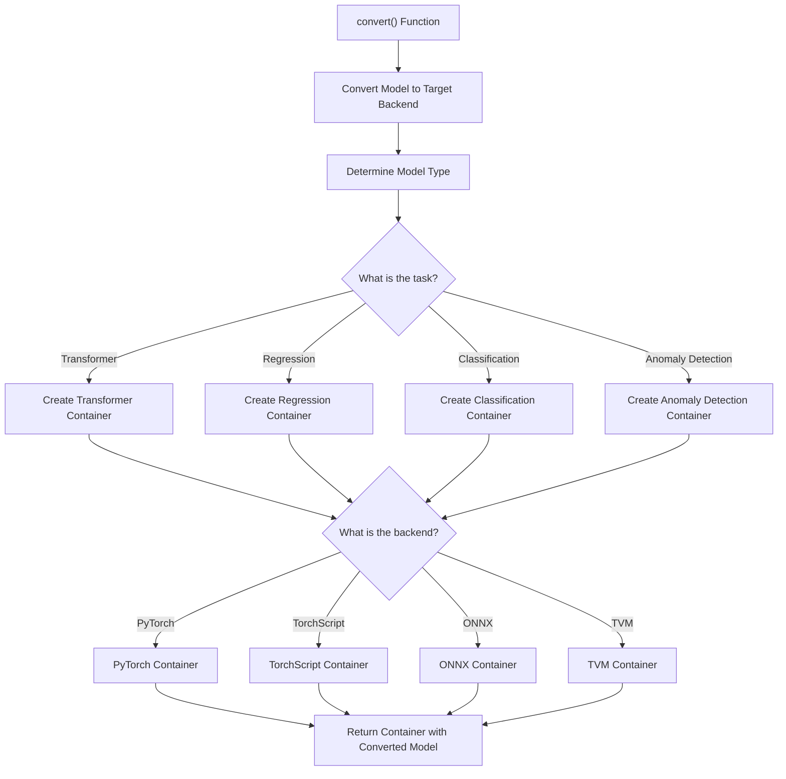
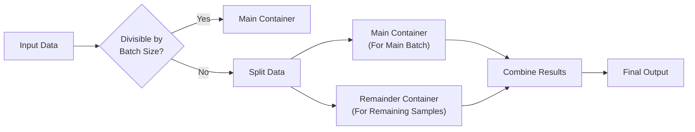
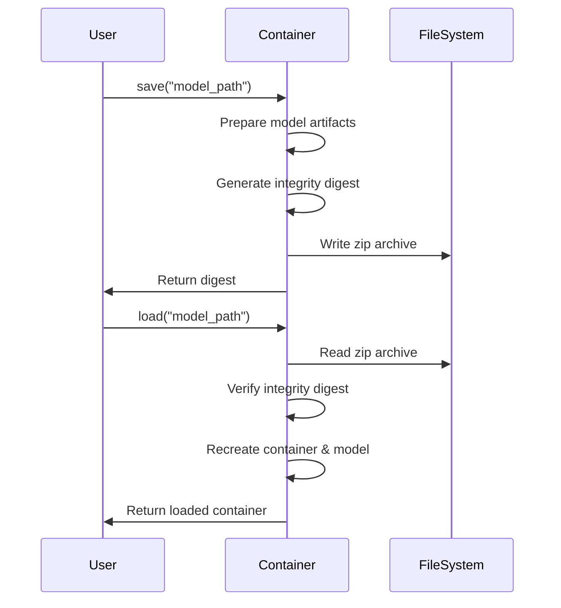
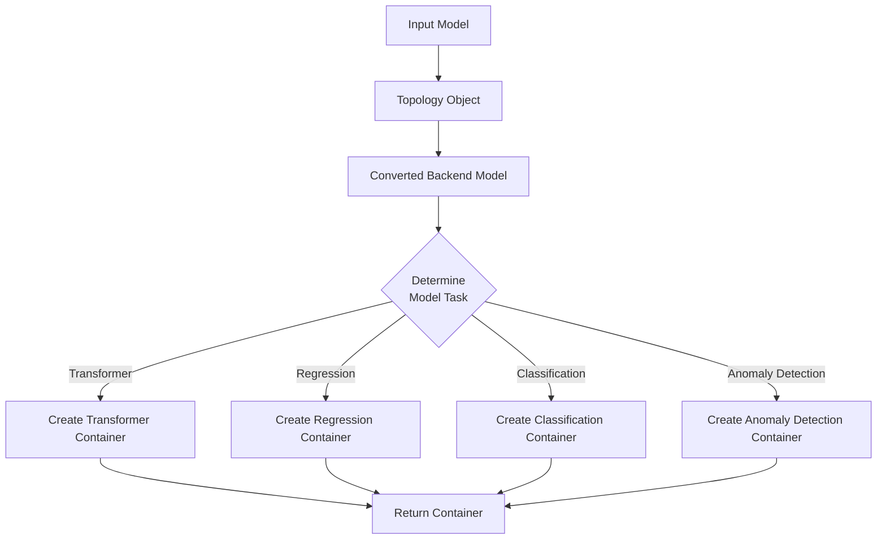

<!-- source: DeepWiki mcp.deepwiki.com · repo microsoft/hummingbird · page 5.2 Container API · fetched 2026-10-26 -->

# Container API

<details>
<summary>Relevant source files</summary>

The following files were used as context for generating this wiki page:

- [hummingbird/ml/__init__.py](hummingbird/ml/__init__.py)
- [hummingbird/ml/_topology.py](hummingbird/ml/_topology.py)
- [hummingbird/ml/_utils.py](hummingbird/ml/_utils.py)
- [hummingbird/ml/containers/sklearn/onnx_containers.py](hummingbird/ml/containers/sklearn/onnx_containers.py)
- [hummingbird/ml/containers/sklearn/pytorch_containers.py](hummingbird/ml/containers/sklearn/pytorch_containers.py)
- [hummingbird/ml/containers/sklearn/tvm_containers.py](hummingbird/ml/containers/sklearn/tvm_containers.py)
- [hummingbird/ml/operator_converters/constants.py](hummingbird/ml/operator_converters/constants.py)
- [tests/test_backends.py](tests/test_backends.py)

</details>


The Container API in Hummingbird provides a unified interface for interacting with converted machine learning models, regardless of which target backend (PyTorch, TorchScript, ONNX, or TVM) is used. This API enables consistent model prediction, serialization, and loading functionality across different backend implementations.

For information about the overall conversion process that creates these containers, see [Model Conversion Pipeline](#3.1).

## Container Architecture

The Container API uses a hierarchical design that combines backend-specific containers (PyTorch, ONNX, TVM) with task-specific containers (classification, regression, transformation, anomaly detection).



Sources:
- [hummingbird/ml/containers/sklearn/pytorch_containers.py:36-106]()
- [hummingbird/ml/containers/sklearn/onnx_containers.py:34-218]()
- [hummingbird/ml/containers/sklearn/tvm_containers.py:35-252]()

## Base Container Types

Hummingbird provides several container types based on the target backend:

| Container Class | Backend | Description |
|-----------------|---------|-------------|
| `PyTorchSklearnContainer` | PyTorch | Provides interface for PyTorch models |
| `TorchScriptSklearnContainer` | TorchScript | Provides interface for TorchScript models |
| `ONNXSklearnContainer` | ONNX | Provides interface for ONNX Runtime models |
| `TVMSklearnContainer` | TVM | Provides interface for TVM models |
| `BatchContainer` | Any | Special container for batch processing |

Each backend-specific container handles the details of interacting with the corresponding framework while providing a consistent API to users.

Sources:
- [hummingbird/ml/__init__.py:28-30]()
- [hummingbird/ml/_topology.py:20-37]()

## Task-Specific Containers

For each backend, Hummingbird provides specialized containers based on the model task:

| Container Type | Task | Main Methods |
|----------------|------|--------------|
| `*ContainerTransformer` | Data transformation | `transform()` |
| `*ContainerRegression` | Regression | `predict()` |
| `*ContainerClassification` | Classification | `predict()`, `predict_proba()` |
| `*ContainerAnomalyDetection` | Anomaly detection | `predict()`, `decision_function()`, `score_samples()` |

These containers are assigned during the conversion process based on the type of operators found in the model.

Sources:
- [hummingbird/ml/containers/sklearn/pytorch_containers.py:198-242]()
- [hummingbird/ml/containers/sklearn/onnx_containers.py:220-273]()
- [hummingbird/ml/containers/sklearn/tvm_containers.py:254-284]()

## Container Selection Process

During model conversion, Hummingbird automatically determines which container type to use based on the model's task and the target backend.



Sources:
- [hummingbird/ml/_topology.py:351-444]()

## Core Container API

All containers provide these common methods and attributes:

### Common Attributes

| Attribute | Description |
|-----------|-------------|
| `model` | The underlying model in the target backend format |
| `input_names` | Names of the input features expected by the model |
| `output_names` | Names of the outputs produced by the model |

### Common Methods

| Method | Description |
|--------|-------------|
| `predict(X)` | Make predictions using the model |
| `save(location)` | Save the model to a file or directory |
| `load(location, [options])` | Static method to load a saved model |

Additional methods for specific tasks:

- **Classification containers**: `predict_proba(X)` for probability predictions
- **Transformer containers**: `transform(X)` for data transformation
- **Anomaly detection containers**: `decision_function(X)` and `score_samples(X)`

Sources:
- [hummingbird/ml/containers/sklearn/pytorch_containers.py:41-105]()
- [hummingbird/ml/containers/sklearn/onnx_containers.py:40-107]()
- [hummingbird/ml/containers/sklearn/tvm_containers.py:41-129]()

## Special Features by Backend

Each backend container provides specialized functionality:

### PyTorch Containers

```python
# Move a PyTorch model to a specific device
hb_model = hummingbird.ml.convert(model, "torch")
hb_model.to("cuda")  # Move to GPU
```

### TorchScript Containers

TorchScript containers provide the same API as PyTorch containers but use a special wrapper function that handles input tensors appropriately for TorchScript models.

### ONNX Containers

ONNX containers use ONNX Runtime for inference and handle named inputs:

```python
# The ONNX container manages the ONNX Runtime session internally
hb_model = hummingbird.ml.convert(model, "onnx", X)
predictions = hb_model.predict(X)  # Uses ONNXRuntime internally
```

### TVM Containers

TVM containers provide context handling for specifying the device target:

```python
# TVM containers manage the runtime context for CPU/GPU execution
hb_model = hummingbird.ml.convert(model, "tvm", X)
predictions = hb_model.predict(X)  # Uses TVM runtime internally
```

Sources:
- [hummingbird/ml/containers/sklearn/pytorch_containers.py:193-195]()
- [hummingbird/ml/containers/sklearn/pytorch_containers.py:245-280]()
- [hummingbird/ml/containers/sklearn/onnx_containers.py:198-218]()
- [hummingbird/ml/containers/sklearn/tvm_containers.py:227-251]()

## Batch Container

The `BatchContainer` is a special container type that manages batch processing by wrapping two containers:

1. A `main_container` for processing the main batch
2. A `remainder_container` for processing any remaining samples not fitting into the batch size

This is used by the `convert_batch` function to handle batch processing efficiently.



Sources:
- [hummingbird/ml/_topology.py:428-442]()
- [hummingbird/ml/_topology.py:141-146]()

## Saving and Loading Models

All containers provide consistent APIs for saving and loading models:

### Saving Models

```python
# Convert a model
hb_model = hummingbird.ml.convert(sklearn_model, "torch")
# Save it
digest = hb_model.save("model_path")
```

The `save` method:
1. Serializes the model according to the backend requirements
2. Includes version information and model configuration
3. Creates a zip file with all model artifacts
4. Returns a digest for model integrity verification

### Loading Models

```python
# Load a model with specific container type
model = hummingbird.ml.TorchContainer.load("model_path.zip")

# Or use the generic load function that detects the type
model = hummingbird.ml.load("model_path.zip")
```

The `load` method:
1. Unpacks the model artifacts
2. Verifies model integrity with the digest (optional)
3. Loads the appropriate container and model
4. Configures the runtime environment (threads, device, etc.)



Sources:
- [hummingbird/ml/containers/sklearn/pytorch_containers.py:41-106]()
- [hummingbird/ml/containers/sklearn/pytorch_containers.py:107-192]()
- [hummingbird/ml/containers/sklearn/onnx_containers.py:55-107]()
- [hummingbird/ml/containers/sklearn/onnx_containers.py:109-196]()
- [hummingbird/ml/containers/sklearn/tvm_containers.py:57-129]()
- [hummingbird/ml/containers/sklearn/tvm_containers.py:131-225]()
- [hummingbird/ml/_utils.py:244-304]()

## Container Creation During Conversion

The container creation process is the final step in the model conversion pipeline:

1. The input model is converted to the target backend
2. Hummingbird analyzes the model operations to determine its task type
3. The appropriate container is selected based on backend and task type
4. The converted model is wrapped in the container and returned



Sources:
- [hummingbird/ml/_topology.py:351-444]()

## Using Containers in Applications

Here are examples of how to use the Container API in real applications:

### Basic Model Conversion and Prediction

```python
import hummingbird.ml
import numpy as np
from sklearn.ensemble import RandomForestClassifier

# Train a model
X = np.random.rand(100, 10)
y = np.random.randint(2, size=100)
model = RandomForestClassifier()
model.fit(X, y)

# Convert to PyTorch
hb_model = hummingbird.ml.convert(model, 'torch')

# Make predictions
predictions = hb_model.predict(X)
probabilities = hb_model.predict_proba(X)

# Save the model
digest = hb_model.save("my_model")

# Later, load the model
loaded_model = hummingbird.ml.load("my_model", digest=digest)
```

### Working with Different Backends

```python
# Convert to ONNX (requires test data)
onnx_model = hummingbird.ml.convert(model, 'onnx', X)

# Convert to TorchScript (requires test data)
torchscript_model = hummingbird.ml.convert(model, 'torch.jit', X)

# Convert to TVM (requires test data)
tvm_model = hummingbird.ml.convert(model, 'tvm', X)
```

### Using Device-Specific Features

```python
# Move PyTorch model to GPU
torch_model = hummingbird.ml.convert(model, 'torch')
torch_model.to('cuda')

# TVM and ONNX models can use GPU automatically when specified during conversion
tvm_gpu_model = hummingbird.ml.convert(model, 'tvm', X, device='cuda')
```

Sources:
- [tests/test_backends.py:80-97]()
- [tests/test_backends.py:100-120]()
- [tests/test_backends.py:316-334]()
- [tests/test_backends.py:467-486]()
- [tests/test_backends.py:769-789]()

## Summary

The Container API is a critical component of Hummingbird that:

1. Provides a consistent interface across different backend implementations
2. Maintains the familiar scikit-learn API for converted models
3. Handles backend-specific details for model execution
4. Offers robust serialization and deserialization capabilities
5. Supports different ML tasks with specialized containers

By abstracting away the implementation details of different backends, the Container API enables users to switch between backends with minimal code changes while maintaining consistent behavior for inference, transformation, and model management.

---

