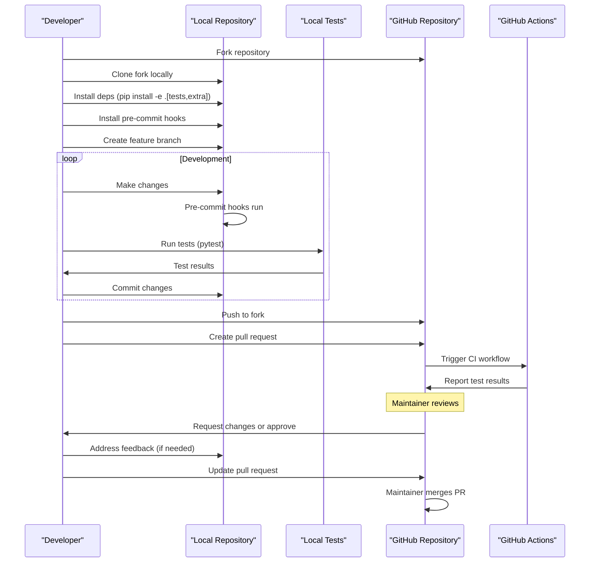
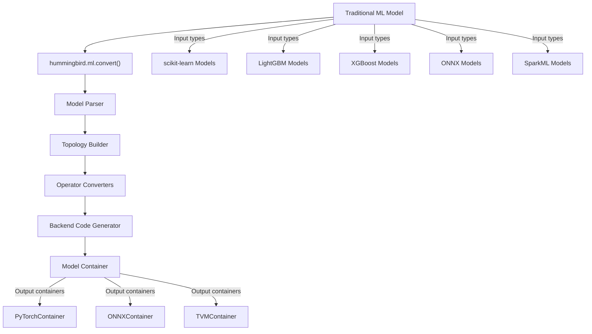
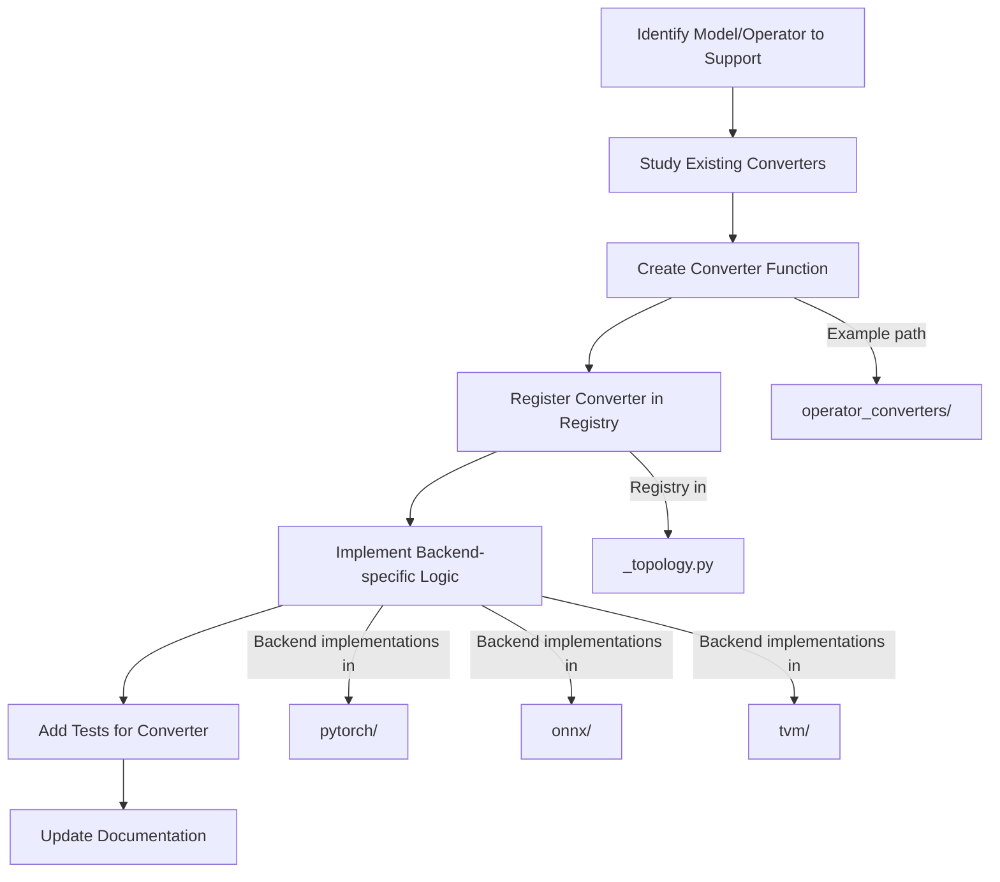

<!-- source: DeepWiki mcp.deepwiki.com · repo microsoft/hummingbird · page 6 Development Guide · fetched 2026-10-26 -->

# Development Guide

<details>
<summary>Relevant source files</summary>

The following files were used as context for generating this wiki page:

- [.devcontainer/Dockerfile](.devcontainer/Dockerfile)
- [.devcontainer/devcontainer.json](.devcontainer/devcontainer.json)
- [.github/workflows/pythonapp.yml](.github/workflows/pythonapp.yml)
- [CONTRIBUTING.md](CONTRIBUTING.md)
- [Dockerfile](Dockerfile)
- [README.md](README.md)
- [TROUBLESHOOTING.md](TROUBLESHOOTING.md)
- [setup.py](setup.py)
- [tests/test_no_extra_install.py](tests/test_no_extra_install.py)

</details>


This guide provides instructions and best practices for developers who want to contribute to Hummingbird. It covers environment setup, development workflow, building and testing, and adding new features. For information about using Hummingbird in your applications, see the [Overview](#1) and [API Reference](#5).

## Setting up the Development Environment

### Prerequisites

Before you begin, ensure you have:
- Python 3.9, 3.10, or 3.11 
- Git
- PyTorch (version specified in [.github/workflows/pythonapp.yml:35-36]())

### Basic Setup

Clone the repository and install in development mode:

```bash
mkdir hummingbird
cd hummingbird
git clone https://github.com/microsoft/hummingbird.git .
python -m pip install -e .[tests,extra]
```

This installs all dependencies including those required for testing and development.

Sources: [CONTRIBUTING.md:33-39](), [setup.py:58-64]()

### Alternative Development Environments

**Docker Setup:**
```bash
docker build git://github.com/microsoft/hummingbird -t hb-dev
docker run -it hb-dev
```

**VS Code Codespaces:**
The repository includes configuration for VS Code Codespaces in the `.devcontainer` directory for a web-based development experience.

Sources: [Dockerfile:1-24](), [.devcontainer/Dockerfile:1-24](), [.devcontainer/devcontainer.json:1-14]()

## Development Workflow

### Development Process

The diagram below illustrates the typical development workflow for contributing to Hummingbird:



Sources: [CONTRIBUTING.md:12-30](), [.github/workflows/pythonapp.yml:4-16]()

### Pre-commit Hooks

Hummingbird uses pre-commit hooks to ensure code quality. Install and set up:

```bash
python -m pip install pre-commit
pre-commit install
```

This will automatically run linters and formatters before each commit.

Sources: [CONTRIBUTING.md:53-75]()

### Pull Request Guidelines

Pull requests should:
1. Reference a filed issue
2. Fill in the pull request template
3. Pass all CI checks
4. Be reviewed and approved by maintainers

Note that all commits in a pull request will be squashed to a single commit with the original creator as author.

Sources: [CONTRIBUTING.md:17-25]()

## Repository Architecture

The following diagram illustrates the key components of Hummingbird and their interactions:



Sources: [README.md:15-22]()

## Building and Testing

### Running Tests Locally

To run the test suite locally:

```bash
pytest                           # Run all tests
coverage run -m pytest tests     # Run tests with coverage
flake8 .                         # Check code style
```

Sources: [.github/workflows/pythonapp.yml:69-71](), [CONTRIBUTING.md:85-92]()

### CI Testing Matrix

Hummingbird's CI pipeline tests on multiple platforms and Python versions:

| OS | Python Versions |
|----|-----------------|
| Ubuntu 24.04 | 3.9, 3.10, 3.11 |
| macOS 14 | 3.9, 3.10, 3.11 |
| Windows 2022 | 3.9, 3.10, 3.11 |

Sources: [.github/workflows/pythonapp.yml:28-32]()

### Test Types

Hummingbird's test suite includes:

1. **Basic Tests**: Core functionality without extra dependencies
2. **Extended Tests**: Functionality with all dependencies 
3. **Backend-specific Tests**: Tests for specific backends (PyTorch, ONNX, TVM)

Sources: [.github/workflows/pythonapp.yml:68-71](), [tests/test_no_extra_install.py:1-64]()

## Adding New Converters

One of the most common contributions to Hummingbird is adding support for new model types or operators.

### Converter Development Process



### Steps for Adding a New Converter

1. **Identify Target Model/Operator**: Determine which model or operator you want to support
2. **Study Existing Converters**: Look at similar converters to understand the pattern
3. **Create Converter Function**: Implement a function that converts the model to Hummingbird's internal representation
4. **Register Converter**: Add the converter to the appropriate registry
5. **Implement Backend Logic**: Add backend-specific implementation for each supported backend
6. **Add Tests**: Create tests for the new converter
7. **Update Documentation**: Update docs to reflect new supported model/operator

## Troubleshooting Common Development Issues

### PyTorch GPU Issues

To run Hummingbird on PyTorch with GPU:
```bash
python -m pip uninstall torch
# Follow PyTorch installation instructions for your CUDA version
```

### Platform-Specific Issues

| Platform | Issue | Solution |
|----------|-------|----------|
| MacOS | XGBoost installation: `cmake: command not found` | Install cmake: `brew install cmake` |
| MacOS | LightGBM installation: `Library not loaded: ...libomp.dylib` | Install libomp: `brew install libomp` |
| Linux | LightGBM installation: `libgomp.so.1: cannot open shared object file` | Install libgomp: `yum install libgomp` or `apt-get install libgomp1` |
| Windows | PyTorch installation: `Could not find a version that satisfies the requirement torch` | Install PyTorch manually from the PyTorch website |

Sources: [TROUBLESHOOTING.md:1-25](), [.github/workflows/pythonapp.yml:72-82]()

## Optional Dependencies

Hummingbird has several optional dependencies for different capabilities:

```bash
python -m pip install hummingbird-ml[extra]     # For XGBoost, LightGBM, etc.
python -m pip install hummingbird-ml[onnx]      # For ONNX support
python -m pip install hummingbird-ml[sparkml]   # For SparkML support
```

The full list of optional dependencies can be found in `setup.py`.

Sources: [setup.py:33-44](), [README.md:76-79]()

## Documentation Generation

To generate the documentation locally:

```bash
make sphinx-site -C website/
```

The generated documentation will be in the `website/public` directory.

Sources: [.github/workflows/pythonapp.yml:180-185]()

---

