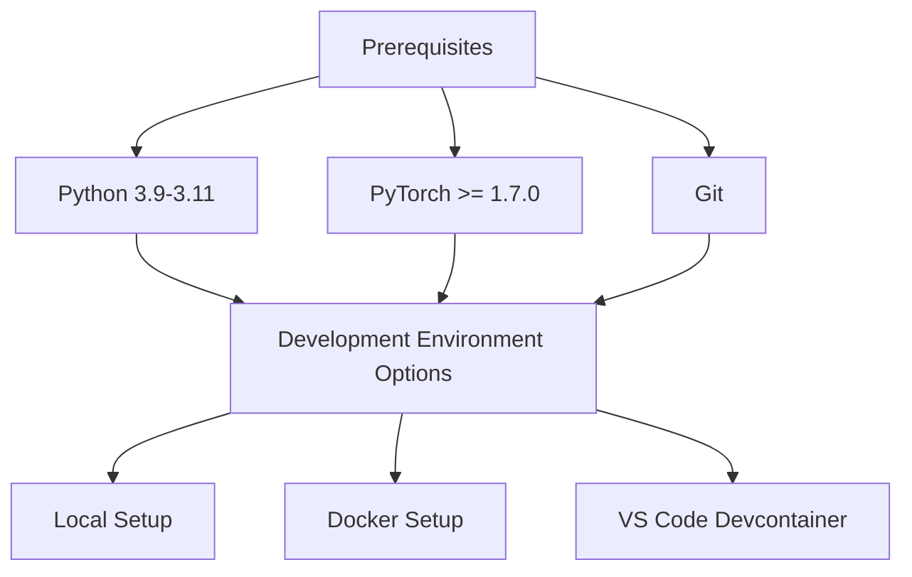
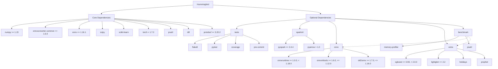
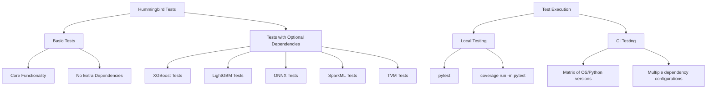
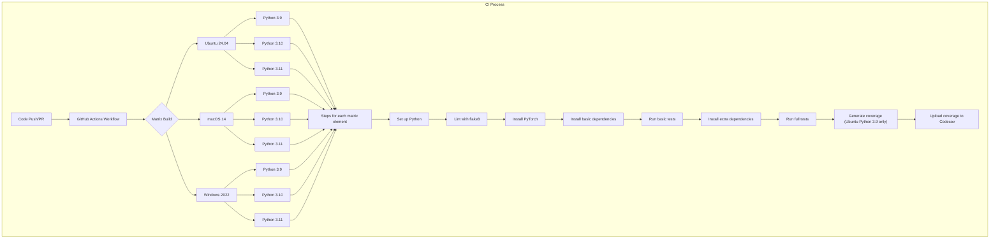

<!-- source: DeepWiki mcp.deepwiki.com · repo microsoft/hummingbird · page 6.1 Building and Testing · fetched 2026-10-26 -->

# Building and Testing

<details>
<summary>Relevant source files</summary>

The following files were used as context for generating this wiki page:

- [.devcontainer/Dockerfile](.devcontainer/Dockerfile)
- [.devcontainer/devcontainer.json](.devcontainer/devcontainer.json)
- [.github/workflows/pythonapp.yml](.github/workflows/pythonapp.yml)
- [CONTRIBUTING.md](CONTRIBUTING.md)
- [Dockerfile](Dockerfile)
- [README.md](README.md)
- [TROUBLESHOOTING.md](TROUBLESHOOTING.md)
- [setup.py](setup.py)
- [tests/test_no_extra_install.py](tests/test_no_extra_install.py)

</details>


This document provides detailed instructions for developers who want to build Hummingbird from source and run its test suite. It covers setting up a development environment, installing dependencies, building the project, and executing tests. For information about adding new converters to Hummingbird, see [Adding New Converters](#6.2).

## Development Environment Setup

Hummingbird supports multiple development environment options to accommodate different workflows and preferences.

### Prerequisites

Before setting up your development environment, ensure you have:

- Python 3.9, 3.10, or 3.11 (Python 3.8 is also supported but being phased out)
- PyTorch >= 1.7.0
- Git



Sources: [setup.py:22-32](), [README.md:67-74](), [.github/workflows/pythonapp.yml:31-36]()

### Local Development Setup

The simplest approach is to set up a local development environment:

1. Create a directory for Hummingbird
2. Clone the repository
3. Install in development mode with required dependencies

```bash
mkdir hummingbird
cd hummingbird
git clone https://github.com/microsoft/hummingbird.git .
python -m pip install -e .[tests,extra]
```

This installs Hummingbird in development mode (`-e`), allowing you to modify the code and immediately see the effects without reinstalling. The `[tests,extra]` part installs additional dependencies needed for testing and extended functionality.

Sources: [CONTRIBUTING.md:33-39]()

### Docker-based Development

For a containerized development environment, Hummingbird provides a Dockerfile:

```bash
docker build git://github.com/microsoft/hummingbird -t hb-dev
docker run -it hb-dev
```

The Docker environment includes all dependencies, including those for documentation, tests, and extra functionalities.

Sources: [CONTRIBUTING.md:43-48](), [Dockerfile:1-24]()

### VS Code Devcontainer

For a lightweight, web-based development experience, Hummingbird supports VS Code's Devcontainers:

1. Install the "Remote - Containers" extension in VS Code
2. Open the Hummingbird repository in VS Code
3. When prompted, click "Reopen in Container"

The configuration automatically installs all necessary dependencies and extensions.

Sources: [CONTRIBUTING.md:49-50](), [.devcontainer/Dockerfile:1-24](), [.devcontainer/devcontainer.json:1-14]()

## Dependency Structure

Hummingbird has a layered dependency structure with core dependencies and optional extensions.



Sources: [setup.py:22-64]()

## Building from Source

Building Hummingbird from source involves installing the package with the appropriate dependencies.

### Basic Installation

For basic development and testing:

```bash
python -m pip install -e .
```

### Installation with Optional Dependencies

To work with specific features or run comprehensive tests:

```bash
# For testing
python -m pip install -e .[tests]

# For machine learning frameworks like XGBoost and LightGBM
python -m pip install -e .[extra]

# For ONNX support
python -m pip install -e .[onnx]

# For Apache Spark support
python -m pip install -e .[sparkml]

# For everything (recommended for development)
python -m pip install -e .[tests,extra,onnx,sparkml]
```

Sources: [setup.py:45-64](), [CONTRIBUTING.md:33-39]()

## Development Tools

Hummingbird uses several tools to maintain code quality.

### Pre-commit Hooks

Pre-commit hooks ensure code quality before committing changes:

1. Install pre-commit:
   ```bash
   python -m pip install pre-commit
   ```

2. Install the git hooks:
   ```bash
   pre-commit install
   ```

3. Run manually on all files:
   ```bash
   pre-commit run --all-files
   ```

The hooks check for code formatting, linting issues, and other quality standards.

### Code Formatting

Hummingbird uses PEP8 standards with a maximum line length of 127 characters:

```bash
flake8 . --count --max-complexity=10 --max-line-length=127 --statistics
```

Sources: [CONTRIBUTING.md:52-83](), [.github/workflows/pythonapp.yml:44-51]()

## Testing

Hummingbird has a comprehensive test suite that can be run in different configurations.

### Running Basic Tests

To run the basic test suite:

```bash
pytest
```

### Running Tests with Coverage

To run tests and generate coverage reports:

```bash
coverage run -m pytest tests
coverage report
```

For XML coverage reports (used by CI):

```bash
coverage xml
```

### Test Configurations

Hummingbird tests can be run with different dependency configurations:



Sources: [.github/workflows/pythonapp.yml:69-71](), [CONTRIBUTING.md:85-92](), [tests/test_no_extra_install.py:1-63]()

## Continuous Integration

Hummingbird uses GitHub Actions for continuous integration.

### CI Workflow



The CI workflow runs on every push to the main branch and for pull requests. It tests Hummingbird on multiple operating systems and Python versions with various dependency configurations.

Sources: [.github/workflows/pythonapp.yml:1-162]()

### TVM Support

TVM support is platform-specific and requires additional setup in CI:

- On Ubuntu and macOS, TVM is built from source using LLVM
- On Windows, TVM tests are skipped due to compilation complexity

The CI pipeline caches the TVM build to speed up subsequent runs.

Sources: [.github/workflows/pythonapp.yml:87-143]()

## Troubleshooting

Here are solutions to common build and test issues:

### PyTorch GPU Support

To run Hummingbird with PyTorch on GPU:

1. Uninstall the CPU version of PyTorch:
   ```bash
   python -m pip uninstall torch
   ```

2. Install the CUDA version from the [PyTorch website](https://pytorch.org/).

### Platform-Specific Issues

#### macOS

- **XGBoost installation issues**:
  Install cmake: `brew install cmake`

- **LightGBM installation issues**:
  Install libomp: `brew install libomp`

#### Linux

- **LightGBM issues on Yum-based systems**:
  Install libgomp: `yum install libgomp`

#### Windows

- **PyTorch installation issues**:
  Install PyTorch manually from the PyTorch website.

Sources: [TROUBLESHOOTING.md:1-25](), [.github/workflows/pythonapp.yml:72-82]()

## Compatibility Testing

Hummingbird includes tests to ensure compatibility when optional dependencies are not installed:

```python
# Example of compatibility test
def test_import_convert_no_extra(self):
    try:
        from hummingbird.ml import convert
    except Exception:
        self.fail("Unexpected Error on importing convert without extra packages")
```

These tests ensure that Hummingbird's core functionality works correctly even without optional dependencies.

Sources: [tests/test_no_extra_install.py:54-59]()

---

