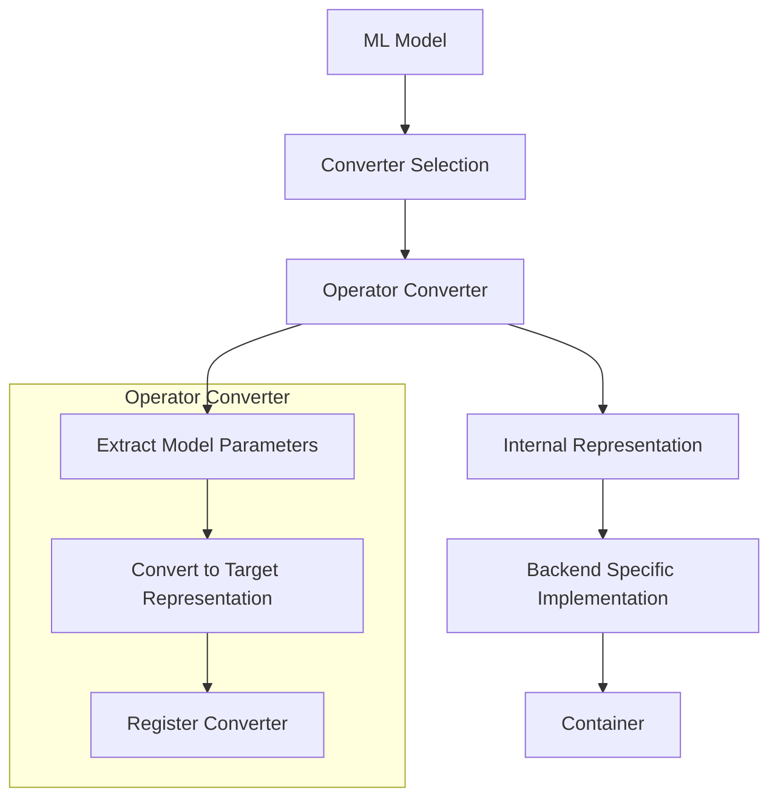
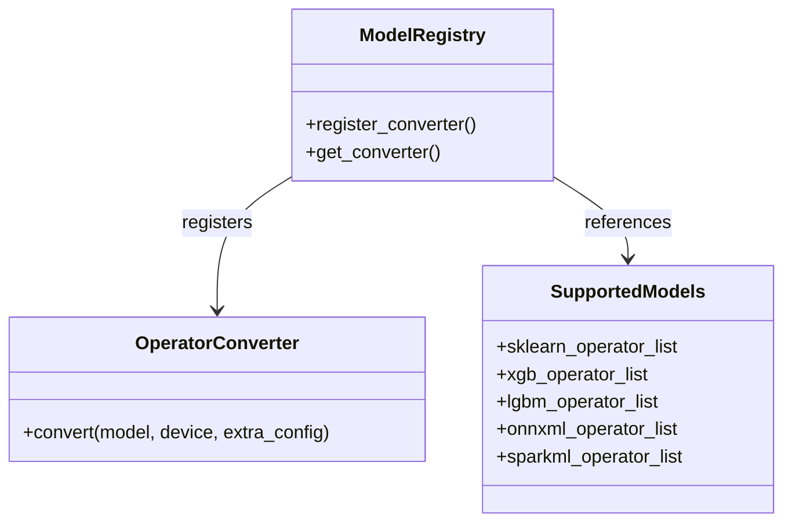
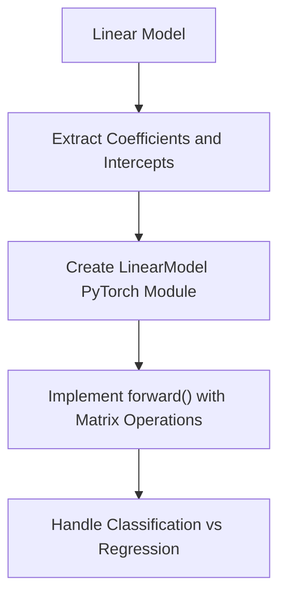
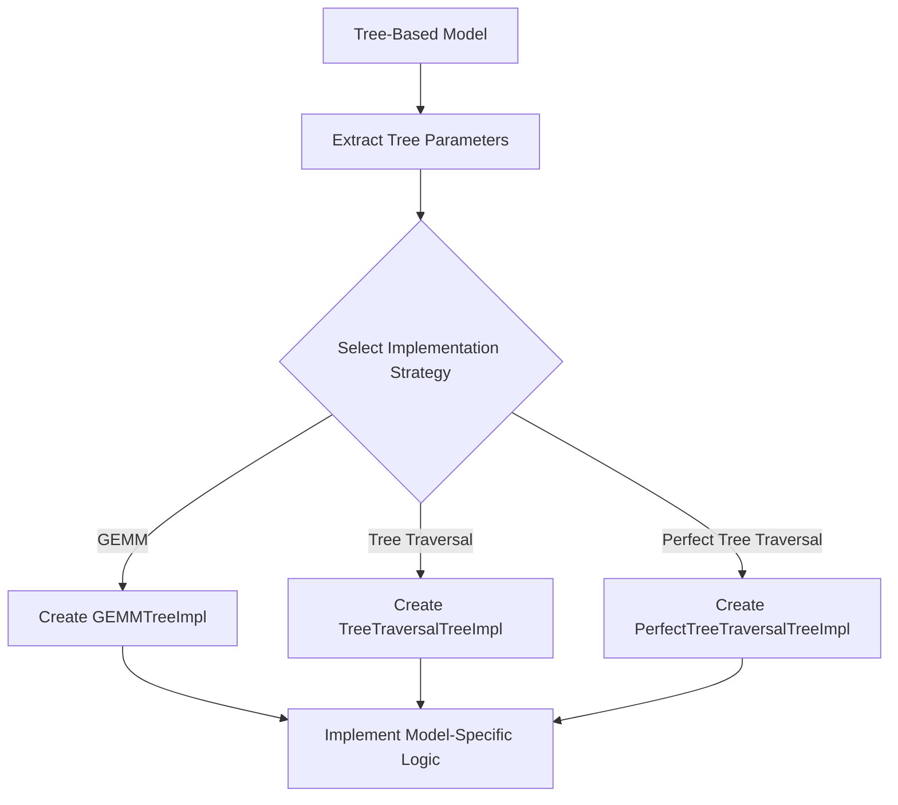
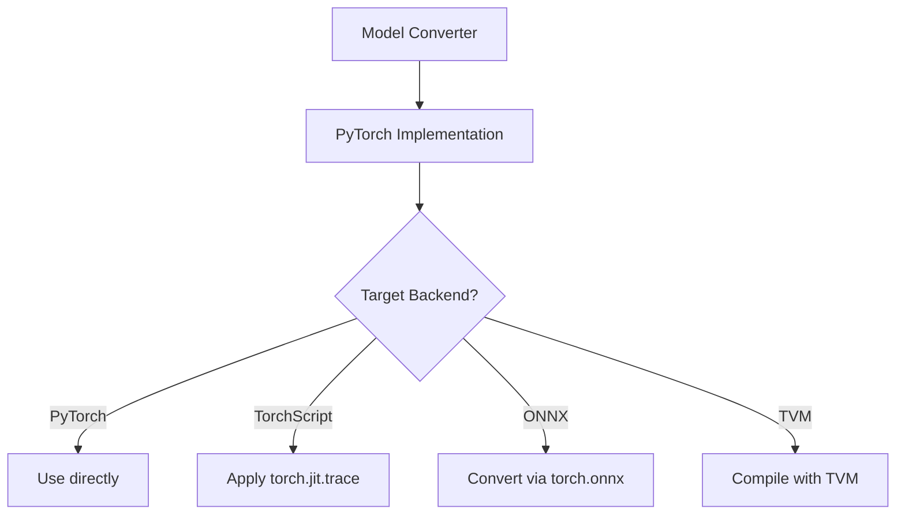
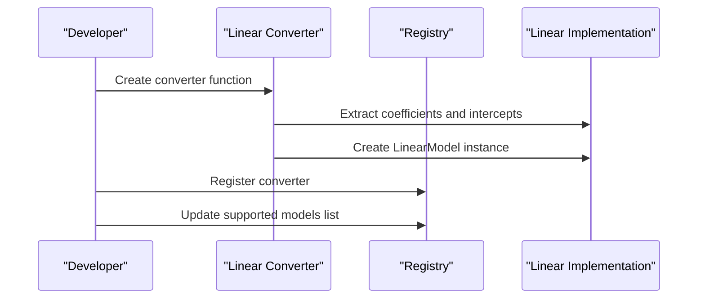
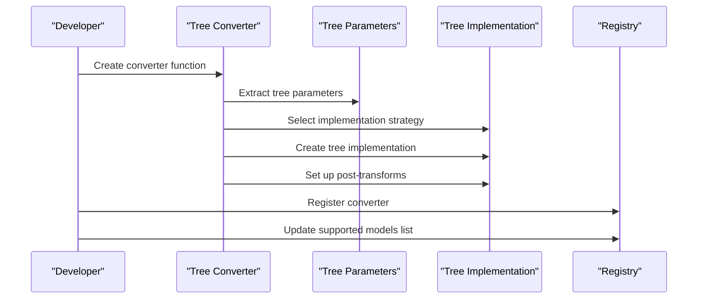

<!-- source: DeepWiki mcp.deepwiki.com · repo microsoft/hummingbird · page 6.2 Adding New Converters · fetched 2026-10-26 -->

# Adding New Converters

<details>
<summary>Relevant source files</summary>

The following files were used as context for generating this wiki page:

- [hummingbird/ml/operator_converters/__init__.py](hummingbird/ml/operator_converters/__init__.py)
- [hummingbird/ml/operator_converters/_gbdt_commons.py](hummingbird/ml/operator_converters/_gbdt_commons.py)
- [hummingbird/ml/operator_converters/_linear_implementations.py](hummingbird/ml/operator_converters/_linear_implementations.py)
- [hummingbird/ml/operator_converters/_tree_commons.py](hummingbird/ml/operator_converters/_tree_commons.py)
- [hummingbird/ml/operator_converters/_tree_implementations.py](hummingbird/ml/operator_converters/_tree_implementations.py)
- [hummingbird/ml/operator_converters/sklearn/linear.py](hummingbird/ml/operator_converters/sklearn/linear.py)
- [hummingbird/ml/operator_converters/xgb.py](hummingbird/ml/operator_converters/xgb.py)
- [hummingbird/ml/supported.py](hummingbird/ml/supported.py)
- [tests/test_sklearn_linear_converter.py](tests/test_sklearn_linear_converter.py)
- [tests/test_sklearn_sv_converter.py](tests/test_sklearn_sv_converter.py)

</details>


This guide explains how to implement new model converters in Hummingbird. It covers the process of adding support for new machine learning model types, allowing them to be converted to tensor computation frameworks like PyTorch, TorchScript, ONNX, and TVM. If you're looking for information about existing converters, see [Operator Converters](#4.1).

## Converter Architecture Overview

Hummingbird's converter system transforms traditional machine learning models into neural network equivalents. The conversion process follows a specific pipeline where operator converters play a crucial role.



Sources: 
- [hummingbird/ml/operator_converters/__init__.py:1-59]()
- [hummingbird/ml/supported.py:7-107]()

## Converter Registration System

Hummingbird maintains a registry of supported models and their converters. New converters must be registered to make them available to the conversion system.



Sources:
- [hummingbird/ml/supported.py:510-522]()

## Creating a New Converter

### Step 1: Identify the Model Type

First, determine which model you want to support. Hummingbird organizes converters by the source framework (scikit-learn, XGBoost, LightGBM, etc.) and model type (linear, tree-based, etc.).

### Step 2: Create a Converter Function

Create a converter function that transforms the source model into a PyTorch module. The function signature should follow this pattern:

```
def convert_my_model(operator, device, extra_config):
    """
    Converter for your model type
    
    Args:
        operator: An operator wrapping the model to convert
        device: The target device (cpu, cuda, etc.)
        extra_config: Additional configuration options
        
    Returns:
        A PyTorch model
    """
    # Extract parameters from the source model
    # Convert parameters to appropriate format
    # Return a PyTorch implementation
```

Sources:
- [hummingbird/ml/operator_converters/sklearn/linear.py:18-67]()
- [hummingbird/ml/operator_converters/xgb.py:84-110]()

### Step 3: Implement the PyTorch Equivalent

For your model, implement a PyTorch module that replicates its behavior. You can often extend existing base classes:

- For linear models: Extend `LinearModel`
- For tree-based models: Use `GEMMTreeImpl`, `TreeTraversalTreeImpl`, or `PerfectTreeTraversalTreeImpl`
- For custom models: Create a new implementation extending `PhysicalOperator` and `torch.nn.Module`

Sources:
- [hummingbird/ml/operator_converters/_linear_implementations.py:16-84]()
- [hummingbird/ml/operator_converters/_tree_implementations.py:30-198]()

### Step 4: Register the Converter

Register your converter using the `register_converter` function. This maps the model type to your converter function.

```python
from onnxconverter_common.registration import register_converter

# Register your converter
register_converter("MyModelType", convert_my_model)
```

Sources:
- [hummingbird/ml/operator_converters/sklearn/linear.py:102-114]()
- [hummingbird/ml/operator_converters/xgb.py:154-156]()

### Step 5: Update Supported Models List

Update the supported models list in `hummingbird/ml/supported.py` to include your new model type.

Sources:
- [hummingbird/ml/supported.py:123-240]()
- [hummingbird/ml/supported.py:510-522]()

## Common Converter Patterns

Different model types follow specific conversion patterns. Understanding these patterns can help implement new converters.

### Linear Model Conversion

Linear models (like LinearRegression, LogisticRegression) are converted by extracting their coefficients and intercepts and implementing them as matrix operations in PyTorch.



Sources:
- [hummingbird/ml/operator_converters/sklearn/linear.py:18-99]()
- [hummingbird/ml/operator_converters/_linear_implementations.py:16-84]()

### Tree-Based Model Conversion

Tree-based models (like DecisionTrees, RandomForests, Boosting models) have multiple implementation strategies:

1. **GEMM Strategy**: Converts trees to matrix multiplications
2. **Tree Traversal Strategy**: Simulates the decision path traversal 
3. **Perfect Tree Traversal Strategy**: Optimized traversal for balanced trees



Sources:
- [hummingbird/ml/operator_converters/_tree_commons.py:21-473]()
- [hummingbird/ml/operator_converters/_tree_implementations.py:114-528]()
- [hummingbird/ml/operator_converters/_gbdt_commons.py:28-183]()

## Advanced Implementation Details

### Parameter Extraction

Converting a model requires extracting its parameters first. Different model types store parameters differently:

- **Linear Models**: Extract coefficients and intercepts
- **Tree Models**: Extract tree structure, node features, thresholds, and leaf values
- **K-Neighbors Models**: Extract training samples and distance metrics

The extraction process must handle model-specific formats and conventions.

### Handling Multiple Backends

While converters initially target PyTorch, they should be designed to support multiple backends (TorchScript, ONNX, TVM). The backend implementation is handled by the core conversion system, but converters should produce representations compatible with all backends.



Sources:
- [hummingbird/ml/supported.py:387-411]()

### Post-Transforms and Aggregations

Many models require post-processing after the core computation. For example:

- Classification models need softmax or sigmoid to get probabilities
- Tree ensembles need to aggregate results from multiple trees
- Some models have base predictions that need to be applied

Implement these using post-transform classes and aggregation methods.

Sources:
- [hummingbird/ml/operator_converters/_tree_commons.py:65-120]()
- [hummingbird/ml/operator_converters/_gbdt_commons.py:140-170]()

## Testing New Converters

Always test new converters thoroughly. Examine existing test files for patterns:

1. Create test cases with various model configurations
2. Compare outputs of the original model and converted model
3. Test with different input types and shapes
4. Test with different backends

Sources:
- [tests/test_sklearn_linear_converter.py:33-845]()
- [tests/test_sklearn_sv_converter.py:15-230]()

## Example: Adding a Simple Linear Model Converter

Let's examine the pattern for adding a linear model converter based on the existing implementations:



The linear converter extracts coefficients and intercepts from the source model, then creates a `LinearModel` PyTorch module that implements the same functionality.

Sources:
- [hummingbird/ml/operator_converters/sklearn/linear.py:18-99]()
- [hummingbird/ml/operator_converters/sklearn/linear.py:102-114]()

## Example: Adding a Tree-Based Model Converter

Tree-based models are more complex and follow this pattern:



The tree converter extracts the tree structure and parameters, selects an implementation strategy, and creates the appropriate tree implementation.

Sources:
- [hummingbird/ml/operator_converters/_tree_commons.py:443-473]()
- [hummingbird/ml/operator_converters/_gbdt_commons.py:68-183]()
- [hummingbird/ml/operator_converters/xgb.py:84-150]()

## Conclusion

Adding new converters to Hummingbird involves understanding the model's structure, implementing a PyTorch equivalent, and registering the converter. By following these patterns and leveraging existing base classes, you can extend Hummingbird to support additional model types. Always test new converters thoroughly to ensure correctness and performance.

---

