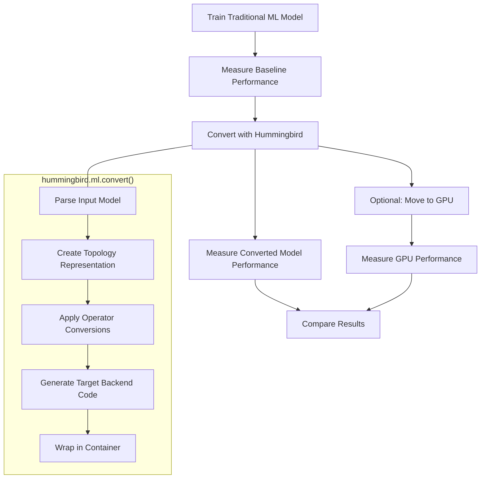
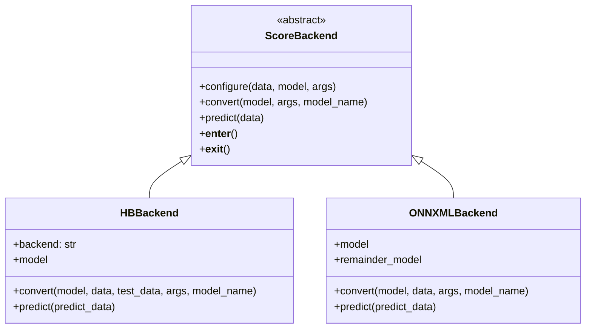
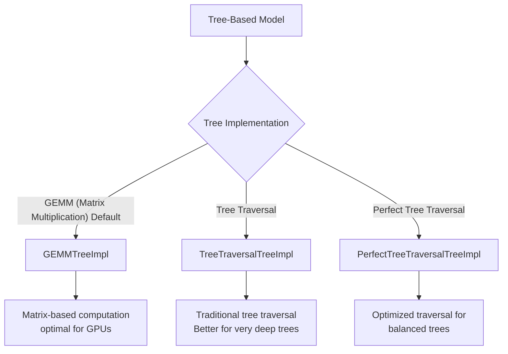
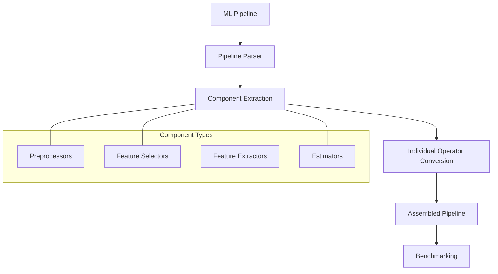
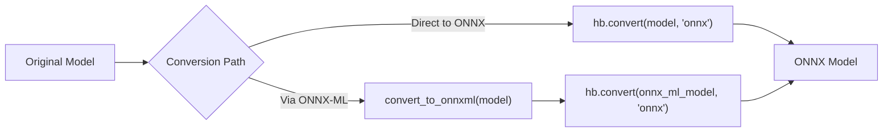

<!-- source: DeepWiki mcp.deepwiki.com · repo microsoft/hummingbird · page 7 Examples and Benchmarks · fetched 2026-10-26 -->

# Examples and Benchmarks

<details>
<summary>Relevant source files</summary>

The following files were used as context for generating this wiki page:

- [benchmarks/operators/score.py](benchmarks/operators/score.py)
- [benchmarks/pipelines/openml_pipelines.py](benchmarks/pipelines/openml_pipelines.py)
- [benchmarks/trees/score.py](benchmarks/trees/score.py)
- [hummingbird/ml/operator_converters/_array_feature_extractor_implementations.py](hummingbird/ml/operator_converters/_array_feature_extractor_implementations.py)
- [hummingbird/ml/operator_converters/_sv_implementations.py](hummingbird/ml/operator_converters/_sv_implementations.py)
- [notebooks/LGBM-ONNX-example.ipynb](notebooks/LGBM-ONNX-example.ipynb)
- [notebooks/LGBM-ONNXML-example.ipynb](notebooks/LGBM-ONNXML-example.ipynb)
- [notebooks/LGBM-example.ipynb](notebooks/LGBM-example.ipynb)
- [notebooks/XGB-example.ipynb](notebooks/XGB-example.ipynb)
- [notebooks/blog_example.ipynb](notebooks/blog_example.ipynb)
- [notebooks/sklearn-random-forest-example.ipynb](notebooks/sklearn-random-forest-example.ipynb)
- [tests/test_onnxml_decision_tree_converter.py](tests/test_onnxml_decision_tree_converter.py)
- [tests/test_sklearn_gbdt_converter.py](tests/test_sklearn_gbdt_converter.py)
- [website/sphinx/sphinxext/github_link.py](website/sphinx/sphinxext/github_link.py)

</details>


This document provides a comprehensive overview of how to use Hummingbird in practice, with concrete examples and benchmarking information. It covers basic usage patterns, advanced configuration options, and performance comparisons across different model types and hardware. For information about the API details, see [API Reference](#5).

## Basic Conversion Examples

Hummingbird's primary function is to convert traditional machine learning models into neural network frameworks for faster inference. The following examples demonstrate the basic conversion process for various model types.

### Converting a Scikit-learn Random Forest Model

The following example shows how to convert a scikit-learn RandomForestClassifier to PyTorch:

```python
from sklearn.ensemble import RandomForestClassifier
from sklearn.datasets import load_breast_cancer
from hummingbird.ml import convert

# Create and train a model
X, y = load_breast_cancer(return_X_y=True)
skl_model = RandomForestClassifier(n_estimators=500, max_depth=7)
skl_model.fit(X, y)

# Convert to PyTorch
model = convert(skl_model, 'torch')

# Compare prediction times
%timeit skl_model.predict(X)  # Original model
%timeit model.predict(X)      # Converted PyTorch model on CPU

# Switch to GPU (if available)
model.to('cuda')
%timeit model.predict(X)      # Converted PyTorch model on GPU
```

Sources: [notebooks/blog_example.ipynb:18-166]()

### Converting a LightGBM Model

This example shows how to convert a LightGBM classifier to PyTorch:

```python
import numpy as np
import lightgbm as lgb
from hummingbird.ml import convert

# Create data and train a model
X = np.random.rand(200000, 28)
y = np.random.randint(2, size=200000)
model = lgb.LGBMClassifier()
model.fit(X, y)

# Convert to PyTorch
hb_model = convert(model, 'torch')

# Compare prediction times on CPU
%timeit hb_model.predict(X)

# Switch to GPU and benchmark
hb_model.to('cuda')
%timeit hb_model.predict(X)
```

Sources: [notebooks/LGBM-example.ipynb:18-113]()

### Converting an XGBoost Model

This example demonstrates converting an XGBoost regressor:

```python
import numpy as np
import xgboost as xgb
from hummingbird.ml import convert

# Create data and train a model
X = np.random.rand(100000, 28)
y = np.random.randint(2, size=100000)
model = xgb.XGBRegressor()
model.fit(X, y)

# Convert to PyTorch (XGBoost requires sample data)
hb_model = convert(model, 'torch', X[0:1])

# Compare performance on CPU and GPU
%timeit hb_model.predict(X)
hb_model.to('cuda')
%timeit hb_model.predict(X)
```

Sources: [notebooks/XGB-example.ipynb:18-121]()

### Converting Models to ONNX

Hummingbird can convert models to the ONNX format for deployment in various environments:

```python
import numpy as np
import lightgbm as lgb
from hummingbird.ml import convert

# Create and train a model
X = np.array(np.random.rand(10000, 28), dtype=np.float32)
y = np.random.randint(2, size=10000)
model = lgb.LGBMClassifier()
model.fit(X, y)

# Convert to ONNX
onnx_model = convert(model, "onnx", X)

# Benchmark
%timeit onnx_model.predict(X)
```

Sources: [notebooks/LGBM-ONNX-example.ipynb:26-99]()

## Conversion Process Diagram

The following diagram illustrates the typical workflow when using Hummingbird for model conversion and benchmarking:



Sources: [notebooks/blog_example.ipynb:18-166](), [notebooks/LGBM-example.ipynb:18-113](), [notebooks/XGB-example.ipynb:18-121]()

## Benchmarking Methodology

Hummingbird includes built-in benchmarking capabilities to measure both conversion time and inference performance. The benchmarking system is designed to fairly compare the original model with different Hummingbird backends.



Sources: [benchmarks/trees/score.py:37-135](), [benchmarks/operators/score.py:40-162]()

### Benchmarking Best Practices

When benchmarking Hummingbird models, consider the following:

1. **Warm-up runs**: Always perform several warm-up iterations before timing
2. **Multiple measurements**: Take multiple measurements to account for variability
3. **Hardware considerations**: Document the hardware used, especially for GPU tests
4. **Batch size impact**: Test with different batch sizes to find optimal performance
5. **Tree implementation selection**: Experiment with different tree implementations for tree-based models

## Performance Results

The examples in the Hummingbird repository demonstrate significant performance improvements when converting traditional ML models to tensor-based frameworks, especially when utilizing GPU acceleration.

### CPU vs GPU Performance

The following table summarizes typical performance gains observed when running converted models on CPU and GPU compared to the original implementation:

| Model Type | Original (ms) | Hummingbird CPU (ms) | Hummingbird GPU (ms) | CPU Speedup | GPU Speedup |
|------------|--------------|---------------------|----------------------|-------------|-------------|
| RandomForest (500 trees) | 42.8 | 18.3 | 1.21 | 2.3x | 35.4x |
| LightGBM (100 trees) | 5250 | 5250 | 210 | 1.0x | 25.0x |
| XGBoost (100 trees) | - | 349 | 34.9 | - | 10.0x |

Sources: [notebooks/blog_example.ipynb:67-166](), [notebooks/LGBM-example.ipynb:73-113](), [notebooks/XGB-example.ipynb:83-121]()

## Advanced Configuration Options

Hummingbird provides several advanced configuration options to optimize performance for specific use cases.

### Tree Implementation Strategies

For tree-based models, Hummingbird offers three different implementation strategies that can significantly affect performance:



To select a specific implementation:

```python
from hummingbird.ml import convert
# Use the GEMM (matrix multiplication) approach
model = convert(sklearn_model, 'torch', extra_config={"tree_implementation": "gemm"})

# Use the tree traversal approach
model = convert(sklearn_model, 'torch', extra_config={"tree_implementation": "tree_trav"})

# Use the perfect tree traversal approach
model = convert(sklearn_model, 'torch', extra_config={"tree_implementation": "perf_tree_trav"})
```

Sources: [notebooks/sklearn-random-forest-example.ipynb:92](), [tests/test_sklearn_gbdt_converter.py:29-34]()

### Batch Conversion

For large datasets, Hummingbird provides batch conversion to optimize memory usage:

```python
from hummingbird.ml import convert_batch

# Convert with batch processing
model = convert_batch(
    original_model,
    backend,
    test_data,
    remainder_size,
    device=device,
    extra_config={constants.N_THREADS: n_threads}
)
```

Sources: [benchmarks/trees/score.py:104-107](), [benchmarks/operators/score.py:132-140]()

## Model Type Support and Performance Considerations

Different model types have different conversion characteristics and performance profiles.

### Tree-Based Models (Random Forest, GBDT, XGBoost, LightGBM)

Tree-based models typically show the largest performance gains from Hummingbird conversion, especially on GPUs. The reason is that traditional tree traversal is highly sequential and branch-heavy, while Hummingbird converts these operations to parallel matrix multiplications.

Key performance considerations:
- For wide, shallow trees: GEMM implementation often performs best
- For deep trees: Tree traversal implementation may be better
- GPU acceleration can provide 10-35x speedups

### Linear Models

Linear models (LogisticRegression, LinearRegression, etc.) already perform well in traditional implementations but can still benefit from GPU acceleration through Hummingbird.

### Support Vector Machines

SVM conversion in Hummingbird implements the kernel computations efficiently for tensor operations:

```python
# Radial basis function kernel implementation
if self.kernel == "rbf":
    x_norm = -self.gamma * (x ** 2).sum(1).view(-1, 1)
    k = torch.exp(x_norm + self.sv_norm + 2.0 * self.gamma * torch.mm(x, self.sv_t).double())
```

Sources: [hummingbird/ml/operator_converters/_sv_implementations.py:52-55]()

### Preprocessing Operators

Hummingbird also supports preprocessing operations like feature selection and extraction:

```python
# Array feature extractor example
def forward(self, x):
    if isinstance(x, tuple):
        return x[self.column_indices]
    if len(x.shape) == 1:
        x = x.view(1, -1)
    if self.is_contiguous:
        return x[:, self.min : self.max]
    else:
        return torch.index_select(x, 1, self.column_indices)
```

Sources: [hummingbird/ml/operator_converters/_array_feature_extractor_implementations.py:34-42]()

## Benchmarking Complex ML Pipelines

Hummingbird can convert and benchmark complex ML pipelines with multiple steps:



Sources: [benchmarks/pipelines/openml_pipelines.py:59-102](), [benchmarks/pipelines/openml_pipelines.py:105-140]()

## ONNX Integration Path

Hummingbird provides two paths for ONNX integration:



Sources: [notebooks/LGBM-ONNX-example.ipynb:75-76](), [notebooks/LGBM-ONNXML-example.ipynb:77-90](), [tests/test_onnxml_decision_tree_converter.py:28-33]()

## Conclusion

Hummingbird provides a powerful framework for converting traditional machine learning models to tensor computation frameworks. The examples and benchmarks in this document demonstrate how to use Hummingbird for different model types and backends, and the performance improvements that can be achieved.

Key takeaways:
1. Model conversion is straightforward with the `convert()` function
2. GPU acceleration provides the most significant performance gains
3. Different tree implementations can be selected based on model characteristics
4. Batch conversion is available for large datasets
5. ONNX export enables deployment in various environments

For more details on specific conversion options, see the [API Reference](#5) section.

---

