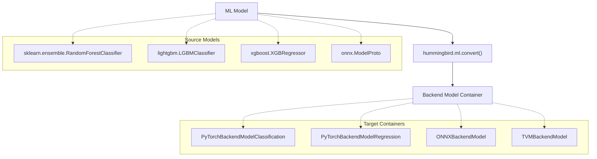
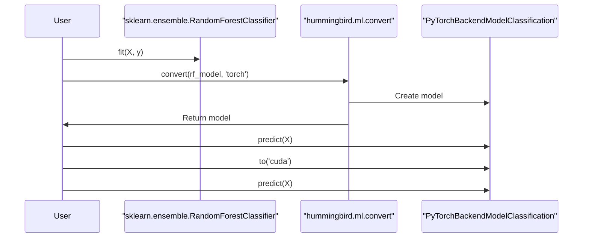
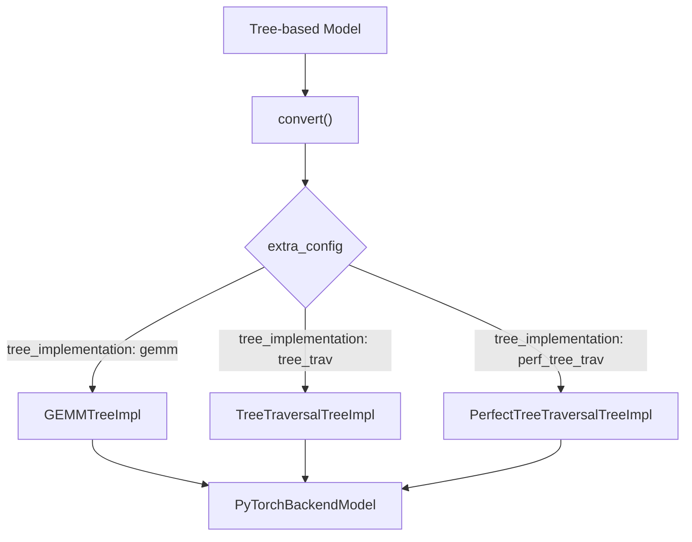
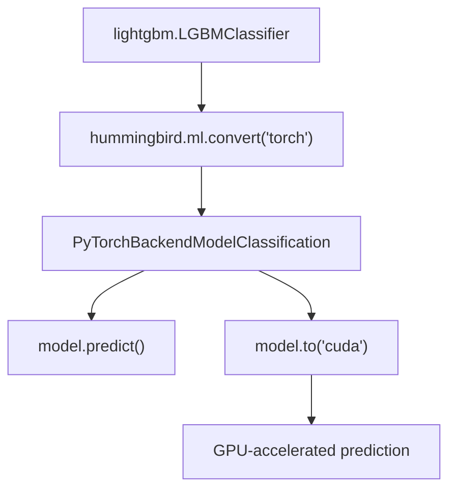
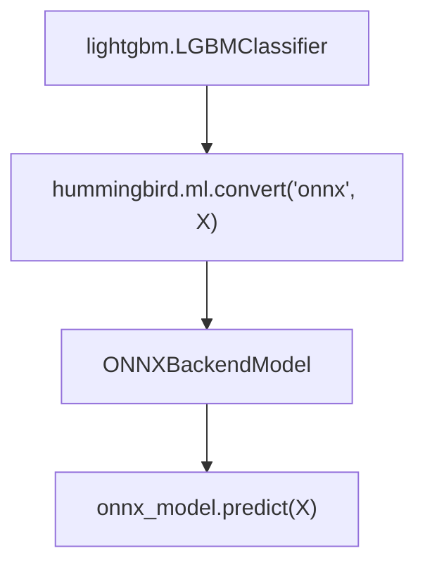
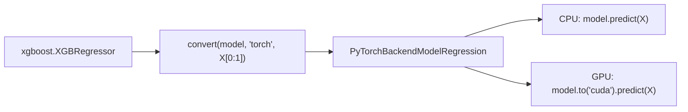
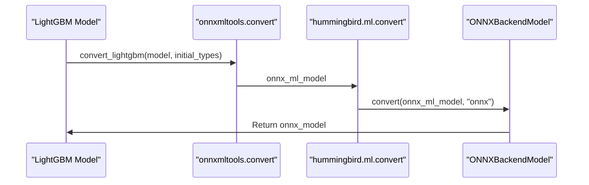
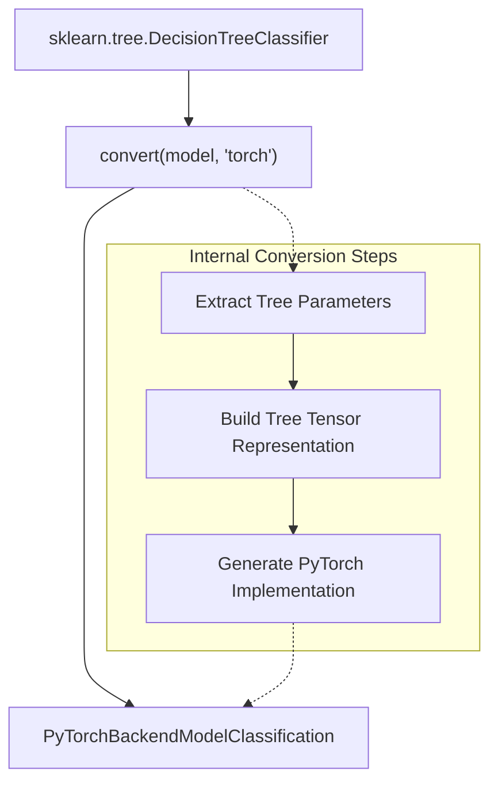

<!-- source: DeepWiki mcp.deepwiki.com · repo microsoft/hummingbird · page 7.1 Basic Conversion Examples · fetched 2026-10-26 -->

# Basic Conversion Examples

<details>
<summary>Relevant source files</summary>

The following files were used as context for generating this wiki page:

- [notebooks/LGBM-ONNX-example.ipynb](notebooks/LGBM-ONNX-example.ipynb)
- [notebooks/LGBM-ONNXML-example.ipynb](notebooks/LGBM-ONNXML-example.ipynb)
- [notebooks/LGBM-example.ipynb](notebooks/LGBM-example.ipynb)
- [notebooks/XGB-example.ipynb](notebooks/XGB-example.ipynb)
- [notebooks/blog_example.ipynb](notebooks/blog_example.ipynb)
- [notebooks/sklearn-random-forest-example.ipynb](notebooks/sklearn-random-forest-example.ipynb)
- [tests/test_onnxml_decision_tree_converter.py](tests/test_onnxml_decision_tree_converter.py)
- [tests/test_sklearn_gbdt_converter.py](tests/test_sklearn_gbdt_converter.py)

</details>


This document provides technical examples of how to use Hummingbird to convert traditional machine learning models into tensor computation frameworks. These examples illustrate the most common conversion patterns for different model types and target backends. For complete API details, see [Conversion API](#5.1).

## Conversion Process Overview

All model conversions in Hummingbird follow a consistent pattern using the `convert` function from `hummingbird.ml`:



The core conversion function signature is:

```python
convert(model, backend, test_input=None, extra_config={})
```

Where:
- `model`: Source model to convert
- `backend`: Target framework ('torch', 'torchscript', 'onnx', 'tvm')
- `test_input`: Example input data (required for some models)
- `extra_config`: Additional conversion parameters

Sources: [notebooks/blog_example.ipynb:18-20](), [notebooks/LGBM-example.ipynb:20](), [notebooks/XGB-example.ipynb:20]()

## Converting Scikit-learn Models

### RandomForestClassifier to PyTorch

Example of converting a scikit-learn `RandomForestClassifier` to PyTorch:



Example code pattern:

```python
from sklearn.ensemble import RandomForestClassifier
from sklearn.datasets import load_breast_cancer
from hummingbird.ml import convert

# Create and train the model
X, y = load_breast_cancer(return_X_y=True)
skl_model = RandomForestClassifier(n_estimators=500, max_depth=7)
skl_model.fit(X, y)

# Convert to PyTorch
model = convert(skl_model, 'torch')

# Make predictions on CPU
pred_cpu = model.predict(X)

# Move to GPU and make predictions
model.to('cuda')
pred_gpu = model.predict(X)
```

Sources: [notebooks/blog_example.ipynb:18-20](), [notebooks/blog_example.ipynb:54-57](), [notebooks/blog_example.ipynb:98](), [notebooks/blog_example.ipynb:139-140](), [notebooks/blog_example.ipynb:165]()

Performance comparison:

| Implementation | Average Inference Time |
|----------------|------------------------|
| scikit-learn   | 42.8 ms                |
| PyTorch CPU    | 18.3 ms                |
| PyTorch GPU    | 1.21 ms                |

Sources: [notebooks/blog_example.ipynb:76-82](), [notebooks/blog_example.ipynb:117-119](), [notebooks/blog_example.ipynb:158-160]()

### Tree Implementation Strategies

Hummingbird provides three implementation strategies for tree-based models through the `tree_implementation` parameter in `extra_config`:



Example:

```python
# Convert with GEMM implementation (matrix multiplication-based)
model_gemm = convert(
    skl_model, 
    'torch', 
    extra_config={"tree_implementation": "gemm"}
)

# Tree traversal implementation
model_trav = convert(
    skl_model,
    'torch',
    extra_config={"tree_implementation": "tree_trav"}
)

# Perfect tree traversal implementation
model_perf = convert(
    skl_model,
    'torch',
    extra_config={"tree_implementation": "perf_tree_trav"}
)
```

Sources: [tests/test_sklearn_gbdt_converter.py:29-33](), [notebooks/sklearn-random-forest-example.ipynb:92]()

| Implementation Strategy | Best Use Case |
|-------------------------|---------------|
| GEMM | Large batch sizes, dense forests |
| Tree Traversal | Small to medium trees |
| Perfect Tree Traversal | Balanced trees |

Performance with RandomForestClassifier (n_estimators=10, max_depth=10):

| Implementation | Average Inference Time |
|----------------|------------------------|
| scikit-learn   | 1.07 ms                |
| PyTorch GEMM   | 444 μs                 |
| PyTorch GEMM (GPU) | 291 μs             |

Sources: [notebooks/sklearn-random-forest-example.ipynb:75-76](), [notebooks/sklearn-random-forest-example.ipynb:104-105](), [notebooks/sklearn-random-forest-example.ipynb:147-148]()

## Converting LightGBM Models

### LGBMClassifier to PyTorch

Example of converting a LightGBM classifier to PyTorch:



Example code:

```python
import numpy as np
import lightgbm as lgb
from hummingbird.ml import convert

# Create data
X = np.random.rand(200000, 28)
y = np.random.randint(2, size=200000)

# Create and train the model
model = lgb.LGBMClassifier()
model.fit(X, y)

# Convert to PyTorch
hb_model = convert(model, 'torch')

# Make predictions on CPU
preds_cpu = hb_model.predict(X)

# Move to GPU and make predictions
hb_model.to('cuda')
preds_gpu = hb_model.predict(X)
```

Sources: [notebooks/LGBM-example.ipynb:18-25](), [notebooks/LGBM-example.ipynb:50-52](), [notebooks/LGBM-example.ipynb:70](), [notebooks/LGBM-example.ipynb:110-111]()

Performance comparison for 200K samples:

| Implementation | Average Inference Time |
|----------------|------------------------|
| LightGBM       | 5.25 s                 |
| PyTorch GPU    | 210 ms                 |

Sources: [notebooks/LGBM-example.ipynb:82-91](), [notebooks/LGBM-example.ipynb:100-112]()

### LGBMClassifier to ONNX

LightGBM models can be converted directly to ONNX:



Example code:

```python
import numpy as np
import lightgbm as lgb
from hummingbird.ml import convert

# Create data (float32 is recommended for ONNX)
X = np.array(np.random.rand(10000, 28), dtype=np.float32)
y = np.random.randint(2, size=10000)

# Create and train the model
model = lgb.LGBMClassifier()
model.fit(X, y)

# Convert to ONNX (requires sample data)
onnx_model = convert(model, "onnx", X)

# Make predictions
predictions = onnx_model.predict(X)
```

Sources: [notebooks/LGBM-ONNX-example.ipynb:26-36](), [notebooks/LGBM-ONNX-example.ipynb:57-58](), [notebooks/LGBM-ONNX-example.ipynb:76]()

## Converting XGBoost Models

XGBoost models require an example input for conversion:



Example code:

```python
import numpy as np
import xgboost as xgb
from hummingbird.ml import convert

# Create data
X = np.random.rand(100000, 28)
y = np.random.randint(2, size=100000)

# Create and train the model
model = xgb.XGBRegressor()
model.fit(X, y)

# Convert to PyTorch with example input
hb_model = convert(model, 'torch', X[0:1])

# Make predictions on CPU
preds_cpu = hb_model.predict(X)

# Move to GPU and make predictions
hb_model.to('cuda')
preds_gpu = hb_model.predict(X)
```

Sources: [notebooks/XGB-example.ipynb:18-25](), [notebooks/XGB-example.ipynb:59-60](), [notebooks/XGB-example.ipynb:78-79](), [notebooks/XGB-example.ipynb:118-120]()

Performance comparison for 100K samples:

| Implementation | Average Inference Time |
|----------------|------------------------|
| XGBoost        | 349 ms                 |
| PyTorch GPU    | 34.9 ms                |

Sources: [notebooks/XGB-example.ipynb:90-99](), [notebooks/XGB-example.ipynb:107-120]()

## Converting Models via ONNXML

Hummingbird supports converting models that have first been converted to ONNXML format:



Example code:

```python
from onnxmltools.convert import convert_lightgbm
from onnxconverter_common.data_types import FloatTensorType
from hummingbird.ml import convert

# Convert to ONNXML
initial_types = [("input", FloatTensorType([None, X.shape[1]]))]
onnx_ml_model = convert_lightgbm(model, initial_types=initial_types, target_opset=9)

# Convert ONNXML to ONNX via Hummingbird
onnx_model = convert(onnx_ml_model, "onnx")

# Make predictions
predictions = onnx_model.predict(X)
```

Sources: [notebooks/LGBM-ONNXML-example.ipynb:75-78](), [notebooks/LGBM-ONNXML-example.ipynb:90](), [notebooks/LGBM-ONNXML-example.ipynb:112]()

## Decision Tree Conversion

Example of converting a scikit-learn `DecisionTreeClassifier`:



Example code:

```python
from sklearn.tree import DecisionTreeClassifier
import numpy as np
from hummingbird.ml import convert

# Create and train model
X = np.array([[0, 1], [1, 1], [2, 0]], dtype=np.float32)
y = np.array([0, 1, 0])
model = DecisionTreeClassifier()
model.fit(X, y)

# Convert to PyTorch
torch_model = convert(model, 'torch')

# Predictions
predictions = torch_model.predict(X)
```

Sources: [tests/test_onnxml_decision_tree_converter.py:169-179]()

## Practical Tips

### Variable Batch Size Support

Models converted to ONNX or PyTorch support variable batch sizes:

```python
# Convert model once
model = convert(skl_model, 'torch')

# Use with different batch sizes
batch_1 = model.predict(X[:10])  # 10 samples
batch_2 = model.predict(X[:100]) # 100 samples
batch_3 = model.predict(X)       # all samples
```

Sources: [tests/test_sklearn_gbdt_converter.py:189-195](), [notebooks/LGBM-ONNXML-example.ipynb:134-135]()

### Data Type Considerations

- For ONNX conversion, using `np.float32` is recommended:

```python
X = np.array(X, dtype=np.float32)
```

- While models support both float32 and float64, float32 is typically faster

Sources: [notebooks/LGBM-ONNX-example.ipynb:35](), [tests/test_onnxml_decision_tree_converter.py:95]()

### Saving and Loading Converted Models

Converted models can be saved and loaded:

```python
# Save the model
hb_model.save('model.pkl')

# Load later
from hummingbird.ml import load
loaded_model = load('model.pkl')
```

This functionality is part of the container system described in [Container API](#5.2).

---

