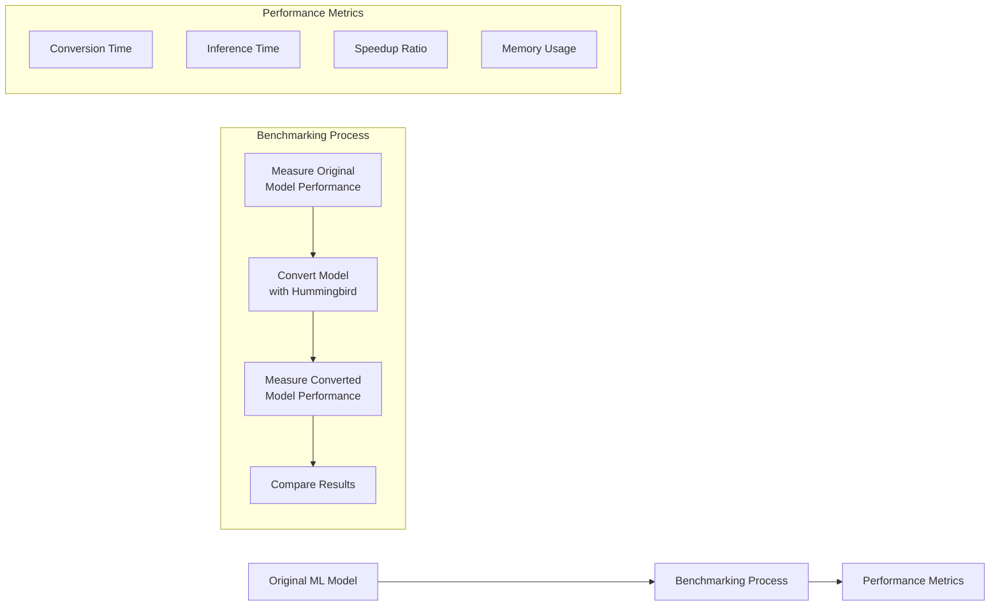
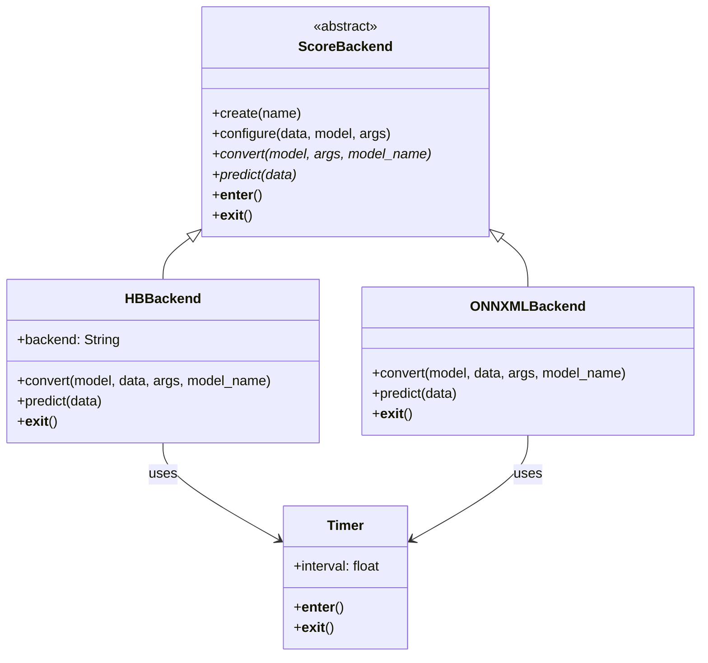
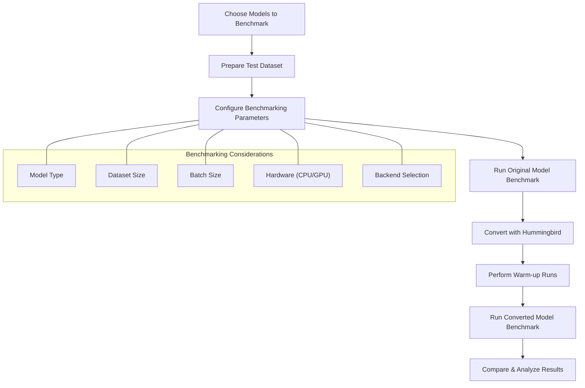
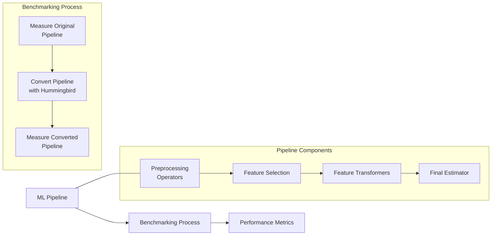

<!-- source: DeepWiki mcp.deepwiki.com · repo microsoft/hummingbird · page 7.2 Benchmarking · fetched 2026-10-26 -->

# Benchmarking

<details>
<summary>Relevant source files</summary>

The following files were used as context for generating this wiki page:

- [benchmarks/operators/score.py](benchmarks/operators/score.py)
- [benchmarks/pipelines/openml_pipelines.py](benchmarks/pipelines/openml_pipelines.py)
- [benchmarks/trees/score.py](benchmarks/trees/score.py)
- [hummingbird/ml/operator_converters/_array_feature_extractor_implementations.py](hummingbird/ml/operator_converters/_array_feature_extractor_implementations.py)
- [hummingbird/ml/operator_converters/_sv_implementations.py](hummingbird/ml/operator_converters/_sv_implementations.py)
- [notebooks/LGBM-example.ipynb](notebooks/LGBM-example.ipynb)
- [notebooks/XGB-example.ipynb](notebooks/XGB-example.ipynb)
- [notebooks/blog_example.ipynb](notebooks/blog_example.ipynb)
- [notebooks/sklearn-random-forest-example.ipynb](notebooks/sklearn-random-forest-example.ipynb)
- [website/sphinx/sphinxext/github_link.py](website/sphinx/sphinxext/github_link.py)

</details>


This document explains how to benchmark Hummingbird's performance to evaluate the speed improvements gained by converting traditional machine learning models to neural network frameworks. Benchmarking is a critical part of understanding when and how Hummingbird can accelerate inference for your models.

For information about converting models, see [Model Conversion Pipeline](#3.1). For specifics about supported models, see [Supported Models and Backends](#4).

## Overview of Benchmarking in Hummingbird

Hummingbird provides multiple approaches to benchmark converted models against their original implementations:

1. **Simple notebook-based benchmarking** using `%%timeit` for quick performance comparisons
2. **Comprehensive benchmarking infrastructure** for systematic evaluation
3. **Batch-size benchmarking** to understand performance characteristics at different scales

The primary metrics typically benchmarked are:
- **Conversion time**: How long it takes to convert a model
- **Inference time**: How fast the converted model executes predictions
- **Speedup ratio**: The relative performance improvement compared to the original model



Sources: [notebooks/blog_example.ipynb:67-124](), [notebooks/LGBM-example.ipynb:74-113](), [notebooks/XGB-example.ipynb:83-122]()

## Simple Benchmarking with Jupyter Notebooks

The simplest way to benchmark Hummingbird is through Jupyter notebooks using the `%%timeit` magic command. This approach is demonstrated in several example notebooks included with Hummingbird.

### Basic Benchmarking Pattern

```python
# 1. Create and train a model
model = RandomForestClassifier(n_estimators=500, max_depth=7)
model.fit(X, y)

# 2. Time the original model
%%timeit
pred = model.predict(X)

# 3. Convert the model with Hummingbird
hb_model = convert(model, 'torch')

# 4. Time the Hummingbird model on CPU
%%timeit
pred_cpu = hb_model.predict(X)

# 5. Time the Hummingbird model on GPU (if available)
hb_model.to('cuda')
%%timeit
pred_gpu = hb_model.predict(X)
```

This pattern allows you to directly compare the performance of the original model against the Hummingbird-converted model on both CPU and GPU.

Sources: [notebooks/blog_example.ipynb:31-167](), [notebooks/LGBM-example.ipynb:12-113](), [notebooks/XGB-example.ipynb:12-122](), [notebooks/sklearn-random-forest-example.ipynb:12-158]()

### Example Results from Notebooks

Example results from a RandomForest model benchmark:

| Model | Runtime | Relative Speed |
|-------|---------|----------------|
| Original scikit-learn | 42.8 ms | 1.0x (baseline) |
| Hummingbird + PyTorch (CPU) | 18.3 ms | 2.3x faster |
| Hummingbird + PyTorch (GPU) | 1.21 ms | 35.4x faster |

These results demonstrate the potential performance improvements when using Hummingbird, especially with GPU acceleration.

Sources: [notebooks/blog_example.ipynb:67-166]()

## Advanced Benchmarking Framework

For systematic benchmarking of multiple models, backends, and configurations, Hummingbird includes a comprehensive benchmarking framework in the `benchmarks/` directory.



Sources: [benchmarks/trees/score.py:30-135](), [benchmarks/operators/score.py:40-162]()

### Using the Benchmarking Framework

The benchmarking framework provides a structured approach to comparing different backends:

1. Create a `ScoreBackend` implementation for each backend to benchmark
2. Configure benchmark parameters (batch size, device, etc.)
3. Measure conversion time with the `convert` method
4. Measure prediction time with the `predict` method
5. Compare results across different backends

The framework supports these Hummingbird backends:
- `hb-pytorch`: PyTorch backend
- `hb-torchscript`: TorchScript backend
- `hb-onnx`: ONNX backend
- `hb-tvm`: TVM backend
- `onnx-ml`: ONNX-ML backend (for comparison)

Sources: [benchmarks/trees/score.py:37-51](), [benchmarks/operators/score.py:40-53]()

### Batch Benchmarking

Hummingbird's benchmarking framework supports batch inference benchmarking, which is crucial for understanding performance characteristics with different batch sizes.

```python
# Configure batch size
batch_size = args.batch_size if args.batch_size != -1 else len(data.X_test)

# For batch benchmarking
if self.batch_benchmark:
    self.model = convert(model, self.backend, test_data, device=self.params["device"])
else:
    remainder_size = test_data.shape[0] % self.params["batch_size"]
    self.model = convert_batch(
        model, self.backend, test_data, remainder_size, device=self.params["device"]
    )
```

This approach allows you to test how models perform with different batch sizes, which is particularly important for deployment scenarios with varying workload patterns.

Sources: [benchmarks/trees/score.py:95-107]()

## Benchmarking Parameters

When benchmarking Hummingbird, several parameters can be adjusted to optimize performance or match your production environment:

| Parameter | Description | Default |
|-----------|-------------|---------|
| `batch_size` | Number of samples to process at once | Full dataset |
| `device` | Target device ('cpu' or 'cuda') | 'cpu' |
| `n_threads` | Number of CPU threads to use | System default |
| `tree_implementation` | Tree conversion algorithm (for tree models) | Detected automatically |
| `extra_config` | Additional backend-specific configurations | {} |

### Tree Implementation Options

For tree-based models, Hummingbird provides several implementation strategies:

- `gemm`: Matrix multiplication-based implementation (best for GPU)
- `tree_trav`: Tree traversal implementation (best for CPU with deep trees)
- `perf_tree_trav`: Perfect tree traversal (optimized for balanced trees)

Specifying the tree implementation:

```python
model = convert(model, 'torch', extra_config={"tree_implementation": "gemm"})
```

Sources: [notebooks/sklearn-random-forest-example.ipynb:92]()

## Benchmarking Best Practices

To ensure fair and meaningful benchmarks:

1. **Warm-up runs**: Perform several prediction runs before timing to avoid JIT compilation overhead
2. **Multiple iterations**: Run benchmarks multiple times to get statistical significance
3. **Consistent data sizes**: Use the same dataset size for all compared models
4. **Realistic workloads**: Test with data sizes and patterns similar to your production environment
5. **CPU vs. GPU considerations**: Some models perform better on CPU, others on GPU
6. **Include conversion time**: For one-time conversions, the speedup might be worth the conversion overhead



Sources: [benchmarks/trees/score.py:100-130](), [benchmarks/operators/score.py:132-158]()

## Interpreting Results

When interpreting benchmarking results, consider:

1. **Speedup ratio**: The relative performance improvement (original time / converted time)
2. **Absolute time**: The actual inference time, which matters for latency-sensitive applications
3. **Conversion overhead**: For infrequently retrained models, one-time conversion cost is usually negligible
4. **Scaling with data size**: How performance changes with larger datasets
5. **Hardware utilization**: GPU utilization and memory usage

Different models may show dramatically different speedups:

| Model Type | Typical CPU Speedup | Typical GPU Speedup |
|------------|---------------------|---------------------|
| Random Forest | 2-5x | 10-40x |
| Gradient Boosting | 1.5-3x | 5-25x |
| Linear Models | 1-2x | 3-10x |

Remember that your specific results will vary based on model complexity, dataset size, and hardware.

Sources: [notebooks/blog_example.ipynb:72-166](), [notebooks/LGBM-example.ipynb:98-112](), [notebooks/XGB-example.ipynb:87-121](), [notebooks/sklearn-random-forest-example.ipynb:110-157]()

## Integration with Pipeline Benchmarking

Hummingbird can also benchmark entire ML pipelines converted from frameworks like scikit-learn. The pipeline benchmarking system handles complex pipelines with multiple preprocessing steps and model components.



Sources: [benchmarks/pipelines/openml_pipelines.py:197-354]()

## Conclusion

Benchmarking is a critical step in evaluating whether Hummingbird will provide performance benefits for your specific models and workloads. The tools and approaches described in this document allow you to systematically evaluate performance improvements and make informed decisions about using Hummingbird in your machine learning pipelines.

For complex benchmarking scenarios or deployment considerations, refer to [Examples and Benchmarks](#7) and [Supported Models and Backends](#4) for more information.