# Page: Overview

# Overview

<details>
<summary>Relevant source files</summary>

The following files were used as context for generating this wiki page:

- [.github/workflows/pythonapp.yml](.github/workflows/pythonapp.yml)
- [README.md](README.md)
- [TROUBLESHOOTING.md](TROUBLESHOOTING.md)
- [hummingbird/__init__.py](hummingbird/__init__.py)
- [hummingbird/ml/_utils.py](hummingbird/ml/_utils.py)
- [hummingbird/ml/containers/sklearn/onnx_containers.py](hummingbird/ml/containers/sklearn/onnx_containers.py)
- [hummingbird/ml/containers/sklearn/pytorch_containers.py](hummingbird/ml/containers/sklearn/pytorch_containers.py)
- [hummingbird/ml/containers/sklearn/tvm_containers.py](hummingbird/ml/containers/sklearn/tvm_containers.py)
- [notebooks/LGBM-example.ipynb](notebooks/LGBM-example.ipynb)
- [notebooks/XGB-example.ipynb](notebooks/XGB-example.ipynb)
- [notebooks/blog_example.ipynb](notebooks/blog_example.ipynb)
- [notebooks/sklearn-random-forest-example.ipynb](notebooks/sklearn-random-forest-example.ipynb)
- [setup.cfg](setup.cfg)
- [setup.py](setup.py)
- [tests/test_backends.py](tests/test_backends.py)
- [website/sphinx/conf.py](website/sphinx/conf.py)

</details>


Hummingbird is a library that converts traditional machine learning models into tensor computations for faster inference. This overview introduces the core architecture, components, and workflow of Hummingbird, providing a high-level understanding of how the system transforms models from frameworks like scikit-learn, LightGBM, and XGBoost into neural network frameworks such as PyTorch, TorchScript, ONNX, and TVM.

Sources: [README.md:15-16](), [setup.py:46-49]()

## Purpose and Benefits

Hummingbird bridges the gap between traditional machine learning frameworks and neural network execution environments. By converting trained ML models into tensor computations, Hummingbird enables:

1. Leveraging optimizations implemented in neural network frameworks
2. Native hardware acceleration (CPU/GPU)
3. Unified platform for both traditional and neural network models
4. Maintaining the original model API (no re-engineering required)

For detailed installation instructions, see [Installation and Setup](#2).

Sources: [README.md:16-19](), [setup.py:45-53]()

## System Architecture

Hummingbird's architecture consists of several key components organized in a conversion pipeline:

### High-level Architecture

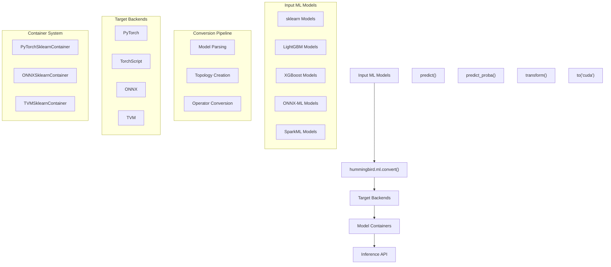

Sources: [README.md:18-19](), [hummingbird/ml/_utils.py:22-34]()

The architecture shows the main workflow in Hummingbird:
1. Input models from various ML frameworks are passed to `hummingbird.ml.convert()`
2. The conversion pipeline parses the model, creates a topology representation, and converts operators
3. Models are converted to the target backend (PyTorch, TorchScript, ONNX, TVM)
4. Converted models are wrapped in containers that provide a consistent API

## Conversion Process

The conversion process transforms a trained traditional ML model into a model that runs on neural network frameworks:

### Conversion Workflow

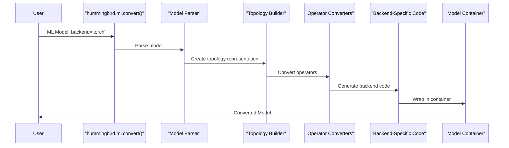

Sources: [hummingbird/__init__.py:8-14](), [README.md:90-118]()

The conversion process starts with the `convert()` function, which:
1. Identifies the type of input model and backend requested
2. Creates an internal topology representation of the model
3. Applies appropriate operator converters for each component of the model
4. Generates code for the target backend
5. Wraps the converted model in a container that mirrors the original API

## Container System

Converted models are wrapped in containers that provide a unified API regardless of the target backend:

### Container Class Hierarchy

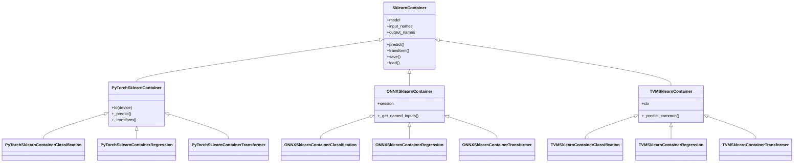

Sources: [hummingbird/ml/containers/sklearn/pytorch_containers.py:36-102](), [hummingbird/ml/containers/sklearn/onnx_containers.py:34-107](), [hummingbird/ml/containers/sklearn/tvm_containers.py:35-128]()

The container system:
1. Provides a consistent API (`predict()`, `predict_proba()`, `transform()`) matching the original model
2. Handles backend-specific operations (moving to different devices, serialization)
3. Supports different model types (classifiers, regressors, transformers)
4. Implements persistence methods (`save()`, `load()`) for model storage and retrieval

## Tree-Based Model Conversion Strategies

Hummingbird implements sophisticated strategies to convert tree-based models (like Random Forests, GBDTs) into tensor computations:

### Tree Conversion Strategies

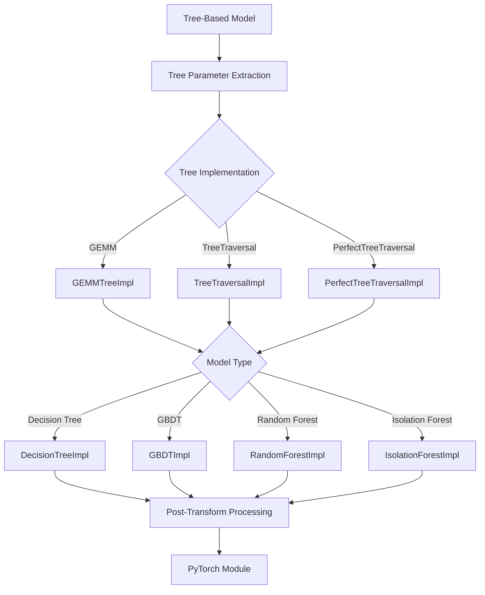

Sources: [README.md:25-63]()

Hummingbird implements multiple strategies for tree conversion:

1. **GEMM (GEneric Matrix Multiplication)**: 
   - Converts tree traversal into matrix multiplications
   - Highly efficient for batch processing on GPUs
   - Default strategy for dense datasets

2. **TreeTraversal**:
   - Implements traditional if-then-else logic for tree traversal
   - Better for sparse datasets or specific path conditions

3. **PerfectTreeTraversal**:
   - Optimized for balanced trees with uniform depth
   - Provides faster inference for models with regular structure

The README provides a detailed explanation of how GEMM works for decision trees, including step-by-step matrix transformations.

## Usage Example

Here's a basic example demonstrating how to use Hummingbird to convert and accelerate a scikit-learn Random Forest model:

```python
import numpy as np
from sklearn.ensemble import RandomForestClassifier
from hummingbird.ml import convert, load

# Create and train a model
X = np.random.rand(100000, 28)
y = np.random.randint(2, size=100000)
skl_model = RandomForestClassifier(n_estimators=10, max_depth=10)
skl_model.fit(X, y)

# Convert to PyTorch
model = convert(skl_model, 'pytorch')

# Run predictions on CPU
model.predict(X)

# Run predictions on GPU
model.to('cuda')
model.predict(X)

# Save the model
model.save('hb_model')

# Load the model back
model = load('hb_model')
```

Sources: [README.md:90-118](), [notebooks/blog_example.ipynb:18-26]()

## Supported Backends

Hummingbird supports the following target backends:

| Backend | Description | Device Support | Serialization |
|---------|-------------|----------------|---------------|
| `'torch'` or `'pytorch'` | PyTorch backend | CPU, GPU | Yes |
| `'torch.jit'` or `'torchscript'` | TorchScript backend | CPU, GPU | Yes |
| `'onnx'` | ONNX Runtime backend | CPU, GPU | Yes |
| `'tvm'` | TVM backend | CPU, GPU | Yes |

Sources: [tests/test_backends.py:60-81](), [README.md:18]()

Each backend requires specific dependencies installed, which can be added using:

```bash
# For basic installation
pip install hummingbird-ml

# For ONNX support
pip install hummingbird-ml[onnx]

# For additional ML frameworks (LightGBM, XGBoost)
pip install hummingbird-ml[extra]
```

Sources: [setup.py:33-44](), [README.md:73-79]()

## Version and Dependencies

Hummingbird requires:
- Python 3.9, 3.10, or 3.11
- PyTorch >= 1.7.0
- scikit-learn
- numpy >= 1.15
- onnxconverter-common >= 1.6.0

Optional dependencies include:
- XGBoost >= 0.90, < 2.0.0
- LightGBM >= 2.2
- ONNX Runtime >= 1.0.0, < 1.18.0

Sources: [setup.py:22-44](), [.github/workflows/pythonapp.yml:31-36]()

## Conclusion

Hummingbird bridges traditional machine learning frameworks and neural network execution environments, enabling acceleration without API changes. By converting models to tensor computations, it leverages GPU acceleration and optimizations from neural network frameworks, while maintaining the familiar interface of the original models.

For more detailed information, see:
- [Model Conversion Pipeline](#3.1) for the detailed conversion process
- [Supported Models and Backends](#4) for information on supported models
- [API Reference](#5) for the complete API documentation

---

# Page: Installation and Setup

# Installation and Setup

<details>
<summary>Relevant source files</summary>

The following files were used as context for generating this wiki page:

- [.devcontainer/Dockerfile](.devcontainer/Dockerfile)
- [.devcontainer/devcontainer.json](.devcontainer/devcontainer.json)
- [.github/workflows/pythonapp.yml](.github/workflows/pythonapp.yml)
- [CONTRIBUTING.md](CONTRIBUTING.md)
- [Dockerfile](Dockerfile)
- [README.md](README.md)
- [TROUBLESHOOTING.md](TROUBLESHOOTING.md)
- [hummingbird/__init__.py](hummingbird/__init__.py)
- [setup.cfg](setup.cfg)
- [setup.py](setup.py)
- [tests/test_no_extra_install.py](tests/test_no_extra_install.py)
- [website/sphinx/conf.py](website/sphinx/conf.py)

</details>


This document provides detailed instructions for installing and configuring Hummingbird. It covers basic installation, dependencies, platform-specific considerations, and troubleshooting common issues. For information on building from source and development setup, see [Development Guide](#6).

## System Requirements

Hummingbird has been tested on the following environments:

| Component | Requirements |
|-----------|--------------|
| Python | 3.9, 3.10, 3.11 (minimum 3.8) |
| Operating Systems | Linux, Windows, MacOS |
| PyTorch | ≥ 1.6.0 (currently tested with 2.4.1) |

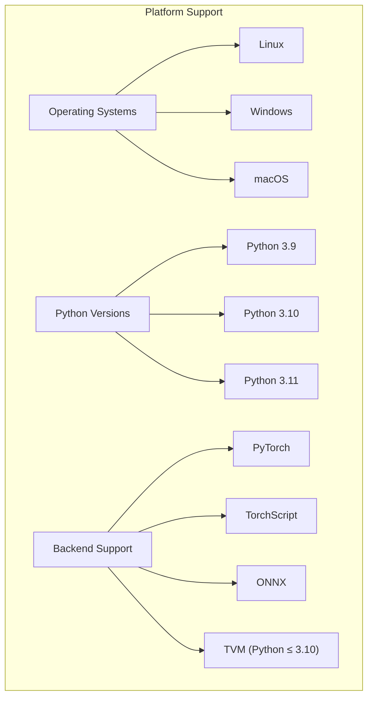

Sources: [README.md:65-67](), [setup.py:72](), [.github/workflows/pythonapp.yml:31-36]()

## Basic Installation

### Prerequisites

Before installing Hummingbird, ensure you have PyTorch installed. PyTorch installation varies based on your platform and hardware requirements.

```bash
# Visit https://pytorch.org/ for specific installation instructions for your platform
# Example for CPU-only installation
python -m pip install torch==2.4.1
```

### Installing Hummingbird

The simplest way to install Hummingbird is through pip:

```bash
python -m pip install hummingbird-ml
```

This installs Hummingbird with the core dependencies:

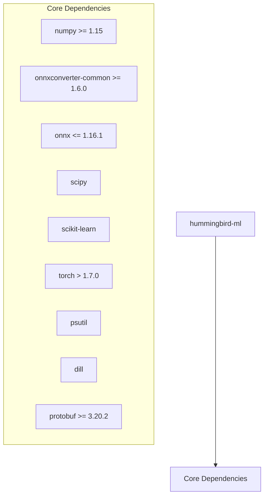

Sources: [README.md:69-74](), [setup.py:22-32]()

## Optional Dependencies

Hummingbird supports several optional components that can be installed based on your needs:

### Extra ML Frameworks

To use Hummingbird with XGBoost, LightGBM, and other ML frameworks:

```bash
python -m pip install hummingbird-ml[extra]
```

### ONNX Backend

For ONNX runtime support:

```bash
python -m pip install hummingbird-ml[onnx]
```

### Spark ML Support

For Apache Spark ML pipeline support:

```bash
python -m pip install hummingbird-ml[sparkml]
```

### Complete Installation

For a complete installation with all dependencies:

```bash
python -m pip install hummingbird-ml[extra,onnx,sparkml]
```

For development and testing:

```bash
python -m pip install hummingbird-ml[tests,extra,onnx,sparkml]
```

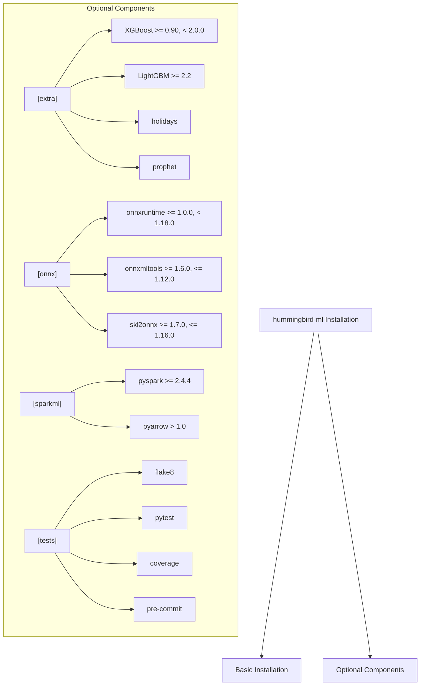

Sources: [setup.py:33-64](), [.github/workflows/pythonapp.yml:84-86]()

## TVM Backend Setup

TVM (Tensor Virtual Machine) is an optional backend with additional installation requirements:

1. TVM requires LLVM
2. TVM is only compatible with Python ≤ 3.10
3. Installation process differs by platform

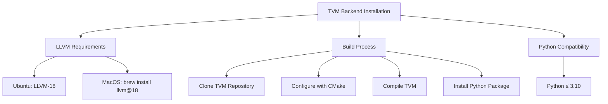

Sources: [.github/workflows/pythonapp.yml:87-143]()

## Platform-Specific Considerations

### Linux

- PyTorch CPU installation requires an extra index URL:
  ```bash
  python -m pip install torch==2.4.1 --extra-index-url https://download.pytorch.org/whl/cpu
  ```

- For LightGBM on Linux with Yum-based systems:
  ```bash
  yum install libgomp
  ```

### macOS

- LightGBM on macOS requires OpenMP:
  ```bash
  brew install libomp
  ```

- XGBoost installation might require CMake:
  ```bash
  brew install cmake
  ```

### Windows

- PyTorch installation might need to be done manually from the official PyTorch website
- Follow platform-specific instructions on the PyTorch website

Sources: [.github/workflows/pythonapp.yml:52-58](), [TROUBLESHOOTING.md:8-25]()

## Development Environment Setup

### Local Development

For development purposes, clone the repository and install in development mode:

```bash
mkdir hummingbird
cd hummingbird
git clone https://github.com/microsoft/hummingbird.git .
python -m pip install -e .[tests,extra]
```

### Docker Development Environment

A Docker image is provided for development:

```bash
docker build git://github.com/microsoft/hummingbird -t hb-dev
docker run -it hb-dev
```

### GitHub Codespaces

Hummingbird provides configuration for GitHub Codespaces, allowing you to develop in a web-based environment without local setup.

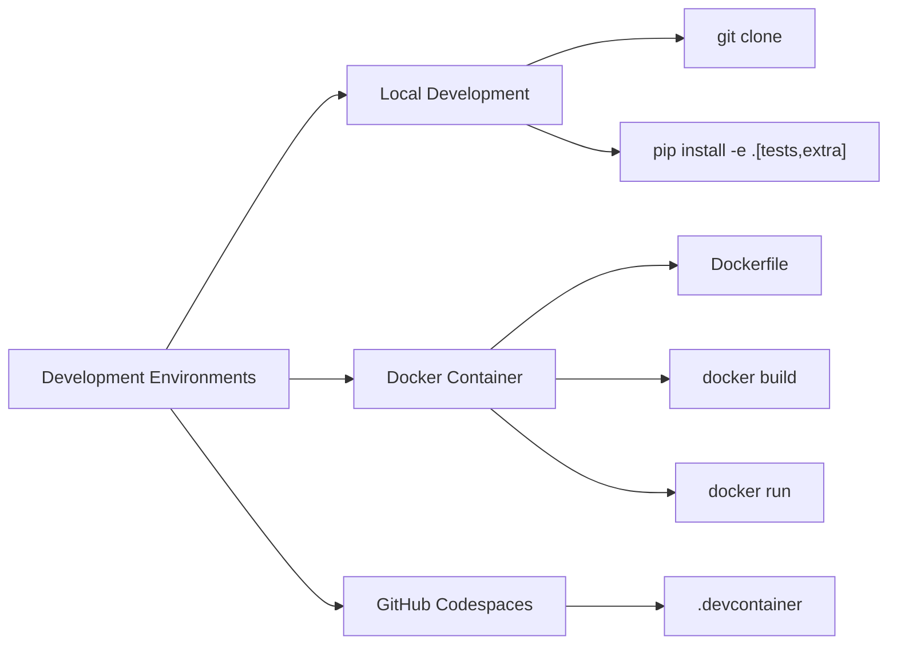

Sources: [CONTRIBUTING.md:32-42](), [Dockerfile:1-24](), [.devcontainer/Dockerfile:1-24](), [.devcontainer/devcontainer.json:1-14]()

## Troubleshooting Common Issues

### PyTorch GPU Support

To use Hummingbird with PyTorch on GPU:

1. Uninstall existing PyTorch: `python -m pip uninstall torch`
2. Reinstall PyTorch with CUDA support (see PyTorch website for specific installation command)

### Common Installation Problems

| Platform | Issue | Solution |
|----------|-------|----------|
| macOS | XGBoost: `cmake: command not found` | `brew install cmake` |
| macOS | LightGBM: `Library not loaded: libomp.dylib` | `brew install libomp` |
| Linux | LightGBM: `libgomp.so.1: cannot open shared object file` | `yum install libgomp` |
| Windows | PyTorch: `Could not find a version that satisfies the requirement` | Install PyTorch manually from the PyTorch website |

Sources: [TROUBLESHOOTING.md:1-25]()

## Verifying Installation

You can verify that Hummingbird and its dependencies are correctly installed with this simple example:

```python
import numpy as np
from sklearn.ensemble import RandomForestClassifier
from hummingbird.ml import convert

# Create a simple model and convert it
X = np.array([[0, 1], [1, 1], [2, 0]])
y = np.array([0, 1, 0])
model = RandomForestClassifier(n_estimators=2, max_depth=1)
model.fit(X, y)

# Convert to PyTorch with Hummingbird
pytorch_model = convert(model, 'pytorch')

# Make predictions
pytorch_model.predict(X)
```

Sources: [README.md:88-119]()

---

# Page: Architecture

# Architecture

<details>
<summary>Relevant source files</summary>

The following files were used as context for generating this wiki page:

- [hummingbird/ml/__init__.py](hummingbird/ml/__init__.py)
- [hummingbird/ml/_parse.py](hummingbird/ml/_parse.py)
- [hummingbird/ml/_topology.py](hummingbird/ml/_topology.py)
- [hummingbird/ml/convert.py](hummingbird/ml/convert.py)
- [hummingbird/ml/operator_converters/constants.py](hummingbird/ml/operator_converters/constants.py)
- [hummingbird/ml/operator_converters/sklearn/bagging.py](hummingbird/ml/operator_converters/sklearn/bagging.py)
- [tests/test_extra_conf.py](tests/test_extra_conf.py)
- [tests/test_onnxml_one_hot_encoder_converter.py](tests/test_onnxml_one_hot_encoder_converter.py)
- [tests/test_sklearn_bagging.py](tests/test_sklearn_bagging.py)
- [tests/test_sklearn_pipeline.py](tests/test_sklearn_pipeline.py)

</details>


This document describes the architectural design of Hummingbird, a compiler that translates traditional machine learning models into neural network frameworks for faster inference. 

Hummingbird's architecture is designed for extensibility, allowing it to support multiple input model formats and output backends while maintaining a consistent conversion pipeline. For information about specific operator converters, see [Operator Converters](#4.1). For API usage information, see [API Reference](#5).

## High-Level Architecture Overview

Hummingbird follows a compile-time conversion approach, translating source models into tensor computations that can be executed efficiently on hardware accelerators.

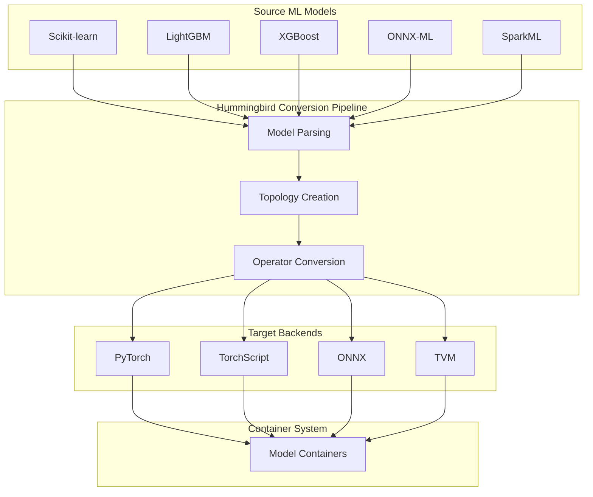

Sources: [hummingbird/ml/convert.py:1-444](), [hummingbird/ml/_topology.py:1-445]()

## Conversion Process

The conversion process begins with the `convert` function, which serves as the main entry point for Hummingbird.

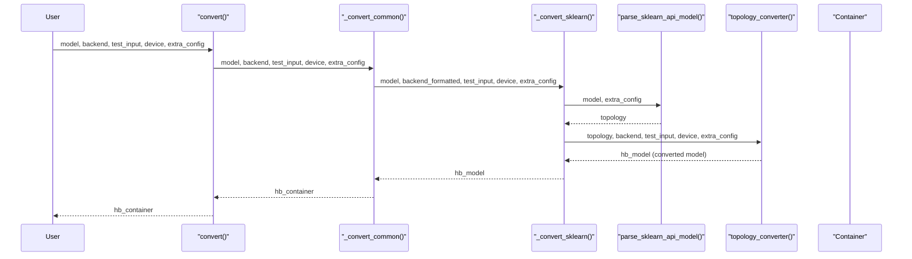

Sources: [hummingbird/ml/convert.py:408-444](), [hummingbird/ml/convert.py:295-406](), [hummingbird/ml/convert.py:95-113]()

### Conversion Flow Details

The conversion flow consists of several key steps:

1. **Input processing**: The input model is checked and the extra configurations are normalized
2. **Model routing**: The model is routed to the appropriate converter based on type (scikit-learn, LightGBM, XGBoost, ONNX, SparkML)
3. **Model parsing**: The model is parsed into Hummingbird's internal topology representation
4. **Operator conversion**: Operators are converted to tensor operations
5. **Container wrapping**: The converted model is wrapped in a container with a consistent API

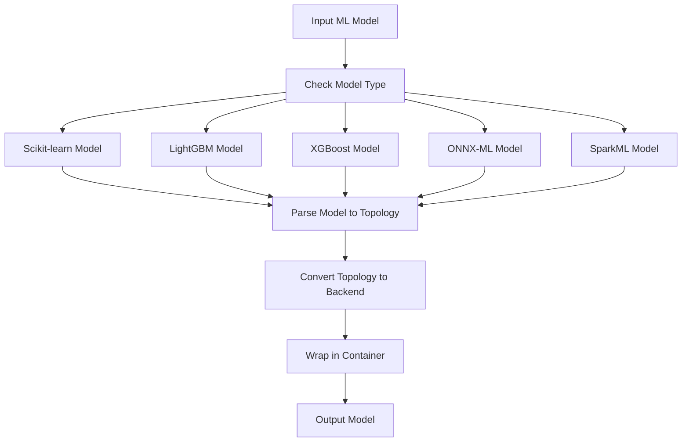

Sources: [hummingbird/ml/convert.py:94-406](), [hummingbird/ml/_parse.py:41-71](), [hummingbird/ml/_topology.py:178-444]()

## Topology System

At the core of Hummingbird's design is the `Topology` class, which provides an intermediate representation of models during conversion. The Topology serves as a bridge between source model formats and target backends.

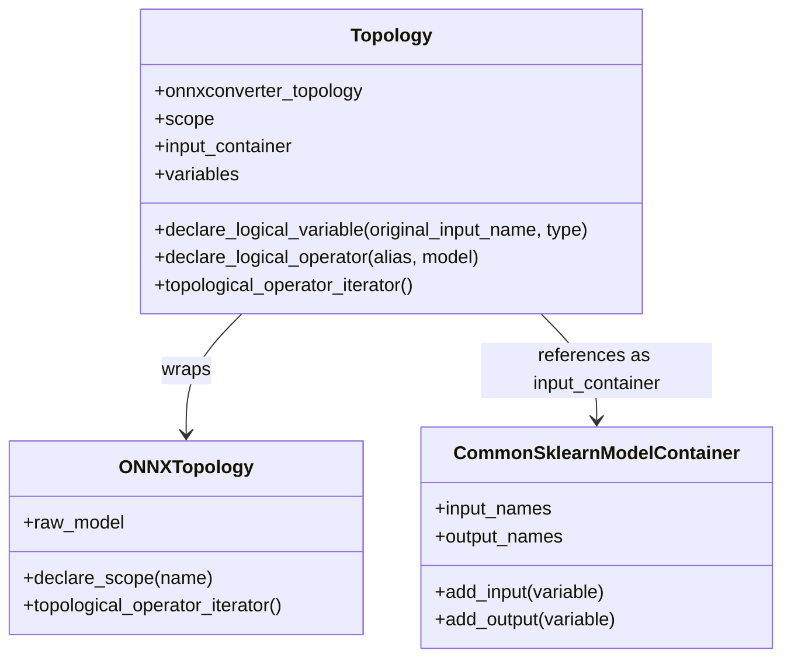

Sources: [hummingbird/ml/_topology.py:50-93](), [hummingbird/ml/_parse.py:41-71]()

### Topology Creation Process

During model parsing, Hummingbird creates a `Topology` object that captures the structure of the input model:

1. The input model is wrapped in a container (e.g., `CommonSklearnModelContainer`)
2. A `Topology` is created with the container
3. Input variables are declared based on the model inputs
4. The model is parsed into logical operators and variables
5. Output variables are declared based on the model outputs

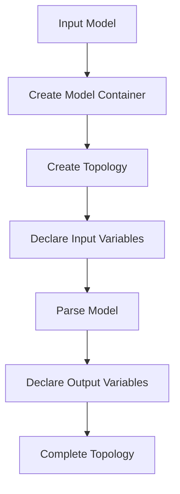

Sources: [hummingbird/ml/_parse.py:41-71](), [hummingbird/ml/_parse.py:148-213]()

## Operator Conversion

Hummingbird converts source model operators (e.g., decision trees, linear models) into their tensor-based equivalents. This conversion happens within the `topology_converter` function.

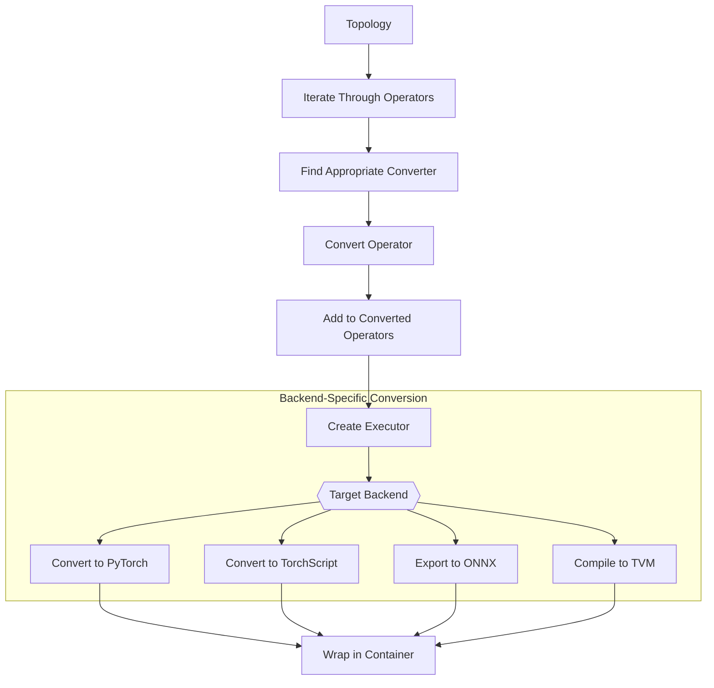

Sources: [hummingbird/ml/_topology.py:178-444](), [hummingbird/ml/convert.py:95-113]()

## Container System

After conversion, models are wrapped in a container that provides a consistent API regardless of the backend. This allows users to interact with converted models in a uniform way.

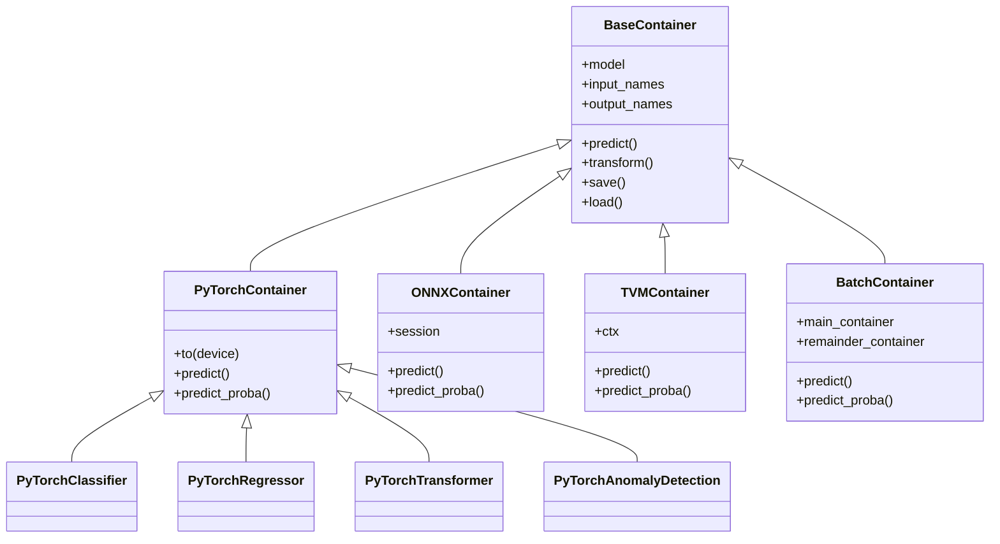

Sources: [hummingbird/ml/_topology.py:20-38](), [hummingbird/ml/_topology.py:423-444]()

## End-to-End Conversion Flow

This diagram illustrates the complete end-to-end flow from an input model to a deployed backend model:

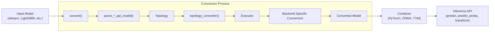

Sources: [hummingbird/ml/convert.py:408-444](), [hummingbird/ml/_topology.py:178-444]()

## Backend-Specific Implementations

Hummingbird supports multiple backends, each with its own conversion process:

### PyTorch Backend

For the PyTorch backend, operators are converted to torch.nn.Module instances that are composed into an Executor.

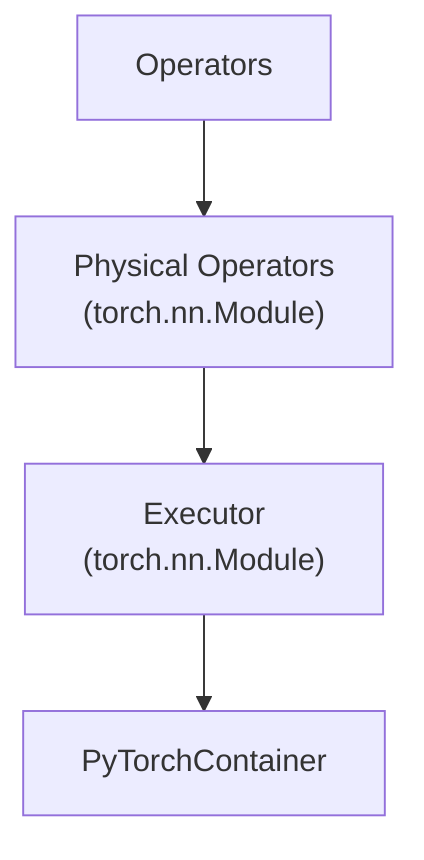

Sources: [hummingbird/ml/_topology.py:333-345]()

### TorchScript Backend

For the TorchScript backend, the PyTorch model is first created and then traced using torch.jit.trace.

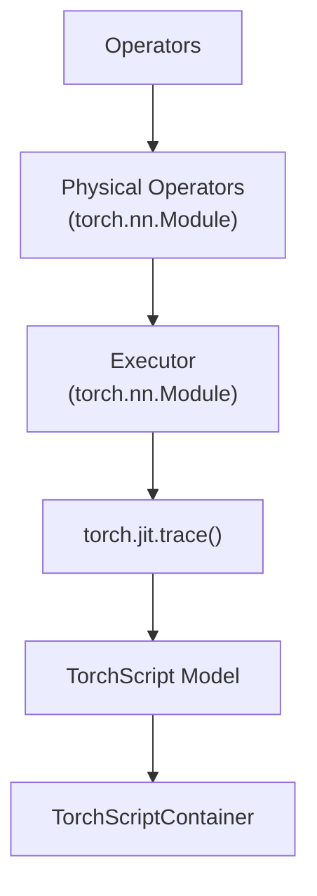

Sources: [hummingbird/ml/_topology.py:95-105](), [hummingbird/ml/_topology.py:340-343]()

### ONNX Backend

For the ONNX backend, the PyTorch model is first created and then exported to ONNX using torch.onnx.export.

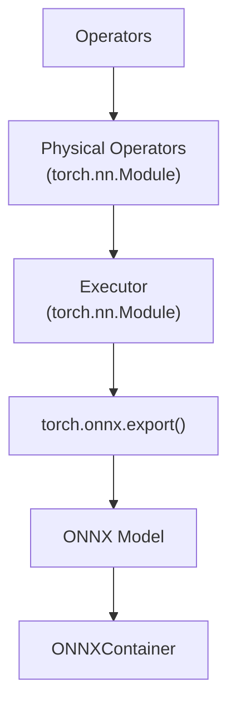

Sources: [hummingbird/ml/_topology.py:265-297]()

### TVM Backend

For the TVM backend, the PyTorch model is first created, then traced to TorchScript, and finally compiled to TVM.

```mermaid
flowchart TB
    operators["Operators"] --> physical_ops["Physical Operators\n(torch.nn.Module)"]
    physical_ops --> executor["Executor\n(torch.nn.Module)"]
    executor --> trace["torch.jit.trace()"]
    trace --> relay["relay.frontend.from_pytorch()"]
    relay --> build["relay.build()"]
    build --> tvm_model["TVM Runtime Module"]
    tvm_model --> container["TVMContainer"]
```

Sources: [hummingbird/ml/_topology.py:149-175](), [hummingbird/ml/_topology.py:298-332]()

## Configuration System

Hummingbird uses an `extra_config` dictionary to pass configuration options throughout the conversion process. This allows for customization of the conversion process and the resulting model.

Key configuration options include:

| Configuration Parameter | Description |
|-------------------------|-------------|
| `constants.N_THREADS`   | Number of threads to use for inference |
| `constants.TEST_INPUT`  | Test input for model tracing |
| `constants.N_FEATURES`  | Number of features in the input data |
| `constants.CONTAINER`   | Whether to wrap the model in a container |
| `constants.REMAINDER_SIZE` | Size of remainder batch for batch conversion |

Sources: [hummingbird/ml/operator_converters/constants.py:1-102](), [hummingbird/ml/convert.py:302-317]()

## Batch Conversion

Hummingbird provides a special `convert_batch` function that creates models capable of processing data in batches. This is particularly useful for TVM backend where the input shape must be fixed.

```mermaid
flowchart TB
    input["Input Model"] --> convert_batch["convert_batch()"]
    convert_batch --> _convert_common["_convert_common()"]
    _convert_common --> batch_model["Main Model\n(for batch size)"]
    _convert_common --> remainder_model["Remainder Model\n(for remainder size)"]
    batch_model & remainder_model --> batch_container["BatchContainer"]
```

Sources: [hummingbird/ml/convert.py:447-481](), [hummingbird/ml/_topology.py:428-442]()

## Extensibility Points

Hummingbird is designed to be extensible, with clear points for adding support for new model types, operators, and backends:

1. **New Model Types**: Add new parsers in `_parse.py` and register them in `convert.py`
2. **New Operators**: Add new converters in the `operator_converters` package
3. **New Backends**: Add new backend-specific conversion in `_topology.py`

This modular architecture allows Hummingbird to evolve and support a wider range of models and backends over time.

Sources: [hummingbird/ml/_parse.py:41-71](), [hummingbird/ml/_parse.py:215-389](), [hummingbird/ml/convert.py:95-113]()

---

# Page: Model Conversion Pipeline

# Model Conversion Pipeline

<details>
<summary>Relevant source files</summary>

The following files were used as context for generating this wiki page:

- [hummingbird/ml/__init__.py](hummingbird/ml/__init__.py)
- [hummingbird/ml/_parse.py](hummingbird/ml/_parse.py)
- [hummingbird/ml/_topology.py](hummingbird/ml/_topology.py)
- [hummingbird/ml/convert.py](hummingbird/ml/convert.py)
- [hummingbird/ml/operator_converters/constants.py](hummingbird/ml/operator_converters/constants.py)
- [hummingbird/ml/operator_converters/sklearn/bagging.py](hummingbird/ml/operator_converters/sklearn/bagging.py)
- [tests/test_extra_conf.py](tests/test_extra_conf.py)
- [tests/test_onnxml_one_hot_encoder_converter.py](tests/test_onnxml_one_hot_encoder_converter.py)
- [tests/test_sklearn_bagging.py](tests/test_sklearn_bagging.py)
- [tests/test_sklearn_pipeline.py](tests/test_sklearn_pipeline.py)

</details>


This document details the end-to-end process of converting machine learning models from their source frameworks (such as scikit-learn, XGBoost, or ONNX-ML) to target tensor computation backends (such as PyTorch, TorchScript, ONNX, or TVM) in Hummingbird. For information about the overall architecture, see [Architecture](#3), and for container details after conversion, see [Container System](#3.3).

## Pipeline Overview

The conversion pipeline is the core of Hummingbird's functionality, transforming traditional ML models into tensor computation representations for accelerated inference. The pipeline consists of four major stages:

```mermaid
flowchart LR
    A["Source ML Model"] --> B["Model Parsing"]
    B --> C["Topology Creation"]
    C --> D["Operator Conversion"]
    D --> E["Backend-Specific Code Generation"]
    E --> F["Target Backend Model"]
    
    subgraph "Input Models"
        A
    end
    
    subgraph "Conversion Pipeline"
        B
        C
        D
        E
    end
    
    subgraph "Output Models"
        F
    end
```

Sources: [hummingbird/ml/convert.py:408-444](), [hummingbird/ml/_topology.py:178-444]()

## Conversion Entry Points

The conversion process begins with one of two main API functions:

1. `convert()` - Standard conversion for models
2. `convert_batch()` - Conversion supporting batch-by-batch prediction

Both functions ultimately call the internal `_convert_common()` function, which handles the conversion workflow.

```mermaid
sequenceDiagram
    participant User
    participant Convert as convert()
    participant ConvertBatch as convert_batch()
    participant ConvertCommon as _convert_common()
    participant Parser as Model Parser
    participant TopologyConverter as topology_converter()
    
    User->>Convert: ML Model, Backend
    Convert->>ConvertCommon: model, backend, test_input
    
    User->>ConvertBatch: ML Model, Backend, Batch Size
    ConvertBatch->>ConvertCommon: model, backend, test_input, remainder_size
    
    ConvertCommon->>ConvertCommon: Process extra_config
    ConvertCommon->>ConvertCommon: Determine model type
    
    alt scikit-learn model
        ConvertCommon->>Parser: parse_sklearn_api_model()
    else XGBoost model 
        ConvertCommon->>Parser: parse_sklearn_api_model()
    else LightGBM model
        ConvertCommon->>Parser: parse_sklearn_api_model()
    else ONNX-ML model
        ConvertCommon->>Parser: parse_onnx_api_model()
    else SparkML model
        ConvertCommon->>Parser: parse_sparkml_api_model()
    end
    
    Parser->>ConvertCommon: topology
    ConvertCommon->>TopologyConverter: topology, backend, test_input
    TopologyConverter->>ConvertCommon: Converted model
    ConvertCommon->>User: Converted model
```

Sources: [hummingbird/ml/convert.py:294-481]()

## Input Processing and Configuration

The conversion process begins by normalizing the inputs and setting up the conversion environment:

1. **Input Validation**: Ensures the model and backend are valid
2. **Extra Configuration Setup**: Sets default configurations and normalizes test inputs
3. **Backend Formatting**: Standardizes backend names for internal use
4. **Model Type Detection**: Determines the type of source model

```python
# Key configuration parameters include:
constants.TEST_INPUT      # Test data for tracing models
constants.N_THREADS       # Number of threads for parallel execution
constants.CONTAINER       # Whether to wrap the model in a container
constants.N_FEATURES      # Number of features in the input data
constants.REMAINDER_SIZE  # For batch conversion
```

Sources: [hummingbird/ml/convert.py:295-304](), [hummingbird/ml/operator_converters/constants.py:77-100]()

## Model Parsing Stage

The first major stage of conversion is parsing the source model into Hummingbird's internal representation.

```mermaid
flowchart TD
    A["Input ML Model"] --> B{"Model Type?"}
    
    B -->|"Scikit-learn"| C["parse_sklearn_api_model()"]
    B -->|"XGBoost"| D["parse_sklearn_api_model()"]
    B -->|"LightGBM"| E["parse_sklearn_api_model()"]
    B -->|"ONNX-ML"| F["parse_onnx_api_model()"]
    B -->|"SparkML"| G["parse_sparkml_api_model()"]
    
    C & D & E & F & G --> H["Topology Object"]
    
    subgraph "Model Detection and Parsing"
        B
        C
        D
        E
        F
        G
    end
```

The parsing process creates a `Topology` object, which is a universal representation of the model's computational graph regardless of the source framework.

Sources: [hummingbird/ml/_parse.py:41-292](), [hummingbird/ml/convert.py:94-292]()

### Framework-Specific Parsing

Each supported ML framework has a specialized parsing function:

| Framework | Parser Function | Description |
|-----------|----------------|-------------|
| Scikit-learn | `_convert_sklearn()` | Handles scikit-learn's estimators, pipelines, and transformers |
| XGBoost | `_convert_xgboost()` | Handles XGBoost models with special feature count extraction |
| LightGBM | `_convert_lightgbm()` | Handles LightGBM models |
| ONNX-ML | `_convert_onnxml()` | Parses ONNX-ML models and extracts input/output information |
| SparkML | `_convert_sparkml()` | Handles Spark ML models |

Sources: [hummingbird/ml/convert.py:94-292](), [hummingbird/ml/_parse.py:41-145]()

## Topology System

The `Topology` class is a central abstraction in Hummingbird's conversion pipeline, representing the computational graph of the model. It wraps the `ONNXTopology` from `onnxconverter_common`.

```mermaid
classDiagram
    class Topology {
        +ONNXTopology onnxconverter_topology
        +Scope scope
        +input_container
        +variables
        +declare_logical_variable()
        +declare_logical_operator()
        +topological_operator_iterator()
    }
    
    class ONNXTopology {
        +raw_model
        +declare_scope()
    }
    
    Topology --> ONNXTopology: contains
```

A topology consists of:
- Variables (inputs and outputs)
- Operators (computational nodes)
- Connections between operators

Sources: [hummingbird/ml/_topology.py:50-93](), [hummingbird/ml/_parse.py:57-69]()

## Operator Conversion

After creating the topology, the next stage converts each operator in the model to its backend-specific implementation.

```mermaid
flowchart LR
    A["Topology"] --> B["topology_converter()"]
    B --> C{"For each operator"}
    C --> D["Get converter for operator type"]
    D --> E["Apply converter to operator"]
    E --> F["Store converted operator"]
    F --> C
    C --> G["Executor"]
    G --> H["Backend-specific model"]
```

Key aspects of operator conversion:
1. Operators are processed in topological order
2. Each operator type has a specific converter
3. Converters are registered and retrieved using `get_converter()`
4. Converted operators are assembled into an execution graph

Sources: [hummingbird/ml/_topology.py:178-223]()

## Backend Code Generation

The final stage of the pipeline generates code for the target backend. This process varies by backend:

### PyTorch Backend

For PyTorch, the conversion process:
1. Creates PyTorch modules for each operator
2. Assembles them into an `Executor` object
3. Optionally moves the model to the specified device (CPU/CUDA)

### TorchScript Backend

For TorchScript:
1. The PyTorch model is created first
2. The model is traced using `torch.jit.trace()` with the provided test input
3. Optimizations are applied to the traced model

```python
# TorchScript conversion using JIT tracing
def _jit_trace(executor, trace_input, device, extra_config):
    if device != "cpu":
        if type(trace_input) is tuple:
            for input_ in trace_input:
                input_.to(device)
        else:
            trace_input.to(device)
    return torch.jit.trace(executor, trace_input).eval()
```

Sources: [hummingbird/ml/_topology.py:95-105]()

### ONNX Backend

For ONNX:
1. A PyTorch model is created first
2. `torch.onnx.export()` is used to convert to ONNX format
3. Dynamic axes are configured to support variable batch sizes
4. The model is loaded back using `onnx.load()`

Sources: [hummingbird/ml/_topology.py:244-297]()

### TVM Backend

For TVM:
1. The PyTorch model is converted to TorchScript
2. TVM's `relay.frontend.from_pytorch()` converts to Relay format
3. Relay is built into a graph runtime model

```mermaid
flowchart TD
    A["topology_converter()"] --> B{"Target Backend?"}
    
    B -->|"PyTorch"| C["Direct PyTorch Modules"]
    B -->|"TorchScript"| D["PyTorch + JIT Tracing"]
    B -->|"ONNX"| E["PyTorch -> torch.onnx.export()"]
    B -->|"TVM"| F["PyTorch -> TorchScript -> Relay -> TVM"]
    
    C & D & E & F --> G["Backend-specific Model"]
```

Sources: [hummingbird/ml/_topology.py:149-175](), [hummingbird/ml/_topology.py:333-346]()

## Model Containerization

The final step in the conversion pipeline wraps the converted model in an appropriate container. The container type is determined by:

1. The model's task type (classification, regression, anomaly detection, or transformation)
2. The target backend (PyTorch, TorchScript, ONNX, or TVM)

```mermaid
flowchart TD
    A["Converted Model"] --> B{"Model Type?"}
    
    B -->|"Transformer"| C{"Backend?"}
    B -->|"Classifier"| D{"Backend?"}
    B -->|"Regressor"| E{"Backend?"}
    B -->|"Anomaly Detector"| F{"Backend?"}
    
    C -->|"PyTorch"| G["PyTorchSklearnContainerTransformer"]
    C -->|"TorchScript"| H["TorchScriptSklearnContainerTransformer"]
    C -->|"ONNX"| I["ONNXSklearnContainerTransformer"]
    C -->|"TVM"| J["TVMSklearnContainerTransformer"]
    
    D -->|"PyTorch"| K["PyTorchSklearnContainerClassification"]
    D -->|"TorchScript"| L["TorchScriptSklearnContainerClassification"]
    D -->|"ONNX"| M["ONNXSklearnContainerClassification"]
    D -->|"TVM"| N["TVMSklearnContainerClassification"]
    
    E -->|"PyTorch"| O["PyTorchSklearnContainerRegression"]
    E -->|"TorchScript"| P["TorchScriptSklearnContainerRegression"]
    E -->|"ONNX"| Q["ONNXSklearnContainerRegression"]
    E -->|"TVM"| R["TVMSklearnContainerRegression"]
    
    F -->|"PyTorch"| S["PyTorchSklearnContainerAnomalyDetection"]
    F -->|"TorchScript"| T["TorchScriptSklearnContainerAnomalyDetection"]
    F -->|"ONNX"| U["ONNXSklearnContainerAnomalyDetection"]
    F -->|"TVM"| V["TVMSklearnContainerAnomalyDetection"]
    
    G & H & I & J & K & L & M & N & O & P & Q & R & S & T & U & V --> W["Final Container Model"]
```

For batch conversion, the models are wrapped in a `BatchContainer` which manages both the main container and the remainder container.

Sources: [hummingbird/ml/_topology.py:348-443](), [hummingbird/ml/convert.py:447-481]()

## Examples

Below are simplified examples of how the conversion pipeline is used:

### Basic Model Conversion

```python
# Convert a scikit-learn model to PyTorch
from sklearn.ensemble import RandomForestClassifier
import hummingbird.ml

# Create and train a model
rf = RandomForestClassifier(n_estimators=10, max_depth=5)
rf.fit(X_train, y_train)

# Convert to PyTorch
pytorch_model = hummingbird.ml.convert(rf, 'torch')

# Use the converted model
predictions = pytorch_model.predict(X_test)
```

### Batch Conversion

```python
# Convert a model with batch processing support
from sklearn.ensemble import GradientBoostingRegressor
import hummingbird.ml

# Create and train a model
gbr = GradientBoostingRegressor(n_estimators=10, max_depth=5)
gbr.fit(X_train, y_train)

# Convert with batch processing
batch_size = 100
remainder_size = X_train.shape[0] % batch_size
batch_model = hummingbird.ml.convert_batch(
    gbr, 'tvm', X_train[:batch_size], remainder_size=remainder_size
)

# Process data in batches
predictions = batch_model.predict(X_test)
```

Sources: [hummingbird/ml/convert.py:408-444](), [hummingbird/ml/convert.py:447-481]()

## Pipeline Configurations

The conversion pipeline can be customized through the `extra_config` parameter, which supports various options:

| Configuration | Description |
|---------------|-------------|
| `constants.TEST_INPUT` | Test data for tracing models (required for some backends) |
| `constants.N_THREADS` | Number of threads for parallel execution |
| `constants.CONTAINER` | Whether to wrap the model in a container |
| `constants.N_FEATURES` | Number of features in the input data |
| `constants.REMAINDER_SIZE` | For batch conversion, size of the remainder data |
| `constants.TREE_IMPLEMENTATION` | Implementation strategy for tree-based models |
| `constants.MAX_STRING_LENGTH` | Maximum length for string inputs |

Sources: [hummingbird/ml/operator_converters/constants.py:10-102](), [hummingbird/ml/convert.py:295-318]()

## Complete Conversion Flow

The following diagram illustrates the complete conversion flow from input model to final container:

```mermaid
flowchart TD
    A["Input ML Model"] --> B["convert() / convert_batch()"]
    B --> C["_convert_common()"]
    
    C --> D{"Model Type?"}
    D -->|"Scikit-learn"| E["_convert_sklearn()"]
    D -->|"XGBoost"| F["_convert_xgboost()"]
    D -->|"LightGBM"| G["_convert_lightgbm()"]
    D -->|"ONNX-ML"| H["_convert_onnxml()"]
    D -->|"SparkML"| I["_convert_sparkml()"]
    
    E & F & G & H & I --> J["parse_*_api_model()"]
    J --> K["Topology"]
    
    K --> L["topology_converter()"]
    L --> M["Iterate through operators"]
    M --> N["Convert each operator"]
    N --> O["Create Executor"]
    
    O --> P{"Backend?"}
    P -->|"PyTorch"| Q["PyTorch Model"]
    P -->|"TorchScript"| R["JIT Trace Model"]
    P -->|"ONNX"| S["Export to ONNX"]
    P -->|"TVM"| T["Compile to TVM"]
    
    Q & R & S & T --> U["Determine Model Type"]
    U --> V["Create appropriate container"]
    V --> W["Final Container Model"]
```

Sources: [hummingbird/ml/convert.py:294-481](), [hummingbird/ml/_topology.py:178-444](), [hummingbird/ml/_parse.py:41-292]()

---

# Page: Topology System

# Topology System

<details>
<summary>Relevant source files</summary>

The following files were used as context for generating this wiki page:

- [hummingbird/ml/__init__.py](hummingbird/ml/__init__.py)
- [hummingbird/ml/_parse.py](hummingbird/ml/_parse.py)
- [hummingbird/ml/_topology.py](hummingbird/ml/_topology.py)
- [hummingbird/ml/operator_converters/constants.py](hummingbird/ml/operator_converters/constants.py)
- [hummingbird/ml/operator_converters/sklearn/bagging.py](hummingbird/ml/operator_converters/sklearn/bagging.py)
- [tests/test_sklearn_bagging.py](tests/test_sklearn_bagging.py)
- [tests/test_sklearn_pipeline.py](tests/test_sklearn_pipeline.py)

</details>


The Topology System in Hummingbird serves as the core internal representation mechanism during model conversion. It provides an abstract representation of machine learning models from various frameworks, enabling their transformation into tensor-based execution frameworks. This page explains how models are represented internally during the conversion process. For information about the overall conversion pipeline, see [Model Conversion Pipeline](#3.1).

## Purpose and Role

The Topology System creates a unified, framework-agnostic representation of machine learning models. This intermediate representation serves as a bridge between:
- **Input**: Models from scikit-learn, LightGBM, XGBoost, ONNX-ML, or SparkML
- **Output**: Tensor computation backends like PyTorch, TorchScript, ONNX, or TVM

## Architecture

```mermaid
graph TD
    subgraph "Model Parsing Phase"
        A["Input ML Model"] --> B["parse_sklearn_api_model()\nparse_onnx_api_model()\nparse_sparkml_api_model()"]
        B --> C["Topology Object"]
    end
    
    subgraph "Topology Components"
        C --> D["Logical Variables"]
        C --> E["Logical Operators"]
        C --> F["Input Container\n(Original Model)"]
    end
    
    subgraph "Conversion Phase"
        C --> G["convert() function"]
        G --> H["Backend-specific Model"]
    end
```

Sources: [hummingbird/ml/_topology.py:50-93](), [hummingbird/ml/_parse.py:41-145]()

## Core Components

The Topology System consists of several key components that work together to represent a machine learning model in an abstract way:

### 1. Topology Class

The `Topology` class is the central component, wrapping the `ONNXTopology` class from the onnxconverter-common library. It provides methods to:
- Declare logical variables representing inputs, intermediates, and outputs
- Declare logical operators representing model operations
- Iterate through operators in topological order

```mermaid
classDiagram
    class Topology {
        +onnxconverter_topology: ONNXTopology
        +scope: Scope
        +input_container
        +variables
        +declare_logical_variable()
        +declare_logical_operator()
        +topological_operator_iterator()
    }
    
    class ONNXTopology {
        +raw_model
        +declare_scope()
        +topological_operator_iterator()
    }
    
    Topology --> ONNXTopology : wraps
```

Sources: [hummingbird/ml/_topology.py:50-93]()

### 2. Input Container

The input container wraps the original input model and maintains the input and output information:
- For scikit-learn models: `CommonSklearnModelContainer`
- For ONNX models: `CommonONNXModelContainer`
- For SparkML models: `CommonSparkMLModelContainer`

Sources: [hummingbird/ml/_parse.py:26-26](), [hummingbird/ml/_topology.py:59-64]()

### 3. Logical Variables

Logical variables represent all data flowing through the model:
- Input features
- Intermediate values
- Output predictions

Variables are created using the `declare_logical_variable` method, which assigns them a name and optional type information.

Sources: [hummingbird/ml/_topology.py:73-79](), [hummingbird/ml/_parse.py:149-198]()

### 4. Logical Operators

Logical operators represent the computational operations in the model:
- Each operator has an alias identifying its type (e.g., "TreeEnsemble")
- Operators have input and output connections to logical variables
- Operators retain a reference to the original model component

Sources: [hummingbird/ml/_topology.py:81-85](), [hummingbird/ml/_parse.py:215-260]()

## Creating a Topology

The process of creating a Topology differs depending on the source framework of the input model:

```mermaid
sequenceDiagram
    participant User
    participant Convert as hummingbird.ml.convert()
    participant Parser as Model Parser
    participant Topology as Topology Object
    
    User->>Convert: ML Model
    Convert->>Parser: Select parser based on model type
    Parser->>Topology: Create Topology
    Parser->>Topology: Declare input variables
    Note over Parser,Topology: Parse model structure
    Parser->>Topology: Add logical operators
    Parser->>Topology: Declare output variables
    Topology->>Convert: Complete Topology
```

Sources: [hummingbird/ml/_parse.py:41-71](), [hummingbird/ml/_parse.py:73-102](), [hummingbird/ml/_parse.py:105-145]()

### Scikit-learn Models

For scikit-learn models, the `parse_sklearn_api_model` function:
1. Creates a `CommonSklearnModelContainer` to wrap the model
2. Initializes a new `Topology` with the container
3. Declares input variables based on the provided input data
4. Parses the model structure, creating logical operators
5. Connects the operators with logical variables
6. Declares output variables

The parsing process handles different scikit-learn structures:
- Single estimators (e.g., `DecisionTreeClassifier`)
- Pipelines
- Feature unions
- Column transformers
- Ensemble models

Sources: [hummingbird/ml/_parse.py:41-71](), [hummingbird/ml/_parse.py:215-260](), [hummingbird/ml/_parse.py:263-277]()

### ONNX Models

For ONNX models, the `parse_onnx_api_model` function:
1. Creates a `CommonONNXModelContainer` to wrap the model
2. Initializes a new `Topology` with the container
3. Declares input variables from the ONNX graph input
4. Parses the ONNX graph structure, creating logical operators
5. Declares output variables from the ONNX graph output

Sources: [hummingbird/ml/_parse.py:105-145](), [hummingbird/ml/_parse.py:603-635]()

### SparkML Models

For SparkML models, the `parse_sparkml_api_model` function follows a similar process to scikit-learn but with specific handling for SparkML's API differences.

Sources: [hummingbird/ml/_parse.py:73-102](), [hummingbird/ml/_parse.py:672-732]()

## Converting from Topology to Backend

Once a Topology is constructed, it's passed to the `convert` function, which:

1. Iterates through the logical operators in topological order
2. Applies the appropriate converter for each operator type
3. Creates an execution plan for the target backend
4. Wraps the converted model in a container providing a consistent API

```mermaid
graph TD
    A["Topology"] --> B["Topological Iteration\nthrough Operators"]
    B --> C["Apply Operator Converters"]
    C --> D["Create Executor"]
    D --> E["Wrap in Container"]
    
    subgraph "Operator Conversion"
        C1["Find Converter\nfor Operator Type"]
        C2["Apply Conversion\nLogic"]
        C3["Generate Backend\nImplementation"]
        C1 --> C2 --> C3
    end
    
    C --> C1
```

Sources: [hummingbird/ml/_topology.py:178-444]()

The conversion process handles:
- Operator-specific transformations
- Backend-specific code generation
- Optimizations specific to the target backend
- Selection of the appropriate container type based on model task

## Handling Complex Models

The Topology System provides specialized handling for complex model types:

### Pipelines and Ensemble Models

For scikit-learn pipelines and ensemble models, the parsing process:
1. Recursively parses each component or stage
2. Connects the outputs of one stage to the inputs of the next
3. Creates a coherent flow through the topology

Sources: [hummingbird/ml/_parse.py:263-277](), [hummingbird/ml/operator_converters/sklearn/bagging.py:19-60](), [tests/test_sklearn_pipeline.py:40-737](), [tests/test_sklearn_bagging.py:13-88]()

### Column Transformers

For column transformers, the parsing process:
1. Extracts column indices or names for each transformer
2. Slices the input variables accordingly
3. Applies each transformer to its slice
4. Concatenates the results

Sources: [hummingbird/ml/_parse.py:392-473](), [tests/test_sklearn_pipeline.py:105-607]()

## Practical Example Flow

Below is a concrete example of how a scikit-learn RandomForest model flows through the Topology System:

```mermaid
flowchart LR
    A["RandomForestClassifier"] --> B["parse_sklearn_api_model()"]
    B --> C["Topology with\nLogical Operators"]
    C --> D["SklearnRandomForestClassifier\nConverter"]
    D --> E["PyTorch Implementation"]
    E --> F["PyTorchSklearnContainerClassification"]
    
    subgraph "Topology Representation"
        C1["Input Variable"]
        C2["TreeEnsemble Operator"]
        C3["Output Variable"]
        C1 --> C2 --> C3
    end
    
    C --> C1
```

Sources: [hummingbird/ml/_parse.py:41-71](), [hummingbird/ml/_topology.py:178-444]()

## Constants and Configuration

The Topology System uses various constants defined in the `constants.py` file to control its behavior, including:
- Input/output name configuration
- Backend-specific parameters
- Batch size settings
- Threading configuration

Sources: [hummingbird/ml/operator_converters/constants.py:7-102]()

## Summary

The Topology System is the core representation mechanism in Hummingbird that enables model conversion between different ML frameworks and backend execution environments. It provides:

1. **Abstraction**: A unified representation independent of source and target frameworks
2. **Flexible parsing**: Specialized parsing for different model types and frameworks
3. **Structured conversion**: A systematic process for converting models to target backends
4. **Consistent interface**: A standardized way to represent model structure and data flow

This intermediate representation is crucial for Hummingbird's ability to handle diverse ML models and target multiple execution environments.

---

# Page: Container System

# Container System

<details>
<summary>Relevant source files</summary>

The following files were used as context for generating this wiki page:

- [hummingbird/ml/__init__.py](hummingbird/ml/__init__.py)
- [hummingbird/ml/_topology.py](hummingbird/ml/_topology.py)
- [hummingbird/ml/_utils.py](hummingbird/ml/_utils.py)
- [hummingbird/ml/containers/sklearn/onnx_containers.py](hummingbird/ml/containers/sklearn/onnx_containers.py)
- [hummingbird/ml/containers/sklearn/pytorch_containers.py](hummingbird/ml/containers/sklearn/pytorch_containers.py)
- [hummingbird/ml/containers/sklearn/tvm_containers.py](hummingbird/ml/containers/sklearn/tvm_containers.py)
- [hummingbird/ml/operator_converters/constants.py](hummingbird/ml/operator_converters/constants.py)
- [tests/test_backends.py](tests/test_backends.py)

</details>


The Hummingbird Container System wraps converted machine learning models to provide a consistent API regardless of the backend framework (PyTorch, TorchScript, ONNX, or TVM). This page explains the container architecture, how containers are created during the conversion process, and how they're used to interact with converted models.

For information about the overall conversion pipeline, see [Model Conversion Pipeline](#3.1). For the internal model representation, see [Topology System](#3.2).

## Purpose and Role

Containers serve several key purposes in Hummingbird:

1. Provide a **consistent, framework-agnostic API** to interact with converted models
2. Support various machine learning tasks (classification, regression, transformation, anomaly detection)
3. Enable **model persistence** through save/load functionality
4. Handle **hardware acceleration** by providing device management
5. Manage **batch processing** for optimized inference

Sources: [hummingbird/ml/_topology.py:423-444](), [hummingbird/ml/containers/sklearn/pytorch_containers.py:36-106]()

## Container Class Hierarchy

```mermaid
classDiagram
    class "BaseContainer" {
        +model
        +input_names
        +output_names
        +predict()
        +transform()
        +save()
        +load()
    }
    
    class "PyTorchContainer" {
        +to(device)
        +save()
        +load()
    }
    
    class "ONNXContainer" {
        +session
        +save()
        +load()
    }
    
    class "TVMContainer" {
        +ctx
        +save()
        +load()
    }
    
    class "BatchContainer" {
        +main_container
        +remainder_container
    }
    
    "BaseContainer" <|-- "PyTorchContainer"
    "BaseContainer" <|-- "ONNXContainer"
    "BaseContainer" <|-- "TVMContainer"
    "BaseContainer" <|-- "BatchContainer"
    
    "PyTorchContainer" <|-- "PyTorchClassifier"
    "PyTorchContainer" <|-- "PyTorchRegressor"
    "PyTorchContainer" <|-- "PyTorchTransformer"
    "PyTorchContainer" <|-- "PyTorchAnomalyDetector"
    
    "ONNXContainer" <|-- "ONNXClassifier"
    "ONNXContainer" <|-- "ONNXRegressor"
    "ONNXContainer" <|-- "ONNXTransformer"
    "ONNXContainer" <|-- "ONNXAnomalyDetector"
    
    "TVMContainer" <|-- "TVMClassifier"
    "TVMContainer" <|-- "TVMRegressor"
    "TVMContainer" <|-- "TVMTransformer"
    "TVMContainer" <|-- "TVMAnomalyDetector"
```

Sources: [hummingbird/ml/_topology.py:383-422](), [hummingbird/ml/containers/sklearn/pytorch_containers.py:36-106](), [hummingbird/ml/containers/sklearn/tvm_containers.py:35-226](), [hummingbird/ml/containers/sklearn/onnx_containers.py:34-274]()

## Container Selection Process

The container selection process happens in the conversion pipeline, after a model has been converted to the target backend. Hummingbird determines the appropriate container type based on:

1. The **target backend** (PyTorch, TorchScript, ONNX, or TVM)
2. The **task type** (classification, regression, transformation, or anomaly detection)

```mermaid
flowchart TD
    A["Converted Model"] --> B{"Backend Type?"}
    B -->|"PyTorch"| C["PyTorchContainer"]
    B -->|"TorchScript"| D["TorchScriptContainer"]
    B -->|"ONNX"| E["ONNXContainer"]
    B -->|"TVM"| F["TVMContainer"]
    
    C --> G{"Task Type?"}
    D --> G
    E --> G
    F --> G
    
    G -->|"Classification"| H["ClassifierContainer"]
    G -->|"Regression"| I["RegressorContainer"]
    G -->|"Transformation"| J["TransformerContainer"]
    G -->|"Anomaly Detection"| K["AnomalyDetectionContainer"]
```

Sources: [hummingbird/ml/_topology.py:346-422]()

## Backend-Specific Containers

Each backend has specialized container implementations to handle backend-specific functionality.

### PyTorch Containers

These containers wrap PyTorch models and provide methods to interact with them. Key features include:

- Direct model invocation through PyTorch
- Device management (GPU/CPU support) through `to(device)` method
- Support for both PyTorch models and TorchScript models

```python
# Example usage
hb_model = hummingbird.ml.convert(sklearn_model, 'torch')
hb_model.to('cuda')  # Move to GPU
predictions = hb_model.predict(X_test)
```

Sources: [hummingbird/ml/containers/sklearn/pytorch_containers.py:36-195]()

### ONNX Containers

ONNX containers wrap ONNX models and use ONNX Runtime for inference:

- Use ONNX Runtime's `InferenceSession` for model execution
- Manage named inputs and outputs for ONNX inference
- Thread control through ONNX Runtime session options

Sources: [hummingbird/ml/containers/sklearn/onnx_containers.py:34-274]()

### TVM Containers

TVM containers wrap compiled TVM models:

- Handle TVM's context-based execution model (CPU/GPU)
- Manage input/output tensor conversions
- Support batch processing with padding if needed

Sources: [hummingbird/ml/containers/sklearn/tvm_containers.py:35-226]()

## Task-Specific Container Types

For each backend, Hummingbird provides specialized containers for different machine learning tasks:

| Task Type | Container Type | Main Methods |
|-----------|---------------|--------------|
| Classification | `ClassifierContainer` | `predict()`, `predict_proba()` |
| Regression | `RegressorContainer` | `predict()` |
| Transformation | `TransformerContainer` | `transform()` |
| Anomaly Detection | `AnomalyDetectionContainer` | `predict()`, `decision_function()`, `score_samples()` |

Sources: [hummingbird/ml/containers/sklearn/pytorch_containers.py:198-357](), [hummingbird/ml/containers/sklearn/onnx_containers.py:220-274](), [hummingbird/ml/containers/sklearn/tvm_containers.py:254-290]()

## Batch Container

The `BatchContainer` is a special container that manages two models:

1. A **main container** optimized for processing complete batches
2. A **remainder container** for handling smaller remainder batches

This design improves performance when processing data in batches that don't perfectly divide the total dataset.

```mermaid
flowchart TD
    A["Input Data"] --> B{"Divisible by\nbatch size?"}
    B -->|"Yes"| C["Process with\nMain Container"]
    B -->|"No"| D["Split Data"]
    D --> E["Main Batch\nto Main Container"]
    D --> F["Remainder\nto Remainder Container"]
    E --> G["Combine Results"]
    F --> G
    G --> H["Final Output"]
```

Sources: [hummingbird/ml/_topology.py:428-436]()

## Model Persistence

Containers provide save and load functionality to persist converted models:

### Saving a Model

The save operation:
1. Serializes the model according to the backend type
2. Records model configuration and versions
3. Creates a zip archive with all necessary files
4. Generates a digest for model verification

```python
# Example of saving a model with digest for verification
model_digest = hb_model.save("my_model")
print(f"Saved model with digest: {model_digest}")
```

### Loading a Model

The load operation:
1. Verifies the model digest (if provided)
2. Unpacks the zip archive
3. Checks version compatibility
4. Loads the model according to the backend type
5. Reconstructs the container with the model

```python
# Example of loading a model with digest verification
loaded_model = hummingbird.ml.load("my_model.zip", digest=model_digest)
```

Each backend has specific serialization formats:

| Backend | Serialization Format |
|---------|---------------------|
| PyTorch | PyTorch model state |
| TorchScript | Scripted model file |
| ONNX | ONNX protobuf file |
| TVM | TVM library, graph, and parameters |

Sources: [hummingbird/ml/containers/sklearn/pytorch_containers.py:41-191](), [hummingbird/ml/containers/sklearn/onnx_containers.py:55-196](), [hummingbird/ml/containers/sklearn/tvm_containers.py:57-225](), [hummingbird/ml/_utils.py:244-302]()

## Container Creation in the Conversion Pipeline

The container system is a key part of the conversion process. Here's how containers are created:

```mermaid
sequenceDiagram
    participant User
    participant Convert as "convert()"
    participant Topology as "Topology Builder"
    participant OpConverters as "Operator Converters"
    participant BackendImpl as "Backend Implementation"
    participant ContainerSelector as "Container Selector"
    
    User->>Convert: ML Model, backend, test_input
    Convert->>Topology: Parse model into topology
    Topology->>OpConverters: Convert operators
    OpConverters->>BackendImpl: Generate backend code
    BackendImpl->>ContainerSelector: Model implementation
    Note over ContainerSelector: Determine task type by\nscanning operators
    ContainerSelector-->>Convert: Appropriate container
    Convert-->>User: Containerized Model
```

The container selection logic examines the properties of converted operators to determine the model's task type (classification, regression, etc.) and selects the appropriate container type for that task and backend.

Sources: [hummingbird/ml/_topology.py:346-422]()

## Container Interface

All containers provide a consistent interface regardless of the backend:

### Core Methods

| Method | Description |
|--------|-------------|
| `predict()` | Make predictions (classifiers/regressors) |
| `predict_proba()` | Get probability estimates (classifiers) |
| `transform()` | Transform data (transformers) |
| `decision_function()` | Get decision scores (anomaly detectors) |
| `save(location)` | Save the model to a file |
| `load(location, [digest])` | Load a model from a file |

### Backend-Specific Methods

Some container types offer additional backend-specific methods:

- **PyTorch Containers**: `to(device)` to move the model between devices
- **TVM Containers**: Context management for different hardware targets
- **ONNX Containers**: Session configuration for inference optimization

Sources: [hummingbird/ml/containers/sklearn/pytorch_containers.py:193-195](), [hummingbird/ml/containers/sklearn/tvm_containers.py:227-251](), [hummingbird/ml/containers/sklearn/onnx_containers.py:198-218]()

## Summary

The Container System is a crucial component of Hummingbird that:

1. Provides a **uniform interface** to interact with converted models regardless of the backend
2. Supports different **ML tasks** through specialized container types
3. Enables **model persistence** through standardized save/load functionality
4. Manages **hardware acceleration** through backend-specific optimizations
5. Facilitates **batch processing** for efficient inference

This abstraction layer allows users to work with converted models in a consistent way, regardless of the target backend, while still benefiting from the performance advantages of tensor-based computation frameworks.

---

# Page: Supported Models and Backends

# Supported Models and Backends

<details>
<summary>Relevant source files</summary>

The following files were used as context for generating this wiki page:

- [hummingbird/ml/operator_converters/__init__.py](hummingbird/ml/operator_converters/__init__.py)
- [hummingbird/ml/operator_converters/_linear_implementations.py](hummingbird/ml/operator_converters/_linear_implementations.py)
- [hummingbird/ml/operator_converters/sklearn/linear.py](hummingbird/ml/operator_converters/sklearn/linear.py)
- [hummingbird/ml/supported.py](hummingbird/ml/supported.py)
- [tests/test_lightgbm_converter.py](tests/test_lightgbm_converter.py)
- [tests/test_sklearn_decision_tree_converter.py](tests/test_sklearn_decision_tree_converter.py)
- [tests/test_sklearn_isolation_forest_converter.py](tests/test_sklearn_isolation_forest_converter.py)
- [tests/test_sklearn_linear_converter.py](tests/test_sklearn_linear_converter.py)
- [tests/test_sklearn_scaler_converter.py](tests/test_sklearn_scaler_converter.py)
- [tests/test_sklearn_sv_converter.py](tests/test_sklearn_sv_converter.py)
- [tests/test_xgboost_converter.py](tests/test_xgboost_converter.py)

</details>


This document provides a comprehensive overview of the machine learning models that Hummingbird can convert and the target backends it supports. Hummingbird serves as a bridge between traditional ML frameworks and neural network execution environments, enabling faster inference while maintaining the familiar training interfaces. For details about how the conversion process works, see [Model Conversion Pipeline](#3.1).

## Supported Input Models

Hummingbird can convert a wide variety of machine learning models from popular frameworks into tensor-based representations for efficient inference.

### scikit-learn Models

```mermaid
graph TD
    subgraph "scikit-learn Models"
        sk["scikit-learn"]
        sk --> sk_tree["Tree-based Models"]
        sk --> sk_linear["Linear Models"]
        sk --> sk_svm["SVM Models"]
        sk --> sk_nn["Neural Networks"]
        sk --> sk_nb["Naive Bayes"]
        sk --> sk_preproc["Preprocessing"]
        sk --> sk_other["Other Models"]
        
        sk_tree --> dt["DecisionTreeClassifier/Regressor"]
        sk_tree --> rf["RandomForestClassifier/Regressor"]
        sk_tree --> et["ExtraTreesClassifier/Regressor"]
        sk_tree --> gb["GradientBoostingClassifier/Regressor"]
        sk_tree --> hgb["HistGradientBoostingClassifier/Regressor"]
        sk_tree --> iforest["IsolationForest"]
        
        sk_linear --> lr["LinearRegression"]
        sk_linear --> logr["LogisticRegression/CV"]
        sk_linear --> sgd["SGDClassifier"]
        sk_linear --> ridge["Ridge/RidgeCV"]
        sk_linear --> lasso["Lasso"]
        sk_linear --> enet["ElasticNet"]
        
        sk_svm --> lsvc["LinearSVC/SVR"]
        sk_svm --> svc["SVC/NuSVC"]
        
        sk_nn --> mlp["MLPClassifier/Regressor"]
        
        sk_nb --> bnb["BernoulliNB"]
        sk_nb --> gnb["GaussianNB"]
        sk_nb --> mnb["MultinomialNB"]
        
        sk_preproc --> scaler["Standard/MinMax/RobustScaler"]
        sk_preproc --> enc["OneHotEncoder/LabelEncoder"]
        sk_preproc --> norm["Normalizer"]
        sk_preproc --> kbins["KBinsDiscretizer"]
        
        sk_other --> kmeans["KMeans"]
        sk_other --> knn["KNeighborsClassifier/Regressor"]
        sk_other --> mix["BayesianGaussianMixture"]
    end
```

Sources: [hummingbird/ml/supported.py:17-71](hummingbird/ml/supported.py:17-71), [hummingbird/ml/supported.py:123-285]()

### Gradient Boosting Frameworks

```mermaid
graph TD
    subgraph "Gradient Boosting Frameworks"
        lgbm["LightGBM"]
        xgb["XGBoost"]
        
        lgbm --> lgbm_cls["LGBMClassifier"]
        lgbm --> lgbm_reg["LGBMRegressor"]
        lgbm --> lgbm_rank["LGBMRanker"]
        lgbm --> lgbm_boost["Booster"]
        
        xgb --> xgb_cls["XGBClassifier"]
        xgb --> xgb_reg["XGBRegressor"]
        xgb --> xgb_rank["XGBRanker"]
    end
```

Sources: [hummingbird/ml/supported.py:73-81](hummingbird/ml/supported.py:73-81), [hummingbird/ml/supported.py:310-329](), [tests/test_lightgbm_converter.py](), [tests/test_xgboost_converter.py]()

### Other Supported Frameworks

```mermaid
graph TD
    subgraph "Other Frameworks"
        onnx["ONNX-ML"]
        spark["SparkML"]
        prophet["Prophet"]
        
        onnx --> onnx_lin["LinearClassifier/Regressor"]
        onnx --> onnx_tree["TreeEnsembleClassifier/Regressor"]
        onnx --> onnx_svm["SVMClassifier"]
        onnx --> onnx_prep["Preprocessing Operators"]
        onnx --> onnx_ops["Basic Operators"]
        
        onnx_prep --> onnx_enc["LabelEncoder/OneHotEncoder"]
        onnx_prep --> onnx_norm["Normalizer/Scaler"]
        onnx_prep --> onnx_imputer["Imputer"]
        
        onnx_ops --> onnx_math["Add/Div/Mul/Sum"]
        onnx_ops --> onnx_shape["Reshape/Concat/Gather"]
        
        spark --> spark_feat["Bucketizer/VectorAssembler"]
        spark --> spark_lin["LogisticRegressionModel"]
        
        prophet --> prophet_model["Prophet"]
    end
```

Sources: [hummingbird/ml/supported.py:83-107](hummingbird/ml/supported.py:83-107), [hummingbird/ml/supported.py:289-307](), [hummingbird/ml/supported.py:334-373]()

## Supported Target Backends

Hummingbird converts the source ML models into one of several neural network inference frameworks:

```mermaid
graph TD
    subgraph "Target Backends"
        pytorch["PyTorch"]
        ts["TorchScript"]
        onnx["ONNX"]
        tvm["TVM"]
    end
    
    pytorch --> pytorch_features["GPU Acceleration<br>Dynamic Computation<br>All Models Supported"]
    ts --> ts_features["Production Deployment<br>Serialization<br>Optimized Execution"]
    onnx --> onnx_features["Cross-Platform<br>Hardware Accelerators<br>Standardized Format"]
    tvm --> tvm_features["Hardware-specific Optimization<br>Specialized Accelerators<br>Compile-time Optimization"]
```

Sources: [hummingbird/ml/supported.py:10-15](hummingbird/ml/supported.py:10-15), [hummingbird/ml/supported.py:387-412]()

## Conversion Process Flow

```mermaid
flowchart LR
    A["Source Model"]
    B["Hummingbird Converter"]
    C["Target Backend Model"]
    
    A --> B
    B --> C
    
    subgraph "Source Model Types"
        A1["scikit-learn"]
        A2["LightGBM"]
        A3["XGBoost"]
        A4["ONNX-ML"]
        A5["SparkML"]
    end
    
    subgraph "Conversion Process"
        B1["Parse Model"]
        B2["Create Topology"]
        B3["Convert Operators"]
        B4["Generate Backend Code"]
    end
    
    subgraph "Target Backends"
        C1["PyTorch"]
        C2["TorchScript"]
        C3["ONNX"]
        C4["TVM"]
    end
    
    A1 & A2 & A3 & A4 & A5 --> B
    B1 --> B2 --> B3 --> B4
    B --> C1 & C2 & C3 & C4
```

Sources: [hummingbird/ml/supported.py](), [hummingbird/ml/operator_converters/__init__.py]()

## Tree-Based Model Implementation Strategies

Tree-based models (such as Random Forests, Decision Trees, Gradient Boosting models, etc.) can be implemented in different ways in Hummingbird, each with different performance characteristics:

```mermaid
graph TD
    subgraph "Tree Implementation Strategies"
        A["Tree-based Model"]
        A --> B["Implementation Strategy"]
        
        B --> C["GEMM<br>(Matrix Multiplication)"]
        B --> D["Tree Traversal"]
        B --> E["Perfect Tree Traversal"]
        
        C --> C_desc["Optimized for large batch sizes<br>Uses hardware-accelerated matrix ops"]
        D --> D_desc["Direct tree traversal logic<br>Better for small batch sizes"]
        E --> E_desc["Optimized for balanced trees<br>Best performance for specific cases"]
    end
```

The implementation strategy can be selected using the `tree_implementation` configuration parameter:

```python
# Example usage
import hummingbird.ml
# Convert using GEMM implementation
model_gemm = hummingbird.ml.convert(model, "torch", 
                                   extra_config={"tree_implementation": "gemm"})
# Convert using tree traversal implementation
model_trav = hummingbird.ml.convert(model, "torch", 
                                   extra_config={"tree_implementation": "tree_trav"})
# Convert using perfect tree traversal implementation
model_perf = hummingbird.ml.convert(model, "torch", 
                                   extra_config={"tree_implementation": "perf_tree_trav"})
```

Sources: [hummingbird/ml/supported.py:526-527](hummingbird/ml/supported.py:526-527), [tests/test_lightgbm_converter.py:30-35](), [tests/test_xgboost_converter.py:35-42](), [tests/test_sklearn_decision_tree_converter.py:31-39](), [tests/test_sklearn_isolation_forest_converter.py:26-30]()

## Configuration Options

Hummingbird provides several configuration options that can be specified during conversion:

| Configuration Option | Description | Possible Values |
|----------------------|-------------|----------------|
| `tree_implementation` | Tree implementation strategy | "gemm", "tree_trav", "perf_tree_trav" |
| `tree_op_precision_dtype` | Data type for tree thresholds | "float32", "float64" |
| `onnx_model_name` | Name for output ONNX model | Any string |
| `onnx_target_opset` | Target ONNX opset version | Integer (default: 11) |
| `tvm_max_fuse_depth` | Maximum operation fusion depth for TVM | Integer (default: 50) |
| `tvm_pad_prediction_inputs` | Pad inputs for variable batch sizes in TVM | Boolean |
| `input_names` | Names for input tensors | List of strings |
| `output_names` | Names for output tensors | List of strings |
| `container` | Return container or just model | Boolean |
| `n_threads` | Number of threads for scoring | Integer |
| `batch_size` | Batch size for inference partitioning | Integer |
| `remainder_size` | Maximum size for remainder model | Integer |
| `max_string_length` | Maximum string feature length | Integer |

These configuration options can be passed to the `convert` function through the `extra_config` parameter:

```python
# Example usage
import hummingbird.ml
# Convert with custom configuration
model_converted = hummingbird.ml.convert(
    model, 
    "torch",
    extra_config={
        "tree_implementation": "gemm",
        "n_threads": 4
    }
)
```

Sources: [hummingbird/ml/supported.py:524-569](hummingbird/ml/supported.py:524-569)

## Operator Conversion Process

```mermaid
flowchart TD
    A["Input ML Model"] --> B{"Framework Type"}
    
    B --> B1["scikit-learn Model"]
    B --> B2["LightGBM Model"]
    B --> B3["XGBoost Model"]
    B --> B4["ONNX-ML Model"]
    B --> B5["SparkML Model"]
    
    B1 & B2 & B3 & B4 & B5 --> C["Operator Name Mapping"]
    
    C --> D["Get Appropriate Converter"]
    
    D --> D1["Linear Model Converters"]
    D --> D2["Tree-based Model Converters"]
    D --> D3["Preprocessing Converters"]
    D --> D4["SVM Converters"]
    D --> D5["Other Specialized Converters"]
    
    D1 & D2 & D3 & D4 & D5 --> E["Convert to Target Backend"]
    
    E --> F1["PyTorch Implementation"]
    E --> F2["TorchScript Implementation"]
    E --> F3["ONNX Implementation"]
    E --> F4["TVM Implementation"]
```

Sources: [hummingbird/ml/supported.py:461-505](), [hummingbird/ml/operator_converters/__init__.py:19-58](hummingbird/ml/operator_converters/__init__.py:19-58)

## Example Linear Model Conversion

This example shows how a scikit-learn linear model is converted to a PyTorch implementation:

```mermaid
flowchart LR
    A["scikit-learn LinearModel"] --> B["Extract Parameters"]
    B --> B1["coefficients"]
    B --> B2["intercepts"]
    B --> B3["classes"]
    
    B1 & B2 & B3 --> C["Create LinearModel PyTorch Module"]
    
    C --> D["Forward Method"]
    D --> D1["Matrix Multiplication + Bias"]
    D1 --> D2["Apply Activation Function"]
    D2 --> D3["Return Predictions"]
    
    C --> E["PyTorch Model"]
```

Sources: [hummingbird/ml/operator_converters/sklearn/linear.py:18-114](hummingbird/ml/operator_converters/sklearn/linear.py:18-114), [hummingbird/ml/operator_converters/_linear_implementations.py:16-84](hummingbird/ml/operator_converters/_linear_implementations.py:16-84)

## Compatibility Matrix

The following table summarizes the compatibility between input model types and target backends:

| Input Model Type | PyTorch | TorchScript | ONNX | TVM |
|------------------|---------|-------------|------|-----|
| scikit-learn     | ✓       | ✓           | ✓    | ✓   |
| LightGBM         | ✓       | ✓           | ✓    | ✓   |
| XGBoost          | ✓       | ✓           | ✓    | ✓   |
| ONNX-ML          | ✓       | ✓           | ✓    | ✓   |
| SparkML          | ✓       | ✓           | ✓    | ✓   |
| Prophet          | ✓       | ✓           | ✗    | ✗   |

Sources: [hummingbird/ml/supported.py](), [tests/test_lightgbm_converter.py:349-444](), [tests/test_xgboost_converter.py:272-337](), [tests/test_sklearn_decision_tree_converter.py:504-535]()

## Conclusion

Hummingbird supports a wide range of machine learning models from various frameworks and can convert them to multiple target backends for efficient inference. The library provides flexible configuration options, particularly for tree-based models, allowing users to optimize for specific use cases.

For more detailed information about specific converters and their implementations, see [Operator Converters](#4.1).

---

# Page: Operator Converters

# Operator Converters

<details>
<summary>Relevant source files</summary>

The following files were used as context for generating this wiki page:

- [hummingbird/ml/operator_converters/_gbdt_commons.py](hummingbird/ml/operator_converters/_gbdt_commons.py)
- [hummingbird/ml/operator_converters/_linear_implementations.py](hummingbird/ml/operator_converters/_linear_implementations.py)
- [hummingbird/ml/operator_converters/_tree_commons.py](hummingbird/ml/operator_converters/_tree_commons.py)
- [hummingbird/ml/operator_converters/_tree_implementations.py](hummingbird/ml/operator_converters/_tree_implementations.py)
- [hummingbird/ml/operator_converters/lightgbm.py](hummingbird/ml/operator_converters/lightgbm.py)
- [hummingbird/ml/operator_converters/onnx/tree_ensemble.py](hummingbird/ml/operator_converters/onnx/tree_ensemble.py)
- [hummingbird/ml/operator_converters/sklearn/decision_tree.py](hummingbird/ml/operator_converters/sklearn/decision_tree.py)
- [hummingbird/ml/operator_converters/sklearn/gbdt.py](hummingbird/ml/operator_converters/sklearn/gbdt.py)
- [hummingbird/ml/operator_converters/sklearn/iforest.py](hummingbird/ml/operator_converters/sklearn/iforest.py)
- [hummingbird/ml/operator_converters/sklearn/linear.py](hummingbird/ml/operator_converters/sklearn/linear.py)
- [hummingbird/ml/operator_converters/xgb.py](hummingbird/ml/operator_converters/xgb.py)
- [tests/test_sklearn_linear_converter.py](tests/test_sklearn_linear_converter.py)
- [tests/test_sklearn_sv_converter.py](tests/test_sklearn_sv_converter.py)

</details>


This page describes the operator converter system in Hummingbird, which is responsible for transforming traditional machine learning operators from their original framework representation into tensor-based implementations for neural network frameworks. For information about the overall conversion pipeline, see [Model Conversion Pipeline](#3.1).

## Overview of Operator Converters

Operator converters are the core components that translate specific machine learning operators (e.g., decision trees, linear models) from their original framework representation to equivalent tensor computation implementations. Each operator type requires specialized conversion logic to maintain its functionality while leveraging tensor operations.

```mermaid
graph TD
    A["ML Model Operator"] --> B["Operator Converter"]
    B --> C["Tensor-Based Implementation"]
    
    subgraph "Converter Components"
        D["Parameter Extraction"] 
        E["Implementation Selection"]
        F["Tensor-Based Transformation"]
    end
    
    B --> D --> E --> F
    
    subgraph "Registration System"
        G["Converter Registry"] 
        H["register_converter()"]
    end
    
    H --> G
    G --> B
```

The operator converters follow a plugin architecture where each converter is registered with the system. When a model is submitted for conversion, Hummingbird identifies the appropriate converter based on the model type and uses it to transform the model into its tensor-based equivalent.

Sources: [hummingbird/ml/operator_converters/sklearn/linear.py:18-67](). [hummingbird/ml/operator_converters/sklearn/linear.py:102-114]().

## Converter Registration System

Hummingbird uses a registration mechanism to associate model types with their respective converters. Each converter is registered using the `register_converter` function, which maps the model type string to the converter function.

```mermaid
graph LR
    A["register_converter()"] --> B["Converter Registry"]
    B --> C["Model Type Lookup"]
    C --> D["Converter Function"]
    D --> E["Convert Operator"]
    
    subgraph "Registration Examples"
        F["SklearnLinearRegression"] --> G["convert_sklearn_linear_regression_model"]
        H["SklearnRandomForestClassifier"] --> I["convert_sklearn_random_forest_classifier"]
        J["LightGBMClassifier"] --> K["convert_sklearn_lgbm_classifier"]
    end
```

All converters take three standard parameters:
- `operator`: The operator to be converted
- `device`: The target device for the converted model (e.g., CPU, CUDA)
- `extra_config`: Additional configuration options

Sources: [hummingbird/ml/operator_converters/sklearn/linear.py:102-114](). [hummingbird/ml/operator_converters/lightgbm.py:125-129](). [hummingbird/ml/operator_converters/sklearn/decision_tree.py:130-135]().

## Categories of Operator Converters

Hummingbird includes converters for several types of ML operators:

### Linear Model Converters

Linear model converters transform linear algorithms like LinearRegression, LogisticRegression, and SVMs into tensor operations.

```mermaid
graph TD
    A["Linear Model\n(e.g., LogisticRegression)"] --> B["Extract Parameters\n(coefficients, intercepts)"]
    B --> C["Create LinearModel Implementation"]
    C --> D["PyTorch Module"]
    
    E["Input Data"] --> F["Matrix Multiplication + Bias\n(torch.addmm)"]
    F --> G["Apply Activation\n(sigmoid, softmax)"]
    G --> H["Output"]
    
    subgraph "LinearModel Forward Pass"
        F --> G --> H
    end
```

The `LinearModel` class implements linear models using matrix multiplication followed by the appropriate activation function based on the model type.

Sources: [hummingbird/ml/operator_converters/_linear_implementations.py:16-84](). [hummingbird/ml/operator_converters/sklearn/linear.py:18-67]().

### Tree-Based Model Converters

Tree-based model converters handle decision trees, random forests, and gradient boosting models. These converters are more complex due to the variety of tree algorithms and implementation strategies.

```mermaid
graph TD
    A["Tree-Based Model"] --> B["Tree Parameter Extraction"]
    B --> C["Implementation Strategy Selection"]
    
    C -->|"Low Depth Trees"| D["GEMM Implementation"]
    C -->|"Medium Depth Trees"| E["Perfect Tree Traversal"]
    C -->|"High Depth Trees"| F["Tree Traversal"]
    
    D & E & F --> G["PyTorch Module"]
    
    subgraph "Tree Parameters"
        H["lefts/rights\n(tree structure)"]
        I["features\n(split features)"]
        J["thresholds\n(split values)"]
        K["values\n(leaf predictions)"]
    end
    
    B --> H & I & J & K
```

Hummingbird supports three main implementation strategies for tree models:

1. **GEMM (General Matrix Multiplication)**: Converts trees to a series of matrix multiplications. Optimal for shallow trees.
2. **Tree Traversal**: Implements traditional tree traversal in PyTorch. Works for all tree types.
3. **Perfect Tree Traversal**: An optimized version for balanced trees with medium depth.

The strategy is selected based on tree depth and user configuration.

Sources: [hummingbird/ml/operator_converters/_tree_commons.py:181-208](). [hummingbird/ml/operator_converters/_tree_implementations.py:114-183](). [hummingbird/ml/operator_converters/_tree_implementations.py:211-306](). [hummingbird/ml/operator_converters/_tree_implementations.py:309-455]().

### Gradient Boosting Model Converters

Gradient boosting models (like XGBoost, LightGBM, and scikit-learn's gradient boosting) are converted using specialized converters that handle their unique characteristics.

```mermaid
graph TD
    A["Gradient Boosting Model"] --> B["Extract Tree Ensemble"]
    B --> C["Convert Individual Trees"]
    C --> D["Apply Ensemble Aggregation"]
    D --> E["Post-Transform\n(sigmoid, softmax)"]
    E --> F["PyTorch Module"]
    
    subgraph "Post-Transform Options"
        G["Sigmoid\n(binary classification)"]
        H["Softmax\n(multiclass classification)"]
        I["Identity\n(regression)"]
        J["Tweedie\n(specific distributions)"]
    end
    
    E --> G & H & I & J
```

Gradient boosting converters extract the tree ensemble, convert each tree, and apply the appropriate aggregation and post-transform functions.

Sources: [hummingbird/ml/operator_converters/_gbdt_commons.py:28-183](). [hummingbird/ml/operator_converters/xgb.py:84-150](). [hummingbird/ml/operator_converters/lightgbm.py:56-101]().

## Tree Implementation Strategies

The choice of tree implementation strategy significantly affects performance. Hummingbird selects the strategy based on tree depth and user configuration:

```mermaid
graph TD
    A["Tree Depth"] --> B{"Depth <= LOW_THRESHOLD?"}
    B -->|"Yes"| C["GEMM Implementation"]
    B -->|"No"| D{"Depth <= HIGH_THRESHOLD?"}
    D -->|"Yes"| E["Perfect Tree Traversal"]
    D -->|"No"| F["Tree Traversal"]
    
    G["User Configuration"] --> H{"Implementation Specified?"}
    H -->|"Yes"| I["Use Specified Implementation"]
    H -->|"No"| A
    
    subgraph "Implementation Characteristics"
        J["GEMM:\nFast for shallow trees\nMemory efficient"]
        K["Perfect Tree Traversal:\nGood for medium-depth balanced trees"]
        L["Tree Traversal:\nWorks for all trees\nBest for deep trees"]
    end
```

### GEMM Implementation

The GEMM implementation converts trees into a series of matrix multiplications:
- First layer: Computes conditions for each split node
- Second layer: Computes path traversals through the tree
- Third layer: Computes leaf node values based on path

### Tree Traversal Implementation

The Tree Traversal implementation more directly mimics traditional tree traversal:
- Maintains tree structure in tensors (lefts, rights, features, thresholds)
- Traverses trees in parallel for batched inputs
- More efficient for deep trees where GEMM would be memory-intensive

### Perfect Tree Traversal Implementation

An optimized version of tree traversal for balanced trees:
- Assumes trees can be represented as perfect binary trees
- Uses efficient indexing for traversal
- Strikes a balance between memory usage and computation efficiency

Sources: [hummingbird/ml/operator_converters/_tree_commons.py:181-208](). [hummingbird/ml/operator_converters/_tree_implementations.py:114-183](). [hummingbird/ml/operator_converters/_tree_implementations.py:211-306](). [hummingbird/ml/operator_converters/_tree_implementations.py:309-455]().

## Specialized Converters

### Isolation Forest Converter

Isolation Forest requires special handling due to its anomaly detection mechanics:

```mermaid
graph TD
    A["Isolation Forest"] --> B["Extract Tree Parameters"]
    B --> C["Calculate Anomaly Score Per Node"]
    C --> D["Convert using Tree Implementation"]
    D --> E["Apply Normalization"]
    E --> F["PyTorch Module"]
    
    subgraph "Isolation Forest Specifics"
        G["Average Path Length Calculation"]
        H["Anomaly Score Normalization"]
    end
    
    C --> G --> H
```

The Isolation Forest converter modifies the tree values to represent anomaly scores and applies specialized normalization.

Sources: [hummingbird/ml/operator_converters/sklearn/iforest.py:24-53](). [hummingbird/ml/operator_converters/sklearn/iforest.py:96-206]().

### ONNX-ML Tree Ensemble Converters

Hummingbird can convert ONNX-ML tree ensemble models (classifiers and regressors):

```mermaid
graph TD
    A["ONNX-ML TreeEnsemble"] --> B["Extract Tree Information"]
    B --> C["Convert to Hummingbird Tree Parameters"]
    C --> D["Select Implementation Strategy"]
    D --> E["PyTorch Module"]
    
    subgraph "ONNX-ML Parameters"
        F["nodes_truenodeids/falsenodeids"]
        G["nodes_featureids"]
        H["nodes_values"]
        I["nodes_modes"]
    end
    
    B --> F & G & H & I
```

The ONNX-ML converters extract tree information from the ONNX model and convert it to Hummingbird's internal representation.

Sources: [hummingbird/ml/operator_converters/onnx/tree_ensemble.py:19-180](). [hummingbird/ml/operator_converters/onnx/tree_ensemble.py:207-263]().

## Common Conversion Patterns

Most operator converters follow a similar pattern:

1. **Parameter Extraction**: Extract model parameters from the source model
2. **Parameter Transformation**: Transform parameters to a format suitable for tensor operations
3. **Implementation Selection**: Choose the most appropriate implementation strategy
4. **PyTorch Module Creation**: Create a PyTorch module that implements the model's behavior

This pattern ensures consistency across different model types while allowing for specialization where needed.

## Summary

The operator converter system in Hummingbird enables the translation of traditional ML models into tensor-based implementations. By providing specialized converters for different model types and implementation strategies optimized for different scenarios, Hummingbird can efficiently convert a wide range of ML models for deployment on tensor computation frameworks like PyTorch.

Sources: [hummingbird/ml/operator_converters/_tree_commons.py:443-473](). [hummingbird/ml/operator_converters/_gbdt_commons.py:68-183](). [hummingbird/ml/operator_converters/sklearn/linear.py:18-67]().

---

# Page: Linear Model Converters

# Linear Model Converters

<details>
<summary>Relevant source files</summary>

The following files were used as context for generating this wiki page:

- [hummingbird/ml/operator_converters/_linear_implementations.py](hummingbird/ml/operator_converters/_linear_implementations.py)
- [hummingbird/ml/operator_converters/sklearn/linear.py](hummingbird/ml/operator_converters/sklearn/linear.py)
- [tests/test_sklearn_linear_converter.py](tests/test_sklearn_linear_converter.py)
- [tests/test_sklearn_sv_converter.py](tests/test_sklearn_sv_converter.py)

</details>


## Purpose and Scope

This document describes how Hummingbird converts scikit-learn linear models into tensor computation frameworks for faster inference. Linear models include regression models (LinearRegression, Ridge, etc.) and classification models (LogisticRegression, LinearSVC, etc.). For information about tree-based model conversion, see [Tree-based Model Converters](#4.1.2).

## Supported Linear Models

Hummingbird supports conversion of the following scikit-learn linear models:

| Classification Models | Regression Models |
|-----------------------|-------------------|
| LogisticRegression | LinearRegression |
| LinearSVC | Ridge |
| SGDClassifier | Lasso |
| LogisticRegressionCV | ElasticNet |
|  | LinearSVR |
|  | RidgeCV |
|  | TweedieRegressor |
|  | PoissonRegressor |
|  | GammaRegressor |

Sources: [hummingbird/ml/operator_converters/sklearn/linear.py:102-114]()

## Linear Model Conversion Architecture

### Conversion Flow

```mermaid
flowchart TD
    A["Scikit-learn Linear Model"] --> B["Hummingbird Converter"]
    B --> C{{"Model Type?"}}
    C -->|"Classification Model"| D["convert_sklearn_linear_model()"]
    C -->|"Regression Model"| E["convert_sklearn_linear_regression_model()"]
    D --> F["Extract model parameters"]
    E --> F
    F --> G["Create LinearModel instance"]
    G --> H["Return PyTorch model"]
    
    subgraph "Parameters Extracted"
        I["coefficients"]
        J["intercepts"]
        K["classes (for classification)"]
        L["multi_class strategy"]
        M["loss function"]
    end
    
    F --> I & J & K & L & M
```

Sources: [hummingbird/ml/operator_converters/sklearn/linear.py:18-99]()

The conversion process follows these steps:

1. User calls `hummingbird.ml.convert()` with a scikit-learn linear model
2. Based on the model type, Hummingbird routes to the appropriate converter
3. The converter extracts key parameters from the model:
   - Coefficients (weights)
   - Intercepts (bias terms)
   - Class labels (for classification)
   - Multi-class strategy (for multi-class classification)
   - Loss function (for models like SGDClassifier that support different losses)
4. These parameters are used to create a `LinearModel` instance
5. The `LinearModel` is returned as a PyTorch module that replicates the original model's functionality

### LinearModel Implementation

```mermaid
classDiagram
    class PhysicalOperator {
        +input_names
        +output_names
        +operator_obj
    }
    
    class torch.nn.Module {
        +parameters()
        +forward()
    }
    
    class LinearModel {
        +coefficients: nn.Parameter
        +intercepts: nn.Parameter
        +classes: nn.Parameter
        +multi_class: str
        +regression: bool
        +classification: bool
        +loss: str
        +binary_classification: bool
        +forward(x)
    }
    
    PhysicalOperator <|-- LinearModel
    torch.nn.Module <|-- LinearModel
```

Sources: [hummingbird/ml/operator_converters/_linear_implementations.py:16-84]()

The `LinearModel` class is the core implementation that powers all converted linear models in Hummingbird. It:

1. Inherits from both `PhysicalOperator` (Hummingbird's base operator class) and `torch.nn.Module`
2. Stores model parameters as `torch.nn.Parameter` objects
3. Implements the `forward()` method for inference

## Implementation Details

### Parameter Extraction and Storage

During conversion, scikit-learn model parameters are extracted and stored as PyTorch parameters:

```python
# Coefficients are transposed to match PyTorch's matrix multiplication order
coefficients = operator.raw_operator.coef_.transpose().astype("float32")

# Intercepts are reshaped for broadcasting
intercepts = operator.raw_operator.intercept_
if np.ndim(intercepts) == 0:
    intercepts = np.array(intercepts, dtype="float32")
else:
    intercepts = intercepts.reshape(1, -1).astype("float32")
```

Sources: [hummingbird/ml/operator_converters/sklearn/linear.py:42-48](), [hummingbird/ml/operator_converters/sklearn/linear.py:86-94]()

In the `LinearModel` constructor, these parameters are wrapped as PyTorch parameters:

```python
self.coefficients = torch.nn.Parameter(torch.from_numpy(coefficients).detach().clone(), requires_grad=False)
self.intercepts = torch.nn.Parameter(torch.from_numpy(intercepts).view(-1).detach().clone(), requires_grad=False)
```

Sources: [hummingbird/ml/operator_converters/_linear_implementations.py:29-30]()

### Forward Pass Implementation

```mermaid
flowchart TD
    A["Input tensor x"] --> B["Convert to float"]
    B --> C["Linear transformation: y = intercepts + x × coefficients"]
    C --> D{{"Is regression?"}}
    
    D -->|"Yes"| E{{"Is log-linked?"}}
    E -->|"Yes"| F["Apply exp(y)"]
    E -->|"No"| G["Return y"]
    
    D -->|"No"| H{{"Is binary classification?"}}
    H -->|"Yes"| I["Apply threshold > 0"]
    H -->|"No"| J["Find argmax"]
    
    I --> K["Map to classes"]
    J --> K
    
    K --> L{{"Multi-class strategy?"}}
    L -->|"multinomial"| M["Apply softmax"]
    L -->|"ovr"| N{{"Loss function?"}}
    
    N -->|"modified_huber"| O["Apply special scaling"]
    N -->|"other"| P["Apply sigmoid"]
    
    O --> Q["Normalize probabilities"]
    P --> Q
    M --> R["Return classes and probabilities"]
    Q --> R
```

Sources: [hummingbird/ml/operator_converters/_linear_implementations.py:43-84]()

The forward pass handles different types of models:

1. For all models:
   - Convert input to float
   - Apply linear transformation (`output = intercepts + x · coefficients`)

2. For regression models:
   - If log-linked (e.g., PoissonRegressor), apply exponential function
   - Otherwise, return the raw output

3. For classification models:
   - For binary classification: apply threshold and map to classes
   - For multiclass: find argmax and map to classes
   - Calculate probabilities based on multi-class strategy and loss function
   - Return both predicted classes and probabilities

## Test Coverage and Validation

Hummingbird's test suite includes comprehensive tests for linear model converters, validating:

1. Binary and multiclass classification
2. Various loss functions (log_loss, modified_huber, hinge, etc.)
3. Different multi-class strategies (ovr, multinomial)
4. Multiple regression types
5. Support for different backends (PyTorch, TorchScript, TVM)

Tests ensure that predictions from the converted models match those from the original scikit-learn models within a small tolerance.

Sources: [tests/test_sklearn_linear_converter.py](), [tests/test_sklearn_sv_converter.py]()

## Usage Example

Here's a simple example of converting a scikit-learn LogisticRegression model:

```python
from sklearn.linear_model import LogisticRegression
import hummingbird.ml

# Create and train a scikit-learn model
model = LogisticRegression()
model.fit(X_train, y_train)

# Convert to PyTorch
torch_model = hummingbird.ml.convert(model, "torch")

# Use the converted model
predictions = torch_model.predict(X_test)
probabilities = torch_model.predict_proba(X_test)
```

The converted model faithfully reproduces the original model's predictions while potentially offering better performance through GPU acceleration and batch processing.

Sources: [tests/test_sklearn_linear_converter.py:35-54]()

## Supported Loss Functions

For SGDClassifier, the following loss functions are supported:

- `log_loss`: Logistic regression loss
- `modified_huber`: Modified Huber loss for classification
- `squared_hinge`: Squared hinge loss
- `hinge`: Hinge loss
- `huber`: Huber loss
- `perceptron`: Perceptron loss
- `epsilon_insensitive`: Epsilon-insensitive loss
- `squared_error`: Squared error loss
- `squared_epsilon_insensitive`: Squared epsilon-insensitive loss

Sources: [hummingbird/ml/operator_converters/sklearn/linear.py:34](), [tests/test_sklearn_linear_converter.py:308-686]()

## Limitations

1. Class labels must be integers. Non-integer labels will raise a RuntimeError during conversion.
2. Only specific loss functions are supported for SGDClassifier.

Sources: [hummingbird/ml/operator_converters/sklearn/linear.py:37-40](), [hummingbird/ml/operator_converters/sklearn/linear.py:61-65]()

---

# Page: Tree-based Model Converters

# Tree-based Model Converters

<details>
<summary>Relevant source files</summary>

The following files were used as context for generating this wiki page:

- [hummingbird/ml/operator_converters/_gbdt_commons.py](hummingbird/ml/operator_converters/_gbdt_commons.py)
- [hummingbird/ml/operator_converters/_tree_commons.py](hummingbird/ml/operator_converters/_tree_commons.py)
- [hummingbird/ml/operator_converters/_tree_implementations.py](hummingbird/ml/operator_converters/_tree_implementations.py)
- [hummingbird/ml/operator_converters/lightgbm.py](hummingbird/ml/operator_converters/lightgbm.py)
- [hummingbird/ml/operator_converters/onnx/tree_ensemble.py](hummingbird/ml/operator_converters/onnx/tree_ensemble.py)
- [hummingbird/ml/operator_converters/sklearn/decision_tree.py](hummingbird/ml/operator_converters/sklearn/decision_tree.py)
- [hummingbird/ml/operator_converters/sklearn/gbdt.py](hummingbird/ml/operator_converters/sklearn/gbdt.py)
- [hummingbird/ml/operator_converters/sklearn/iforest.py](hummingbird/ml/operator_converters/sklearn/iforest.py)
- [hummingbird/ml/operator_converters/xgb.py](hummingbird/ml/operator_converters/xgb.py)
- [notebooks/LGBM-ONNX-example.ipynb](notebooks/LGBM-ONNX-example.ipynb)
- [notebooks/LGBM-ONNXML-example.ipynb](notebooks/LGBM-ONNXML-example.ipynb)
- [tests/test_lightgbm_converter.py](tests/test_lightgbm_converter.py)
- [tests/test_onnxml_decision_tree_converter.py](tests/test_onnxml_decision_tree_converter.py)
- [tests/test_sklearn_decision_tree_converter.py](tests/test_sklearn_decision_tree_converter.py)
- [tests/test_sklearn_gbdt_converter.py](tests/test_sklearn_gbdt_converter.py)
- [tests/test_sklearn_isolation_forest_converter.py](tests/test_sklearn_isolation_forest_converter.py)
- [tests/test_sklearn_scaler_converter.py](tests/test_sklearn_scaler_converter.py)
- [tests/test_xgboost_converter.py](tests/test_xgboost_converter.py)

</details>


This page documents the tree-based model converters in Hummingbird, which transform decision trees, random forests, gradient boosting, and other tree-based models from traditional ML frameworks into PyTorch/ONNX tensor computation for faster inference. This is a core component of Hummingbird's ability to accelerate tree-based models by leveraging hardware acceleration capabilities of neural network frameworks.

For information about linear model converters, see [Linear Model Converters](#4.1.1). For information about preprocessing converters, see [Preprocessing Converters](#4.1.3).

## Overview

Tree-based models (e.g., Decision Trees, Random Forests, Gradient Boosting) are very popular in traditional machine learning but typically execute inference using CPU-optimized code. Hummingbird converts these models into tensor operations that can be efficiently executed on modern hardware like GPUs or specialized ML accelerators.

```mermaid
graph LR
    subgraph "Source Models"
        sklearn["scikit-learn\nDecision Trees\nRandom Forests\nGradient Boosting"]
        xgb["XGBoost"]
        lgb["LightGBM"]
        onnxml["ONNX-ML\nTree Ensemble"]
    end

    subgraph "Hummingbird Conversion"
        params["Tree Parameter\nExtraction"]
        impl["Implementation Strategy\nSelection"]
        tensor["Tensor-Based\nImplementation"]
    end

    subgraph "Target Backends"
        torch["PyTorch"]
        torchscript["TorchScript"]
        onnx["ONNX"]
        tvm["TVM"]
    end

    sklearn & xgb & lgb & onnxml --> params
    params --> impl
    impl --> tensor
    tensor --> torch & torchscript & onnx & tvm
```

Sources: [hummingbird/ml/operator_converters/_tree_commons.py](), [hummingbird/ml/operator_converters/_tree_implementations.py]()

## Tree Implementation Strategies

Hummingbird offers three different strategies for implementing tree-based models as neural networks, each with different performance characteristics depending on the tree structure:

### 1. GEMM (General Matrix Multiplication)

The GEMM strategy converts tree decisions into matrix operations, which is efficient on GPUs for shallow trees (typically depth ≤ 3).

### 2. Tree Traversal

The Tree Traversal strategy simulates the traditional tree traversal algorithm using tensor operations. This approach is generally better for very deep trees (depth > 10).

### 3. Perfect Tree Traversal

The Perfect Tree Traversal strategy is optimized for trees of moderate depth (between 3 and 10), using an approach that assumes a perfectly balanced tree structure for more efficient memory access.

```mermaid
graph TB
    subgraph "Tree Implementation Strategies"
        direction TB
        gemm["GEMM Strategy"]
        trav["Tree Traversal Strategy"]
        perf["Perfect Tree Traversal Strategy"]
        
        gemm -->|"Shallow Trees\n(depth ≤ 3)"| shallow["Uses Matrix Multiplication\nGood for GPU acceleration\nWorks well with batched inputs"]
        trav -->|"Deep Trees\n(depth > 10)"| deep["Simulates traditional traversal\nHandles irregularly shaped trees\nGood for complex decision boundaries"]
        perf -->|"Medium Trees\n(3 < depth ≤ 10)"| medium["Optimized memory access\nBalanced traversal\nGood compromise of speed & flexibility"]
    end
```

Sources: [hummingbird/ml/operator_converters/_tree_implementations.py:14-32](), [hummingbird/ml/operator_converters/_tree_commons.py:181-207]()

## Tree Implementation Class Hierarchy

Hummingbird implements a comprehensive class hierarchy for tree-based models, with specialized implementations for different model types:

```mermaid
classDiagram
    class PhysicalOperator {
        Base class for all operators
    }
    class AbstracTreeImpl {
        +aggregation(x)
    }
    class AbstractPyTorchTreeImpl {
        +tree_parameters
        +n_features
        +classes
        +decision_cond
    }
    class TreeImpl {
        <<enumeration>>
        gemm
        tree_trav
        perf_tree_trav
    }
    
    PhysicalOperator <|-- AbstracTreeImpl
    AbstracTreeImpl <|-- AbstractPyTorchTreeImpl
    AbstractPyTorchTreeImpl <|-- GEMMTreeImpl
    AbstractPyTorchTreeImpl <|-- TreeTraversalTreeImpl
    AbstractPyTorchTreeImpl <|-- PerfectTreeTraversalTreeImpl
    
    GEMMTreeImpl <|-- GEMMDecisionTreeImpl
    GEMMTreeImpl <|-- GEMMGBDTImpl
    GEMMTreeImpl <|-- GEMMIsolationForestImpl
    
    TreeTraversalTreeImpl <|-- TreeTraversalDecisionTreeImpl
    TreeTraversalTreeImpl <|-- TreeTraversalGBDTImpl
    TreeTraversalTreeImpl <|-- TreeTraversalIsolationForestImpl
    
    PerfectTreeTraversalTreeImpl <|-- PerfectTreeTraversalDecisionTreeImpl
    PerfectTreeTraversalTreeImpl <|-- PerfectTreeTraversalGBDTImpl
    PerfectTreeTraversalTreeImpl <|-- PerfectTreeTraversalIsolationForestImpl
```

Sources: [hummingbird/ml/operator_converters/_tree_implementations.py:30-183](), [hummingbird/ml/operator_converters/_tree_implementations.py:458-630]()

## Conversion Process

The conversion of tree-based models follows a structured process:

```mermaid
graph TD
    A["Source Tree Model"] --> B["Extract Tree Parameters"]
    B --> C["Create TreeParameters Objects"]
    C --> D["Determine Max Tree Depth"]
    D --> E["Select Tree Implementation Strategy"]
    E --> F{"Which Strategy?"}
    F -->|"GEMM"| G1["Generate GEMM Parameters\n(weights & biases)"]
    F -->|"Tree Traversal"| G2["Generate Tree Traversal\nParameters"]
    F -->|"Perfect Tree Traversal"| G3["Generate Perfect Tree\nTraversal Parameters"]
    G1 & G2 & G3 --> H["Create PyTorch Implementation"]
    H --> I["Apply Post-Transform\n(if needed)"]
    I --> J["Return Converted Model"]
```

Sources: [hummingbird/ml/operator_converters/_tree_commons.py:210-228](), [hummingbird/ml/operator_converters/_tree_commons.py:443-473](), [hummingbird/ml/operator_converters/_gbdt_commons.py:68-183]()

## Tree Parameters Extraction

The first step in converting a tree-based model is extracting its parameters. Hummingbird uses a common internal representation called `TreeParameters` which contains:

- `lefts`: The indices of left child nodes
- `rights`: The indices of right child nodes
- `features`: The feature indices used for decisions at each node
- `thresholds`: The threshold values for each decision
- `values`: The output values at leaf nodes

This extraction process varies by the source model framework:

```mermaid
graph LR
    subgraph "Source-Specific Extraction"
        sklearn["Scikit-Learn\nExtraction"]
        xgb["XGBoost\nExtraction"]
        lgb["LightGBM\nExtraction"]
        onnx["ONNX-ML\nExtraction"]
    end
    
    subgraph "Common Representation"
        treeparam["TreeParameters"]
    end
    
    sklearn --> |"get_parameters_for_sklearn_common"| treeparam
    xgb --> |"_get_tree_parameters"| treeparam
    lgb --> |"_get_tree_parameters"| treeparam
    onnx --> |"_get_tree_parameters"| treeparam
```

Sources: [hummingbird/ml/operator_converters/_tree_commons.py:21-63](), [hummingbird/ml/operator_converters/xgb.py:62-81](), [hummingbird/ml/operator_converters/lightgbm.py:42-53](), [hummingbird/ml/operator_converters/onnx/tree_ensemble.py:19-180]()

## Implementation Strategy Selection

The choice of tree implementation strategy is determined by either explicit configuration or heuristics based on tree depth:

```mermaid
graph TD
    start["Tree-based Model"] --> A{"Implementation\nSpecified?"}
    A -->|"Yes"| B{"Which Strategy?"}
    A -->|"No"| C{"What is max_depth?"}
    
    B -->|"gemm"| D["GEMMTreeImpl"]
    B -->|"tree_trav"| E["TreeTraversalTreeImpl"]
    B -->|"perf_tree_trav"| F["PerfectTreeTraversalTreeImpl"]
    
    C -->|"max_depth ≤ 3"| D
    C -->|"3 < max_depth ≤ 10"| F
    C -->|"max_depth > 10"| E
```

Sources: [hummingbird/ml/operator_converters/_tree_commons.py:181-207]()

## Specialized Implementations

### Decision Trees and Random Forests

These implementations focus on single tree prediction or averaging predictions from multiple trees:

```python
# Decision Tree (simplified representation)
class GEMMDecisionTreeImpl:
    def aggregation(self, x):
        # Sum over all trees (for random forest)
        return x.sum(0).t()

class TreeTraversalDecisionTreeImpl:
    def aggregation(self, x):
        # Sum over all trees (for random forest)
        return x.sum(1)
```

Sources: [hummingbird/ml/operator_converters/sklearn/decision_tree.py:19-135](), [hummingbird/ml/operator_converters/_tree_implementations.py:458-527]()

### Gradient Boosting Models

These implementations handle the additive nature of gradient boosting models and apply appropriate post-transforms:

```python
# GBDT (simplified representation)
class GEMMGBDTImpl:
    def aggregation(self, x):
        # Sum tree predictions by class
        output = x.view(-1, self.n_gbdt_classes, self.n_trees_per_class).sum(2)
        # Apply sigmoid, softmax, etc.
        return self.post_transform(output)
```

Sources: [hummingbird/ml/operator_converters/_gbdt_commons.py:28-183](), [hummingbird/ml/operator_converters/_tree_implementations.py:531-630]()

### Isolation Forest

These implementations calculate anomaly scores:

```python
# Isolation Forest (simplified representation)
class GEMMIsolationForestImpl:
    def aggregation(self, x):
        output = x.sum(0).t()
        # Normalize and calculate anomaly score
        output = -1.0 * 2 ** (-output / self.average_path_length) - self.offset
        return output
```

Sources: [hummingbird/ml/operator_converters/sklearn/iforest.py:24-261]()

## Post-Transform Operations

After converting tree models, Hummingbird applies appropriate post-transforms based on the model type:

1. For binary classification: Sigmoid transformation
2. For multi-class classification: Softmax transformation
3. For regression: Identity or custom transformations (e.g., for Tweedie models)
4. For base prediction adjustment: Adding the initial prediction value

```mermaid
graph TD
    A["Tree Model Output"] --> B{"Model Type?"}
    
    B -->|"Binary Classifier"| C["Apply Sigmoid\n(0-1 Probability)"]
    B -->|"Multi-class Classifier"| D["Apply Softmax\n(Class Probabilities)"]
    B -->|"Regressor"| E["Identity or\nCustom Transform"]
    B -->|"Isolation Forest"| F["Anomaly Score\nCalculation"]
    
    C & D & E & F --> G["Apply Base Prediction\n(if applicable)"]
    G --> H["Final Prediction"]
```

Sources: [hummingbird/ml/operator_converters/_tree_commons.py:65-122](), [hummingbird/ml/operator_converters/_gbdt_commons.py:127-169]()

## Supported Models

Hummingbird can convert the following tree-based models:

| Model Type | Frameworks Supported | Implementation Strategies |
|------------|----------------------|---------------------------|
| Decision Trees | scikit-learn, ONNX-ML | GEMM, Tree Traversal, Perfect Tree Traversal |
| Random Forests | scikit-learn, ONNX-ML | GEMM, Tree Traversal, Perfect Tree Traversal |
| Gradient Boosting | scikit-learn, LightGBM, XGBoost, ONNX-ML | GEMM, Tree Traversal, Perfect Tree Traversal |
| Isolation Forest | scikit-learn | GEMM, Tree Traversal, Perfect Tree Traversal |

Sources: [hummingbird/ml/operator_converters/sklearn/decision_tree.py:130-135](), [hummingbird/ml/operator_converters/lightgbm.py:126-129](), [hummingbird/ml/operator_converters/xgb.py:154-156](), [hummingbird/ml/operator_converters/sklearn/iforest.py:265](), [hummingbird/ml/operator_converters/onnx/tree_ensemble.py:262-263]()

## Performance Considerations

Tree-based model conversion offers several performance advantages:

1. **Hardware Acceleration**: Converting tree-based models to tensor operations enables GPU acceleration
2. **Implementation Strategy Selection**: The optimal strategy varies by tree complexity:
   - GEMM: Best for shallow trees (depth ≤ 3), excellent on GPUs
   - Perfect Tree Traversal: Best for medium trees (3 < depth ≤ 10)
   - Tree Traversal: Best for deep trees (depth > 10)
3. **Precision Control**: Control numerical precision using `tree_op_precision_dtype` in `extra_config`:
   ```python
   extra_config = {constants.TREE_OP_PRECISION_DTYPE: "float64"}
   ```

Sources: [hummingbird/ml/operator_converters/_tree_implementations.py:97-106](), [tests/test_lightgbm_converter.py:464-469]()

## Example: Converting a Tree-based Model

Here's how conversion of a LightGBM model to ONNX works:

```mermaid
graph TB
    A["LightGBM Model"] --> B["Extract Tree Parameters\nvia model.booster_.dump_model()"]
    B --> C["Create TreeParameters\nObjects"]
    C --> D["Select Implementation\nStrategy"]
    D --> E["Convert to PyTorch\nImplementation"]
    E --> F["Convert to ONNX"]
    F --> G["ONNX Model"]
```

Example code:
```python
import numpy as np
import lightgbm as lgb
from hummingbird.ml import convert

# Create a LightGBM model
model = lgb.LGBMClassifier()
X = np.random.rand(1000, 28).astype(np.float32)
y = np.random.randint(2, size=1000)
model.fit(X, y)

# Convert to ONNX via Hummingbird
onnx_model = convert(model, "onnx")
```

Sources: [notebooks/LGBM-ONNX-example.ipynb:16-76]()

## Customization Options

Tree model converters support several customization options via `extra_config`:

| Option | Description | Possible Values |
|--------|-------------|-----------------|
| `tree_implementation` | Force a specific implementation strategy | `"gemm"`, `"tree_trav"`, `"perf_tree_trav"` |
| `tree_op_precision_dtype` | Set numerical precision | `"float32"`, `"float64"` |
| `post_transform` | Override default post-transform | `None`, `"SIGMOID"`, `"SOFTMAX"`, `"TWEEDIE"` |
| `base_prediction` | Specify a base prediction value | Float or array |

Sources: [hummingbird/ml/operator_converters/_tree_commons.py:181-207](), [hummingbird/ml/operator_converters/_tree_implementations.py:97-112](), [hummingbird/ml/operator_converters/_gbdt_commons.py:148-169]()

## Integration with Backends

Tree-based models can be converted to multiple backends:

```mermaid
graph LR
    subgraph "Tree-based Models"
        dt["Decision Trees"]
        rf["Random Forests"]
        gbdt["Gradient Boosting"]
        iforest["Isolation Forest"]
    end
    
    subgraph "Hummingbird Implementation"
        gemm["GEMM\nImplementation"]
        trav["Tree Traversal\nImplementation"]
        perf["Perfect Tree\nTraversal Implementation"]
    end
    
    subgraph "Target Backends"
        pytorch["PyTorch"]
        torchscript["TorchScript"]
        onnx["ONNX"]
        tvm["TVM"]
    end
    
    dt & rf & gbdt & iforest --> gemm & trav & perf
    gemm & trav & perf --> pytorch
    pytorch --> torchscript & onnx & tvm
```

Sources: [tests/test_lightgbm_converter.py:348-444](), [tests/test_xgboost_converter.py:292-338](), [tests/test_sklearn_isolation_forest_converter.py:107-126]()

## Summary

Hummingbird's tree-based model converters provide a sophisticated system for transforming traditional tree models into tensor-based operations. By offering multiple implementation strategies and backend targets, it allows for significant performance improvements through hardware acceleration while maintaining prediction accuracy. The conversion process handles a wide variety of tree-based models and provides customization options to optimize for specific use cases.

---

# Page: Preprocessing Converters

# Preprocessing Converters

<details>
<summary>Relevant source files</summary>

The following files were used as context for generating this wiki page:

- [hummingbird/ml/operator_converters/_decomposition_implementations.py](hummingbird/ml/operator_converters/_decomposition_implementations.py)
- [hummingbird/ml/operator_converters/_discretizer_implementations.py](hummingbird/ml/operator_converters/_discretizer_implementations.py)
- [hummingbird/ml/operator_converters/_pipeline_implementations.py](hummingbird/ml/operator_converters/_pipeline_implementations.py)
- [hummingbird/ml/operator_converters/_scaler_implementations.py](hummingbird/ml/operator_converters/_scaler_implementations.py)
- [hummingbird/ml/operator_converters/onnx/onnx_operator.py](hummingbird/ml/operator_converters/onnx/onnx_operator.py)
- [hummingbird/ml/operator_converters/onnx/sv.py](hummingbird/ml/operator_converters/onnx/sv.py)
- [hummingbird/ml/operator_converters/sklearn/decomposition.py](hummingbird/ml/operator_converters/sklearn/decomposition.py)
- [hummingbird/ml/operator_converters/sklearn/discretizer.py](hummingbird/ml/operator_converters/sklearn/discretizer.py)
- [hummingbird/ml/operator_converters/sklearn/pipeline.py](hummingbird/ml/operator_converters/sklearn/pipeline.py)
- [hummingbird/ml/operator_converters/sklearn/sv.py](hummingbird/ml/operator_converters/sklearn/sv.py)
- [hummingbird/ml/operator_converters/sparkml/discretizer.py](hummingbird/ml/operator_converters/sparkml/discretizer.py)
- [hummingbird/ml/operator_converters/sparkml/vector_assembler.py](hummingbird/ml/operator_converters/sparkml/vector_assembler.py)
- [tests/test_onnxml_linear_converter.py](tests/test_onnxml_linear_converter.py)
- [tests/test_onnxml_normalizer_converter.py](tests/test_onnxml_normalizer_converter.py)
- [tests/test_onnxml_scaler_converter.py](tests/test_onnxml_scaler_converter.py)
- [tests/test_onnxml_sv_converter.py](tests/test_onnxml_sv_converter.py)
- [tests/test_sklearn_decomposition.py](tests/test_sklearn_decomposition.py)
- [tests/test_sklearn_discretizer_converters.py](tests/test_sklearn_discretizer_converters.py)
- [tests/test_sklearn_model_selection.py](tests/test_sklearn_model_selection.py)
- [tests/test_sklearn_normalizer_converter.py](tests/test_sklearn_normalizer_converter.py)

</details>


## Purpose and Scope

This document covers the preprocessing converters in Hummingbird, which transform data preprocessing operators from traditional machine learning frameworks (scikit-learn, ONNX-ML, SparkML) into tensor computation-based equivalents. Preprocessing operations are essential parts of machine learning pipelines that prepare raw data for model training and inference.

Preprocessing converters in Hummingbird handle operations such as:
- Matrix decomposition (PCA, FastICA, etc.)
- Normalization and scaling
- Discretization
- Feature extraction and transformation

For details on model conversion, see [Operator Converters](#4.1) and for specifics on tree-based or linear models, refer to [Tree-based Model Converters](#4.1.2) and [Linear Model Converters](#4.1.1) respectively.

## Conversion Architecture

Preprocessing converters follow Hummingbird's general conversion pattern, where an original preprocessing operator is transformed into a PyTorch implementation that maintains the same behavior but leverages tensor operations for improved performance.

```mermaid
flowchart TD
    subgraph "Preprocessing Operator Conversion Flow"
        A["ML Preprocessing Operator\n(scikit-learn, ONNX-ML, SparkML)"] --> B["Hummingbird Converter Function"]
        B --> C["Extract Parameters"] 
        C --> D["Create PyTorch Implementation"]
        D --> E["PyTorch Module\n(inherits from PhysicalOperator)"]
    end
```

Sources: [hummingbird/ml/operator_converters/sklearn/decomposition.py](hummingbird/ml/operator_converters/sklearn/decomposition.py), [hummingbird/ml/operator_converters/_scaler_implementations.py](hummingbird/ml/operator_converters/_scaler_implementations.py)

The conversion process has two main components:
1. **Converter functions**: Register handlers for specific preprocessing operators
2. **Implementation classes**: Define the tensor-based implementations

## Supported Preprocessing Categories

Hummingbird supports the following categories of preprocessing operations:

```mermaid
classDiagram
    class PhysicalOperator {
        +logical_operator
        +transformer
        +regression
    }
    
    class TorchModule {
        +forward()
    }
    
    PhysicalOperator <|-- Decomposition
    TorchModule <|-- Decomposition
    class Decomposition {
        +mean
        +transform_matrix
        +forward()
    }
    
    PhysicalOperator <|-- KernelPCA
    TorchModule <|-- KernelPCA
    class KernelPCA {
        +kernel
        +degree
        +sv
        +scaled_alphas
        +forward()
    }
    
    PhysicalOperator <|-- Scaler
    TorchModule <|-- Scaler
    class Scaler {
        +offset
        +scale
        +forward()
    }
    
    PhysicalOperator <|-- Binarizer
    TorchModule <|-- Binarizer
    class Binarizer {
        +threshold
        +forward()
    }
    
    PhysicalOperator <|-- KBinsDiscretizer
    TorchModule <|-- KBinsDiscretizer
    class KBinsDiscretizer {
        +encode
        +ge_tensor
        +n_bins
        +forward()
    }
    
    PhysicalOperator <|-- Concat
    TorchModule <|-- Concat
    class Concat {
        +forward()
    }
```

Sources: [hummingbird/ml/operator_converters/_decomposition_implementations.py](hummingbird/ml/operator_converters/_decomposition_implementations.py), [hummingbird/ml/operator_converters/_scaler_implementations.py](hummingbird/ml/operator_converters/_scaler_implementations.py), [hummingbird/ml/operator_converters/_discretizer_implementations.py](hummingbird/ml/operator_converters/_discretizer_implementations.py)

## Matrix Decomposition Converters

Matrix decomposition techniques reduce the dimensionality of data while preserving important information. Hummingbird supports several matrix decomposition techniques from scikit-learn.

### Supported Decomposition Techniques

| Technique | Original Class | Implementation Class |
|-----------|----------------|----------------------|
| PCA | `sklearn.decomposition.PCA` | `Decomposition` |
| Kernel PCA | `sklearn.decomposition.KernelPCA` | `KernelPCA` |
| FastICA | `sklearn.decomposition.FastICA` | `Decomposition` |
| TruncatedSVD | `sklearn.decomposition.TruncatedSVD` | `Decomposition` |
| PLS Regression | `sklearn.cross_decomposition.PLSRegression` | `CrossDecomposition` |

### Implementation Details

The matrix decomposition converters translate the fitted parameters from scikit-learn models into PyTorch tensors and operations:

1. **PCA, FastICA, TruncatedSVD**: Use the `Decomposition` class that performs the operation by applying a transformation matrix (and optionally subtracting the mean).

```mermaid
flowchart LR
    A["Input Data"] --> B["Subtract Mean\n(if applicable)"]
    B --> C["Matrix Multiplication\nwith Transform Matrix"]
    C --> D["Output Data"]
```

2. **KernelPCA**: Implements different kernel functions (linear, poly, rbf, sigmoid, cosine) as PyTorch operations.

```mermaid
flowchart LR
    A["Input Data"] --> B["Kernel Function\n(based on kernel type)"]
    B --> C["Centering Transformation"]
    C --> D["Projection using\nScaled Eigenvectors"]
    D --> E["Output Data"]
```

Sources: [hummingbird/ml/operator_converters/_decomposition_implementations.py](hummingbird/ml/operator_converters/_decomposition_implementations.py), [hummingbird/ml/operator_converters/sklearn/decomposition.py](hummingbird/ml/operator_converters/sklearn/decomposition.py)

## Normalizers and Scalers

Normalization and scaling are common preprocessing techniques that transform features to have specific statistical properties.

### Normalizers

Normalizers scale input vectors to unit norm. Hummingbird supports L1, L2, and Max normalization from scikit-learn and ONNX-ML.

The conversion process extracts the norm type and implements the normalization using PyTorch operations:
- L1 norm: Dividing by the sum of absolute values
- L2 norm: Dividing by the Euclidean length
- Max norm: Dividing by the maximum absolute value

### Scalers

Scalers transform features by scaling to a specific range or by standardizing:

| Scaler | Original Class | Purpose |
|--------|----------------|---------|
| StandardScaler | `sklearn.preprocessing.StandardScaler` | Zero mean and unit variance |
| RobustScaler | `sklearn.preprocessing.RobustScaler` | Robust to outliers using quantiles |
| MaxAbsScaler | `sklearn.preprocessing.MaxAbsScaler` | Scale by maximum absolute value |
| MinMaxScaler | `sklearn.preprocessing.MinMaxScaler` | Scale to a specific range |

Implementation is done through the `Scaler` class, which follows this pattern:

```mermaid
flowchart LR
    A["Input Data"] --> B["Subtract Offset\n(if applicable)"]
    B --> C["Multiply by Scale\n(if applicable)"]
    C --> D["Output Data"]
```

Sources: [hummingbird/ml/operator_converters/_scaler_implementations.py](hummingbird/ml/operator_converters/_scaler_implementations.py), [tests/test_sklearn_normalizer_converter.py](tests/test_sklearn_normalizer_converter.py), [tests/test_onnxml_scaler_converter.py](tests/test_onnxml_scaler_converter.py)

## Discretizers

Discretizers convert continuous features into discrete ones, which can be beneficial for certain algorithms.

### Supported Discretizers

Hummingbird supports the following discretizers:

| Discretizer | Original Class | Framework | Purpose |
|-------------|----------------|-----------|---------|
| Binarizer | `sklearn.preprocessing.Binarizer` | scikit-learn | Binarize data using a threshold |
| KBinsDiscretizer | `sklearn.preprocessing.KBinsDiscretizer` | scikit-learn | Bin values into k discrete bins |
| Bucketizer | `pyspark.ml.feature.Bucketizer` | SparkML | Bin values based on splits |

### Implementation Details

1. **Binarizer**: Implements a simple threshold function using PyTorch's comparison operations:

```mermaid
flowchart LR
    A["Input Data"] --> B["Compare with Threshold\n(torch.gt)"]
    B --> C["Convert to Float\n(torch.float)"]
    C --> D["Output Data"]
```

2. **KBinsDiscretizer**: Supports 'ordinal', 'onehot', and 'onehot-dense' encoding modes:

```mermaid
flowchart TD
    A["Input Data"] --> B["Compare with Bin Edges\n(torch.ge)"]
    B --> C["Sum to Get Bin Index\n(torch.sum)"]
    C --> D{"Encoding Mode?"}
    D -->|"ordinal"| F["Output Bin Indices"]
    D -->|"onehot/onehot-dense"| E["Apply One-Hot Encoding"]
    E --> G["Output One-Hot Encoded Data"]
```

Sources: [hummingbird/ml/operator_converters/_discretizer_implementations.py](hummingbird/ml/operator_converters/_discretizer_implementations.py), [hummingbird/ml/operator_converters/sklearn/discretizer.py](hummingbird/ml/operator_converters/sklearn/discretizer.py), [tests/test_sklearn_discretizer_converters.py](tests/test_sklearn_discretizer_converters.py)

## Pipeline Integration

Preprocessing operators are often used in pipelines, where multiple transformations are applied sequentially. Hummingbird provides special operators to handle pipeline integration.

### Pipeline Components

| Component | Purpose |
|-----------|---------|
| Concat | Concatenate outputs from multiple transformers |
| ArrayFeatureExtractor | Extract specific features by index |
| Multiply | Multiply features by a score (for weighted features) |

The `Concat` operator is particularly important as it allows for joining features from different preprocessing steps:

```mermaid
flowchart LR
    A["Input Features 1"] --> C["Concat Operator"]
    B["Input Features 2"] --> C
    C --> D["torch.cat (for 2D)\nor torch.stack (for 1D)"]
    D --> E["Concatenated Features"]
```

Sources: [hummingbird/ml/operator_converters/_pipeline_implementations.py](hummingbird/ml/operator_converters/_pipeline_implementations.py), [hummingbird/ml/operator_converters/sklearn/pipeline.py](hummingbird/ml/operator_converters/sklearn/pipeline.py)

## Cross-Framework Support

Hummingbird preprocessing converters work with multiple machine learning frameworks, allowing for interoperability.

```mermaid
flowchart TD
    A["Preprocessing Operators"] --> B{"Framework?"}
    
    B -->|"scikit-learn"| C["sklearn Converters"]
    C --> C1["StandardScaler"]
    C --> C2["PCA"]
    C --> C3["Binarizer"]
    C --> C4["..."]
    
    B -->|"ONNX-ML"| D["ONNX Converters"]
    D --> D1["ONNXMLScaler"]
    D --> D2["ONNXMLNormalizer"]
    D --> D3["ONNXMLCast"]
    D --> D4["..."]
    
    B -->|"SparkML"| E["SparkML Converters"]
    E --> E1["Bucketizer"]
    E --> E2["VectorAssembler"]
    E --> E3["..."]
    
    C1 & C2 & C3 & C4 & D1 & D2 & D3 & D4 & E1 & E2 & E3 --> F["PyTorch Implementations"]
    F --> G["Converted Model"]
```

### Operator Registration System

The converter functions are registered using a registration system that maps operator types to their appropriate converters. For example:

```python
register_converter("SklearnPCA", convert_sklearn_pca)
register_converter("SklearnBinarizer", convert_sklearn_binarizer)
register_converter("ONNXMLScaler", convert_onnx_scaler)
```

This system allows Hummingbird to automatically select the correct converter based on the input operator type.

Sources: [hummingbird/ml/operator_converters/sklearn/decomposition.py:149-153](hummingbird/ml/operator_converters/sklearn/decomposition.py:149-153), [hummingbird/ml/operator_converters/sklearn/discretizer.py:66-67](hummingbird/ml/operator_converters/sklearn/discretizer.py:66-67), [hummingbird/ml/operator_converters/onnx/onnx_operator.py:454-466](hummingbird/ml/operator_converters/onnx/onnx_operator.py:454-466)

## Performance Considerations

Converting preprocessing operators to tensor-based implementations offers several benefits:

1. **Parallelization**: Operations are automatically parallelized on GPUs when available
2. **Batching**: Efficient processing of batches of data
3. **Integration**: Seamless integration with deep learning models
4. **Optimization**: PyTorch's optimization capabilities for tensor operations

For example, the KernelPCA implementation leverages efficient matrix operations in PyTorch to compute kernel matrices, which can be significantly faster than the original numpy-based implementation in scikit-learn when using GPU acceleration.

## Example Flow with Multiple Preprocessing Steps

This diagram illustrates how multiple preprocessing converters work together in a complete pipeline:

```mermaid
flowchart TD
    A["Input Data"] --> B["StandardScaler\n(Center and Scale)"]
    B --> C["PCA\n(Dimensionality Reduction)"]
    C --> D{"Need Discretization?"}
    D -->|"Yes"| E["KBinsDiscretizer\n(Bin Continuous Values)"]
    D -->|"No"| F["Skip Discretization"]
    E --> G["Concatenate with Other Features"]
    F --> G
    G --> H["Model Input"]
```

Sources: [hummingbird/ml/operator_converters/_pipeline_implementations.py](hummingbird/ml/operator_converters/_pipeline_implementations.py), [hummingbird/ml/operator_converters/_decomposition_implementations.py](hummingbird/ml/operator_converters/_decomposition_implementations.py), [hummingbird/ml/operator_converters/_discretizer_implementations.py](hummingbird/ml/operator_converters/_discretizer_implementations.py)

## Extensibility

Hummingbird's preprocessing converter system is designed to be extensible. To add support for a new preprocessing operator, you need to:

1. Create a PyTorch implementation class that inherits from `PhysicalOperator` and `torch.nn.Module`
2. Create a converter function that extracts parameters from the original operator
3. Register the converter using `register_converter`

This design allows for the addition of new preprocessing operators as machine learning frameworks evolve.

---

# Page: K-Neighbors and Other Converters

# K-Neighbors and Other Converters

<details>
<summary>Relevant source files</summary>

The following files were used as context for generating this wiki page:

- [hummingbird/ml/operator_converters/_kneighbors_implementations.py](hummingbird/ml/operator_converters/_kneighbors_implementations.py)
- [hummingbird/ml/operator_converters/sklearn/kneighbors.py](hummingbird/ml/operator_converters/sklearn/kneighbors.py)
- [tests/test_sklearn_kneighbors.py](tests/test_sklearn_kneighbors.py)
- [tests/test_sklearn_multioutput_regression.py](tests/test_sklearn_multioutput_regression.py)

</details>


This page documents the implementation of K-Neighbors models and other specialized converters in Hummingbird. These converters transform scikit-learn's neighbor-based models and multi-output models into equivalent PyTorch implementations for accelerated inference.

For information about other types of converters such as tree-based models, see [Tree-based Model Converters](#4.1.2), or for preprocessing operations, see [Preprocessing Converters](#4.1.3).

## K-Neighbors Models Overview

Hummingbird supports the conversion of the following scikit-learn neighbor-based models:

- `KNeighborsClassifier`: For classification tasks
- `KNeighborsRegressor`: For regression tasks, including multi-output regression

The converter transforms these models into PyTorch implementations while maintaining their prediction behavior.

```mermaid
flowchart LR
    subgraph "scikit-learn"
        sklearn_KNC["KNeighborsClassifier"]
        sklearn_KNR["KNeighborsRegressor"]
    end
    
    subgraph "Hummingbird Converters"
        convert_class["convert_sklearn_kneighbors_classification_model()"]
        convert_reg["convert_sklearn_kneighbors_regression_model()"]
        kn_impl["KNeighborsModel"]
    end
    
    subgraph "PyTorch Implementation"
        torch_model["PyTorch Module"]
    end
    
    sklearn_KNC --> convert_class
    sklearn_KNR --> convert_reg
    convert_class --> kn_impl
    convert_reg --> kn_impl
    kn_impl --> torch_model
```

Sources: [hummingbird/ml/operator_converters/sklearn/kneighbors.py:19-48](), [hummingbird/ml/operator_converters/_kneighbors_implementations.py:25-147]()

## K-Neighbors Conversion Process

The conversion of K-Neighbors models follows these steps:

1. The model's parameters (training data, labels, metrics, weights) are extracted
2. Distance metrics and their parameters are validated and configured
3. A `KNeighborsModel` instance is created with the appropriate configuration
4. The model is registered as a PyTorch module

```mermaid
sequenceDiagram
    participant User
    participant Converter as "KNeighbors Converter"
    participant Model as "KNeighborsModel"
    participant PyTorch as "PyTorch Runtime"
    
    User->>Converter: sklearn KNeighbors model
    Converter->>Converter: Extract model parameters
    Converter->>Converter: Configure metric type
    Converter->>Converter: Validate configuration
    Converter->>Model: Create with configuration
    Model->>PyTorch: Register as torch.nn.Module
    Converter->>User: Return converted model
```

Sources: [hummingbird/ml/operator_converters/sklearn/kneighbors.py:51-131]()

## Supported Configurations

### Distance Metrics

Hummingbird supports the following distance metrics for K-Neighbors models:

| Metric Type | Description | Parameters |
|-------------|-------------|------------|
| minkowski | Minkowski distance (p-norm) | p: power parameter (default=2) |
| euclidean | Euclidean distance (L2 norm) | None (equivalent to minkowski with p=2) |
| manhattan | Manhattan distance (L1 norm) | None (equivalent to minkowski with p=1) |
| chebyshev | Chebyshev distance (L∞ norm) | None (equivalent to minkowski with p=inf) |
| wminkowski | Weighted Minkowski distance | p: power parameter, w: weight vector |
| seuclidean | Standardized Euclidean distance | V: variance vector |
| mahalanobis | Mahalanobis distance | VI: inverse covariance matrix |

These metrics are implemented as an enum `MetricType` and handled in the `KNeighborsModel` class.

Sources: [hummingbird/ml/operator_converters/_kneighbors_implementations.py:18-23](), [hummingbird/ml/operator_converters/sklearn/kneighbors.py:68-106]()

### Weighting Schemes

Two weighting schemes are supported:

- `uniform`: All points in the neighborhood are weighted equally
- `distance`: Points are weighted by the inverse of their distance

Sources: [hummingbird/ml/operator_converters/sklearn/kneighbors.py:108-114](), [hummingbird/ml/operator_converters/_kneighbors_implementations.py:93-119]()

## Implementation Details

The `KNeighborsModel` class implements the K-Neighbors algorithm using PyTorch operations:

```mermaid
flowchart TD
    input["Input Data"] --> metric{"Distance Metric"}
    
    metric -->|"minkowski"| cdist1["torch.cdist(p=self.p)"]
    metric -->|"wminkowski"| cdist2["torch.cdist(self.w * x, ...)"]
    metric -->|"seuclidean"| cdist3["torch.cdist(self.V * x, ...)"]
    metric -->|"mahalanobis"| cdist4["torch.cdist(torch.mm(x, self.L), ...)"]
    
    cdist1 & cdist2 & cdist3 & cdist4 --> topk["torch.topk - Find k nearest neighbors"]
    topk --> weights{"Weighting Scheme"}
    
    weights -->|"uniform"| uniform["Equal weights"]
    weights -->|"distance"| distance["Inverse distance weights"]
    
    uniform & distance --> task{"Task Type"}
    
    task -->|"Classification"| class["Calculate class probabilities"]
    task -->|"Regression"| reg["Calculate weighted average"]
    
    class --> output1["Prediction result"]
    reg --> output2["Prediction result"]
```

Sources: [hummingbird/ml/operator_converters/_kneighbors_implementations.py:95-147]()

### Classification

For classification, the implementation:
1. Computes distances between input points and training data
2. Finds the k-nearest neighbors using `torch.topk`
3. Applies the weighting scheme
4. Computes class probabilities by aggregating neighbor votes
5. Returns both the predicted class and probability distribution

Sources: [hummingbird/ml/operator_converters/_kneighbors_implementations.py:122-133]()

### Regression

For regression, the implementation:
1. Computes distances between input points and training data
2. Finds the k-nearest neighbors using `torch.topk`
3. Applies the weighting scheme
4. Computes the weighted average of neighbor values
5. Handles both single-target and multi-target regression

Sources: [hummingbird/ml/operator_converters/_kneighbors_implementations.py:134-147]()

## Conversion Requirements

When converting K-Neighbors models, Hummingbird requires:

1. An explicit `batch_size` parameter in the `extra_config` dictionary
2. Integer class labels for classification tasks
3. Supported metric and weighting configurations

```python
# Example:
extra_config = {hummingbird.ml.operator_converters.constants.BATCH_SIZE: X.shape[0]}
torch_model = hummingbird.ml.convert(model, "torch", extra_config=extra_config)
```

Sources: [hummingbird/ml/operator_converters/sklearn/kneighbors.py:52-64](), [tests/test_sklearn_kneighbors.py:48-49]()

## Other Specialized Converters

### Multi-Output Regression Models

Hummingbird also supports the conversion of scikit-learn's multi-output models:

1. `MultiOutputRegressor`: Fits one regressor per target
2. `RegressorChain`: Fits a sequence of regressors, each using previous predictions as features

```mermaid
flowchart LR
    subgraph "scikit-learn"
        MOR["MultiOutputRegressor"]
        RC["RegressorChain"]
        BR["Base Regressors"]
    end
    
    subgraph "Hummingbird"
        conv["Converter"]
        impl["Implementation"]
    end
    
    subgraph "PyTorch"
        module["PyTorch Module"]
    end
    
    MOR --> conv
    RC --> conv
    BR --> MOR
    BR --> RC
    conv --> impl
    impl --> module
```

These models are supported with various base regressors:
- Decision Tree Regressors
- Random Forest Regressors
- Extra Trees Regressors
- Linear Regression models

Sources: [tests/test_sklearn_multioutput_regression.py:26-51](), [tests/test_sklearn_multioutput_regression.py:54-81]()

## Limitations and Considerations

### K-Neighbors Limitations

1. Class labels must be integers for classification
2. Only supports 'uniform' and 'distance' weighting schemes
3. Limited to specific distance metrics
4. Requires explicit batch size specification
5. The Chebyshev distance metric (p=∞) has some implementation issues in PyTorch's `cdist` function

Sources: [hummingbird/ml/operator_converters/sklearn/kneighbors.py:61-63](), [hummingbird/ml/operator_converters/sklearn/kneighbors.py:108-114](), [tests/test_sklearn_kneighbors.py:85-88]()

### Performance Considerations

The K-Neighbors implementation in Hummingbird computes distances using PyTorch's `cdist` function, which can provide acceleration on GPU hardware. However, for very large training datasets, memory usage can be a concern as the entire training set must be stored in the model.

The conversion process preserves the original model's prediction behavior while enabling GPU acceleration when available.

Sources: [hummingbird/ml/operator_converters/_kneighbors_implementations.py:96-109]()

---

# Page: API Reference

# API Reference

<details>
<summary>Relevant source files</summary>

The following files were used as context for generating this wiki page:

- [hummingbird/ml/_utils.py](hummingbird/ml/_utils.py)
- [hummingbird/ml/containers/sklearn/onnx_containers.py](hummingbird/ml/containers/sklearn/onnx_containers.py)
- [hummingbird/ml/containers/sklearn/pytorch_containers.py](hummingbird/ml/containers/sklearn/pytorch_containers.py)
- [hummingbird/ml/containers/sklearn/tvm_containers.py](hummingbird/ml/containers/sklearn/tvm_containers.py)
- [hummingbird/ml/convert.py](hummingbird/ml/convert.py)
- [hummingbird/ml/operator_converters/__init__.py](hummingbird/ml/operator_converters/__init__.py)
- [hummingbird/ml/supported.py](hummingbird/ml/supported.py)
- [tests/test_backends.py](tests/test_backends.py)
- [tests/test_extra_conf.py](tests/test_extra_conf.py)
- [tests/test_onnxml_one_hot_encoder_converter.py](tests/test_onnxml_one_hot_encoder_converter.py)

</details>


This page provides a comprehensive reference for Hummingbird's public API. It covers the main conversion functions, model containers, supported models/backends, and configuration options. For installation instructions, see [Installation and Setup](#2). For architectural details, see [Architecture](#3).

## Conversion API

The conversion API is the primary entry point for using Hummingbird.

```mermaid
flowchart TD
    A["Input Model"] --> B["convert() / convert_batch()"]
    B --> C["Model Container"]
    
    subgraph "Input Models"
        D1["scikit-learn Models"]
        D2["LightGBM Models"]
        D3["XGBoost Models"]
        D4["ONNX-ML Models"]
        D5["SparkML Models"]
    end
    
    subgraph "Target Backends"
        E1["PyTorch"]
        E2["TorchScript"]
        E3["ONNX"]
        E4["TVM"]
    end
    
    subgraph "Return Containers"
        F1["PyTorchContainer"]
        F2["ONNXContainer"] 
        F3["TVMContainer"]
    end
    
    A -.-> D1
    A -.-> D2
    A -.-> D3
    A -.-> D4
    A -.-> D5
    
    C -.-> F1
    C -.-> F2
    C -.-> F3
    
    B -.-> E1
    B -.-> E2
    B -.-> E3
    B -.-> E4
```

Sources: [hummingbird/ml/convert.py:408-444](), [hummingbird/ml/convert.py:447-481]()

### convert()

The main function for converting machine learning models to target backends.

```python
convert(model, backend, test_input=None, device="cpu", extra_config={})
```

**Parameters:**

| Parameter | Type | Description |
|-----------|------|-------------|
| model | object | The model to convert (from scikit-learn, LightGBM, XGBoost, ONNX-ML, or SparkML) |
| backend | string | Target backend ("torch", "torch.jit", "onnx", or "tvm") |
| test_input | array-like, optional | Test data used to trace execution for TorchScript/TVM or to generate inputs for ONNX conversion |
| device | string, optional | Target device ("cpu" or "cuda") for PyTorch models |
| extra_config | dict, optional | Extra configuration options (see configuration section) |

**Returns:**

A model container implementing the appropriate API based on the input model type and target backend.

**Examples:**

```python
# Convert a scikit-learn model to PyTorch
pytorch_model = convert(sklearn_model, 'torch')

# Convert a XGBoost model to TorchScript with test input
torchscript_model = convert(xgb_model, 'torch.jit', X_test)
```

Sources: [hummingbird/ml/convert.py:408-444]()

### convert_batch()

A variant of the conversion function for batch prediction use cases, particularly useful for TVM backend.

```python
convert_batch(model, backend, test_input, remainder_size=0, device="cpu", extra_config={})
```

This function creates models that can handle inputs whose number of rows is `test_input.shape[0] * k + remainder_size`, where `k` is any integer. This is particularly useful for the TVM backend which normally requires fixed input shapes.

**Parameters:**

| Parameter | Type | Description |
|-----------|------|-------------|
| model | object | The model to convert |
| backend | string | Target backend ("torch", "torch.jit", "onnx", or "tvm") |
| test_input | array-like | Sample input used to trace model execution |
| remainder_size | int, optional | The size of test data that can be predicted beyond batch_size multiples |
| device | string, optional | Target device ("cpu" or "cuda") for PyTorch models |
| extra_config | dict, optional | Extra configuration options |

**Returns:**

A `BatchContainer` object that wraps one or two containers to handle batch prediction.

**Examples:**

```python
# Convert model with batch size 100 and support for 50 remaining samples
batch_model = convert_batch(sklearn_model, 'tvm', X[:100], remainder_size=50)
```

Sources: [hummingbird/ml/convert.py:447-481]()

## Container API

Hummingbird wraps all converted models in containers that provide a standardized API similar to scikit-learn.

```mermaid
classDiagram
    class BaseContainer {
        +model
        +input_names
        +output_names
        +predict()
        +transform()
        +save()
        +load()
    }
    
    class PyTorchContainer {
        +to(device)
    }
    
    class ONNXContainer {
        +session
    }
    
    class TVMContainer {
        +ctx
        +_tvm_tensors
    }
    
    class BatchContainer {
        +main_container
        +remainder_container
    }
    
    BaseContainer <|-- PyTorchContainer
    BaseContainer <|-- ONNXContainer
    BaseContainer <|-- TVMContainer
    BaseContainer <|-- BatchContainer
    
    PyTorchContainer <|-- PyTorchClassifierContainer
    PyTorchContainer <|-- PyTorchRegressorContainer
    PyTorchContainer <|-- PyTorchTransformerContainer
    
    ONNXContainer <|-- ONNXClassifierContainer
    ONNXContainer <|-- ONNXRegressorContainer
    ONNXContainer <|-- ONNXTransformerContainer
    
    TVMContainer <|-- TVMClassifierContainer
    TVMContainer <|-- TVMRegressorContainer
    TVMContainer <|-- TVMTransformerContainer
```

Sources: [hummingbird/ml/containers/sklearn/pytorch_containers.py:36-196](), [hummingbird/ml/containers/sklearn/onnx_containers.py:34-196](), [hummingbird/ml/containers/sklearn/tvm_containers.py:35-197]()

### Common Container Methods

All containers provide the following common methods:

| Method | Description |
|--------|-------------|
| predict() | Returns model predictions (for classifiers and regressors) |
| predict_proba() | Returns probability estimates (for classifiers) |
| transform() | Returns transformed data (for transformers) |
| save(location) | Saves the model to the specified location |

Additionally, specialized container types provide additional methods:

- **Anomaly Detection Containers:** `decision_function()`, `score_samples()`
- **PyTorch Containers:** `to(device)` for moving the model between CPU and GPU

### Loading Models

Models can be loaded using the specific container class or the generic `load` function:

```python
# Load using specific container type
model = hummingbird.ml.TorchContainer.load("model_path.zip")

# Load using generic function (auto-detects container type)
model = hummingbird.ml.load("model_path.zip")
```

Model loading supports model integrity verification:

```python
# Save model and get digest
digest = model.save("model.zip")

# Load with integrity verification
loaded_model = hummingbird.ml.load("model.zip", digest=digest)
```

Sources: [hummingbird/ml/_utils.py:244-304](), [hummingbird/ml/containers/sklearn/pytorch_containers.py:107-191](), [hummingbird/ml/containers/sklearn/onnx_containers.py:109-196](), [hummingbird/ml/containers/sklearn/tvm_containers.py:131-225]()

## Supported Models and Backends

Hummingbird supports various input model types and target backends.

### Supported Models

```mermaid
graph TD
    subgraph "Supported Input Models"
        A1["scikit-learn Models"]
        A2["LightGBM Models"]
        A3["XGBoost Models"]
        A4["ONNX-ML Models"]
        A5["SparkML Models"]
        A6["Prophet Models"]
    end
    
    subgraph "scikit-learn Categories"
        B1["Tree-based Models"]
        B2["Linear Models"]
        B3["SVMs"]
        B4["Neural Networks"]
        B5["Preprocessing"]
        B6["Ensemble Models"]
        B7["Other"]
    end
    
    A1 --> B1
    A1 --> B2
    A1 --> B3
    A1 --> B4
    A1 --> B5
    A1 --> B6
    A1 --> B7
```

Sources: [hummingbird/ml/supported.py:11-107](), [hummingbird/ml/supported.py:123-304]()

#### scikit-learn Models

Hummingbird supports a wide range of scikit-learn models including:

- **Tree-based Models:** `DecisionTree`, `RandomForest`, `GradientBoosting`, `HistGradientBoosting`, `IsolationForest`, etc.
- **Linear Models:** `LinearRegression`, `LogisticRegression`, `SGDClassifier`, etc.
- **SVMs:** `LinearSVC`, `LinearSVR`, etc.
- **Neural Networks:** `MLPClassifier`, `MLPRegressor`
- **Preprocessing:** `StandardScaler`, `MinMaxScaler`, `OneHotEncoder`, etc.
- **Other:** `KNeighborsClassifier`, `KMeans`, `PCA`, etc.

#### Other Frameworks

- **LightGBM:** `LGBMClassifier`, `LGBMRegressor`, `LGBMRanker`
- **XGBoost:** `XGBClassifier`, `XGBRegressor`, `XGBRanker`
- **ONNX-ML:** Operators like `TreeEnsembleClassifier`, `LinearClassifier`, etc.
- **SparkML:** Limited support including `LogisticRegressionModel`, `Bucketizer`, `VectorAssembler`
- **Prophet:** `Prophet` forecasting model

Sources: [hummingbird/ml/supported.py:11-107](), [hummingbird/ml/supported.py:289-459]()

### Supported Backends

Hummingbird supports converting models to the following backends:

| Backend | Description |
|---------|-------------|
| PyTorch (`'torch'`) | PyTorch models (default) |
| TorchScript (`'torch.jit'`) | TorchScript models for production deployment |
| ONNX (`'onnx'`) | ONNX format for cross-platform deployment |
| TVM (`'tvm'`) | Apache TVM for compiled models |

Each backend has specific requirements:
- `torch.jit` and `tvm` require test input
- `onnx` works best with test input but can generate some automatically

Sources: [hummingbird/ml/supported.py:387-412](), [hummingbird/ml/convert.py:92-98]()

## Configuration Options

Hummingbird supports various configuration options that can be passed to the `convert()` or `convert_batch()` functions via the `extra_config` parameter.

```mermaid
graph LR
    A["extra_config"] --> B["Tree Options"]
    A --> C["Input/Output Options"]
    A --> D["Backend-specific Options"]
    A --> E["Performance Options"]
    
    B --> B1["TREE_IMPLEMENTATION"]
    B --> B2["TREE_OP_PRECISION_DTYPE"]
    
    C --> C1["INPUT_NAMES"]
    C --> C2["OUTPUT_NAMES"]
    C --> C3["MAX_STRING_LENGTH"]
    
    D --> D1["ONNX_OUTPUT_MODEL_NAME"]
    D --> D2["ONNX_TARGET_OPSET"]
    D --> D3["TVM_MAX_FUSE_DEPTH"]
    D --> D4["TVM_PAD_INPUT"]
    
    E --> E1["N_THREADS"]
    E --> E2["BATCH_SIZE"]
    E --> E3["REMAINDER_SIZE"]
```

Sources: [hummingbird/ml/supported.py:524-569](), [tests/test_extra_conf.py:41-227]()

### Common Configuration Options

| Option | Type | Description |
|--------|------|-------------|
| `TREE_IMPLEMENTATION` | string | Tree implementation technique: "gemm", "tree_trav", or "perf_tree_trav" |
| `N_THREADS` | int | Number of threads to use for inference (intra-op parallelism) |
| `INPUT_NAMES` | list | Custom names for the model inputs |
| `OUTPUT_NAMES` | list | Custom names for the model outputs |
| `BATCH_SIZE` | int | Size for batch processing |

### Backend-Specific Options

| Option | Backend | Description |
|--------|---------|-------------|
| `ONNX_OUTPUT_MODEL_NAME` | ONNX | Sets the name of the output ONNX model |
| `ONNX_TARGET_OPSET` | ONNX | Target ONNX opset version (default: 11) |
| `TVM_MAX_FUSE_DEPTH` | TVM | Maximum operation fusion depth (default: 50) |
| `TVM_PAD_INPUT` | TVM | Whether to pad inputs on batch dimension (may impact performance) |

### Example Usage

```python
# Configure a tree model to use tree traversal and 4 threads
extra_config = {
    constants.TREE_IMPLEMENTATION: "tree_trav",
    constants.N_THREADS: 4
}
model = convert(gbdt_model, "torch", extra_config=extra_config)

# Configure TVM conversion with padding for variable batch sizes
extra_config = {
    constants.TVM_PAD_INPUT: True,
    constants.TVM_MAX_FUSE_DEPTH: 30
}
model = convert(sklearn_model, "tvm", X_test, extra_config=extra_config)
```

Sources: [hummingbird/ml/supported.py:524-569](), [tests/test_extra_conf.py:41-227]()

## Advanced Usage

### Model Serialization

All Hummingbird containers support saving and loading models:

```python
# Save model
model = convert(sklearn_model, "torch")
digest = model.save("model.zip")  # Returns a digest for integrity verification

# Load model with integrity check
loaded_model = hummingbird.ml.load("model.zip", digest=digest)

# Load without verification (not recommended for untrusted sources)
loaded_model = hummingbird.ml.load("model.zip", override_flag=True)
```

The save method creates a zip archive containing the model and metadata. Loading can be done with either the specific container type or the generic `load()` function, which auto-detects the container type.

Sources: [hummingbird/ml/containers/sklearn/pytorch_containers.py:41-105](), [hummingbird/ml/_utils.py:244-304]()

### Handling Variable Batch Sizes

For backends like TVM that compile models for specific input shapes, `convert_batch()` provides a solution for handling variable batch sizes:

```python
batch_size = 32
remainder_size = 16  # For handling batches not divisible by batch_size
model = hummingbird.ml.convert_batch(
    sklearn_model, 
    "tvm", 
    X[:batch_size], 
    remainder_size=remainder_size
)

# Can now predict on any input size = batch_size * k + remainder_size
# where k is any non-negative integer
predictions = model.predict(X)  # X can have any compatible size
```

This creates a model that can handle input data in batches, with a special path for handling the remainder.

Sources: [hummingbird/ml/convert.py:447-481](), [tests/test_extra_conf.py:425-618]()

### Input Types

Hummingbird supports various input types:

- NumPy arrays
- Pandas DataFrames
- Spark DataFrames
- Lists
- Tuples of arrays (for multiple inputs)

When using Pandas or Spark DataFrames, Hummingbird extracts column information automatically:

```python
# Convert with a pandas DataFrame as test input
import pandas as pd
X_df = pd.DataFrame(X, columns=["feature1", "feature2", "feature3"])
model = convert(sklearn_pipeline, "torch", X_df)

# Later predict with the same DataFrame structure
predictions = model.predict(new_df)
```

Sources: [hummingbird/ml/convert.py:295-380](), [tests/test_extra_conf.py:620-718]()

## Error Handling

Hummingbird provides specific exceptions for common conversion issues:

- `MissingConverter`: Raised when a converter for the input model type is not available
- `MissingBackend`: Raised when the requested backend is not supported
- `RuntimeError`: Raised for various conversion issues, including missing test input for backends that require it

Examples:

```python
try:
    model = convert(custom_model, "torch")
except MissingConverter:
    print("This model type is not supported by Hummingbird")
    
try:
    model = convert(sklearn_model, "torch.jit")
except RuntimeError as e:
    if "requires test inputs" in str(e):
        # Provide test input and try again
        model = convert(sklearn_model, "torch.jit", X_test)
```

Sources: [hummingbird/ml/convert.py:60-98](), [hummingbird/ml/supported.py:461-474]()

---

# Page: Conversion API

# Conversion API

<details>
<summary>Relevant source files</summary>

The following files were used as context for generating this wiki page:

- [hummingbird/ml/convert.py](hummingbird/ml/convert.py)
- [hummingbird/ml/operator_converters/__init__.py](hummingbird/ml/operator_converters/__init__.py)
- [hummingbird/ml/supported.py](hummingbird/ml/supported.py)
- [tests/test_extra_conf.py](tests/test_extra_conf.py)
- [tests/test_onnxml_one_hot_encoder_converter.py](tests/test_onnxml_one_hot_encoder_converter.py)

</details>


The Conversion API is the primary interface for transforming traditional machine learning models into tensor computation frameworks in Hummingbird. This page documents the main conversion functions and their parameters, supporting you in converting models from frameworks like scikit-learn, LightGBM, and XGBoost to backends such as PyTorch, TorchScript, ONNX, and TVM.

For information about using the converted models, see [Container API](#5.2).

## Overview of the Conversion Process

Hummingbird's conversion process transforms trained ML models into tensor-based implementations that can execute more efficiently on modern hardware accelerators.

```mermaid
flowchart TD
    subgraph "Input Models"
        SK["Scikit-learn Models"]
        LGBM["LightGBM Models"]
        XGB["XGBoost Models"]
        ONNX["ONNX-ML Models"]
        SPK["SparkML Models"]
    end

    subgraph "Conversion API"
        convert["convert()"]
        convert_batch["convert_batch()"]
    end

    subgraph "Backend Implementations"
        PT["PyTorch"]
        TS["TorchScript"]
        ON["ONNX"]
        TVM["TVM"]
    end

    SK --> convert
    LGBM --> convert
    XGB --> convert
    ONNX --> convert
    SPK --> convert
    
    SK --> convert_batch
    LGBM --> convert_batch
    XGB --> convert_batch
    ONNX --> convert_batch
    SPK --> convert_batch
    
    convert --> PT
    convert --> TS
    convert --> ON
    convert --> TVM
    
    convert_batch --> PT
    convert_batch --> TS
    convert_batch --> ON
    convert_batch --> TVM
```

Sources: [hummingbird/ml/convert.py:408-444](), [hummingbird/ml/convert.py:447-481](), [hummingbird/ml/supported.py:386-411]()

## Main Conversion Functions

### convert()

The primary function for converting ML models to tensor-based backends.

```python
def convert(model, backend, test_input=None, device="cpu", extra_config={}):
    """
    Convert a model from its original framework to the specified backend.
    """
```

#### Parameters:

| Parameter | Type | Description |
|-----------|------|-------------|
| `model` | object | The input model to convert (scikit-learn, LightGBM, XGBoost, ONNX, or SparkML) |
| `backend` | string | Target backend ("torch", "torch.jit", "onnx", or "tvm") |
| `test_input` | array-like, optional | Input data used to trace model execution. Required for "torch.jit" and "tvm". Can be tuple for multiple inputs. |
| `device` | string, default="cpu" | Target device for model execution ("cpu" or "cuda") |
| `extra_config` | dict, default={} | Additional configuration options |

#### Returns:

A model implemented in the specified backend, equivalent to the input model.

Sources: [hummingbird/ml/convert.py:408-444]()

### convert_batch()

A specialized function for batch-by-batch prediction use cases, particularly useful for TVM backend where container has strict input shape requirements.

```python
def convert_batch(model, backend, test_input, remainder_size=0, device="cpu", extra_config={}):
    """
    Converts a model and returns a container that supports batch-by-batch prediction.
    """
```

#### Parameters:
Same as `convert()` with one additional parameter:

| Parameter | Type | Description |
|-----------|------|-------------|
| `remainder_size` | int, default=0 | Determines size of additional inputs the model can accept beyond multiples of the batch size |

#### Returns:

A `BatchContainer` object that wraps one or two models created by `convert()`.

Sources: [hummingbird/ml/convert.py:447-481]()

## Detailed Conversion Process

When you call `convert()` or `convert_batch()`, Hummingbird performs a series of operations to transform your model.

```mermaid
sequenceDiagram
    participant User
    participant Convert as "convert()/convert_batch()"
    participant Parser as "Model Parser"
    participant Topology as "Topology Builder"
    participant Backend as "Backend Converter"
    participant Container as "Model Container"

    User->>Convert: Model + Backend + Configuration
    Convert->>Convert: Validate inputs
    Convert->>Convert: Determine model type
    
    alt XGBoost Model
        Convert->>Convert: Extract number of features
    end
    
    Convert->>Parser: Parse model into topology
    Parser->>Topology: Create internal representation
    Topology->>Backend: Convert to backend implementation
    Backend->>Container: Wrap in appropriate container
    Container->>User: Return converted model
```

Sources: [hummingbird/ml/convert.py:95-154](), [hummingbird/ml/convert.py:156-274](), [hummingbird/ml/convert.py:277-292](), [hummingbird/ml/convert.py:295-405]()

## Supported Models and Backends

### Input Model Types

Hummingbird can convert models from various ML frameworks:

1. **scikit-learn models**:
   - Tree-based models (Random Forest, Gradient Boosting, etc.)
   - Linear models (Linear/Logistic Regression, SGD, etc.)
   - Support Vector Machines
   - Preprocessing operators (Scalers, Encoders, etc.)
   - And many more

2. **LightGBM models**:
   - LGBMClassifier
   - LGBMRegressor
   - LGBMRanker
   - Booster

3. **XGBoost models**:
   - XGBClassifier
   - XGBRegressor
   - XGBRanker

4. **ONNX-ML models**:
   - Various ONNX operators

5. **SparkML models**:
   - Limited operators including LogisticRegressionModel, Bucketizer, VectorAssembler

For the complete and up-to-date list, refer to [hummingbird/ml/supported.py:16-106]().

### Target Backends

Hummingbird currently supports conversion to:

| Backend | Identifier | Description |
|---------|------------|-------------|
| PyTorch | "torch" | Standard PyTorch model |
| TorchScript | "torch.jit" or "torchscript" | Serialized and optimized PyTorch model |
| ONNX | "onnx" | Open Neural Network Exchange format |
| TVM | "tvm" | Apache TVM (Tensor Virtual Machine) |

Sources: [hummingbird/ml/supported.py:10-14](), [hummingbird/ml/supported.py:387-411]()

## Extra Configuration Options

You can customize the conversion process using the `extra_config` parameter:

```mermaid
classDiagram
    class ExtraConfig {
        TREE_IMPLEMENTATION
        TREE_OP_PRECISION_DTYPE
        ONNX_OUTPUT_MODEL_NAME
        ONNX_TARGET_OPSET
        TVM_MAX_FUSE_DEPTH
        TVM_PAD_INPUT
        INPUT_NAMES
        OUTPUT_NAMES
        CONTAINER
        N_THREADS
        BATCH_SIZE
        REMAINDER_SIZE
        MAX_STRING_LENGTH
        TEST_INPUT
    }
```

| Configuration Option | Description |
|----------------------|-------------|
| `TREE_IMPLEMENTATION` | Tree implementation type: "gemm", "tree_trav", or "perf_tree_trav" |
| `TREE_OP_PRECISION_DTYPE` | Data type for tree nodes: "float32" or "float64" |
| `ONNX_OUTPUT_MODEL_NAME` | Name for the output ONNX model |
| `ONNX_TARGET_OPSET` | Target opset for ONNX models (default: 11) |
| `TVM_MAX_FUSE_DEPTH` | Maximum fusion depth for TVM operations (default: 50) |
| `TVM_PAD_INPUT` | Whether to pad inputs on batch dimension in TVM |
| `INPUT_NAMES` | Names for model inputs |
| `OUTPUT_NAMES` | Names for model outputs |
| `CONTAINER` | Whether to return model in a container (default: True) |
| `N_THREADS` | Number of threads for scoring (default: physical core count) |
| `BATCH_SIZE` | Whether to partition input dataset for inference |
| `REMAINDER_SIZE` | Rows that an auxiliary remainder model can accept |
| `MAX_STRING_LENGTH` | Maximum expected length for string features |
| `TEST_INPUT` | Test input data for tracing model execution |

Sources: [hummingbird/ml/supported.py:524-569](), [tests/test_extra_conf.py]()

## Batch Conversion Mechanism

The `convert_batch()` function creates models that can handle inputs of varying batch sizes, which is particularly useful for the TVM backend that otherwise requires fixed input shapes.

```mermaid
flowchart TD
    subgraph "BatchContainer"
        MainModel["Main Model\n(batch_size)"]
        RemainderModel["Remainder Model\n(remainder_size)"]
        
        input[/"Input Data"/] --> size{Size?}
        size -->|"Multiple of batch_size"| MainModel
        size -->|"Has remainder"| split["Split Input"]
        
        split --> MainModel
        split --> RemainderModel
        
        MainModel --> combine["Combine Results"]
        RemainderModel --> combine
        combine --> output[/"Output"/]
    end
```

When using `convert_batch()`:
1. You provide the batch size through `test_input.shape[0]`
2. You specify the remainder size with the `remainder_size` parameter
3. The function creates:
   - A main model that handles inputs in multiples of the batch size
   - A remainder model that handles the extra rows (if any)
4. At prediction time, the input is appropriately split and processed by both models

Sources: [hummingbird/ml/convert.py:447-481](), [tests/test_extra_conf.py:136-618]()

## Usage Examples

### Basic Model Conversion

Converting a scikit-learn RandomForestClassifier to PyTorch:

```python
from sklearn.ensemble import RandomForestClassifier
import hummingbird.ml

# Train a model
rf = RandomForestClassifier(n_estimators=10)
rf.fit(X_train, y_train)

# Convert to PyTorch
pytorch_model = hummingbird.ml.convert(rf, 'torch')

# Make predictions
predictions = pytorch_model.predict(X_test)
```

### Converting to TorchScript with Test Input

```python
import numpy as np
import hummingbird.ml

# Convert to TorchScript (requires test_input)
test_input = np.array(X_test[:100], dtype=np.float32)
torchscript_model = hummingbird.ml.convert(
    sklearn_model, 
    'torch.jit', 
    test_input
)

# Save the model
torchscript_model.save('model.pt')
```

### Using Batch Conversion for TVM

```python
import hummingbird.ml
import numpy as np

# Define batch size and remainder
batch_size = 10  # Will use X_test[:10] for tracing
remainder_size = X_test.shape[0] % batch_size

# Convert with batch support
tvm_model = hummingbird.ml.convert_batch(
    sklearn_model,
    'tvm',
    X_test[:batch_size],
    remainder_size=remainder_size
)

# Can now predict on arbitrary sized inputs
predictions = tvm_model.predict(X_test)
```

### Configuring Tree Implementation

```python
import hummingbird.ml
from hummingbird.ml import constants

# Use GEMM implementation for tree-based models
pytorch_model = hummingbird.ml.convert(
    tree_model,
    'torch',
    extra_config={constants.TREE_IMPLEMENTATION: 'gemm'}
)
```

Sources: [tests/test_extra_conf.py]()

## Troubleshooting

Common issues when using the Conversion API:

1. **Missing test_input**: The `torch.jit` and `tvm` backends require test inputs for tracing.

2. **Unsupported model types**: Check if your model type is in the supported list. You can extend Hummingbird by adding new converters.

3. **TVM input size requirements**: TVM compiled models expect specific input shapes. Use `convert_batch()` or set `extra_config={constants.TVM_PAD_INPUT: True}` to handle different input sizes.

4. **String features in ONNX**: For models with string features, you may need to specify the `MAX_STRING_LENGTH` configuration.

Sources: [hummingbird/ml/convert.py:60-92](), [tests/test_onnxml_one_hot_encoder_converter.py:138-152]()

---

# Page: Container API

# Container API

<details>
<summary>Relevant source files</summary>

The following files were used as context for generating this wiki page:

- [hummingbird/ml/__init__.py](hummingbird/ml/__init__.py)
- [hummingbird/ml/_topology.py](hummingbird/ml/_topology.py)
- [hummingbird/ml/_utils.py](hummingbird/ml/_utils.py)
- [hummingbird/ml/containers/sklearn/onnx_containers.py](hummingbird/ml/containers/sklearn/onnx_containers.py)
- [hummingbird/ml/containers/sklearn/pytorch_containers.py](hummingbird/ml/containers/sklearn/pytorch_containers.py)
- [hummingbird/ml/containers/sklearn/tvm_containers.py](hummingbird/ml/containers/sklearn/tvm_containers.py)
- [hummingbird/ml/operator_converters/constants.py](hummingbird/ml/operator_converters/constants.py)
- [tests/test_backends.py](tests/test_backends.py)

</details>


The Container API in Hummingbird provides a unified interface for interacting with converted machine learning models, regardless of which target backend (PyTorch, TorchScript, ONNX, or TVM) is used. This API enables consistent model prediction, serialization, and loading functionality across different backend implementations.

For information about the overall conversion process that creates these containers, see [Model Conversion Pipeline](#3.1).

## Container Architecture

The Container API uses a hierarchical design that combines backend-specific containers (PyTorch, ONNX, TVM) with task-specific containers (classification, regression, transformation, anomaly detection).

```mermaid
classDiagram
    class BaseContainer {
        +model
        +input_names
        +output_names
        +predict()
        +transform()
        +save()
        +load()
    }
    
    class PyTorchContainer {
        +to(device)
    }
    
    class ONNXContainer {
        +session
    }
    
    class TVMContainer {
        +ctx
    }
    
    class BatchContainer {
        +main_container
        +remainder_container
    }
    
    BaseContainer <|-- PyTorchContainer
    BaseContainer <|-- ONNXContainer
    BaseContainer <|-- TVMContainer
    BaseContainer <|-- BatchContainer
    
    PyTorchContainer <|-- PyTorchClassifier
    PyTorchContainer <|-- PyTorchRegressor
    PyTorchContainer <|-- PyTorchTransformer
    
    ONNXContainer <|-- ONNXClassifier
    ONNXContainer <|-- ONNXRegressor
    ONNXContainer <|-- ONNXTransformer
    
    TVMContainer <|-- TVMClassifier
    TVMContainer <|-- TVMRegressor
    TVMContainer <|-- TVMTransformer
```

Sources:
- [hummingbird/ml/containers/sklearn/pytorch_containers.py:36-106]()
- [hummingbird/ml/containers/sklearn/onnx_containers.py:34-218]()
- [hummingbird/ml/containers/sklearn/tvm_containers.py:35-252]()

## Base Container Types

Hummingbird provides several container types based on the target backend:

| Container Class | Backend | Description |
|-----------------|---------|-------------|
| `PyTorchSklearnContainer` | PyTorch | Provides interface for PyTorch models |
| `TorchScriptSklearnContainer` | TorchScript | Provides interface for TorchScript models |
| `ONNXSklearnContainer` | ONNX | Provides interface for ONNX Runtime models |
| `TVMSklearnContainer` | TVM | Provides interface for TVM models |
| `BatchContainer` | Any | Special container for batch processing |

Each backend-specific container handles the details of interacting with the corresponding framework while providing a consistent API to users.

Sources:
- [hummingbird/ml/__init__.py:28-30]()
- [hummingbird/ml/_topology.py:20-37]()

## Task-Specific Containers

For each backend, Hummingbird provides specialized containers based on the model task:

| Container Type | Task | Main Methods |
|----------------|------|--------------|
| `*ContainerTransformer` | Data transformation | `transform()` |
| `*ContainerRegression` | Regression | `predict()` |
| `*ContainerClassification` | Classification | `predict()`, `predict_proba()` |
| `*ContainerAnomalyDetection` | Anomaly detection | `predict()`, `decision_function()`, `score_samples()` |

These containers are assigned during the conversion process based on the type of operators found in the model.

Sources:
- [hummingbird/ml/containers/sklearn/pytorch_containers.py:198-242]()
- [hummingbird/ml/containers/sklearn/onnx_containers.py:220-273]()
- [hummingbird/ml/containers/sklearn/tvm_containers.py:254-284]()

## Container Selection Process

During model conversion, Hummingbird automatically determines which container type to use based on the model's task and the target backend.

```mermaid
flowchart TD
    A["convert() Function"] --> B["Convert Model to Target Backend"]
    B --> C["Determine Model Type"]
    C --> D{"What is the task?"}
    D -->|"Transformer"| E["Create Transformer Container"]
    D -->|"Regression"| F["Create Regression Container"]
    D -->|"Classification"| G["Create Classification Container"]
    D -->|"Anomaly Detection"| H["Create Anomaly Detection Container"]
    
    E & F & G & H --> I{"What is the backend?"}
    I -->|"PyTorch"| J["PyTorch Container"]
    I -->|"TorchScript"| K["TorchScript Container"]
    I -->|"ONNX"| L["ONNX Container"]
    I -->|"TVM"| M["TVM Container"]
    
    J & K & L & M --> N["Return Container with Converted Model"]
```

Sources:
- [hummingbird/ml/_topology.py:351-444]()

## Core Container API

All containers provide these common methods and attributes:

### Common Attributes

| Attribute | Description |
|-----------|-------------|
| `model` | The underlying model in the target backend format |
| `input_names` | Names of the input features expected by the model |
| `output_names` | Names of the outputs produced by the model |

### Common Methods

| Method | Description |
|--------|-------------|
| `predict(X)` | Make predictions using the model |
| `save(location)` | Save the model to a file or directory |
| `load(location, [options])` | Static method to load a saved model |

Additional methods for specific tasks:

- **Classification containers**: `predict_proba(X)` for probability predictions
- **Transformer containers**: `transform(X)` for data transformation
- **Anomaly detection containers**: `decision_function(X)` and `score_samples(X)`

Sources:
- [hummingbird/ml/containers/sklearn/pytorch_containers.py:41-105]()
- [hummingbird/ml/containers/sklearn/onnx_containers.py:40-107]()
- [hummingbird/ml/containers/sklearn/tvm_containers.py:41-129]()

## Special Features by Backend

Each backend container provides specialized functionality:

### PyTorch Containers

```python
# Move a PyTorch model to a specific device
hb_model = hummingbird.ml.convert(model, "torch")
hb_model.to("cuda")  # Move to GPU
```

### TorchScript Containers

TorchScript containers provide the same API as PyTorch containers but use a special wrapper function that handles input tensors appropriately for TorchScript models.

### ONNX Containers

ONNX containers use ONNX Runtime for inference and handle named inputs:

```python
# The ONNX container manages the ONNX Runtime session internally
hb_model = hummingbird.ml.convert(model, "onnx", X)
predictions = hb_model.predict(X)  # Uses ONNXRuntime internally
```

### TVM Containers

TVM containers provide context handling for specifying the device target:

```python
# TVM containers manage the runtime context for CPU/GPU execution
hb_model = hummingbird.ml.convert(model, "tvm", X)
predictions = hb_model.predict(X)  # Uses TVM runtime internally
```

Sources:
- [hummingbird/ml/containers/sklearn/pytorch_containers.py:193-195]()
- [hummingbird/ml/containers/sklearn/pytorch_containers.py:245-280]()
- [hummingbird/ml/containers/sklearn/onnx_containers.py:198-218]()
- [hummingbird/ml/containers/sklearn/tvm_containers.py:227-251]()

## Batch Container

The `BatchContainer` is a special container type that manages batch processing by wrapping two containers:

1. A `main_container` for processing the main batch
2. A `remainder_container` for processing any remaining samples not fitting into the batch size

This is used by the `convert_batch` function to handle batch processing efficiently.

```mermaid
flowchart LR
    A["Input Data"] --> B{"Divisible by\nBatch Size?"}
    B -->|"Yes"| C["Main Container"]
    B -->|"No"| D["Split Data"]
    D --> E["Main Container\n(For Main Batch)"]
    D --> F["Remainder Container\n(For Remaining Samples)"]
    E --> G["Combine Results"]
    F --> G
    G --> H["Final Output"]
```

Sources:
- [hummingbird/ml/_topology.py:428-442]()
- [hummingbird/ml/_topology.py:141-146]()

## Saving and Loading Models

All containers provide consistent APIs for saving and loading models:

### Saving Models

```python
# Convert a model
hb_model = hummingbird.ml.convert(sklearn_model, "torch")
# Save it
digest = hb_model.save("model_path")
```

The `save` method:
1. Serializes the model according to the backend requirements
2. Includes version information and model configuration
3. Creates a zip file with all model artifacts
4. Returns a digest for model integrity verification

### Loading Models

```python
# Load a model with specific container type
model = hummingbird.ml.TorchContainer.load("model_path.zip")

# Or use the generic load function that detects the type
model = hummingbird.ml.load("model_path.zip")
```

The `load` method:
1. Unpacks the model artifacts
2. Verifies model integrity with the digest (optional)
3. Loads the appropriate container and model
4. Configures the runtime environment (threads, device, etc.)

```mermaid
sequenceDiagram
    participant User
    participant Container
    participant FileSystem
    
    User->>Container: save("model_path")
    Container->>Container: Prepare model artifacts
    Container->>Container: Generate integrity digest
    Container->>FileSystem: Write zip archive
    Container->>User: Return digest
    
    User->>Container: load("model_path")
    Container->>FileSystem: Read zip archive
    Container->>Container: Verify integrity digest
    Container->>Container: Recreate container & model
    Container->>User: Return loaded container
```

Sources:
- [hummingbird/ml/containers/sklearn/pytorch_containers.py:41-106]()
- [hummingbird/ml/containers/sklearn/pytorch_containers.py:107-192]()
- [hummingbird/ml/containers/sklearn/onnx_containers.py:55-107]()
- [hummingbird/ml/containers/sklearn/onnx_containers.py:109-196]()
- [hummingbird/ml/containers/sklearn/tvm_containers.py:57-129]()
- [hummingbird/ml/containers/sklearn/tvm_containers.py:131-225]()
- [hummingbird/ml/_utils.py:244-304]()

## Container Creation During Conversion

The container creation process is the final step in the model conversion pipeline:

1. The input model is converted to the target backend
2. Hummingbird analyzes the model operations to determine its task type
3. The appropriate container is selected based on backend and task type
4. The converted model is wrapped in the container and returned

```mermaid
flowchart TD
    A["Input Model"] --> B["Topology Object"]
    B --> C["Converted Backend Model"]
    C --> D{"Determine\nModel Task"}
    
    D -->|"Transformer"| E["Create Transformer Container"]
    D -->|"Regression"| F["Create Regression Container"]
    D -->|"Classification"| G["Create Classification Container"]
    D -->|"Anomaly Detection"| H["Create Anomaly Detection Container"]
    
    E & F & G & H --> I["Return Container"]
```

Sources:
- [hummingbird/ml/_topology.py:351-444]()

## Using Containers in Applications

Here are examples of how to use the Container API in real applications:

### Basic Model Conversion and Prediction

```python
import hummingbird.ml
import numpy as np
from sklearn.ensemble import RandomForestClassifier

# Train a model
X = np.random.rand(100, 10)
y = np.random.randint(2, size=100)
model = RandomForestClassifier()
model.fit(X, y)

# Convert to PyTorch
hb_model = hummingbird.ml.convert(model, 'torch')

# Make predictions
predictions = hb_model.predict(X)
probabilities = hb_model.predict_proba(X)

# Save the model
digest = hb_model.save("my_model")

# Later, load the model
loaded_model = hummingbird.ml.load("my_model", digest=digest)
```

### Working with Different Backends

```python
# Convert to ONNX (requires test data)
onnx_model = hummingbird.ml.convert(model, 'onnx', X)

# Convert to TorchScript (requires test data)
torchscript_model = hummingbird.ml.convert(model, 'torch.jit', X)

# Convert to TVM (requires test data)
tvm_model = hummingbird.ml.convert(model, 'tvm', X)
```

### Using Device-Specific Features

```python
# Move PyTorch model to GPU
torch_model = hummingbird.ml.convert(model, 'torch')
torch_model.to('cuda')

# TVM and ONNX models can use GPU automatically when specified during conversion
tvm_gpu_model = hummingbird.ml.convert(model, 'tvm', X, device='cuda')
```

Sources:
- [tests/test_backends.py:80-97]()
- [tests/test_backends.py:100-120]()
- [tests/test_backends.py:316-334]()
- [tests/test_backends.py:467-486]()
- [tests/test_backends.py:769-789]()

## Summary

The Container API is a critical component of Hummingbird that:

1. Provides a consistent interface across different backend implementations
2. Maintains the familiar scikit-learn API for converted models
3. Handles backend-specific details for model execution
4. Offers robust serialization and deserialization capabilities
5. Supports different ML tasks with specialized containers

By abstracting away the implementation details of different backends, the Container API enables users to switch between backends with minimal code changes while maintaining consistent behavior for inference, transformation, and model management.

---

# Page: Development Guide

# Development Guide

<details>
<summary>Relevant source files</summary>

The following files were used as context for generating this wiki page:

- [.devcontainer/Dockerfile](.devcontainer/Dockerfile)
- [.devcontainer/devcontainer.json](.devcontainer/devcontainer.json)
- [.github/workflows/pythonapp.yml](.github/workflows/pythonapp.yml)
- [CONTRIBUTING.md](CONTRIBUTING.md)
- [Dockerfile](Dockerfile)
- [README.md](README.md)
- [TROUBLESHOOTING.md](TROUBLESHOOTING.md)
- [setup.py](setup.py)
- [tests/test_no_extra_install.py](tests/test_no_extra_install.py)

</details>


This guide provides instructions and best practices for developers who want to contribute to Hummingbird. It covers environment setup, development workflow, building and testing, and adding new features. For information about using Hummingbird in your applications, see the [Overview](#1) and [API Reference](#5).

## Setting up the Development Environment

### Prerequisites

Before you begin, ensure you have:
- Python 3.9, 3.10, or 3.11 
- Git
- PyTorch (version specified in [.github/workflows/pythonapp.yml:35-36]())

### Basic Setup

Clone the repository and install in development mode:

```bash
mkdir hummingbird
cd hummingbird
git clone https://github.com/microsoft/hummingbird.git .
python -m pip install -e .[tests,extra]
```

This installs all dependencies including those required for testing and development.

Sources: [CONTRIBUTING.md:33-39](), [setup.py:58-64]()

### Alternative Development Environments

**Docker Setup:**
```bash
docker build git://github.com/microsoft/hummingbird -t hb-dev
docker run -it hb-dev
```

**VS Code Codespaces:**
The repository includes configuration for VS Code Codespaces in the `.devcontainer` directory for a web-based development experience.

Sources: [Dockerfile:1-24](), [.devcontainer/Dockerfile:1-24](), [.devcontainer/devcontainer.json:1-14]()

## Development Workflow

### Development Process

The diagram below illustrates the typical development workflow for contributing to Hummingbird:

```mermaid
sequenceDiagram
    participant dev as "Developer"
    participant local as "Local Repository"
    participant tests as "Local Tests"
    participant remote as "GitHub Repository"
    participant ci as "GitHub Actions"
    
    dev->>remote: Fork repository
    dev->>local: Clone fork locally
    dev->>local: Install deps (pip install -e .[tests,extra])
    dev->>local: Install pre-commit hooks
    dev->>local: Create feature branch
    loop Development
        dev->>local: Make changes
        local->>local: Pre-commit hooks run
        dev->>tests: Run tests (pytest)
        tests->>dev: Test results
        dev->>local: Commit changes
    end
    dev->>remote: Push to fork
    dev->>remote: Create pull request
    remote->>ci: Trigger CI workflow
    ci->>remote: Report test results
    Note over remote: Maintainer reviews
    remote->>dev: Request changes or approve
    dev->>local: Address feedback (if needed)
    dev->>remote: Update pull request
    remote->>remote: Maintainer merges PR
```

Sources: [CONTRIBUTING.md:12-30](), [.github/workflows/pythonapp.yml:4-16]()

### Pre-commit Hooks

Hummingbird uses pre-commit hooks to ensure code quality. Install and set up:

```bash
python -m pip install pre-commit
pre-commit install
```

This will automatically run linters and formatters before each commit.

Sources: [CONTRIBUTING.md:53-75]()

### Pull Request Guidelines

Pull requests should:
1. Reference a filed issue
2. Fill in the pull request template
3. Pass all CI checks
4. Be reviewed and approved by maintainers

Note that all commits in a pull request will be squashed to a single commit with the original creator as author.

Sources: [CONTRIBUTING.md:17-25]()

## Repository Architecture

The following diagram illustrates the key components of Hummingbird and their interactions:

```mermaid
graph TD
    A["Traditional ML Model"] --> B["hummingbird.ml.convert()"]
    B --> C["Model Parser"]
    C --> D["Topology Builder"]
    D --> E["Operator Converters"]
    E --> F["Backend Code Generator"]
    F --> G["Model Container"]
    
    A --> |"Input types"| A1["scikit-learn Models"]
    A --> |"Input types"| A2["LightGBM Models"]
    A --> |"Input types"| A3["XGBoost Models"]
    A --> |"Input types"| A4["ONNX Models"]
    A --> |"Input types"| A5["SparkML Models"]
    
    G --> |"Output containers"| G1["PyTorchContainer"]
    G --> |"Output containers"| G2["ONNXContainer"]
    G --> |"Output containers"| G3["TVMContainer"]
```

Sources: [README.md:15-22]()

## Building and Testing

### Running Tests Locally

To run the test suite locally:

```bash
pytest                           # Run all tests
coverage run -m pytest tests     # Run tests with coverage
flake8 .                         # Check code style
```

Sources: [.github/workflows/pythonapp.yml:69-71](), [CONTRIBUTING.md:85-92]()

### CI Testing Matrix

Hummingbird's CI pipeline tests on multiple platforms and Python versions:

| OS | Python Versions |
|----|-----------------|
| Ubuntu 24.04 | 3.9, 3.10, 3.11 |
| macOS 14 | 3.9, 3.10, 3.11 |
| Windows 2022 | 3.9, 3.10, 3.11 |

Sources: [.github/workflows/pythonapp.yml:28-32]()

### Test Types

Hummingbird's test suite includes:

1. **Basic Tests**: Core functionality without extra dependencies
2. **Extended Tests**: Functionality with all dependencies 
3. **Backend-specific Tests**: Tests for specific backends (PyTorch, ONNX, TVM)

Sources: [.github/workflows/pythonapp.yml:68-71](), [tests/test_no_extra_install.py:1-64]()

## Adding New Converters

One of the most common contributions to Hummingbird is adding support for new model types or operators.

### Converter Development Process

```mermaid
graph TD
    A["Identify Model/Operator to Support"] --> B["Study Existing Converters"]
    B --> C["Create Converter Function"]
    C --> D["Register Converter in Registry"]
    D --> E["Implement Backend-specific Logic"]
    E --> F["Add Tests for Converter"]
    F --> G["Update Documentation"]
    
    C --> |"Example path"| C1["operator_converters/"]
    D --> |"Registry in"| D1["_topology.py"]
    E --> |"Backend implementations in"| E1["pytorch/"]
    E --> |"Backend implementations in"| E2["onnx/"]
    E --> |"Backend implementations in"| E3["tvm/"]
```

### Steps for Adding a New Converter

1. **Identify Target Model/Operator**: Determine which model or operator you want to support
2. **Study Existing Converters**: Look at similar converters to understand the pattern
3. **Create Converter Function**: Implement a function that converts the model to Hummingbird's internal representation
4. **Register Converter**: Add the converter to the appropriate registry
5. **Implement Backend Logic**: Add backend-specific implementation for each supported backend
6. **Add Tests**: Create tests for the new converter
7. **Update Documentation**: Update docs to reflect new supported model/operator

## Troubleshooting Common Development Issues

### PyTorch GPU Issues

To run Hummingbird on PyTorch with GPU:
```bash
python -m pip uninstall torch
# Follow PyTorch installation instructions for your CUDA version
```

### Platform-Specific Issues

| Platform | Issue | Solution |
|----------|-------|----------|
| MacOS | XGBoost installation: `cmake: command not found` | Install cmake: `brew install cmake` |
| MacOS | LightGBM installation: `Library not loaded: ...libomp.dylib` | Install libomp: `brew install libomp` |
| Linux | LightGBM installation: `libgomp.so.1: cannot open shared object file` | Install libgomp: `yum install libgomp` or `apt-get install libgomp1` |
| Windows | PyTorch installation: `Could not find a version that satisfies the requirement torch` | Install PyTorch manually from the PyTorch website |

Sources: [TROUBLESHOOTING.md:1-25](), [.github/workflows/pythonapp.yml:72-82]()

## Optional Dependencies

Hummingbird has several optional dependencies for different capabilities:

```bash
python -m pip install hummingbird-ml[extra]     # For XGBoost, LightGBM, etc.
python -m pip install hummingbird-ml[onnx]      # For ONNX support
python -m pip install hummingbird-ml[sparkml]   # For SparkML support
```

The full list of optional dependencies can be found in `setup.py`.

Sources: [setup.py:33-44](), [README.md:76-79]()

## Documentation Generation

To generate the documentation locally:

```bash
make sphinx-site -C website/
```

The generated documentation will be in the `website/public` directory.

Sources: [.github/workflows/pythonapp.yml:180-185]()

---

# Page: Building and Testing

# Building and Testing

<details>
<summary>Relevant source files</summary>

The following files were used as context for generating this wiki page:

- [.devcontainer/Dockerfile](.devcontainer/Dockerfile)
- [.devcontainer/devcontainer.json](.devcontainer/devcontainer.json)
- [.github/workflows/pythonapp.yml](.github/workflows/pythonapp.yml)
- [CONTRIBUTING.md](CONTRIBUTING.md)
- [Dockerfile](Dockerfile)
- [README.md](README.md)
- [TROUBLESHOOTING.md](TROUBLESHOOTING.md)
- [setup.py](setup.py)
- [tests/test_no_extra_install.py](tests/test_no_extra_install.py)

</details>


This document provides detailed instructions for developers who want to build Hummingbird from source and run its test suite. It covers setting up a development environment, installing dependencies, building the project, and executing tests. For information about adding new converters to Hummingbird, see [Adding New Converters](#6.2).

## Development Environment Setup

Hummingbird supports multiple development environment options to accommodate different workflows and preferences.

### Prerequisites

Before setting up your development environment, ensure you have:

- Python 3.9, 3.10, or 3.11 (Python 3.8 is also supported but being phased out)
- PyTorch >= 1.7.0
- Git

```mermaid
flowchart TD
    A["Prerequisites"] --> B["Python 3.9-3.11"]
    A --> C["PyTorch >= 1.7.0"]
    A --> D["Git"]
    
    B --> E["Development Environment Options"]
    C --> E
    D --> E
    
    E --> F["Local Setup"]
    E --> G["Docker Setup"]
    E --> H["VS Code Devcontainer"]
```

Sources: [setup.py:22-32](), [README.md:67-74](), [.github/workflows/pythonapp.yml:31-36]()

### Local Development Setup

The simplest approach is to set up a local development environment:

1. Create a directory for Hummingbird
2. Clone the repository
3. Install in development mode with required dependencies

```bash
mkdir hummingbird
cd hummingbird
git clone https://github.com/microsoft/hummingbird.git .
python -m pip install -e .[tests,extra]
```

This installs Hummingbird in development mode (`-e`), allowing you to modify the code and immediately see the effects without reinstalling. The `[tests,extra]` part installs additional dependencies needed for testing and extended functionality.

Sources: [CONTRIBUTING.md:33-39]()

### Docker-based Development

For a containerized development environment, Hummingbird provides a Dockerfile:

```bash
docker build git://github.com/microsoft/hummingbird -t hb-dev
docker run -it hb-dev
```

The Docker environment includes all dependencies, including those for documentation, tests, and extra functionalities.

Sources: [CONTRIBUTING.md:43-48](), [Dockerfile:1-24]()

### VS Code Devcontainer

For a lightweight, web-based development experience, Hummingbird supports VS Code's Devcontainers:

1. Install the "Remote - Containers" extension in VS Code
2. Open the Hummingbird repository in VS Code
3. When prompted, click "Reopen in Container"

The configuration automatically installs all necessary dependencies and extensions.

Sources: [CONTRIBUTING.md:49-50](), [.devcontainer/Dockerfile:1-24](), [.devcontainer/devcontainer.json:1-14]()

## Dependency Structure

Hummingbird has a layered dependency structure with core dependencies and optional extensions.

```mermaid
flowchart TD
    A["Hummingbird"] --> B["Core Dependencies"]
    A --> C["Optional Dependencies"]
    
    B --> D["numpy >= 1.15"]
    B --> E["onnxconverter-common >= 1.6.0"]
    B --> F["onnx <= 1.16.1"]
    B --> G["scipy"]
    B --> H["scikit-learn"]
    B --> I["torch > 1.7.0"]
    B --> J["psutil"]
    B --> K["dill"]
    B --> L["protobuf >= 3.20.2"]
    
    C --> M["tests"]
    C --> N["sparkml"]
    C --> O["onnx"]
    C --> P["extra"]
    C --> Q["benchmark"]
    
    M --> M1["flake8"]
    M --> M2["pytest"]
    M --> M3["coverage"]
    M --> M4["pre-commit"]
    
    N --> N1["pyspark >= 2.4.4"]
    N --> N2["pyarrow > 1.0"]
    
    O --> O1["onnxruntime >= 1.0.0, < 1.18.0"]
    O --> O2["onnxmltools >= 1.6.0, <= 1.12.0"]
    O --> O3["skl2onnx >= 1.7.0, <= 1.16.0"]
    
    P --> P1["xgboost >= 0.90, < 2.0.0"]
    P --> P2["lightgbm >= 2.2"]
    P --> P3["holidays"]
    P --> P4["prophet"]
    
    Q --> Q1["memory-profiler"]
    Q --> Q2["psutil"]
    Q -.-> O
    Q -.-> P
```

Sources: [setup.py:22-64]()

## Building from Source

Building Hummingbird from source involves installing the package with the appropriate dependencies.

### Basic Installation

For basic development and testing:

```bash
python -m pip install -e .
```

### Installation with Optional Dependencies

To work with specific features or run comprehensive tests:

```bash
# For testing
python -m pip install -e .[tests]

# For machine learning frameworks like XGBoost and LightGBM
python -m pip install -e .[extra]

# For ONNX support
python -m pip install -e .[onnx]

# For Apache Spark support
python -m pip install -e .[sparkml]

# For everything (recommended for development)
python -m pip install -e .[tests,extra,onnx,sparkml]
```

Sources: [setup.py:45-64](), [CONTRIBUTING.md:33-39]()

## Development Tools

Hummingbird uses several tools to maintain code quality.

### Pre-commit Hooks

Pre-commit hooks ensure code quality before committing changes:

1. Install pre-commit:
   ```bash
   python -m pip install pre-commit
   ```

2. Install the git hooks:
   ```bash
   pre-commit install
   ```

3. Run manually on all files:
   ```bash
   pre-commit run --all-files
   ```

The hooks check for code formatting, linting issues, and other quality standards.

### Code Formatting

Hummingbird uses PEP8 standards with a maximum line length of 127 characters:

```bash
flake8 . --count --max-complexity=10 --max-line-length=127 --statistics
```

Sources: [CONTRIBUTING.md:52-83](), [.github/workflows/pythonapp.yml:44-51]()

## Testing

Hummingbird has a comprehensive test suite that can be run in different configurations.

### Running Basic Tests

To run the basic test suite:

```bash
pytest
```

### Running Tests with Coverage

To run tests and generate coverage reports:

```bash
coverage run -m pytest tests
coverage report
```

For XML coverage reports (used by CI):

```bash
coverage xml
```

### Test Configurations

Hummingbird tests can be run with different dependency configurations:

```mermaid
flowchart TD
    A["Hummingbird Tests"] --> B["Basic Tests"]
    A --> C["Tests with Optional Dependencies"]
    
    B --> B1["Core Functionality"]
    B --> B2["No Extra Dependencies"]
    
    C --> C1["XGBoost Tests"]
    C --> C2["LightGBM Tests"]
    C --> C3["ONNX Tests"]
    C --> C4["SparkML Tests"]
    C --> C5["TVM Tests"]
    
    D["Test Execution"] --> D1["Local Testing"]
    D --> D2["CI Testing"]
    
    D1 --> E1["pytest"]
    D1 --> E2["coverage run -m pytest"]
    
    D2 --> F1["Matrix of OS/Python versions"]
    D2 --> F2["Multiple dependency configurations"]
```

Sources: [.github/workflows/pythonapp.yml:69-71](), [CONTRIBUTING.md:85-92](), [tests/test_no_extra_install.py:1-63]()

## Continuous Integration

Hummingbird uses GitHub Actions for continuous integration.

### CI Workflow

```mermaid
flowchart TB
    subgraph "CI Process"
        A["Code Push/PR"] --> B["GitHub Actions Workflow"]
        B --> C{"Matrix Build"}
        
        C --> D["Ubuntu 24.04"]
        C --> E["macOS 14"]
        C --> F["Windows 2022"]
        
        D --> G["Python 3.9"]
        D --> H["Python 3.10"]
        D --> I["Python 3.11"]
        
        E --> J["Python 3.9"]
        E --> K["Python 3.10"]
        E --> L["Python 3.11"]
        
        F --> M["Python 3.9"]
        F --> N["Python 3.10"]
        F --> O["Python 3.11"]
        
        P["Steps for each matrix element"] --> P1["Set up Python"]
        P1 --> P2["Lint with flake8"]
        P2 --> P3["Install PyTorch"]
        P3 --> P4["Install basic dependencies"]
        P4 --> P5["Run basic tests"]
        P5 --> P6["Install extra dependencies"]
        P6 --> P7["Run full tests"]
        P7 --> P8["Generate coverage (Ubuntu Python 3.9 only)"]
        
        G --> P
        H --> P
        I --> P
        J --> P
        K --> P
        L --> P
        M --> P
        N --> P
        O --> P
        
        P8 --> Q["Upload coverage to Codecov"]
    end
```

The CI workflow runs on every push to the main branch and for pull requests. It tests Hummingbird on multiple operating systems and Python versions with various dependency configurations.

Sources: [.github/workflows/pythonapp.yml:1-162]()

### TVM Support

TVM support is platform-specific and requires additional setup in CI:

- On Ubuntu and macOS, TVM is built from source using LLVM
- On Windows, TVM tests are skipped due to compilation complexity

The CI pipeline caches the TVM build to speed up subsequent runs.

Sources: [.github/workflows/pythonapp.yml:87-143]()

## Troubleshooting

Here are solutions to common build and test issues:

### PyTorch GPU Support

To run Hummingbird with PyTorch on GPU:

1. Uninstall the CPU version of PyTorch:
   ```bash
   python -m pip uninstall torch
   ```

2. Install the CUDA version from the [PyTorch website](https://pytorch.org/).

### Platform-Specific Issues

#### macOS

- **XGBoost installation issues**:
  Install cmake: `brew install cmake`

- **LightGBM installation issues**:
  Install libomp: `brew install libomp`

#### Linux

- **LightGBM issues on Yum-based systems**:
  Install libgomp: `yum install libgomp`

#### Windows

- **PyTorch installation issues**:
  Install PyTorch manually from the PyTorch website.

Sources: [TROUBLESHOOTING.md:1-25](), [.github/workflows/pythonapp.yml:72-82]()

## Compatibility Testing

Hummingbird includes tests to ensure compatibility when optional dependencies are not installed:

```python
# Example of compatibility test
def test_import_convert_no_extra(self):
    try:
        from hummingbird.ml import convert
    except Exception:
        self.fail("Unexpected Error on importing convert without extra packages")
```

These tests ensure that Hummingbird's core functionality works correctly even without optional dependencies.

Sources: [tests/test_no_extra_install.py:54-59]()

---

# Page: Adding New Converters

# Adding New Converters

<details>
<summary>Relevant source files</summary>

The following files were used as context for generating this wiki page:

- [hummingbird/ml/operator_converters/__init__.py](hummingbird/ml/operator_converters/__init__.py)
- [hummingbird/ml/operator_converters/_gbdt_commons.py](hummingbird/ml/operator_converters/_gbdt_commons.py)
- [hummingbird/ml/operator_converters/_linear_implementations.py](hummingbird/ml/operator_converters/_linear_implementations.py)
- [hummingbird/ml/operator_converters/_tree_commons.py](hummingbird/ml/operator_converters/_tree_commons.py)
- [hummingbird/ml/operator_converters/_tree_implementations.py](hummingbird/ml/operator_converters/_tree_implementations.py)
- [hummingbird/ml/operator_converters/sklearn/linear.py](hummingbird/ml/operator_converters/sklearn/linear.py)
- [hummingbird/ml/operator_converters/xgb.py](hummingbird/ml/operator_converters/xgb.py)
- [hummingbird/ml/supported.py](hummingbird/ml/supported.py)
- [tests/test_sklearn_linear_converter.py](tests/test_sklearn_linear_converter.py)
- [tests/test_sklearn_sv_converter.py](tests/test_sklearn_sv_converter.py)

</details>


This guide explains how to implement new model converters in Hummingbird. It covers the process of adding support for new machine learning model types, allowing them to be converted to tensor computation frameworks like PyTorch, TorchScript, ONNX, and TVM. If you're looking for information about existing converters, see [Operator Converters](#4.1).

## Converter Architecture Overview

Hummingbird's converter system transforms traditional machine learning models into neural network equivalents. The conversion process follows a specific pipeline where operator converters play a crucial role.

```mermaid
flowchart TD
    A["ML Model"] --> B["Converter Selection"]
    B --> C["Operator Converter"]
    C --> D["Internal Representation"]
    D --> E["Backend Specific Implementation"]
    E --> F["Container"]

    subgraph "Operator Converter"
        C1["Extract Model Parameters"]
        C2["Convert to Target Representation"]
        C3["Register Converter"]
    end

    C --> C1 --> C2 --> C3
```

Sources: 
- [hummingbird/ml/operator_converters/__init__.py:1-59]()
- [hummingbird/ml/supported.py:7-107]()

## Converter Registration System

Hummingbird maintains a registry of supported models and their converters. New converters must be registered to make them available to the conversion system.

```mermaid
classDiagram
    class ModelRegistry {
        +register_converter()
        +get_converter()
    }
    
    class OperatorConverter {
        +convert(model, device, extra_config)
    }
    
    class SupportedModels {
        +sklearn_operator_list
        +xgb_operator_list
        +lgbm_operator_list
        +onnxml_operator_list
        +sparkml_operator_list
    }
    
    ModelRegistry --> OperatorConverter: registers
    ModelRegistry --> SupportedModels: references
```

Sources:
- [hummingbird/ml/supported.py:510-522]()

## Creating a New Converter

### Step 1: Identify the Model Type

First, determine which model you want to support. Hummingbird organizes converters by the source framework (scikit-learn, XGBoost, LightGBM, etc.) and model type (linear, tree-based, etc.).

### Step 2: Create a Converter Function

Create a converter function that transforms the source model into a PyTorch module. The function signature should follow this pattern:

```
def convert_my_model(operator, device, extra_config):
    """
    Converter for your model type
    
    Args:
        operator: An operator wrapping the model to convert
        device: The target device (cpu, cuda, etc.)
        extra_config: Additional configuration options
        
    Returns:
        A PyTorch model
    """
    # Extract parameters from the source model
    # Convert parameters to appropriate format
    # Return a PyTorch implementation
```

Sources:
- [hummingbird/ml/operator_converters/sklearn/linear.py:18-67]()
- [hummingbird/ml/operator_converters/xgb.py:84-110]()

### Step 3: Implement the PyTorch Equivalent

For your model, implement a PyTorch module that replicates its behavior. You can often extend existing base classes:

- For linear models: Extend `LinearModel`
- For tree-based models: Use `GEMMTreeImpl`, `TreeTraversalTreeImpl`, or `PerfectTreeTraversalTreeImpl`
- For custom models: Create a new implementation extending `PhysicalOperator` and `torch.nn.Module`

Sources:
- [hummingbird/ml/operator_converters/_linear_implementations.py:16-84]()
- [hummingbird/ml/operator_converters/_tree_implementations.py:30-198]()

### Step 4: Register the Converter

Register your converter using the `register_converter` function. This maps the model type to your converter function.

```python
from onnxconverter_common.registration import register_converter

# Register your converter
register_converter("MyModelType", convert_my_model)
```

Sources:
- [hummingbird/ml/operator_converters/sklearn/linear.py:102-114]()
- [hummingbird/ml/operator_converters/xgb.py:154-156]()

### Step 5: Update Supported Models List

Update the supported models list in `hummingbird/ml/supported.py` to include your new model type.

Sources:
- [hummingbird/ml/supported.py:123-240]()
- [hummingbird/ml/supported.py:510-522]()

## Common Converter Patterns

Different model types follow specific conversion patterns. Understanding these patterns can help implement new converters.

### Linear Model Conversion

Linear models (like LinearRegression, LogisticRegression) are converted by extracting their coefficients and intercepts and implementing them as matrix operations in PyTorch.

```mermaid
flowchart TD
    A["Linear Model"] --> B["Extract Coefficients and Intercepts"]
    B --> C["Create LinearModel PyTorch Module"]
    C --> D["Implement forward() with Matrix Operations"]
    D --> E["Handle Classification vs Regression"]
```

Sources:
- [hummingbird/ml/operator_converters/sklearn/linear.py:18-99]()
- [hummingbird/ml/operator_converters/_linear_implementations.py:16-84]()

### Tree-Based Model Conversion

Tree-based models (like DecisionTrees, RandomForests, Boosting models) have multiple implementation strategies:

1. **GEMM Strategy**: Converts trees to matrix multiplications
2. **Tree Traversal Strategy**: Simulates the decision path traversal 
3. **Perfect Tree Traversal Strategy**: Optimized traversal for balanced trees

```mermaid
flowchart TD
    A["Tree-Based Model"] --> B["Extract Tree Parameters"]
    B --> C{"Select Implementation Strategy"}
    C -->|"GEMM"| D["Create GEMMTreeImpl"]
    C -->|"Tree Traversal"| E["Create TreeTraversalTreeImpl"]
    C -->|"Perfect Tree Traversal"| F["Create PerfectTreeTraversalTreeImpl"]
    D & E & F --> G["Implement Model-Specific Logic"]
```

Sources:
- [hummingbird/ml/operator_converters/_tree_commons.py:21-473]()
- [hummingbird/ml/operator_converters/_tree_implementations.py:114-528]()
- [hummingbird/ml/operator_converters/_gbdt_commons.py:28-183]()

## Advanced Implementation Details

### Parameter Extraction

Converting a model requires extracting its parameters first. Different model types store parameters differently:

- **Linear Models**: Extract coefficients and intercepts
- **Tree Models**: Extract tree structure, node features, thresholds, and leaf values
- **K-Neighbors Models**: Extract training samples and distance metrics

The extraction process must handle model-specific formats and conventions.

### Handling Multiple Backends

While converters initially target PyTorch, they should be designed to support multiple backends (TorchScript, ONNX, TVM). The backend implementation is handled by the core conversion system, but converters should produce representations compatible with all backends.

```mermaid
flowchart TD
    A["Model Converter"] --> B["PyTorch Implementation"]
    B --> C{"Target Backend?"}
    C -->|"PyTorch"| D["Use directly"]
    C -->|"TorchScript"| E["Apply torch.jit.trace"]
    C -->|"ONNX"| F["Convert via torch.onnx"]
    C -->|"TVM"| G["Compile with TVM"]
```

Sources:
- [hummingbird/ml/supported.py:387-411]()

### Post-Transforms and Aggregations

Many models require post-processing after the core computation. For example:

- Classification models need softmax or sigmoid to get probabilities
- Tree ensembles need to aggregate results from multiple trees
- Some models have base predictions that need to be applied

Implement these using post-transform classes and aggregation methods.

Sources:
- [hummingbird/ml/operator_converters/_tree_commons.py:65-120]()
- [hummingbird/ml/operator_converters/_gbdt_commons.py:140-170]()

## Testing New Converters

Always test new converters thoroughly. Examine existing test files for patterns:

1. Create test cases with various model configurations
2. Compare outputs of the original model and converted model
3. Test with different input types and shapes
4. Test with different backends

Sources:
- [tests/test_sklearn_linear_converter.py:33-845]()
- [tests/test_sklearn_sv_converter.py:15-230]()

## Example: Adding a Simple Linear Model Converter

Let's examine the pattern for adding a linear model converter based on the existing implementations:

```mermaid
sequenceDiagram
    participant Dev as "Developer"
    participant LC as "Linear Converter"
    participant RC as "Registry"
    participant LI as "Linear Implementation"
    
    Dev->>LC: Create converter function
    LC->>LI: Extract coefficients and intercepts
    LC->>LI: Create LinearModel instance
    Dev->>RC: Register converter
    Dev->>RC: Update supported models list
```

The linear converter extracts coefficients and intercepts from the source model, then creates a `LinearModel` PyTorch module that implements the same functionality.

Sources:
- [hummingbird/ml/operator_converters/sklearn/linear.py:18-99]()
- [hummingbird/ml/operator_converters/sklearn/linear.py:102-114]()

## Example: Adding a Tree-Based Model Converter

Tree-based models are more complex and follow this pattern:

```mermaid
sequenceDiagram
    participant Dev as "Developer"
    participant TC as "Tree Converter"
    participant TP as "Tree Parameters"
    participant TI as "Tree Implementation"
    participant RC as "Registry"
    
    Dev->>TC: Create converter function
    TC->>TP: Extract tree parameters
    TC->>TI: Select implementation strategy
    TC->>TI: Create tree implementation
    TC->>TI: Set up post-transforms
    Dev->>RC: Register converter
    Dev->>RC: Update supported models list
```

The tree converter extracts the tree structure and parameters, selects an implementation strategy, and creates the appropriate tree implementation.

Sources:
- [hummingbird/ml/operator_converters/_tree_commons.py:443-473]()
- [hummingbird/ml/operator_converters/_gbdt_commons.py:68-183]()
- [hummingbird/ml/operator_converters/xgb.py:84-150]()

## Conclusion

Adding new converters to Hummingbird involves understanding the model's structure, implementing a PyTorch equivalent, and registering the converter. By following these patterns and leveraging existing base classes, you can extend Hummingbird to support additional model types. Always test new converters thoroughly to ensure correctness and performance.

---

# Page: Examples and Benchmarks

# Examples and Benchmarks

<details>
<summary>Relevant source files</summary>

The following files were used as context for generating this wiki page:

- [benchmarks/operators/score.py](benchmarks/operators/score.py)
- [benchmarks/pipelines/openml_pipelines.py](benchmarks/pipelines/openml_pipelines.py)
- [benchmarks/trees/score.py](benchmarks/trees/score.py)
- [hummingbird/ml/operator_converters/_array_feature_extractor_implementations.py](hummingbird/ml/operator_converters/_array_feature_extractor_implementations.py)
- [hummingbird/ml/operator_converters/_sv_implementations.py](hummingbird/ml/operator_converters/_sv_implementations.py)
- [notebooks/LGBM-ONNX-example.ipynb](notebooks/LGBM-ONNX-example.ipynb)
- [notebooks/LGBM-ONNXML-example.ipynb](notebooks/LGBM-ONNXML-example.ipynb)
- [notebooks/LGBM-example.ipynb](notebooks/LGBM-example.ipynb)
- [notebooks/XGB-example.ipynb](notebooks/XGB-example.ipynb)
- [notebooks/blog_example.ipynb](notebooks/blog_example.ipynb)
- [notebooks/sklearn-random-forest-example.ipynb](notebooks/sklearn-random-forest-example.ipynb)
- [tests/test_onnxml_decision_tree_converter.py](tests/test_onnxml_decision_tree_converter.py)
- [tests/test_sklearn_gbdt_converter.py](tests/test_sklearn_gbdt_converter.py)
- [website/sphinx/sphinxext/github_link.py](website/sphinx/sphinxext/github_link.py)

</details>


This document provides a comprehensive overview of how to use Hummingbird in practice, with concrete examples and benchmarking information. It covers basic usage patterns, advanced configuration options, and performance comparisons across different model types and hardware. For information about the API details, see [API Reference](#5).

## Basic Conversion Examples

Hummingbird's primary function is to convert traditional machine learning models into neural network frameworks for faster inference. The following examples demonstrate the basic conversion process for various model types.

### Converting a Scikit-learn Random Forest Model

The following example shows how to convert a scikit-learn RandomForestClassifier to PyTorch:

```python
from sklearn.ensemble import RandomForestClassifier
from sklearn.datasets import load_breast_cancer
from hummingbird.ml import convert

# Create and train a model
X, y = load_breast_cancer(return_X_y=True)
skl_model = RandomForestClassifier(n_estimators=500, max_depth=7)
skl_model.fit(X, y)

# Convert to PyTorch
model = convert(skl_model, 'torch')

# Compare prediction times
%timeit skl_model.predict(X)  # Original model
%timeit model.predict(X)      # Converted PyTorch model on CPU

# Switch to GPU (if available)
model.to('cuda')
%timeit model.predict(X)      # Converted PyTorch model on GPU
```

Sources: [notebooks/blog_example.ipynb:18-166]()

### Converting a LightGBM Model

This example shows how to convert a LightGBM classifier to PyTorch:

```python
import numpy as np
import lightgbm as lgb
from hummingbird.ml import convert

# Create data and train a model
X = np.random.rand(200000, 28)
y = np.random.randint(2, size=200000)
model = lgb.LGBMClassifier()
model.fit(X, y)

# Convert to PyTorch
hb_model = convert(model, 'torch')

# Compare prediction times on CPU
%timeit hb_model.predict(X)

# Switch to GPU and benchmark
hb_model.to('cuda')
%timeit hb_model.predict(X)
```

Sources: [notebooks/LGBM-example.ipynb:18-113]()

### Converting an XGBoost Model

This example demonstrates converting an XGBoost regressor:

```python
import numpy as np
import xgboost as xgb
from hummingbird.ml import convert

# Create data and train a model
X = np.random.rand(100000, 28)
y = np.random.randint(2, size=100000)
model = xgb.XGBRegressor()
model.fit(X, y)

# Convert to PyTorch (XGBoost requires sample data)
hb_model = convert(model, 'torch', X[0:1])

# Compare performance on CPU and GPU
%timeit hb_model.predict(X)
hb_model.to('cuda')
%timeit hb_model.predict(X)
```

Sources: [notebooks/XGB-example.ipynb:18-121]()

### Converting Models to ONNX

Hummingbird can convert models to the ONNX format for deployment in various environments:

```python
import numpy as np
import lightgbm as lgb
from hummingbird.ml import convert

# Create and train a model
X = np.array(np.random.rand(10000, 28), dtype=np.float32)
y = np.random.randint(2, size=10000)
model = lgb.LGBMClassifier()
model.fit(X, y)

# Convert to ONNX
onnx_model = convert(model, "onnx", X)

# Benchmark
%timeit onnx_model.predict(X)
```

Sources: [notebooks/LGBM-ONNX-example.ipynb:26-99]()

## Conversion Process Diagram

The following diagram illustrates the typical workflow when using Hummingbird for model conversion and benchmarking:

```mermaid
flowchart TD
    A["Train Traditional ML Model"] --> B["Measure Baseline Performance"]
    B --> C["Convert with Hummingbird"]
    C --> D["Measure Converted Model Performance"]
    D --> E["Compare Results"]
    C --> F["Optional: Move to GPU"]
    F --> G["Measure GPU Performance"]
    G --> E

    subgraph "hummingbird.ml.convert()"
        C1["Parse Input Model"]
        C2["Create Topology Representation"]
        C3["Apply Operator Conversions"]
        C4["Generate Target Backend Code"]
        C5["Wrap in Container"]
        C1 --> C2 --> C3 --> C4 --> C5
    end

    C --- C1
```

Sources: [notebooks/blog_example.ipynb:18-166](), [notebooks/LGBM-example.ipynb:18-113](), [notebooks/XGB-example.ipynb:18-121]()

## Benchmarking Methodology

Hummingbird includes built-in benchmarking capabilities to measure both conversion time and inference performance. The benchmarking system is designed to fairly compare the original model with different Hummingbird backends.

```mermaid
classDiagram
    class ScoreBackend {
        <<abstract>>
        +configure(data, model, args)
        +convert(model, args, model_name)
        +predict(data)
        +__enter__()
        +__exit__()
    }
    
    class HBBackend {
        +backend: str
        +model
        +convert(model, data, test_data, args, model_name)
        +predict(predict_data)
    }
    
    class ONNXMLBackend {
        +model
        +remainder_model
        +convert(model, data, args, model_name)
        +predict(predict_data)
    }
    
    ScoreBackend <|-- HBBackend
    ScoreBackend <|-- ONNXMLBackend
```

Sources: [benchmarks/trees/score.py:37-135](), [benchmarks/operators/score.py:40-162]()

### Benchmarking Best Practices

When benchmarking Hummingbird models, consider the following:

1. **Warm-up runs**: Always perform several warm-up iterations before timing
2. **Multiple measurements**: Take multiple measurements to account for variability
3. **Hardware considerations**: Document the hardware used, especially for GPU tests
4. **Batch size impact**: Test with different batch sizes to find optimal performance
5. **Tree implementation selection**: Experiment with different tree implementations for tree-based models

## Performance Results

The examples in the Hummingbird repository demonstrate significant performance improvements when converting traditional ML models to tensor-based frameworks, especially when utilizing GPU acceleration.

### CPU vs GPU Performance

The following table summarizes typical performance gains observed when running converted models on CPU and GPU compared to the original implementation:

| Model Type | Original (ms) | Hummingbird CPU (ms) | Hummingbird GPU (ms) | CPU Speedup | GPU Speedup |
|------------|--------------|---------------------|----------------------|-------------|-------------|
| RandomForest (500 trees) | 42.8 | 18.3 | 1.21 | 2.3x | 35.4x |
| LightGBM (100 trees) | 5250 | 5250 | 210 | 1.0x | 25.0x |
| XGBoost (100 trees) | - | 349 | 34.9 | - | 10.0x |

Sources: [notebooks/blog_example.ipynb:67-166](), [notebooks/LGBM-example.ipynb:73-113](), [notebooks/XGB-example.ipynb:83-121]()

## Advanced Configuration Options

Hummingbird provides several advanced configuration options to optimize performance for specific use cases.

### Tree Implementation Strategies

For tree-based models, Hummingbird offers three different implementation strategies that can significantly affect performance:

```mermaid
flowchart TD
    A["Tree-Based Model"] --> B{"Tree Implementation"}
    B -->|"GEMM (Matrix Multiplication)" Default| C["GEMMTreeImpl"]
    B -->|"Tree Traversal"| D["TreeTraversalTreeImpl"] 
    B -->|"Perfect Tree Traversal"| E["PerfectTreeTraversalTreeImpl"]
    
    C --> F["Matrix-based computation\noptimal for GPUs"]
    D --> G["Traditional tree traversal\nBetter for very deep trees"]
    E --> H["Optimized traversal for\nbalanced trees"]
```

To select a specific implementation:

```python
from hummingbird.ml import convert
# Use the GEMM (matrix multiplication) approach
model = convert(sklearn_model, 'torch', extra_config={"tree_implementation": "gemm"})

# Use the tree traversal approach
model = convert(sklearn_model, 'torch', extra_config={"tree_implementation": "tree_trav"})

# Use the perfect tree traversal approach
model = convert(sklearn_model, 'torch', extra_config={"tree_implementation": "perf_tree_trav"})
```

Sources: [notebooks/sklearn-random-forest-example.ipynb:92](), [tests/test_sklearn_gbdt_converter.py:29-34]()

### Batch Conversion

For large datasets, Hummingbird provides batch conversion to optimize memory usage:

```python
from hummingbird.ml import convert_batch

# Convert with batch processing
model = convert_batch(
    original_model,
    backend,
    test_data,
    remainder_size,
    device=device,
    extra_config={constants.N_THREADS: n_threads}
)
```

Sources: [benchmarks/trees/score.py:104-107](), [benchmarks/operators/score.py:132-140]()

## Model Type Support and Performance Considerations

Different model types have different conversion characteristics and performance profiles.

### Tree-Based Models (Random Forest, GBDT, XGBoost, LightGBM)

Tree-based models typically show the largest performance gains from Hummingbird conversion, especially on GPUs. The reason is that traditional tree traversal is highly sequential and branch-heavy, while Hummingbird converts these operations to parallel matrix multiplications.

Key performance considerations:
- For wide, shallow trees: GEMM implementation often performs best
- For deep trees: Tree traversal implementation may be better
- GPU acceleration can provide 10-35x speedups

### Linear Models

Linear models (LogisticRegression, LinearRegression, etc.) already perform well in traditional implementations but can still benefit from GPU acceleration through Hummingbird.

### Support Vector Machines

SVM conversion in Hummingbird implements the kernel computations efficiently for tensor operations:

```python
# Radial basis function kernel implementation
if self.kernel == "rbf":
    x_norm = -self.gamma * (x ** 2).sum(1).view(-1, 1)
    k = torch.exp(x_norm + self.sv_norm + 2.0 * self.gamma * torch.mm(x, self.sv_t).double())
```

Sources: [hummingbird/ml/operator_converters/_sv_implementations.py:52-55]()

### Preprocessing Operators

Hummingbird also supports preprocessing operations like feature selection and extraction:

```python
# Array feature extractor example
def forward(self, x):
    if isinstance(x, tuple):
        return x[self.column_indices]
    if len(x.shape) == 1:
        x = x.view(1, -1)
    if self.is_contiguous:
        return x[:, self.min : self.max]
    else:
        return torch.index_select(x, 1, self.column_indices)
```

Sources: [hummingbird/ml/operator_converters/_array_feature_extractor_implementations.py:34-42]()

## Benchmarking Complex ML Pipelines

Hummingbird can convert and benchmark complex ML pipelines with multiple steps:

```mermaid
flowchart TD
    A["ML Pipeline"] --> B["Pipeline Parser"]
    B --> C["Component Extraction"]
    C --> D["Individual Operator Conversion"]
    D --> E["Assembled Pipeline"]
    E --> F["Benchmarking"]
    
    subgraph "Component Types"
        G["Preprocessors"]
        H["Feature Selectors"]
        I["Feature Extractors"]
        J["Estimators"]
    end
    
    C --- G & H & I & J
```

Sources: [benchmarks/pipelines/openml_pipelines.py:59-102](), [benchmarks/pipelines/openml_pipelines.py:105-140]()

## ONNX Integration Path

Hummingbird provides two paths for ONNX integration:

```mermaid
flowchart LR
    A["Original Model"] --> B{"Conversion Path"}
    B -->|"Direct to ONNX"| C["hb.convert(model, 'onnx')"]
    B -->|"Via ONNX-ML"| D["convert_to_onnxml(model)"]
    D --> E["hb.convert(onnx_ml_model, 'onnx')"]
    
    C --> F["ONNX Model"]
    E --> F
```

Sources: [notebooks/LGBM-ONNX-example.ipynb:75-76](), [notebooks/LGBM-ONNXML-example.ipynb:77-90](), [tests/test_onnxml_decision_tree_converter.py:28-33]()

## Conclusion

Hummingbird provides a powerful framework for converting traditional machine learning models to tensor computation frameworks. The examples and benchmarks in this document demonstrate how to use Hummingbird for different model types and backends, and the performance improvements that can be achieved.

Key takeaways:
1. Model conversion is straightforward with the `convert()` function
2. GPU acceleration provides the most significant performance gains
3. Different tree implementations can be selected based on model characteristics
4. Batch conversion is available for large datasets
5. ONNX export enables deployment in various environments

For more details on specific conversion options, see the [API Reference](#5) section.

---

# Page: Basic Conversion Examples

# Basic Conversion Examples

<details>
<summary>Relevant source files</summary>

The following files were used as context for generating this wiki page:

- [notebooks/LGBM-ONNX-example.ipynb](notebooks/LGBM-ONNX-example.ipynb)
- [notebooks/LGBM-ONNXML-example.ipynb](notebooks/LGBM-ONNXML-example.ipynb)
- [notebooks/LGBM-example.ipynb](notebooks/LGBM-example.ipynb)
- [notebooks/XGB-example.ipynb](notebooks/XGB-example.ipynb)
- [notebooks/blog_example.ipynb](notebooks/blog_example.ipynb)
- [notebooks/sklearn-random-forest-example.ipynb](notebooks/sklearn-random-forest-example.ipynb)
- [tests/test_onnxml_decision_tree_converter.py](tests/test_onnxml_decision_tree_converter.py)
- [tests/test_sklearn_gbdt_converter.py](tests/test_sklearn_gbdt_converter.py)

</details>


This document provides technical examples of how to use Hummingbird to convert traditional machine learning models into tensor computation frameworks. These examples illustrate the most common conversion patterns for different model types and target backends. For complete API details, see [Conversion API](#5.1).

## Conversion Process Overview

All model conversions in Hummingbird follow a consistent pattern using the `convert` function from `hummingbird.ml`:

```mermaid
graph TD
    A["ML Model"] --> B["hummingbird.ml.convert()"]
    B --> C["Backend Model Container"]
    
    subgraph "Source Models"
        A1["sklearn.ensemble.RandomForestClassifier"] 
        A2["lightgbm.LGBMClassifier"]
        A3["xgboost.XGBRegressor"]
        A4["onnx.ModelProto"]
    end
    
    subgraph "Target Containers"
        C1["PyTorchBackendModelClassification"]
        C2["PyTorchBackendModelRegression"]
        C3["ONNXBackendModel"]
        C4["TVMBackendModel"]
    end
    
    A -.-> A1 & A2 & A3 & A4
    C -.-> C1 & C2 & C3 & C4
```

The core conversion function signature is:

```python
convert(model, backend, test_input=None, extra_config={})
```

Where:
- `model`: Source model to convert
- `backend`: Target framework ('torch', 'torchscript', 'onnx', 'tvm')
- `test_input`: Example input data (required for some models)
- `extra_config`: Additional conversion parameters

Sources: [notebooks/blog_example.ipynb:18-20](), [notebooks/LGBM-example.ipynb:20](), [notebooks/XGB-example.ipynb:20]()

## Converting Scikit-learn Models

### RandomForestClassifier to PyTorch

Example of converting a scikit-learn `RandomForestClassifier` to PyTorch:

```mermaid
sequenceDiagram
    participant User
    participant RF as "sklearn.ensemble.RandomForestClassifier"
    participant Convert as "hummingbird.ml.convert"
    participant Model as "PyTorchBackendModelClassification"
    
    User->>RF: fit(X, y)
    User->>Convert: convert(rf_model, 'torch')
    Convert->>Model: Create model
    Convert->>User: Return model
    User->>Model: predict(X)
    User->>Model: to('cuda')
    User->>Model: predict(X) # GPU accelerated
```

Example code pattern:

```python
from sklearn.ensemble import RandomForestClassifier
from sklearn.datasets import load_breast_cancer
from hummingbird.ml import convert

# Create and train the model
X, y = load_breast_cancer(return_X_y=True)
skl_model = RandomForestClassifier(n_estimators=500, max_depth=7)
skl_model.fit(X, y)

# Convert to PyTorch
model = convert(skl_model, 'torch')

# Make predictions on CPU
pred_cpu = model.predict(X)

# Move to GPU and make predictions
model.to('cuda')
pred_gpu = model.predict(X)
```

Sources: [notebooks/blog_example.ipynb:18-20](), [notebooks/blog_example.ipynb:54-57](), [notebooks/blog_example.ipynb:98](), [notebooks/blog_example.ipynb:139-140](), [notebooks/blog_example.ipynb:165]()

Performance comparison:

| Implementation | Average Inference Time |
|----------------|------------------------|
| scikit-learn   | 42.8 ms                |
| PyTorch CPU    | 18.3 ms                |
| PyTorch GPU    | 1.21 ms                |

Sources: [notebooks/blog_example.ipynb:76-82](), [notebooks/blog_example.ipynb:117-119](), [notebooks/blog_example.ipynb:158-160]()

### Tree Implementation Strategies

Hummingbird provides three implementation strategies for tree-based models through the `tree_implementation` parameter in `extra_config`:

```mermaid
graph TD
    A["Tree-based Model"] --> B["convert()"]
    B --> C{"extra_config"}
    C -->|"tree_implementation: gemm"| D["GEMMTreeImpl"]
    C -->|"tree_implementation: tree_trav"| E["TreeTraversalTreeImpl"]
    C -->|"tree_implementation: perf_tree_trav"| F["PerfectTreeTraversalTreeImpl"]
    
    D --> G["PyTorchBackendModel"]
    E --> G
    F --> G
```

Example:

```python
# Convert with GEMM implementation (matrix multiplication-based)
model_gemm = convert(
    skl_model, 
    'torch', 
    extra_config={"tree_implementation": "gemm"}
)

# Tree traversal implementation
model_trav = convert(
    skl_model,
    'torch',
    extra_config={"tree_implementation": "tree_trav"}
)

# Perfect tree traversal implementation
model_perf = convert(
    skl_model,
    'torch',
    extra_config={"tree_implementation": "perf_tree_trav"}
)
```

Sources: [tests/test_sklearn_gbdt_converter.py:29-33](), [notebooks/sklearn-random-forest-example.ipynb:92]()

| Implementation Strategy | Best Use Case |
|-------------------------|---------------|
| GEMM | Large batch sizes, dense forests |
| Tree Traversal | Small to medium trees |
| Perfect Tree Traversal | Balanced trees |

Performance with RandomForestClassifier (n_estimators=10, max_depth=10):

| Implementation | Average Inference Time |
|----------------|------------------------|
| scikit-learn   | 1.07 ms                |
| PyTorch GEMM   | 444 μs                 |
| PyTorch GEMM (GPU) | 291 μs             |

Sources: [notebooks/sklearn-random-forest-example.ipynb:75-76](), [notebooks/sklearn-random-forest-example.ipynb:104-105](), [notebooks/sklearn-random-forest-example.ipynb:147-148]()

## Converting LightGBM Models

### LGBMClassifier to PyTorch

Example of converting a LightGBM classifier to PyTorch:

```mermaid
graph TD
    A["lightgbm.LGBMClassifier"] --> B["hummingbird.ml.convert('torch')"]
    B --> C["PyTorchBackendModelClassification"]
    C --> D["model.predict()"]
    C --> E["model.to('cuda')"]
    E --> F["GPU-accelerated prediction"]
```

Example code:

```python
import numpy as np
import lightgbm as lgb
from hummingbird.ml import convert

# Create data
X = np.random.rand(200000, 28)
y = np.random.randint(2, size=200000)

# Create and train the model
model = lgb.LGBMClassifier()
model.fit(X, y)

# Convert to PyTorch
hb_model = convert(model, 'torch')

# Make predictions on CPU
preds_cpu = hb_model.predict(X)

# Move to GPU and make predictions
hb_model.to('cuda')
preds_gpu = hb_model.predict(X)
```

Sources: [notebooks/LGBM-example.ipynb:18-25](), [notebooks/LGBM-example.ipynb:50-52](), [notebooks/LGBM-example.ipynb:70](), [notebooks/LGBM-example.ipynb:110-111]()

Performance comparison for 200K samples:

| Implementation | Average Inference Time |
|----------------|------------------------|
| LightGBM       | 5.25 s                 |
| PyTorch GPU    | 210 ms                 |

Sources: [notebooks/LGBM-example.ipynb:82-91](), [notebooks/LGBM-example.ipynb:100-112]()

### LGBMClassifier to ONNX

LightGBM models can be converted directly to ONNX:

```mermaid
graph TD
    A["lightgbm.LGBMClassifier"] --> B["hummingbird.ml.convert('onnx', X)"]
    B --> C["ONNXBackendModel"]
    C --> D["onnx_model.predict(X)"]
```

Example code:

```python
import numpy as np
import lightgbm as lgb
from hummingbird.ml import convert

# Create data (float32 is recommended for ONNX)
X = np.array(np.random.rand(10000, 28), dtype=np.float32)
y = np.random.randint(2, size=10000)

# Create and train the model
model = lgb.LGBMClassifier()
model.fit(X, y)

# Convert to ONNX (requires sample data)
onnx_model = convert(model, "onnx", X)

# Make predictions
predictions = onnx_model.predict(X)
```

Sources: [notebooks/LGBM-ONNX-example.ipynb:26-36](), [notebooks/LGBM-ONNX-example.ipynb:57-58](), [notebooks/LGBM-ONNX-example.ipynb:76]()

## Converting XGBoost Models

XGBoost models require an example input for conversion:

```mermaid
graph LR
    A["xgboost.XGBRegressor"] --> B["convert(model, 'torch', X[0:1])"]
    B --> C["PyTorchBackendModelRegression"]
    C --> D["CPU: model.predict(X)"]
    C --> E["GPU: model.to('cuda').predict(X)"]
```

Example code:

```python
import numpy as np
import xgboost as xgb
from hummingbird.ml import convert

# Create data
X = np.random.rand(100000, 28)
y = np.random.randint(2, size=100000)

# Create and train the model
model = xgb.XGBRegressor()
model.fit(X, y)

# Convert to PyTorch with example input
hb_model = convert(model, 'torch', X[0:1])

# Make predictions on CPU
preds_cpu = hb_model.predict(X)

# Move to GPU and make predictions
hb_model.to('cuda')
preds_gpu = hb_model.predict(X)
```

Sources: [notebooks/XGB-example.ipynb:18-25](), [notebooks/XGB-example.ipynb:59-60](), [notebooks/XGB-example.ipynb:78-79](), [notebooks/XGB-example.ipynb:118-120]()

Performance comparison for 100K samples:

| Implementation | Average Inference Time |
|----------------|------------------------|
| XGBoost        | 349 ms                 |
| PyTorch GPU    | 34.9 ms                |

Sources: [notebooks/XGB-example.ipynb:90-99](), [notebooks/XGB-example.ipynb:107-120]()

## Converting Models via ONNXML

Hummingbird supports converting models that have first been converted to ONNXML format:

```mermaid
sequenceDiagram
    participant Model as "LightGBM Model"
    participant ONNXML as "onnxmltools.convert"
    participant HB as "hummingbird.ml.convert"
    participant Result as "ONNXBackendModel"
    
    Model->>ONNXML: convert_lightgbm(model, initial_types)
    ONNXML->>HB: onnx_ml_model
    HB->>Result: convert(onnx_ml_model, "onnx")
    Result->>Model: Return onnx_model
```

Example code:

```python
from onnxmltools.convert import convert_lightgbm
from onnxconverter_common.data_types import FloatTensorType
from hummingbird.ml import convert

# Convert to ONNXML
initial_types = [("input", FloatTensorType([None, X.shape[1]]))]
onnx_ml_model = convert_lightgbm(model, initial_types=initial_types, target_opset=9)

# Convert ONNXML to ONNX via Hummingbird
onnx_model = convert(onnx_ml_model, "onnx")

# Make predictions
predictions = onnx_model.predict(X)
```

Sources: [notebooks/LGBM-ONNXML-example.ipynb:75-78](), [notebooks/LGBM-ONNXML-example.ipynb:90](), [notebooks/LGBM-ONNXML-example.ipynb:112]()

## Decision Tree Conversion

Example of converting a scikit-learn `DecisionTreeClassifier`:

```mermaid
graph TD
    A["sklearn.tree.DecisionTreeClassifier"] --> B["convert(model, 'torch')"]
    B --> C["PyTorchBackendModelClassification"]
    
    subgraph "Internal Conversion Steps"
        B1["Extract Tree Parameters"]
        B2["Build Tree Tensor Representation"]
        B3["Generate PyTorch Implementation"]
    end
    
    B -.-> B1 --> B2 --> B3 -.-> C
```

Example code:

```python
from sklearn.tree import DecisionTreeClassifier
import numpy as np
from hummingbird.ml import convert

# Create and train model
X = np.array([[0, 1], [1, 1], [2, 0]], dtype=np.float32)
y = np.array([0, 1, 0])
model = DecisionTreeClassifier()
model.fit(X, y)

# Convert to PyTorch
torch_model = convert(model, 'torch')

# Predictions
predictions = torch_model.predict(X)
```

Sources: [tests/test_onnxml_decision_tree_converter.py:169-179]()

## Practical Tips

### Variable Batch Size Support

Models converted to ONNX or PyTorch support variable batch sizes:

```python
# Convert model once
model = convert(skl_model, 'torch')

# Use with different batch sizes
batch_1 = model.predict(X[:10])  # 10 samples
batch_2 = model.predict(X[:100]) # 100 samples
batch_3 = model.predict(X)       # all samples
```

Sources: [tests/test_sklearn_gbdt_converter.py:189-195](), [notebooks/LGBM-ONNXML-example.ipynb:134-135]()

### Data Type Considerations

- For ONNX conversion, using `np.float32` is recommended:

```python
X = np.array(X, dtype=np.float32)
```

- While models support both float32 and float64, float32 is typically faster

Sources: [notebooks/LGBM-ONNX-example.ipynb:35](), [tests/test_onnxml_decision_tree_converter.py:95]()

### Saving and Loading Converted Models

Converted models can be saved and loaded:

```python
# Save the model
hb_model.save('model.pkl')

# Load later
from hummingbird.ml import load
loaded_model = load('model.pkl')
```

This functionality is part of the container system described in [Container API](#5.2).

---

# Page: Benchmarking

# Benchmarking

<details>
<summary>Relevant source files</summary>

The following files were used as context for generating this wiki page:

- [benchmarks/operators/score.py](benchmarks/operators/score.py)
- [benchmarks/pipelines/openml_pipelines.py](benchmarks/pipelines/openml_pipelines.py)
- [benchmarks/trees/score.py](benchmarks/trees/score.py)
- [hummingbird/ml/operator_converters/_array_feature_extractor_implementations.py](hummingbird/ml/operator_converters/_array_feature_extractor_implementations.py)
- [hummingbird/ml/operator_converters/_sv_implementations.py](hummingbird/ml/operator_converters/_sv_implementations.py)
- [notebooks/LGBM-example.ipynb](notebooks/LGBM-example.ipynb)
- [notebooks/XGB-example.ipynb](notebooks/XGB-example.ipynb)
- [notebooks/blog_example.ipynb](notebooks/blog_example.ipynb)
- [notebooks/sklearn-random-forest-example.ipynb](notebooks/sklearn-random-forest-example.ipynb)
- [website/sphinx/sphinxext/github_link.py](website/sphinx/sphinxext/github_link.py)

</details>


This document explains how to benchmark Hummingbird's performance to evaluate the speed improvements gained by converting traditional machine learning models to neural network frameworks. Benchmarking is a critical part of understanding when and how Hummingbird can accelerate inference for your models.

For information about converting models, see [Model Conversion Pipeline](#3.1). For specifics about supported models, see [Supported Models and Backends](#4).

## Overview of Benchmarking in Hummingbird

Hummingbird provides multiple approaches to benchmark converted models against their original implementations:

1. **Simple notebook-based benchmarking** using `%%timeit` for quick performance comparisons
2. **Comprehensive benchmarking infrastructure** for systematic evaluation
3. **Batch-size benchmarking** to understand performance characteristics at different scales

The primary metrics typically benchmarked are:
- **Conversion time**: How long it takes to convert a model
- **Inference time**: How fast the converted model executes predictions
- **Speedup ratio**: The relative performance improvement compared to the original model

```mermaid
flowchart LR
    A["Original ML Model"] --> B["Benchmarking Process"]
    B --> C["Performance Metrics"]
    
    subgraph "Benchmarking Process"
        D["Measure Original\nModel Performance"]
        E["Convert Model\nwith Hummingbird"]
        F["Measure Converted\nModel Performance"]
        G["Compare Results"]
        
        D --> E --> F --> G
    end
    
    subgraph "Performance Metrics"
        H["Conversion Time"]
        I["Inference Time"]
        J["Speedup Ratio"]
        K["Memory Usage"]
    end
```

Sources: [notebooks/blog_example.ipynb:67-124](), [notebooks/LGBM-example.ipynb:74-113](), [notebooks/XGB-example.ipynb:83-122]()

## Simple Benchmarking with Jupyter Notebooks

The simplest way to benchmark Hummingbird is through Jupyter notebooks using the `%%timeit` magic command. This approach is demonstrated in several example notebooks included with Hummingbird.

### Basic Benchmarking Pattern

```python
# 1. Create and train a model
model = RandomForestClassifier(n_estimators=500, max_depth=7)
model.fit(X, y)

# 2. Time the original model
%%timeit
pred = model.predict(X)

# 3. Convert the model with Hummingbird
hb_model = convert(model, 'torch')

# 4. Time the Hummingbird model on CPU
%%timeit
pred_cpu = hb_model.predict(X)

# 5. Time the Hummingbird model on GPU (if available)
hb_model.to('cuda')
%%timeit
pred_gpu = hb_model.predict(X)
```

This pattern allows you to directly compare the performance of the original model against the Hummingbird-converted model on both CPU and GPU.

Sources: [notebooks/blog_example.ipynb:31-167](), [notebooks/LGBM-example.ipynb:12-113](), [notebooks/XGB-example.ipynb:12-122](), [notebooks/sklearn-random-forest-example.ipynb:12-158]()

### Example Results from Notebooks

Example results from a RandomForest model benchmark:

| Model | Runtime | Relative Speed |
|-------|---------|----------------|
| Original scikit-learn | 42.8 ms | 1.0x (baseline) |
| Hummingbird + PyTorch (CPU) | 18.3 ms | 2.3x faster |
| Hummingbird + PyTorch (GPU) | 1.21 ms | 35.4x faster |

These results demonstrate the potential performance improvements when using Hummingbird, especially with GPU acceleration.

Sources: [notebooks/blog_example.ipynb:67-166]()

## Advanced Benchmarking Framework

For systematic benchmarking of multiple models, backends, and configurations, Hummingbird includes a comprehensive benchmarking framework in the `benchmarks/` directory.

```mermaid
classDiagram
    class ScoreBackend {
        <<abstract>>
        +create(name)
        +configure(data, model, args)
        +convert(model, args, model_name)*
        +predict(data)*
        +__enter__()
        +__exit__()
    }
    
    class HBBackend {
        +backend: String
        +convert(model, data, args, model_name)
        +predict(data)
        +__exit__()
    }
    
    class ONNXMLBackend {
        +convert(model, data, args, model_name)
        +predict(data)
        +__exit__()
    }
    
    class Timer {
        +interval: float
        +__enter__()
        +__exit__()
    }
    
    ScoreBackend <|-- HBBackend
    ScoreBackend <|-- ONNXMLBackend
    HBBackend --> Timer: uses
    ONNXMLBackend --> Timer: uses
```

Sources: [benchmarks/trees/score.py:30-135](), [benchmarks/operators/score.py:40-162]()

### Using the Benchmarking Framework

The benchmarking framework provides a structured approach to comparing different backends:

1. Create a `ScoreBackend` implementation for each backend to benchmark
2. Configure benchmark parameters (batch size, device, etc.)
3. Measure conversion time with the `convert` method
4. Measure prediction time with the `predict` method
5. Compare results across different backends

The framework supports these Hummingbird backends:
- `hb-pytorch`: PyTorch backend
- `hb-torchscript`: TorchScript backend
- `hb-onnx`: ONNX backend
- `hb-tvm`: TVM backend
- `onnx-ml`: ONNX-ML backend (for comparison)

Sources: [benchmarks/trees/score.py:37-51](), [benchmarks/operators/score.py:40-53]()

### Batch Benchmarking

Hummingbird's benchmarking framework supports batch inference benchmarking, which is crucial for understanding performance characteristics with different batch sizes.

```python
# Configure batch size
batch_size = args.batch_size if args.batch_size != -1 else len(data.X_test)

# For batch benchmarking
if self.batch_benchmark:
    self.model = convert(model, self.backend, test_data, device=self.params["device"])
else:
    remainder_size = test_data.shape[0] % self.params["batch_size"]
    self.model = convert_batch(
        model, self.backend, test_data, remainder_size, device=self.params["device"]
    )
```

This approach allows you to test how models perform with different batch sizes, which is particularly important for deployment scenarios with varying workload patterns.

Sources: [benchmarks/trees/score.py:95-107]()

## Benchmarking Parameters

When benchmarking Hummingbird, several parameters can be adjusted to optimize performance or match your production environment:

| Parameter | Description | Default |
|-----------|-------------|---------|
| `batch_size` | Number of samples to process at once | Full dataset |
| `device` | Target device ('cpu' or 'cuda') | 'cpu' |
| `n_threads` | Number of CPU threads to use | System default |
| `tree_implementation` | Tree conversion algorithm (for tree models) | Detected automatically |
| `extra_config` | Additional backend-specific configurations | {} |

### Tree Implementation Options

For tree-based models, Hummingbird provides several implementation strategies:

- `gemm`: Matrix multiplication-based implementation (best for GPU)
- `tree_trav`: Tree traversal implementation (best for CPU with deep trees)
- `perf_tree_trav`: Perfect tree traversal (optimized for balanced trees)

Specifying the tree implementation:

```python
model = convert(model, 'torch', extra_config={"tree_implementation": "gemm"})
```

Sources: [notebooks/sklearn-random-forest-example.ipynb:92]()

## Benchmarking Best Practices

To ensure fair and meaningful benchmarks:

1. **Warm-up runs**: Perform several prediction runs before timing to avoid JIT compilation overhead
2. **Multiple iterations**: Run benchmarks multiple times to get statistical significance
3. **Consistent data sizes**: Use the same dataset size for all compared models
4. **Realistic workloads**: Test with data sizes and patterns similar to your production environment
5. **CPU vs. GPU considerations**: Some models perform better on CPU, others on GPU
6. **Include conversion time**: For one-time conversions, the speedup might be worth the conversion overhead

```mermaid
flowchart TD
    A["Choose Models to Benchmark"] --> B["Prepare Test Dataset"]
    B --> C["Configure Benchmarking Parameters"]
    C --> D["Run Original Model Benchmark"]
    D --> E["Convert with Hummingbird"]
    E --> F["Perform Warm-up Runs"]
    F --> G["Run Converted Model Benchmark"]
    G --> H["Compare & Analyze Results"]
    
    subgraph "Benchmarking Considerations"
        I["Model Type"]
        J["Dataset Size"]
        K["Batch Size"]
        L["Hardware (CPU/GPU)"]
        M["Backend Selection"]
    end
    
    C --- I & J & K & L & M
```

Sources: [benchmarks/trees/score.py:100-130](), [benchmarks/operators/score.py:132-158]()

## Interpreting Results

When interpreting benchmarking results, consider:

1. **Speedup ratio**: The relative performance improvement (original time / converted time)
2. **Absolute time**: The actual inference time, which matters for latency-sensitive applications
3. **Conversion overhead**: For infrequently retrained models, one-time conversion cost is usually negligible
4. **Scaling with data size**: How performance changes with larger datasets
5. **Hardware utilization**: GPU utilization and memory usage

Different models may show dramatically different speedups:

| Model Type | Typical CPU Speedup | Typical GPU Speedup |
|------------|---------------------|---------------------|
| Random Forest | 2-5x | 10-40x |
| Gradient Boosting | 1.5-3x | 5-25x |
| Linear Models | 1-2x | 3-10x |

Remember that your specific results will vary based on model complexity, dataset size, and hardware.

Sources: [notebooks/blog_example.ipynb:72-166](), [notebooks/LGBM-example.ipynb:98-112](), [notebooks/XGB-example.ipynb:87-121](), [notebooks/sklearn-random-forest-example.ipynb:110-157]()

## Integration with Pipeline Benchmarking

Hummingbird can also benchmark entire ML pipelines converted from frameworks like scikit-learn. The pipeline benchmarking system handles complex pipelines with multiple preprocessing steps and model components.

```mermaid
flowchart LR
    A["ML Pipeline"] --> B["Benchmarking Process"]
    
    subgraph "Pipeline Components"
        C["Preprocessing\nOperators"]
        D["Feature Selection"]
        E["Feature Transformers"]
        F["Final Estimator"]
        
        C --> D --> E --> F
    end
    
    subgraph "Benchmarking Process"
        G["Measure Original\nPipeline"]
        H["Convert Pipeline\nwith Hummingbird"]
        I["Measure Converted\nPipeline"]
        
        G --> H --> I
    end
    
    A --- C
    B --> J["Performance Metrics"]
```

Sources: [benchmarks/pipelines/openml_pipelines.py:197-354]()

## Conclusion

Benchmarking is a critical step in evaluating whether Hummingbird will provide performance benefits for your specific models and workloads. The tools and approaches described in this document allow you to systematically evaluate performance improvements and make informed decisions about using Hummingbird in your machine learning pipelines.

For complex benchmarking scenarios or deployment considerations, refer to [Examples and Benchmarks](#7) and [Supported Models and Backends](#4) for more information.