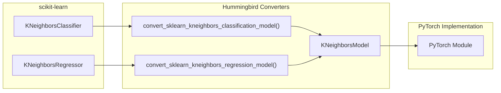
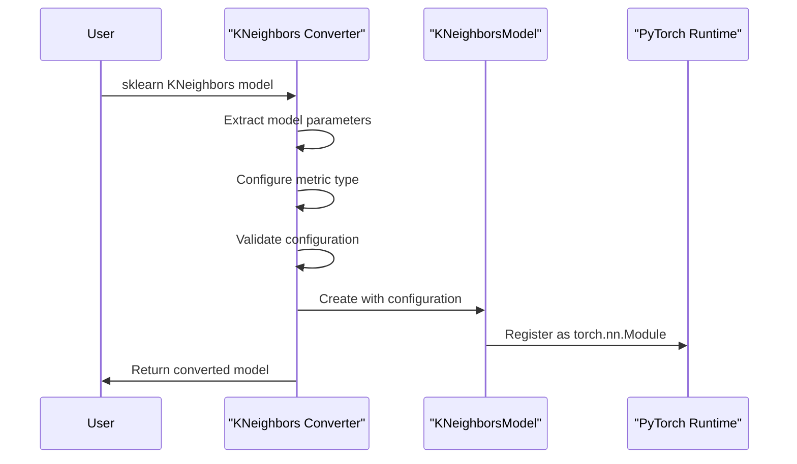
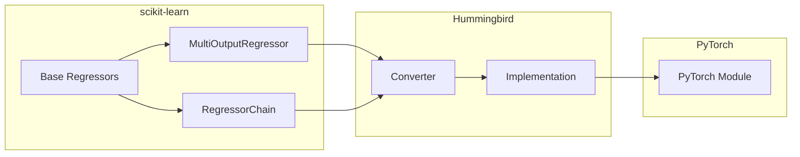

<!-- source: DeepWiki mcp.deepwiki.com · repo microsoft/hummingbird · extra page K-Neighbors and Other Converters · fetched 2026-10-26 -->

# K-Neighbors and Other Converters

<details>
<summary>Relevant source files</summary>

The following files were used as context for generating this wiki page:

- [hummingbird/ml/operator_converters/_kneighbors_implementations.py](hummingbird/ml/operator_converters/_kneighbors_implementations.py)
- [hummingbird/ml/operator_converters/sklearn/kneighbors.py](hummingbird/ml/operator_converters/sklearn/kneighbors.py)
- [tests/test_sklearn_kneighbors.py](tests/test_sklearn_kneighbors.py)
- [tests/test_sklearn_multioutput_regression.py](tests/test_sklearn_multioutput_regression.py)

</details>


This page documents the implementation of K-Neighbors models and other specialized converters in Hummingbird. These converters transform scikit-learn's neighbor-based models and multi-output models into equivalent PyTorch implementations for accelerated inference.

For information about other types of converters such as tree-based models, see [Tree-based Model Converters](#4.1.2), or for preprocessing operations, see [Preprocessing Converters](#4.1.3).

## K-Neighbors Models Overview

Hummingbird supports the conversion of the following scikit-learn neighbor-based models:

- `KNeighborsClassifier`: For classification tasks
- `KNeighborsRegressor`: For regression tasks, including multi-output regression

The converter transforms these models into PyTorch implementations while maintaining their prediction behavior.



Sources: [hummingbird/ml/operator_converters/sklearn/kneighbors.py:19-48](), [hummingbird/ml/operator_converters/_kneighbors_implementations.py:25-147]()

## K-Neighbors Conversion Process

The conversion of K-Neighbors models follows these steps:

1. The model's parameters (training data, labels, metrics, weights) are extracted
2. Distance metrics and their parameters are validated and configured
3. A `KNeighborsModel` instance is created with the appropriate configuration
4. The model is registered as a PyTorch module



Sources: [hummingbird/ml/operator_converters/sklearn/kneighbors.py:51-131]()

## Supported Configurations

### Distance Metrics

Hummingbird supports the following distance metrics for K-Neighbors models:

| Metric Type | Description | Parameters |
|-------------|-------------|------------|
| minkowski | Minkowski distance (p-norm) | p: power parameter (default=2) |
| euclidean | Euclidean distance (L2 norm) | None (equivalent to minkowski with p=2) |
| manhattan | Manhattan distance (L1 norm) | None (equivalent to minkowski with p=1) |
| chebyshev | Chebyshev distance (L∞ norm) | None (equivalent to minkowski with p=inf) |
| wminkowski | Weighted Minkowski distance | p: power parameter, w: weight vector |
| seuclidean | Standardized Euclidean distance | V: variance vector |
| mahalanobis | Mahalanobis distance | VI: inverse covariance matrix |

These metrics are implemented as an enum `MetricType` and handled in the `KNeighborsModel` class.

Sources: [hummingbird/ml/operator_converters/_kneighbors_implementations.py:18-23](), [hummingbird/ml/operator_converters/sklearn/kneighbors.py:68-106]()

### Weighting Schemes

Two weighting schemes are supported:

- `uniform`: All points in the neighborhood are weighted equally
- `distance`: Points are weighted by the inverse of their distance

Sources: [hummingbird/ml/operator_converters/sklearn/kneighbors.py:108-114](), [hummingbird/ml/operator_converters/_kneighbors_implementations.py:93-119]()

## Implementation Details

The `KNeighborsModel` class implements the K-Neighbors algorithm using PyTorch operations:

```mermaid
flowchart TD
    input["Input Data"] --> metric{"Distance Metric"}
    
    metric -->|"minkowski"| cdist1["torch.cdist(p=self.p)"]
    metric -->|"wminkowski"| cdist2["torch.cdist(self.w * x, ...)"]
    metric -->|"seuclidean"| cdist3["torch.cdist(self.V * x, ...)"]
    metric -->|"mahalanobis"| cdist4["torch.cdist(torch.mm(x, self.L), ...)"]
    
    cdist1 & cdist2 & cdist3 & cdist4 --> topk["torch.topk - Find k nearest neighbors"]
    topk --> weights{"Weighting Scheme"}
    
    weights -->|"uniform"| uniform["Equal weights"]
    weights -->|"distance"| distance["Inverse distance weights"]
    
    uniform & distance --> task{"Task Type"}
    
    task -->|"Classification"| class["Calculate class probabilities"]
    task -->|"Regression"| reg["Calculate weighted average"]
    
    class --> output1["Prediction result"]
    reg --> output2["Prediction result"]
```

Sources: [hummingbird/ml/operator_converters/_kneighbors_implementations.py:95-147]()

### Classification

For classification, the implementation:
1. Computes distances between input points and training data
2. Finds the k-nearest neighbors using `torch.topk`
3. Applies the weighting scheme
4. Computes class probabilities by aggregating neighbor votes
5. Returns both the predicted class and probability distribution

Sources: [hummingbird/ml/operator_converters/_kneighbors_implementations.py:122-133]()

### Regression

For regression, the implementation:
1. Computes distances between input points and training data
2. Finds the k-nearest neighbors using `torch.topk`
3. Applies the weighting scheme
4. Computes the weighted average of neighbor values
5. Handles both single-target and multi-target regression

Sources: [hummingbird/ml/operator_converters/_kneighbors_implementations.py:134-147]()

## Conversion Requirements

When converting K-Neighbors models, Hummingbird requires:

1. An explicit `batch_size` parameter in the `extra_config` dictionary
2. Integer class labels for classification tasks
3. Supported metric and weighting configurations

```python
# Example:
extra_config = {hummingbird.ml.operator_converters.constants.BATCH_SIZE: X.shape[0]}
torch_model = hummingbird.ml.convert(model, "torch", extra_config=extra_config)
```

Sources: [hummingbird/ml/operator_converters/sklearn/kneighbors.py:52-64](), [tests/test_sklearn_kneighbors.py:48-49]()

## Other Specialized Converters

### Multi-Output Regression Models

Hummingbird also supports the conversion of scikit-learn's multi-output models:

1. `MultiOutputRegressor`: Fits one regressor per target
2. `RegressorChain`: Fits a sequence of regressors, each using previous predictions as features



These models are supported with various base regressors:
- Decision Tree Regressors
- Random Forest Regressors
- Extra Trees Regressors
- Linear Regression models

Sources: [tests/test_sklearn_multioutput_regression.py:26-51](), [tests/test_sklearn_multioutput_regression.py:54-81]()

## Limitations and Considerations

### K-Neighbors Limitations

1. Class labels must be integers for classification
2. Only supports 'uniform' and 'distance' weighting schemes
3. Limited to specific distance metrics
4. Requires explicit batch size specification
5. The Chebyshev distance metric (p=∞) has some implementation issues in PyTorch's `cdist` function

Sources: [hummingbird/ml/operator_converters/sklearn/kneighbors.py:61-63](), [hummingbird/ml/operator_converters/sklearn/kneighbors.py:108-114](), [tests/test_sklearn_kneighbors.py:85-88]()

### Performance Considerations

The K-Neighbors implementation in Hummingbird computes distances using PyTorch's `cdist` function, which can provide acceleration on GPU hardware. However, for very large training datasets, memory usage can be a concern as the entire training set must be stored in the model.

The conversion process preserves the original model's prediction behavior while enabling GPU acceleration when available.

Sources: [hummingbird/ml/operator_converters/_kneighbors_implementations.py:96-109]()

---

