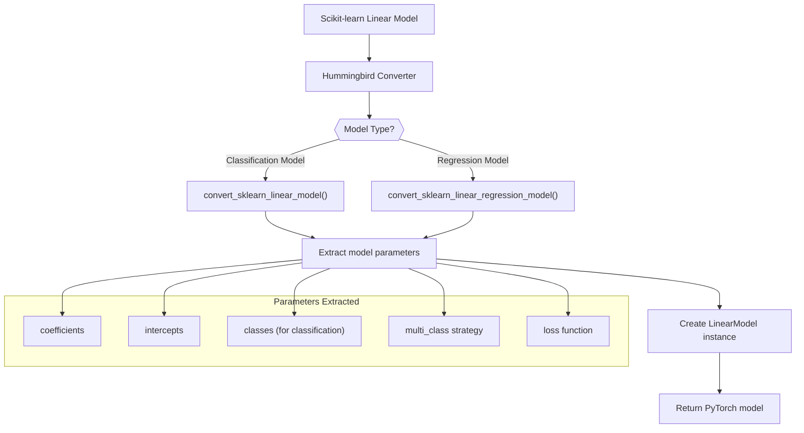
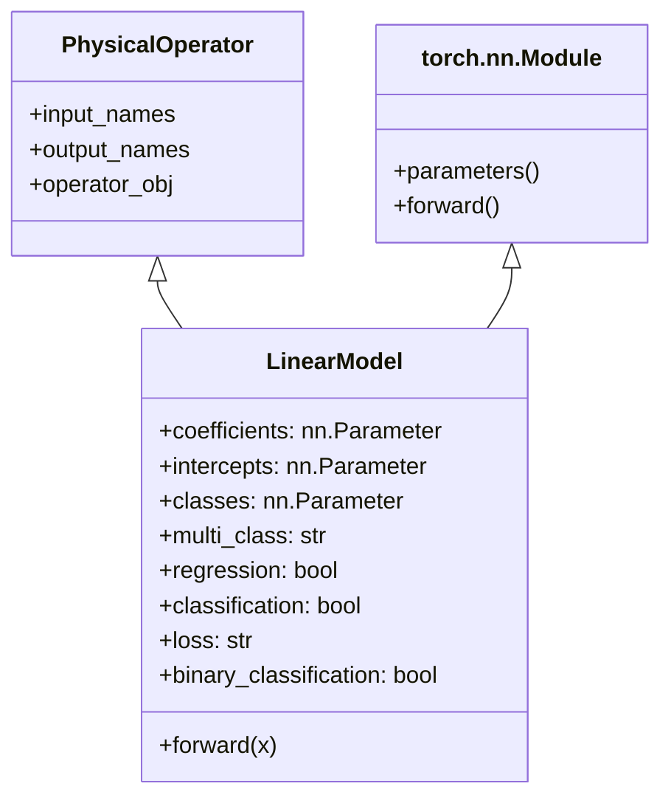
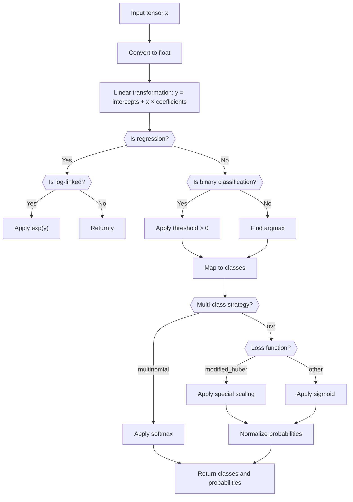

<!-- source: DeepWiki mcp.deepwiki.com · repo microsoft/hummingbird · extra page Linear Model Converters · fetched 2026-10-26 -->

# Linear Model Converters

<details>
<summary>Relevant source files</summary>

The following files were used as context for generating this wiki page:

- [hummingbird/ml/operator_converters/_linear_implementations.py](hummingbird/ml/operator_converters/_linear_implementations.py)
- [hummingbird/ml/operator_converters/sklearn/linear.py](hummingbird/ml/operator_converters/sklearn/linear.py)
- [tests/test_sklearn_linear_converter.py](tests/test_sklearn_linear_converter.py)
- [tests/test_sklearn_sv_converter.py](tests/test_sklearn_sv_converter.py)

</details>


## Purpose and Scope

This document describes how Hummingbird converts scikit-learn linear models into tensor computation frameworks for faster inference. Linear models include regression models (LinearRegression, Ridge, etc.) and classification models (LogisticRegression, LinearSVC, etc.). For information about tree-based model conversion, see [Tree-based Model Converters](#4.1.2).

## Supported Linear Models

Hummingbird supports conversion of the following scikit-learn linear models:

| Classification Models | Regression Models |
|-----------------------|-------------------|
| LogisticRegression | LinearRegression |
| LinearSVC | Ridge |
| SGDClassifier | Lasso |
| LogisticRegressionCV | ElasticNet |
|  | LinearSVR |
|  | RidgeCV |
|  | TweedieRegressor |
|  | PoissonRegressor |
|  | GammaRegressor |

Sources: [hummingbird/ml/operator_converters/sklearn/linear.py:102-114]()

## Linear Model Conversion Architecture

### Conversion Flow



Sources: [hummingbird/ml/operator_converters/sklearn/linear.py:18-99]()

The conversion process follows these steps:

1. User calls `hummingbird.ml.convert()` with a scikit-learn linear model
2. Based on the model type, Hummingbird routes to the appropriate converter
3. The converter extracts key parameters from the model:
   - Coefficients (weights)
   - Intercepts (bias terms)
   - Class labels (for classification)
   - Multi-class strategy (for multi-class classification)
   - Loss function (for models like SGDClassifier that support different losses)
4. These parameters are used to create a `LinearModel` instance
5. The `LinearModel` is returned as a PyTorch module that replicates the original model's functionality

### LinearModel Implementation



Sources: [hummingbird/ml/operator_converters/_linear_implementations.py:16-84]()

The `LinearModel` class is the core implementation that powers all converted linear models in Hummingbird. It:

1. Inherits from both `PhysicalOperator` (Hummingbird's base operator class) and `torch.nn.Module`
2. Stores model parameters as `torch.nn.Parameter` objects
3. Implements the `forward()` method for inference

## Implementation Details

### Parameter Extraction and Storage

During conversion, scikit-learn model parameters are extracted and stored as PyTorch parameters:

```python
# Coefficients are transposed to match PyTorch's matrix multiplication order
coefficients = operator.raw_operator.coef_.transpose().astype("float32")

# Intercepts are reshaped for broadcasting
intercepts = operator.raw_operator.intercept_
if np.ndim(intercepts) == 0:
    intercepts = np.array(intercepts, dtype="float32")
else:
    intercepts = intercepts.reshape(1, -1).astype("float32")
```

Sources: [hummingbird/ml/operator_converters/sklearn/linear.py:42-48](), [hummingbird/ml/operator_converters/sklearn/linear.py:86-94]()

In the `LinearModel` constructor, these parameters are wrapped as PyTorch parameters:

```python
self.coefficients = torch.nn.Parameter(torch.from_numpy(coefficients).detach().clone(), requires_grad=False)
self.intercepts = torch.nn.Parameter(torch.from_numpy(intercepts).view(-1).detach().clone(), requires_grad=False)
```

Sources: [hummingbird/ml/operator_converters/_linear_implementations.py:29-30]()

### Forward Pass Implementation



Sources: [hummingbird/ml/operator_converters/_linear_implementations.py:43-84]()

The forward pass handles different types of models:

1. For all models:
   - Convert input to float
   - Apply linear transformation (`output = intercepts + x · coefficients`)

2. For regression models:
   - If log-linked (e.g., PoissonRegressor), apply exponential function
   - Otherwise, return the raw output

3. For classification models:
   - For binary classification: apply threshold and map to classes
   - For multiclass: find argmax and map to classes
   - Calculate probabilities based on multi-class strategy and loss function
   - Return both predicted classes and probabilities

## Test Coverage and Validation

Hummingbird's test suite includes comprehensive tests for linear model converters, validating:

1. Binary and multiclass classification
2. Various loss functions (log_loss, modified_huber, hinge, etc.)
3. Different multi-class strategies (ovr, multinomial)
4. Multiple regression types
5. Support for different backends (PyTorch, TorchScript, TVM)

Tests ensure that predictions from the converted models match those from the original scikit-learn models within a small tolerance.

Sources: [tests/test_sklearn_linear_converter.py](), [tests/test_sklearn_sv_converter.py]()

## Usage Example

Here's a simple example of converting a scikit-learn LogisticRegression model:

```python
from sklearn.linear_model import LogisticRegression
import hummingbird.ml

# Create and train a scikit-learn model
model = LogisticRegression()
model.fit(X_train, y_train)

# Convert to PyTorch
torch_model = hummingbird.ml.convert(model, "torch")

# Use the converted model
predictions = torch_model.predict(X_test)
probabilities = torch_model.predict_proba(X_test)
```

The converted model faithfully reproduces the original model's predictions while potentially offering better performance through GPU acceleration and batch processing.

Sources: [tests/test_sklearn_linear_converter.py:35-54]()

## Supported Loss Functions

For SGDClassifier, the following loss functions are supported:

- `log_loss`: Logistic regression loss
- `modified_huber`: Modified Huber loss for classification
- `squared_hinge`: Squared hinge loss
- `hinge`: Hinge loss
- `huber`: Huber loss
- `perceptron`: Perceptron loss
- `epsilon_insensitive`: Epsilon-insensitive loss
- `squared_error`: Squared error loss
- `squared_epsilon_insensitive`: Squared epsilon-insensitive loss

Sources: [hummingbird/ml/operator_converters/sklearn/linear.py:34](), [tests/test_sklearn_linear_converter.py:308-686]()

## Limitations

1. Class labels must be integers. Non-integer labels will raise a RuntimeError during conversion.
2. Only specific loss functions are supported for SGDClassifier.

Sources: [hummingbird/ml/operator_converters/sklearn/linear.py:37-40](), [hummingbird/ml/operator_converters/sklearn/linear.py:61-65]()

---

