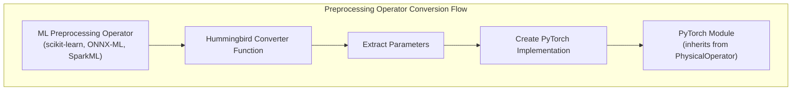
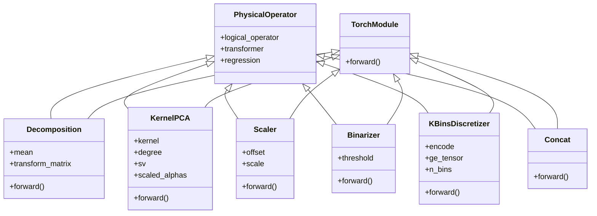
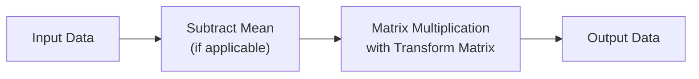
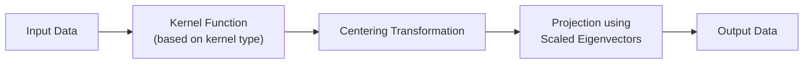
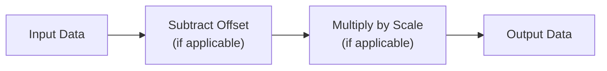
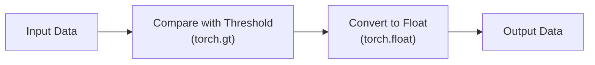
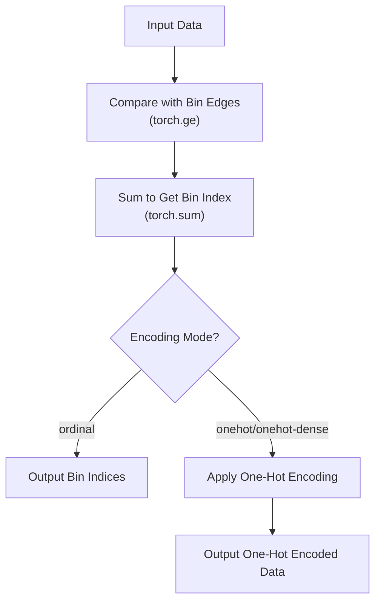
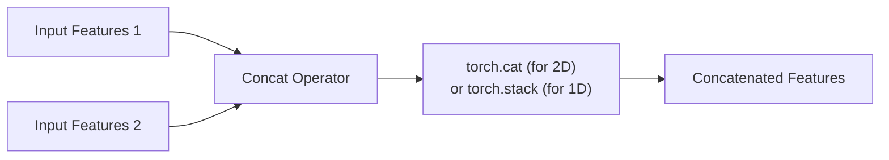
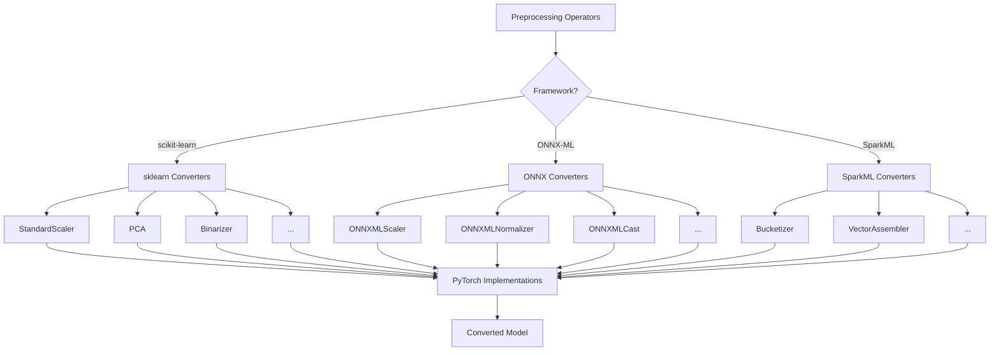
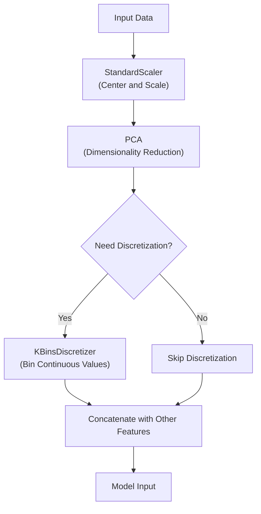

<!-- source: DeepWiki mcp.deepwiki.com · repo microsoft/hummingbird · extra page Preprocessing Converters · fetched 2026-10-26 -->

# Preprocessing Converters

<details>
<summary>Relevant source files</summary>

The following files were used as context for generating this wiki page:

- [hummingbird/ml/operator_converters/_decomposition_implementations.py](hummingbird/ml/operator_converters/_decomposition_implementations.py)
- [hummingbird/ml/operator_converters/_discretizer_implementations.py](hummingbird/ml/operator_converters/_discretizer_implementations.py)
- [hummingbird/ml/operator_converters/_pipeline_implementations.py](hummingbird/ml/operator_converters/_pipeline_implementations.py)
- [hummingbird/ml/operator_converters/_scaler_implementations.py](hummingbird/ml/operator_converters/_scaler_implementations.py)
- [hummingbird/ml/operator_converters/onnx/onnx_operator.py](hummingbird/ml/operator_converters/onnx/onnx_operator.py)
- [hummingbird/ml/operator_converters/onnx/sv.py](hummingbird/ml/operator_converters/onnx/sv.py)
- [hummingbird/ml/operator_converters/sklearn/decomposition.py](hummingbird/ml/operator_converters/sklearn/decomposition.py)
- [hummingbird/ml/operator_converters/sklearn/discretizer.py](hummingbird/ml/operator_converters/sklearn/discretizer.py)
- [hummingbird/ml/operator_converters/sklearn/pipeline.py](hummingbird/ml/operator_converters/sklearn/pipeline.py)
- [hummingbird/ml/operator_converters/sklearn/sv.py](hummingbird/ml/operator_converters/sklearn/sv.py)
- [hummingbird/ml/operator_converters/sparkml/discretizer.py](hummingbird/ml/operator_converters/sparkml/discretizer.py)
- [hummingbird/ml/operator_converters/sparkml/vector_assembler.py](hummingbird/ml/operator_converters/sparkml/vector_assembler.py)
- [tests/test_onnxml_linear_converter.py](tests/test_onnxml_linear_converter.py)
- [tests/test_onnxml_normalizer_converter.py](tests/test_onnxml_normalizer_converter.py)
- [tests/test_onnxml_scaler_converter.py](tests/test_onnxml_scaler_converter.py)
- [tests/test_onnxml_sv_converter.py](tests/test_onnxml_sv_converter.py)
- [tests/test_sklearn_decomposition.py](tests/test_sklearn_decomposition.py)
- [tests/test_sklearn_discretizer_converters.py](tests/test_sklearn_discretizer_converters.py)
- [tests/test_sklearn_model_selection.py](tests/test_sklearn_model_selection.py)
- [tests/test_sklearn_normalizer_converter.py](tests/test_sklearn_normalizer_converter.py)

</details>


## Purpose and Scope

This document covers the preprocessing converters in Hummingbird, which transform data preprocessing operators from traditional machine learning frameworks (scikit-learn, ONNX-ML, SparkML) into tensor computation-based equivalents. Preprocessing operations are essential parts of machine learning pipelines that prepare raw data for model training and inference.

Preprocessing converters in Hummingbird handle operations such as:
- Matrix decomposition (PCA, FastICA, etc.)
- Normalization and scaling
- Discretization
- Feature extraction and transformation

For details on model conversion, see [Operator Converters](#4.1) and for specifics on tree-based or linear models, refer to [Tree-based Model Converters](#4.1.2) and [Linear Model Converters](#4.1.1) respectively.

## Conversion Architecture

Preprocessing converters follow Hummingbird's general conversion pattern, where an original preprocessing operator is transformed into a PyTorch implementation that maintains the same behavior but leverages tensor operations for improved performance.



Sources: [hummingbird/ml/operator_converters/sklearn/decomposition.py](hummingbird/ml/operator_converters/sklearn/decomposition.py), [hummingbird/ml/operator_converters/_scaler_implementations.py](hummingbird/ml/operator_converters/_scaler_implementations.py)

The conversion process has two main components:
1. **Converter functions**: Register handlers for specific preprocessing operators
2. **Implementation classes**: Define the tensor-based implementations

## Supported Preprocessing Categories

Hummingbird supports the following categories of preprocessing operations:



Sources: [hummingbird/ml/operator_converters/_decomposition_implementations.py](hummingbird/ml/operator_converters/_decomposition_implementations.py), [hummingbird/ml/operator_converters/_scaler_implementations.py](hummingbird/ml/operator_converters/_scaler_implementations.py), [hummingbird/ml/operator_converters/_discretizer_implementations.py](hummingbird/ml/operator_converters/_discretizer_implementations.py)

## Matrix Decomposition Converters

Matrix decomposition techniques reduce the dimensionality of data while preserving important information. Hummingbird supports several matrix decomposition techniques from scikit-learn.

### Supported Decomposition Techniques

| Technique | Original Class | Implementation Class |
|-----------|----------------|----------------------|
| PCA | `sklearn.decomposition.PCA` | `Decomposition` |
| Kernel PCA | `sklearn.decomposition.KernelPCA` | `KernelPCA` |
| FastICA | `sklearn.decomposition.FastICA` | `Decomposition` |
| TruncatedSVD | `sklearn.decomposition.TruncatedSVD` | `Decomposition` |
| PLS Regression | `sklearn.cross_decomposition.PLSRegression` | `CrossDecomposition` |

### Implementation Details

The matrix decomposition converters translate the fitted parameters from scikit-learn models into PyTorch tensors and operations:

1. **PCA, FastICA, TruncatedSVD**: Use the `Decomposition` class that performs the operation by applying a transformation matrix (and optionally subtracting the mean).



2. **KernelPCA**: Implements different kernel functions (linear, poly, rbf, sigmoid, cosine) as PyTorch operations.



Sources: [hummingbird/ml/operator_converters/_decomposition_implementations.py](hummingbird/ml/operator_converters/_decomposition_implementations.py), [hummingbird/ml/operator_converters/sklearn/decomposition.py](hummingbird/ml/operator_converters/sklearn/decomposition.py)

## Normalizers and Scalers

Normalization and scaling are common preprocessing techniques that transform features to have specific statistical properties.

### Normalizers

Normalizers scale input vectors to unit norm. Hummingbird supports L1, L2, and Max normalization from scikit-learn and ONNX-ML.

The conversion process extracts the norm type and implements the normalization using PyTorch operations:
- L1 norm: Dividing by the sum of absolute values
- L2 norm: Dividing by the Euclidean length
- Max norm: Dividing by the maximum absolute value

### Scalers

Scalers transform features by scaling to a specific range or by standardizing:

| Scaler | Original Class | Purpose |
|--------|----------------|---------|
| StandardScaler | `sklearn.preprocessing.StandardScaler` | Zero mean and unit variance |
| RobustScaler | `sklearn.preprocessing.RobustScaler` | Robust to outliers using quantiles |
| MaxAbsScaler | `sklearn.preprocessing.MaxAbsScaler` | Scale by maximum absolute value |
| MinMaxScaler | `sklearn.preprocessing.MinMaxScaler` | Scale to a specific range |

Implementation is done through the `Scaler` class, which follows this pattern:



Sources: [hummingbird/ml/operator_converters/_scaler_implementations.py](hummingbird/ml/operator_converters/_scaler_implementations.py), [tests/test_sklearn_normalizer_converter.py](tests/test_sklearn_normalizer_converter.py), [tests/test_onnxml_scaler_converter.py](tests/test_onnxml_scaler_converter.py)

## Discretizers

Discretizers convert continuous features into discrete ones, which can be beneficial for certain algorithms.

### Supported Discretizers

Hummingbird supports the following discretizers:

| Discretizer | Original Class | Framework | Purpose |
|-------------|----------------|-----------|---------|
| Binarizer | `sklearn.preprocessing.Binarizer` | scikit-learn | Binarize data using a threshold |
| KBinsDiscretizer | `sklearn.preprocessing.KBinsDiscretizer` | scikit-learn | Bin values into k discrete bins |
| Bucketizer | `pyspark.ml.feature.Bucketizer` | SparkML | Bin values based on splits |

### Implementation Details

1. **Binarizer**: Implements a simple threshold function using PyTorch's comparison operations:



2. **KBinsDiscretizer**: Supports 'ordinal', 'onehot', and 'onehot-dense' encoding modes:



Sources: [hummingbird/ml/operator_converters/_discretizer_implementations.py](hummingbird/ml/operator_converters/_discretizer_implementations.py), [hummingbird/ml/operator_converters/sklearn/discretizer.py](hummingbird/ml/operator_converters/sklearn/discretizer.py), [tests/test_sklearn_discretizer_converters.py](tests/test_sklearn_discretizer_converters.py)

## Pipeline Integration

Preprocessing operators are often used in pipelines, where multiple transformations are applied sequentially. Hummingbird provides special operators to handle pipeline integration.

### Pipeline Components

| Component | Purpose |
|-----------|---------|
| Concat | Concatenate outputs from multiple transformers |
| ArrayFeatureExtractor | Extract specific features by index |
| Multiply | Multiply features by a score (for weighted features) |

The `Concat` operator is particularly important as it allows for joining features from different preprocessing steps:



Sources: [hummingbird/ml/operator_converters/_pipeline_implementations.py](hummingbird/ml/operator_converters/_pipeline_implementations.py), [hummingbird/ml/operator_converters/sklearn/pipeline.py](hummingbird/ml/operator_converters/sklearn/pipeline.py)

## Cross-Framework Support

Hummingbird preprocessing converters work with multiple machine learning frameworks, allowing for interoperability.



### Operator Registration System

The converter functions are registered using a registration system that maps operator types to their appropriate converters. For example:

```python
register_converter("SklearnPCA", convert_sklearn_pca)
register_converter("SklearnBinarizer", convert_sklearn_binarizer)
register_converter("ONNXMLScaler", convert_onnx_scaler)
```

This system allows Hummingbird to automatically select the correct converter based on the input operator type.

Sources: [hummingbird/ml/operator_converters/sklearn/decomposition.py:149-153](hummingbird/ml/operator_converters/sklearn/decomposition.py:149-153), [hummingbird/ml/operator_converters/sklearn/discretizer.py:66-67](hummingbird/ml/operator_converters/sklearn/discretizer.py:66-67), [hummingbird/ml/operator_converters/onnx/onnx_operator.py:454-466](hummingbird/ml/operator_converters/onnx/onnx_operator.py:454-466)

## Performance Considerations

Converting preprocessing operators to tensor-based implementations offers several benefits:

1. **Parallelization**: Operations are automatically parallelized on GPUs when available
2. **Batching**: Efficient processing of batches of data
3. **Integration**: Seamless integration with deep learning models
4. **Optimization**: PyTorch's optimization capabilities for tensor operations

For example, the KernelPCA implementation leverages efficient matrix operations in PyTorch to compute kernel matrices, which can be significantly faster than the original numpy-based implementation in scikit-learn when using GPU acceleration.

## Example Flow with Multiple Preprocessing Steps

This diagram illustrates how multiple preprocessing converters work together in a complete pipeline:



Sources: [hummingbird/ml/operator_converters/_pipeline_implementations.py](hummingbird/ml/operator_converters/_pipeline_implementations.py), [hummingbird/ml/operator_converters/_decomposition_implementations.py](hummingbird/ml/operator_converters/_decomposition_implementations.py), [hummingbird/ml/operator_converters/_discretizer_implementations.py](hummingbird/ml/operator_converters/_discretizer_implementations.py)

## Extensibility

Hummingbird's preprocessing converter system is designed to be extensible. To add support for a new preprocessing operator, you need to:

1. Create a PyTorch implementation class that inherits from `PhysicalOperator` and `torch.nn.Module`
2. Create a converter function that extracts parameters from the original operator
3. Register the converter using `register_converter`

This design allows for the addition of new preprocessing operators as machine learning frameworks evolve.

---

