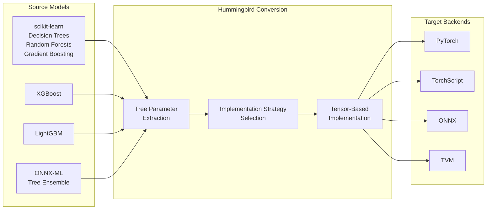
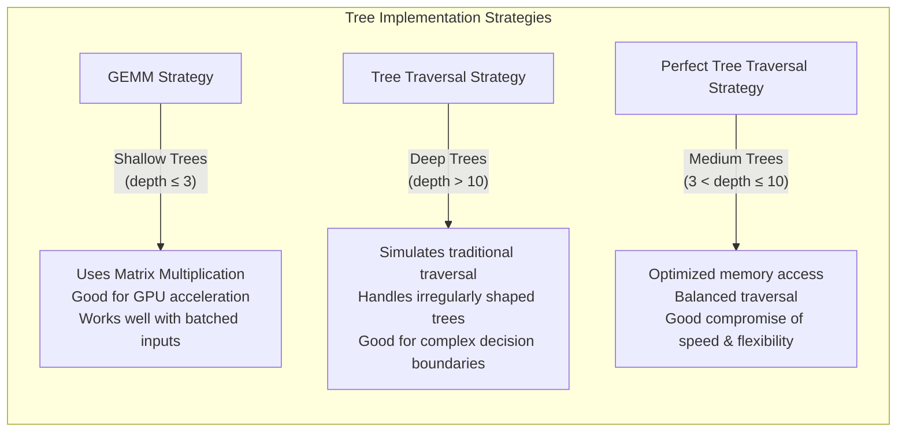
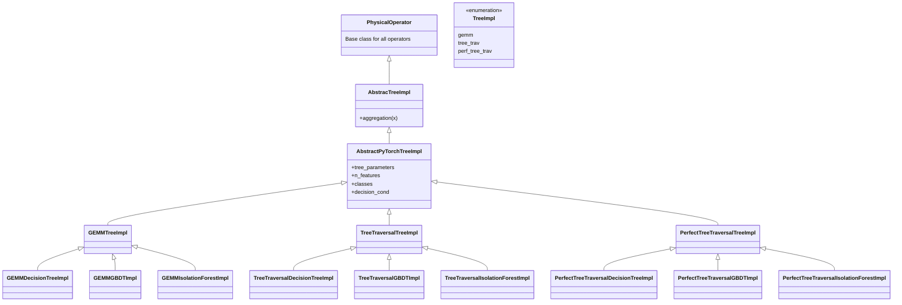
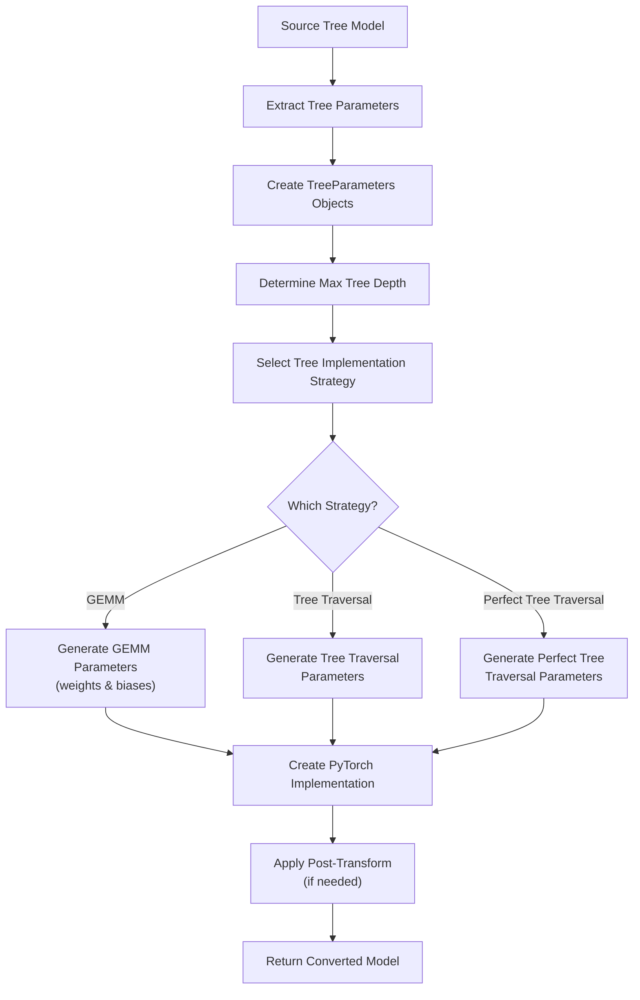
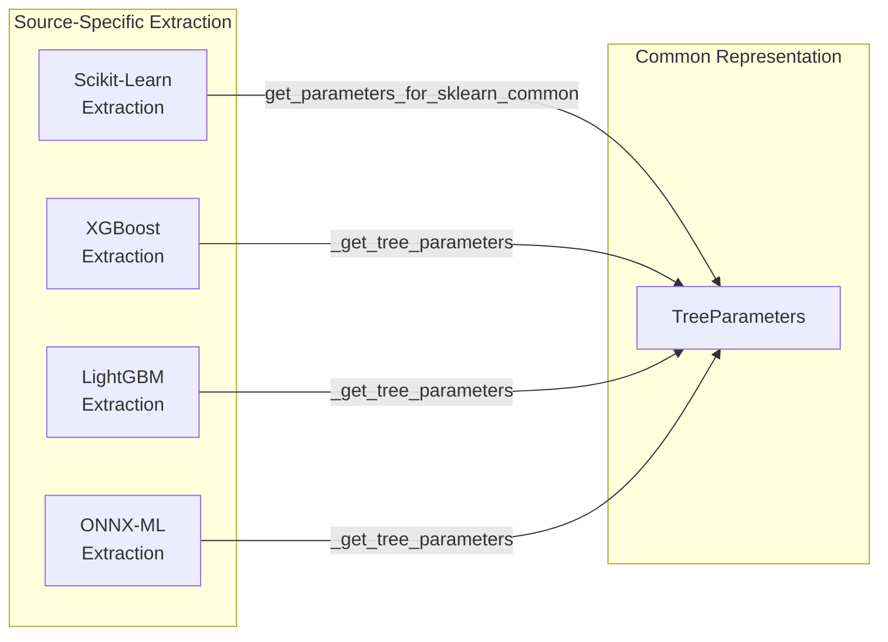
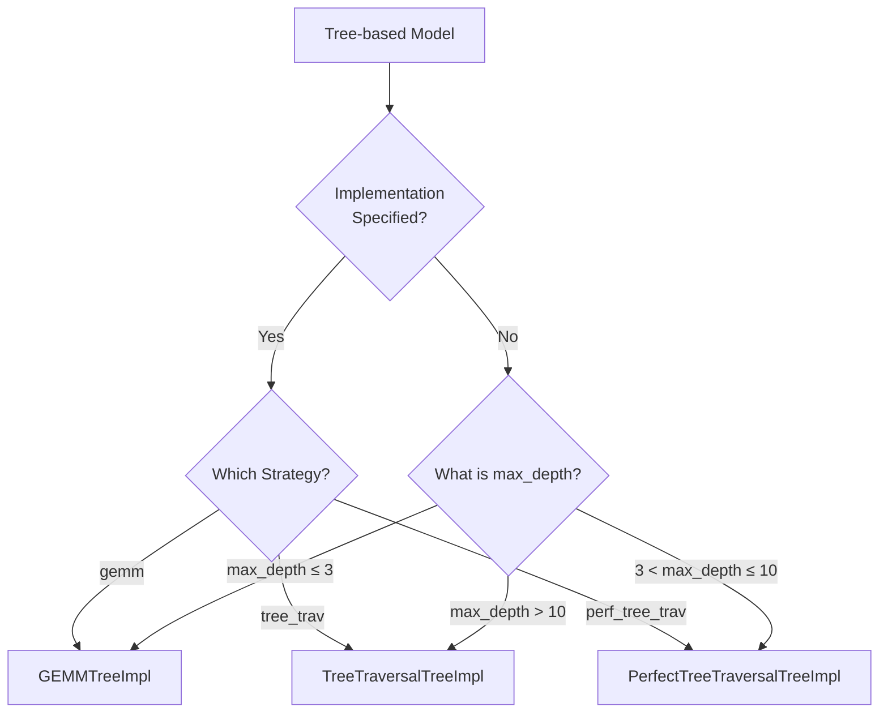
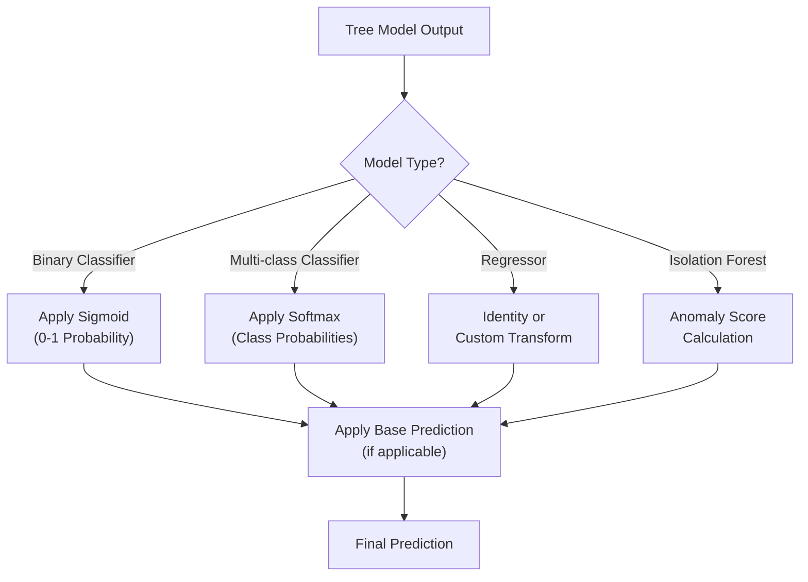
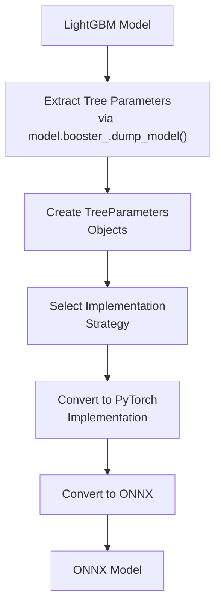
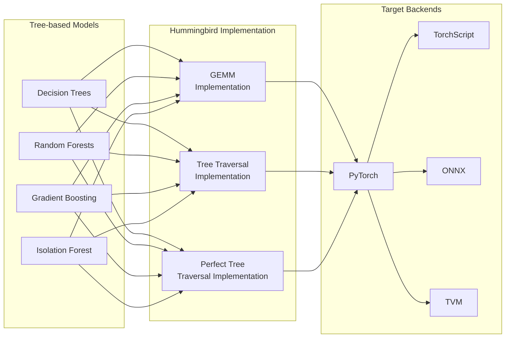

<!-- source: DeepWiki mcp.deepwiki.com · repo microsoft/hummingbird · extra page Tree-based Model Converters · fetched 2026-10-26 -->

# Tree-based Model Converters

<details>
<summary>Relevant source files</summary>

The following files were used as context for generating this wiki page:

- [hummingbird/ml/operator_converters/_gbdt_commons.py](hummingbird/ml/operator_converters/_gbdt_commons.py)
- [hummingbird/ml/operator_converters/_tree_commons.py](hummingbird/ml/operator_converters/_tree_commons.py)
- [hummingbird/ml/operator_converters/_tree_implementations.py](hummingbird/ml/operator_converters/_tree_implementations.py)
- [hummingbird/ml/operator_converters/lightgbm.py](hummingbird/ml/operator_converters/lightgbm.py)
- [hummingbird/ml/operator_converters/onnx/tree_ensemble.py](hummingbird/ml/operator_converters/onnx/tree_ensemble.py)
- [hummingbird/ml/operator_converters/sklearn/decision_tree.py](hummingbird/ml/operator_converters/sklearn/decision_tree.py)
- [hummingbird/ml/operator_converters/sklearn/gbdt.py](hummingbird/ml/operator_converters/sklearn/gbdt.py)
- [hummingbird/ml/operator_converters/sklearn/iforest.py](hummingbird/ml/operator_converters/sklearn/iforest.py)
- [hummingbird/ml/operator_converters/xgb.py](hummingbird/ml/operator_converters/xgb.py)
- [notebooks/LGBM-ONNX-example.ipynb](notebooks/LGBM-ONNX-example.ipynb)
- [notebooks/LGBM-ONNXML-example.ipynb](notebooks/LGBM-ONNXML-example.ipynb)
- [tests/test_lightgbm_converter.py](tests/test_lightgbm_converter.py)
- [tests/test_onnxml_decision_tree_converter.py](tests/test_onnxml_decision_tree_converter.py)
- [tests/test_sklearn_decision_tree_converter.py](tests/test_sklearn_decision_tree_converter.py)
- [tests/test_sklearn_gbdt_converter.py](tests/test_sklearn_gbdt_converter.py)
- [tests/test_sklearn_isolation_forest_converter.py](tests/test_sklearn_isolation_forest_converter.py)
- [tests/test_sklearn_scaler_converter.py](tests/test_sklearn_scaler_converter.py)
- [tests/test_xgboost_converter.py](tests/test_xgboost_converter.py)

</details>


This page documents the tree-based model converters in Hummingbird, which transform decision trees, random forests, gradient boosting, and other tree-based models from traditional ML frameworks into PyTorch/ONNX tensor computation for faster inference. This is a core component of Hummingbird's ability to accelerate tree-based models by leveraging hardware acceleration capabilities of neural network frameworks.

For information about linear model converters, see [Linear Model Converters](#4.1.1). For information about preprocessing converters, see [Preprocessing Converters](#4.1.3).

## Overview

Tree-based models (e.g., Decision Trees, Random Forests, Gradient Boosting) are very popular in traditional machine learning but typically execute inference using CPU-optimized code. Hummingbird converts these models into tensor operations that can be efficiently executed on modern hardware like GPUs or specialized ML accelerators.



Sources: [hummingbird/ml/operator_converters/_tree_commons.py](), [hummingbird/ml/operator_converters/_tree_implementations.py]()

## Tree Implementation Strategies

Hummingbird offers three different strategies for implementing tree-based models as neural networks, each with different performance characteristics depending on the tree structure:

### 1. GEMM (General Matrix Multiplication)

The GEMM strategy converts tree decisions into matrix operations, which is efficient on GPUs for shallow trees (typically depth ≤ 3).

### 2. Tree Traversal

The Tree Traversal strategy simulates the traditional tree traversal algorithm using tensor operations. This approach is generally better for very deep trees (depth > 10).

### 3. Perfect Tree Traversal

The Perfect Tree Traversal strategy is optimized for trees of moderate depth (between 3 and 10), using an approach that assumes a perfectly balanced tree structure for more efficient memory access.



Sources: [hummingbird/ml/operator_converters/_tree_implementations.py:14-32](), [hummingbird/ml/operator_converters/_tree_commons.py:181-207]()

## Tree Implementation Class Hierarchy

Hummingbird implements a comprehensive class hierarchy for tree-based models, with specialized implementations for different model types:



Sources: [hummingbird/ml/operator_converters/_tree_implementations.py:30-183](), [hummingbird/ml/operator_converters/_tree_implementations.py:458-630]()

## Conversion Process

The conversion of tree-based models follows a structured process:



Sources: [hummingbird/ml/operator_converters/_tree_commons.py:210-228](), [hummingbird/ml/operator_converters/_tree_commons.py:443-473](), [hummingbird/ml/operator_converters/_gbdt_commons.py:68-183]()

## Tree Parameters Extraction

The first step in converting a tree-based model is extracting its parameters. Hummingbird uses a common internal representation called `TreeParameters` which contains:

- `lefts`: The indices of left child nodes
- `rights`: The indices of right child nodes
- `features`: The feature indices used for decisions at each node
- `thresholds`: The threshold values for each decision
- `values`: The output values at leaf nodes

This extraction process varies by the source model framework:



Sources: [hummingbird/ml/operator_converters/_tree_commons.py:21-63](), [hummingbird/ml/operator_converters/xgb.py:62-81](), [hummingbird/ml/operator_converters/lightgbm.py:42-53](), [hummingbird/ml/operator_converters/onnx/tree_ensemble.py:19-180]()

## Implementation Strategy Selection

The choice of tree implementation strategy is determined by either explicit configuration or heuristics based on tree depth:



Sources: [hummingbird/ml/operator_converters/_tree_commons.py:181-207]()

## Specialized Implementations

### Decision Trees and Random Forests

These implementations focus on single tree prediction or averaging predictions from multiple trees:

```python
# Decision Tree (simplified representation)
class GEMMDecisionTreeImpl:
    def aggregation(self, x):
        # Sum over all trees (for random forest)
        return x.sum(0).t()

class TreeTraversalDecisionTreeImpl:
    def aggregation(self, x):
        # Sum over all trees (for random forest)
        return x.sum(1)
```

Sources: [hummingbird/ml/operator_converters/sklearn/decision_tree.py:19-135](), [hummingbird/ml/operator_converters/_tree_implementations.py:458-527]()

### Gradient Boosting Models

These implementations handle the additive nature of gradient boosting models and apply appropriate post-transforms:

```python
# GBDT (simplified representation)
class GEMMGBDTImpl:
    def aggregation(self, x):
        # Sum tree predictions by class
        output = x.view(-1, self.n_gbdt_classes, self.n_trees_per_class).sum(2)
        # Apply sigmoid, softmax, etc.
        return self.post_transform(output)
```

Sources: [hummingbird/ml/operator_converters/_gbdt_commons.py:28-183](), [hummingbird/ml/operator_converters/_tree_implementations.py:531-630]()

### Isolation Forest

These implementations calculate anomaly scores:

```python
# Isolation Forest (simplified representation)
class GEMMIsolationForestImpl:
    def aggregation(self, x):
        output = x.sum(0).t()
        # Normalize and calculate anomaly score
        output = -1.0 * 2 ** (-output / self.average_path_length) - self.offset
        return output
```

Sources: [hummingbird/ml/operator_converters/sklearn/iforest.py:24-261]()

## Post-Transform Operations

After converting tree models, Hummingbird applies appropriate post-transforms based on the model type:

1. For binary classification: Sigmoid transformation
2. For multi-class classification: Softmax transformation
3. For regression: Identity or custom transformations (e.g., for Tweedie models)
4. For base prediction adjustment: Adding the initial prediction value



Sources: [hummingbird/ml/operator_converters/_tree_commons.py:65-122](), [hummingbird/ml/operator_converters/_gbdt_commons.py:127-169]()

## Supported Models

Hummingbird can convert the following tree-based models:

| Model Type | Frameworks Supported | Implementation Strategies |
|------------|----------------------|---------------------------|
| Decision Trees | scikit-learn, ONNX-ML | GEMM, Tree Traversal, Perfect Tree Traversal |
| Random Forests | scikit-learn, ONNX-ML | GEMM, Tree Traversal, Perfect Tree Traversal |
| Gradient Boosting | scikit-learn, LightGBM, XGBoost, ONNX-ML | GEMM, Tree Traversal, Perfect Tree Traversal |
| Isolation Forest | scikit-learn | GEMM, Tree Traversal, Perfect Tree Traversal |

Sources: [hummingbird/ml/operator_converters/sklearn/decision_tree.py:130-135](), [hummingbird/ml/operator_converters/lightgbm.py:126-129](), [hummingbird/ml/operator_converters/xgb.py:154-156](), [hummingbird/ml/operator_converters/sklearn/iforest.py:265](), [hummingbird/ml/operator_converters/onnx/tree_ensemble.py:262-263]()

## Performance Considerations

Tree-based model conversion offers several performance advantages:

1. **Hardware Acceleration**: Converting tree-based models to tensor operations enables GPU acceleration
2. **Implementation Strategy Selection**: The optimal strategy varies by tree complexity:
   - GEMM: Best for shallow trees (depth ≤ 3), excellent on GPUs
   - Perfect Tree Traversal: Best for medium trees (3 < depth ≤ 10)
   - Tree Traversal: Best for deep trees (depth > 10)
3. **Precision Control**: Control numerical precision using `tree_op_precision_dtype` in `extra_config`:
   ```python
   extra_config = {constants.TREE_OP_PRECISION_DTYPE: "float64"}
   ```

Sources: [hummingbird/ml/operator_converters/_tree_implementations.py:97-106](), [tests/test_lightgbm_converter.py:464-469]()

## Example: Converting a Tree-based Model

Here's how conversion of a LightGBM model to ONNX works:



Example code:
```python
import numpy as np
import lightgbm as lgb
from hummingbird.ml import convert

# Create a LightGBM model
model = lgb.LGBMClassifier()
X = np.random.rand(1000, 28).astype(np.float32)
y = np.random.randint(2, size=1000)
model.fit(X, y)

# Convert to ONNX via Hummingbird
onnx_model = convert(model, "onnx")
```

Sources: [notebooks/LGBM-ONNX-example.ipynb:16-76]()

## Customization Options

Tree model converters support several customization options via `extra_config`:

| Option | Description | Possible Values |
|--------|-------------|-----------------|
| `tree_implementation` | Force a specific implementation strategy | `"gemm"`, `"tree_trav"`, `"perf_tree_trav"` |
| `tree_op_precision_dtype` | Set numerical precision | `"float32"`, `"float64"` |
| `post_transform` | Override default post-transform | `None`, `"SIGMOID"`, `"SOFTMAX"`, `"TWEEDIE"` |
| `base_prediction` | Specify a base prediction value | Float or array |

Sources: [hummingbird/ml/operator_converters/_tree_commons.py:181-207](), [hummingbird/ml/operator_converters/_tree_implementations.py:97-112](), [hummingbird/ml/operator_converters/_gbdt_commons.py:148-169]()

## Integration with Backends

Tree-based models can be converted to multiple backends:



Sources: [tests/test_lightgbm_converter.py:348-444](), [tests/test_xgboost_converter.py:292-338](), [tests/test_sklearn_isolation_forest_converter.py:107-126]()

## Summary

Hummingbird's tree-based model converters provide a sophisticated system for transforming traditional tree models into tensor-based operations. By offering multiple implementation strategies and backend targets, it allows for significant performance improvements through hardware acceleration while maintaining prediction accuracy. The conversion process handles a wide variety of tree-based models and provides customization options to optimize for specific use cases.

---

