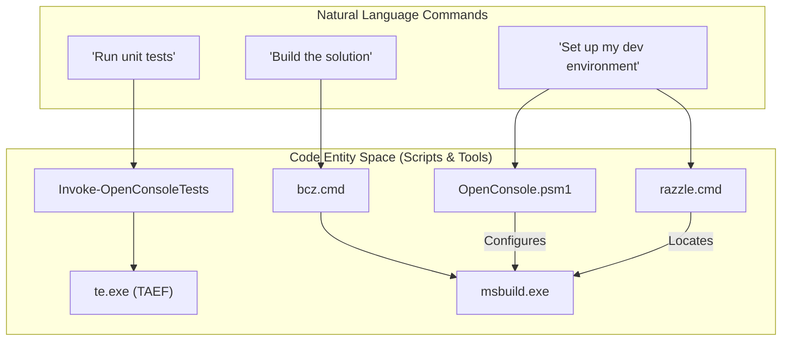
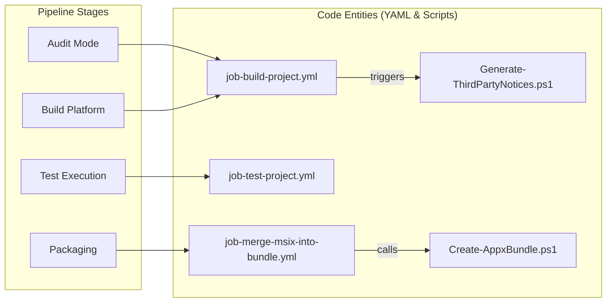

<!-- source: DeepWiki mcp.deepwiki.com · repo microsoft/intelligent-terminal · page 1.1 Getting Started: Installation and Building · fetched 2026-10-26 -->

# Getting Started: Installation and Building

<details>
<summary>Relevant source files</summary>

The following files were used as context for generating this wiki page:

- [.cargo/config.toml](.cargo/config.toml)
- [.github/copilot-instructions.md](.github/copilot-instructions.md)
- [.github/workflows/spelling2.yml](.github/workflows/spelling2.yml)
- [Directory.Build.props](Directory.Build.props)
- [Directory.Build.targets](Directory.Build.targets)
- [build/Helix/ConvertWttLogToXUnit.ps1](build/Helix/ConvertWttLogToXUnit.ps1)
- [build/Helix/HelixTestHelpers.cs](build/Helix/HelixTestHelpers.cs)
- [build/Helix/OutputTestErrorsForAzureDevops.ps1](build/Helix/OutputTestErrorsForAzureDevops.ps1)
- [build/config/GitCheckin.json](build/config/GitCheckin.json)
- [build/config/release.gdnbaselines](build/config/release.gdnbaselines)
- [build/config/tsa.json](build/config/tsa.json)
- [build/pipelines/1espt-nightly.yml](build/pipelines/1espt-nightly.yml)
- [build/pipelines/ci-caching.yml](build/pipelines/ci-caching.yml)
- [build/pipelines/ci.yml](build/pipelines/ci.yml)
- [build/pipelines/ob-nightly.yml](build/pipelines/ob-nightly.yml)
- [build/pipelines/ob-release.yml](build/pipelines/ob-release.yml)
- [build/pipelines/pgo.yml](build/pipelines/pgo.yml)
- [build/pipelines/templates-v2/job-build-package-wpf.yml](build/pipelines/templates-v2/job-build-package-wpf.yml)
- [build/pipelines/templates-v2/job-build-project.yml](build/pipelines/templates-v2/job-build-project.yml)
- [build/pipelines/templates-v2/job-merge-msix-into-bundle.yml](build/pipelines/templates-v2/job-merge-msix-into-bundle.yml)
- [build/pipelines/templates-v2/job-package-conpty.yml](build/pipelines/templates-v2/job-package-conpty.yml)
- [build/pipelines/templates-v2/job-pgo-build-nuget-and-publish.yml](build/pipelines/templates-v2/job-pgo-build-nuget-and-publish.yml)
- [build/pipelines/templates-v2/job-publish-symbols-using-symbolrequestprod-api.yml](build/pipelines/templates-v2/job-publish-symbols-using-symbolrequestprod-api.yml)
- [build/pipelines/templates-v2/job-publish-symbols.yml](build/pipelines/templates-v2/job-publish-symbols.yml)
- [build/pipelines/templates-v2/job-run-pgo-tests.yml](build/pipelines/templates-v2/job-run-pgo-tests.yml)
- [build/pipelines/templates-v2/job-submit-windows-vpack.yml](build/pipelines/templates-v2/job-submit-windows-vpack.yml)
- [build/pipelines/templates-v2/job-test-project.yml](build/pipelines/templates-v2/job-test-project.yml)
- [build/pipelines/templates-v2/pipeline-1espt-full-release-build.yml](build/pipelines/templates-v2/pipeline-1espt-full-release-build.yml)
- [build/pipelines/templates-v2/pipeline-full-release-build.yml](build/pipelines/templates-v2/pipeline-full-release-build.yml)
- [build/pipelines/templates-v2/pipeline-onebranch-full-release-build.yml](build/pipelines/templates-v2/pipeline-onebranch-full-release-build.yml)
- [build/pipelines/templates-v2/steps-ensure-nuget-version.yml](build/pipelines/templates-v2/steps-ensure-nuget-version.yml)
- [build/pipelines/templates-v2/steps-esrp-signing.yml](build/pipelines/templates-v2/steps-esrp-signing.yml)
- [build/pipelines/templates-v2/steps-install-terrapin.yml](build/pipelines/templates-v2/steps-install-terrapin.yml)
- [build/pipelines/templates-v2/steps-restore-nuget.yml](build/pipelines/templates-v2/steps-restore-nuget.yml)
- [build/pipelines/templates-v2/steps-setup-versioning.yml](build/pipelines/templates-v2/steps-setup-versioning.yml)
- [build/pipelines/templates-v2/variables-nuget-package-version.yml](build/pipelines/templates-v2/variables-nuget-package-version.yml)
- [build/pipelines/templates-v2/variables-onebranch-config.yml](build/pipelines/templates-v2/variables-onebranch-config.yml)
- [build/scripts/Get-DependenciesFromAppxRecipe.ps1](build/scripts/Get-DependenciesFromAppxRecipe.ps1)
- [build/scripts/New-WtaLocalInstaller.ps1](build/scripts/New-WtaLocalInstaller.ps1)
- [build/scripts/Run-Tests.ps1](build/scripts/Run-Tests.ps1)
- [build/scripts/Set-LatestVCToolsVersion.ps1](build/scripts/Set-LatestVCToolsVersion.ps1)
- [custom.props](custom.props)
- [dep/nuget/nuget.exe](dep/nuget/nuget.exe)
- [doc/building.md](doc/building.md)
- [src/cascadia/TerminalSettingsEditor/Compatibility.cpp](src/cascadia/TerminalSettingsEditor/Compatibility.cpp)
- [src/cascadia/TerminalSettingsEditor/Compatibility.h](src/cascadia/TerminalSettingsEditor/Compatibility.h)
- [src/cascadia/TerminalSettingsEditor/Compatibility.idl](src/cascadia/TerminalSettingsEditor/Compatibility.idl)
- [src/cascadia/TerminalSettingsEditor/Compatibility.xaml](src/cascadia/TerminalSettingsEditor/Compatibility.xaml)
- [src/cascadia/TerminalSettingsEditor/Extensions.xaml](src/cascadia/TerminalSettingsEditor/Extensions.xaml)
- [src/cascadia/TerminalSettingsEditor/NewTabMenu.xaml](src/cascadia/TerminalSettingsEditor/NewTabMenu.xaml)
- [src/cascadia/TerminalSettingsEditor/SearchIndex.cpp](src/cascadia/TerminalSettingsEditor/SearchIndex.cpp)
- [src/cascadia/TerminalSettingsEditor/SearchIndex.h](src/cascadia/TerminalSettingsEditor/SearchIndex.h)
- [src/cascadia/UnitTests_Control/Control.UnitTests.vcxproj](src/cascadia/UnitTests_Control/Control.UnitTests.vcxproj)
- [src/cascadia/UnitTests_Control/UnitTests_Control.def](src/cascadia/UnitTests_Control/UnitTests_Control.def)
- [src/cascadia/UnitTests_Control/pch.cpp](src/cascadia/UnitTests_Control/pch.cpp)
- [src/interactivity/onecore/SystemConfigurationProvider.cpp](src/interactivity/onecore/SystemConfigurationProvider.cpp)
- [tools/GenerateSettingsIndex.ps1](tools/GenerateSettingsIndex.ps1)
- [tools/OpenConsole.psm1](tools/OpenConsole.psm1)
- [tools/ReleaseEngineering/Draft-TerminalReleases.ps1](tools/ReleaseEngineering/Draft-TerminalReleases.ps1)
- [tools/bcz.cmd](tools/bcz.cmd)
- [tools/bx.ps1](tools/bx.ps1)
- [tools/razzle.cmd](tools/razzle.cmd)
- [tools/runft.cmd](tools/runft.cmd)
- [tools/runuia.cmd](tools/runuia.cmd)
- [tools/runut.cmd](tools/runut.cmd)
- [tools/tests.xml](tools/tests.xml)
- [tools/wta/Cargo.lock](tools/wta/Cargo.lock)
- [tools/wta/build.rs](tools/wta/build.rs)

</details>


This page provides technical instructions for installing, configuring, and building the Intelligent Terminal codebase. It covers the environment requirements, the specialized PowerShell and Cmd tooling used for development, and the structure of the Continuous Integration (CI) pipelines.

## System Requirements and Installation

Intelligent Terminal targets modern Windows environments. The primary distribution methods are the Microsoft Store and WinGet.

### Requirements
*   **Operating System**: Windows 11 22H2 (Build 22621) or higher.
*   **Architecture**: x64, x86, or ARM64.
*   **Dependencies**: The terminal utilizes `Microsoft.UI.Xaml` for its UI layer [doc/building.md:76-77]().

### Distribution Channels
*   **Microsoft Store**: The official release channel.
*   **WinGet**: Can be installed via `winget install Microsoft.IntelligentTerminal`.
*   **Unpackaged/Portable**: The build system supports a `-PortableMode` argument for Canary-branded builds [build/pipelines/templates-v2/job-build-project.yml:120-121]().

---

## Development Environment Setup

The repository uses a mix of C++ (for the terminal core and UI) and Rust (for the WTA agent).

### Prerequisites
1.  **Visual Studio 2022**: Version 17.0 to 18.0 is required to maintain compatibility with the `v143` PlatformToolset [tools/razzle.cmd:52-58]().
2.  **Git Submodules**: Several dependencies (including `oss` and `dep` folders) are managed via submodules [doc/building.md:4-8]().
    ```shell
    git submodule update --init --recursive
    ```
3.  **Rust Toolchain**: Required for building the `wta` (Windows Terminal Agent) binary [build/pipelines/templates-v2/job-build-project.yml:186-191]().

### Tooling Initialization
The project provides two primary entry points for setting up the developer environment:

*   **PowerShell (`OpenConsole.psm1`)**: The preferred modern method. It provides functions like `Set-MsbuildDevEnvironment` to locate Visual Studio instances and configure the shell [tools/OpenConsole.psm1:63-101]().
*   **Cmd (`razzle.cmd`)**: A legacy-style script that mimics the internal Windows development environment ("Razzle"). It adds `msbuild`, `nuget`, and internal tools to the `%PATH%` [tools/razzle.cmd:1-25]().

**Sources:** [tools/OpenConsole.psm1:1-101](), [tools/razzle.cmd:1-60](), [doc/building.md:1-26]()

---

## Building from Source

### Using PowerShell (Recommended)
The `OpenConsole.psm1` module exports several `Invoke-` cmdlets to manage the build lifecycle:

| Function | Purpose |
| :--- | :--- |
| `Set-MsBuildDevEnvironment` | Imports `VSSetup` and configures `$env:PATH` for the correct architecture [tools/OpenConsole.psm1:63-101](). |
| `Invoke-OpenConsoleBuild` | Wrapper around MSBuild to compile the `OpenConsole.slnx` solution [doc/building.md:30](). |
| `Invoke-OpenConsoleTests` | Executes TAEF-based unit and feature tests [tools/OpenConsole.psm1:163-188](). |
| `Invoke-CodeFormat` | Applies `clang-format` based on the project's style guide [doc/building.md:34](). |

### Using Cmd
After running `razzle.cmd`, developers can use `bcz.cmd` (Build-Clean-Zap) to compile the solution:
*   `bcz dbg`: Builds the Debug configuration [tools/bcz.cmd:27-30]().
*   `bcz rel`: Builds the Release configuration [tools/bcz.cmd:31-34]().
*   `bcz no_clean`: Skips the `Clean` target for faster incremental builds [tools/bcz.cmd:39-41]().

### The Rust Agent (WTA)
The Rust-based agent (`tools/wta`) is integrated into the MSBuild pipeline. Before the Rust build occurs, versioning overlays are applied to `src/cascadia/TerminalApp/init.cpp` and `dep/telemetry/ProjectTelemetry.h`, which are then consumed by `tools/wta/build.rs` [build/pipelines/templates-v2/job-build-project.yml:59-68]().

**Sources:** [doc/building.md:20-48](), [tools/bcz.cmd:1-80](), [build/pipelines/templates-v2/job-build-project.yml:179-183]()

---

## Project Build Pipeline and Data Flow

The following diagram illustrates how natural language build commands translate into code entity executions within the build system.

### Build Tooling Architecture
"Natural Language Space" to "Code Entity Space" (1/2)


**Sources:** [tools/OpenConsole.psm1:8-101](), [tools/razzle.cmd:1-60](), [tools/bcz.cmd:1-80](), [doc/building.md:20-48]()

---

## MSIX Packaging and Deployment

Intelligent Terminal is packaged as an MSIX bundle. The primary project for this is `CascadiaPackage.wapproj` [doc/building.md:103]().

### Manual Deployment Flow
Because `WindowsTerminal.exe` cannot be launched directly as a loose file due to its dependency on the MSIX identity, a specific deployment flow is required:

1.  **Build the Package**: Run MSBuild with the `/t:Terminal\CascadiaPackage` target [doc/building.md:106]().
2.  **Unpack**: Use `makeappx.exe` to expand the `.msix` into a "loose" directory [doc/building.md:124]().
3.  **Register**: Use `Add-AppxPackage -Register` pointing to the `AppxManifest.xml` in the loose directory [doc/building.md:125]().

### Build Branding
The build system uses a branding parameter to determine the Package Family Name (PFN) and AppX manifest variants:
*   **Dev**: `WindowsTerminalDev` [build/pipelines/templates-v2/job-merge-msix-into-bundle.yml:64]().
*   **Preview**: `Microsoft.WindowsTerminalPreview` [build/pipelines/templates-v2/job-merge-msix-into-bundle.yml:60]().
*   **Canary**: `Microsoft.WindowsTerminalCanary` [build/pipelines/templates-v2/job-merge-msix-into-bundle.yml:62]().
*   **Release**: `Microsoft.IntelligentTerminal` [build/pipelines/templates-v2/job-merge-msix-into-bundle.yml:58]().

**Sources:** [doc/building.md:102-137](), [build/pipelines/templates-v2/job-merge-msix-into-bundle.yml:57-67]()

---

## Continuous Integration (CI) Infrastructure

The project uses Azure DevOps (OneBranch) for its CI/CD pipelines.

### Pipeline Definitions
*   **`ci.yml`**: Triggered on PRs and pushes to `main`. It runs an "Audit Mode" build (static analysis) and executes tests across x64, x86, and ARM64 [build/pipelines/ci.yml:1-50]().
*   **`ob-nightly.yml`**: A scheduled build that produces "Canary" branded releases and publishes symbols to the public server [build/pipelines/ob-nightly.yml:1-46]().
*   **`pipeline-onebranch-full-release-build.yml`**: The master template for official release builds, including code signing via ESRP and SBOM generation [build/pipelines/templates-v2/pipeline-onebranch-full-release-build.yml:1-112]().

### CI Data Flow
"Natural Language Space" to "Code Entity Space" (2/2)


**Sources:** [build/pipelines/ci.yml:50-110](), [build/pipelines/templates-v2/job-build-project.yml:1-130](), [build/pipelines/templates-v2/job-merge-msix-into-bundle.yml:1-100]()

### Build Configurations
The solution supports three primary configurations [doc/building.md:59-63]():
1.  **Debug**: Optimized for developer iteration.
2.  **Release**: Optimized for performance; includes PGO (Profile-Guided Optimization) in official pipelines [build/pipelines/ob-nightly.yml:31]().
3.  **AuditMode**: Enables `CppCoreCheck` and additional static analysis [doc/building.md:65]().

**Sources:** [build/pipelines/ci.yml:1-110](), [build/pipelines/ob-nightly.yml:1-66](), [doc/building.md:59-66]()

---

