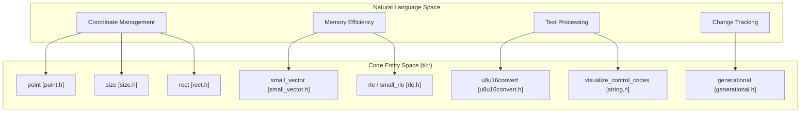
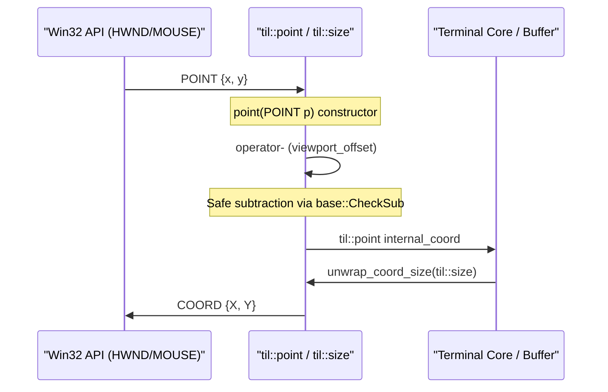

<!-- source: DeepWiki mcp.deepwiki.com · repo microsoft/intelligent-terminal · page 10.1 til: Terminal Implementation Library · fetched 2026-10-26 -->

# til: Terminal Implementation Library

Relevant source files

The following files were used as context for generating this wiki page:

- [src/cascadia/TerminalApp/Jumplist.cpp](src/cascadia/TerminalApp/Jumplist.cpp)
- [src/cascadia/TerminalApp/Jumplist.h](src/cascadia/TerminalApp/Jumplist.h)
- [src/cascadia/TerminalControl/KeyChord.cpp](src/cascadia/TerminalControl/KeyChord.cpp)
- [src/cascadia/TerminalControl/KeyChord.h](src/cascadia/TerminalControl/KeyChord.h)
- [src/cascadia/TerminalControl/KeyChord.idl](src/cascadia/TerminalControl/KeyChord.idl)
- [src/cascadia/TerminalSettingsModel/KeyChordSerialization.cpp](src/cascadia/TerminalSettingsModel/KeyChordSerialization.cpp)
- [src/cascadia/WinRTUtils/inc/Utils.h](src/cascadia/WinRTUtils/inc/Utils.h)
- [src/inc/LibraryIncludes.h](src/inc/LibraryIncludes.h)
- [src/inc/til.h](src/inc/til.h)
- [src/inc/til/color.h](src/inc/til/color.h)
- [src/inc/til/point.h](src/inc/til/point.h)
- [src/inc/til/size.h](src/inc/til/size.h)
- [src/inc/til/small_vector.h](src/inc/til/small_vector.h)
- [src/inc/til/string.h](src/inc/til/string.h)
- [src/renderer/atlas/atlas.vcxproj](src/renderer/atlas/atlas.vcxproj)
- [src/renderer/atlas/pch.h](src/renderer/atlas/pch.h)
- [src/til/ut_til/ColorTests.cpp](src/til/ut_til/ColorTests.cpp)
- [src/til/ut_til/PointTests.cpp](src/til/ut_til/PointTests.cpp)
- [src/til/ut_til/RectangleTests.cpp](src/til/ut_til/RectangleTests.cpp)
- [src/til/ut_til/SizeTests.cpp](src/til/ut_til/SizeTests.cpp)
- [src/til/ut_til/SmallVectorTests.cpp](src/til/ut_til/SmallVectorTests.cpp)
- [src/til/ut_til/sources](src/til/ut_til/sources)
- [src/til/ut_til/string.cpp](src/til/ut_til/string.cpp)
- [src/til/ut_til/til.unit.tests.vcxproj](src/til/ut_til/til.unit.tests.vcxproj)
- [src/til/ut_til/til.unit.tests.vcxproj.filters](src/til/ut_til/til.unit.tests.vcxproj.filters)
- [tools/ConsoleTypes.natvis](tools/ConsoleTypes.natvis)

The **Terminal Implementation Library (til)** is a header-only utility library designed to provide high-performance, terminal-specific data structures and common helper functions used throughout the Intelligent Terminal codebase [src/inc/LibraryIncludes.h:125-128](). It abstracts complex operations like coordinate math, color blending, and efficient string manipulation into a unified namespace `til` [src/inc/til.h:55-56]().

## Coordinate and Geometry Types

TIL provides a set of 2D geometry primitives specifically tuned for terminal grid operations. Unlike standard Win32 `POINT` or `RECT` structures which use `LONG`, TIL types use `til::CoordType` (a 32-bit integer) and provide operator overloading for safe arithmetic using Chromium's safe math library [src/inc/til/point.h:8-10](), [src/inc/til/point.h:95-100]().

### til::point and til::size
*   **`til::point`**: Represents a coordinate $(x, y)$ on the terminal grid or screen [src/inc/til/point.h:30-33](). It supports comparison operators (e.g., `operator<` for row-major ordering) and safe arithmetic [src/inc/til/point.h:68-71]().
*   **`til::size`**: Represents dimensions (width, height) [src/inc/til/size.h:10-11](). It includes helper methods like `area()` and `divide_ceil()` for calculating grid layouts [src/inc/til/size.h:87-100](), [src/inc/til/size.h:115-118]().

### til::rect
Represents a rectangular region defined by `left`, `top`, `right`, and `bottom` edges [tools/ConsoleTypes.natvis:80-82](). It is used extensively for invalidation regions in the renderer and viewport management in the text buffer.

### Coordinate Space Mapping
TIL provides explicit conversion helpers to bridge between internal terminal coordinates and external APIs (Win32, Direct2D, and WinRT).

| From Type | To Type | Conversion Method |
| :--- | :--- | :--- |
| `til::point` | `POINT` | `to_win32_point()` [src/inc/til/point.h:178-181]() |
| `til::size` | `SIZE` | `to_win32_size()` [src/inc/til/size.h:126-129]() |
| `til::point` | `D2D1_POINT_2F` | `to_d2d_point()` [src/inc/til/point.h:205-208]() |
| `COORD` | `til::size` | `wrap_coord_size()` [src/inc/til/size.h:182-185]() |

**Sources:** `src/inc/til/point.h`, `src/inc/til/size.h`, `tools/ConsoleTypes.natvis`

## Color and Alpha Blending

`til::color` is a universal 8bpp RGBA color type [src/inc/til/color.h:8-9](). It is implemented as a union of four `uint8_t` components (`r, g, b, a`) and a single `uint32_t abgr` for fast register-level operations and compatibility with `COLORREF` [src/inc/til/color.h:28-39]().

### Key Features:
*   **Alpha Compositing**: Implements "source-over" alpha blending via `layer_over(destination)` [src/inc/til/color.h:142-156]().
*   **Format Interop**: Implicitly converts to/from `COLORREF`, `D3DCOLORVALUE`, and various WinRT color structures using SFINAE-based constructors [src/inc/til/color.h:69-126]().
*   **Luminance Utilities**: Includes logic for calculating perceived brightness to support high-contrast mode adjustments.

**Sources:** `src/inc/til/color.h`

## Specialized Data Structures

### til::small_rle and til::rle
Run-Length Encoding (RLE) is used to store text attributes (colors, styles) efficiently. Since terminal rows often have long sequences of identical attributes, RLE significantly reduces memory overhead [tools/ConsoleTypes.natvis:88-94]().
*   **`til::small_rle`**: Optimized for small numbers of runs, often used within the `ROW` structure of the `TextBuffer`.
*   **Iterators**: Provides `rle_const_iterator` to traverse encoded runs as if they were a flat array [tools/ConsoleTypes.natvis:96-98]().

### til::small_vector
A `std::vector`-like container with a small-buffer optimization (SBO). It allocates elements on the stack until a threshold is reached, at which point it spills to the heap [tools/ConsoleTypes.natvis:100-110](). This is critical for performance in the rendering pipeline where many small collections are created per frame.

### til::static_map
A compile-time, branchless lookup table used for mapping strings to enums (e.g., parsing key chords in settings) [src/cascadia/TerminalSettingsModel/KeyChordSerialization.cpp:132-141]().

### til::generational
A wrapper used for change detection. It associates a value with a "generation" counter that increments whenever the value is modified, allowing consumers to quickly check if they need to re-process data [tools/ConsoleTypes.natvis:120-124]().

**Sources:** `src/inc/til/small_vector.h`, `src/inc/til/rle.h`, `src/cascadia/TerminalSettingsModel/KeyChordSerialization.cpp`, `tools/ConsoleTypes.natvis`

## String and UTF Conversion

TIL provides high-performance string utilities that avoid unnecessary allocations and handle terminal-specific edge cases.

### Visualization and Cleaning
*   **`visualize_control_codes`**: Converts non-printable ASCII control characters (0x00-0x1F) into their Unicode "Control Pictures" equivalents (e.g., `^C` becomes `␃`) [src/inc/til/string.h:8-26]().
*   **`clean_filename` / `clean_path`**: Uses a branchless bitmask filter (`details::pathFilter`) to strip illegal characters from strings intended for use in the filesystem [src/inc/til/string.h:71-89]().

### UTF Conversion (`u8u16convert.h`)
Provides efficient conversion between UTF-8 (used by many CLI tools and WTA) and UTF-16 (used by Win32/WinRT).
*   **`u16u8`**: Converts UTF-16 to UTF-8.
*   **`u8u16`**: Converts UTF-8 to UTF-16.
*   Includes error handling for "Bad Last Error" bugs in `MultiByteToWideChar` [src/inc/til.h:119-137]().

**Sources:** `src/inc/til/string.h`, `src/inc/til/u8u16convert.h`, `src/inc/til.h`

## Architecture and Data Flow

### Entity Mapping: Logic to Code
The following diagram maps high-level implementation concepts to their specific `til` identifiers.

Title: TIL Entity Mapping

**Sources:** `src/inc/til/point.h`, `src/inc/til/size.h`, `src/inc/til/small_vector.h`, `src/inc/til/string.h`, `src/inc/til/generational.h`

### Data Flow: Coordinate Conversion
This diagram illustrates how a coordinate moves from a raw Win32 input through TIL types into the internal Terminal engine.

Title: Coordinate Transformation Flow

**Sources:** `src/inc/til/point.h:173-176`, `src/inc/til/point.h:102-113`, `src/inc/til/size.h:187-193`

## Testing Infrastructure

TIL is verified via a dedicated unit test project: `til.unit.tests.vcxproj`. These tests cover:
*   **Math Validation**: Ensuring `base::CheckedNumeric` correctly throws `gsl::narrowing_error` on overflow [src/inc/til/point.h:16-28]().
*   **RLE Correctness**: Testing run merging and splitting logic in `RunLengthEncodingTests.cpp` [src/til/ut_til/til.unit.tests.vcxproj:31]().
*   **String Performance**: Benchmarking UTF conversion and path cleaning [src/til/ut_til/til.unit.tests.vcxproj:36-38]().

**Sources:** `src/til/ut_til/til.unit.tests.vcxproj`, `src/til/ut_til/til.unit.tests.vcxproj.filters`

---

