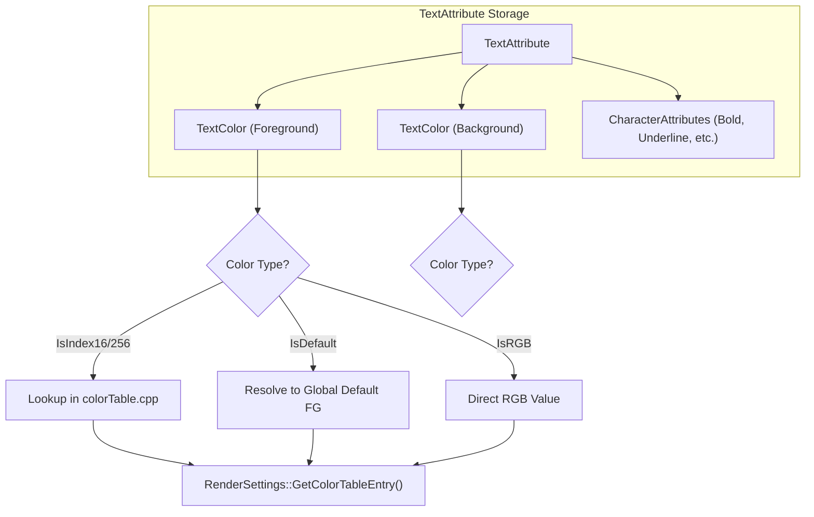
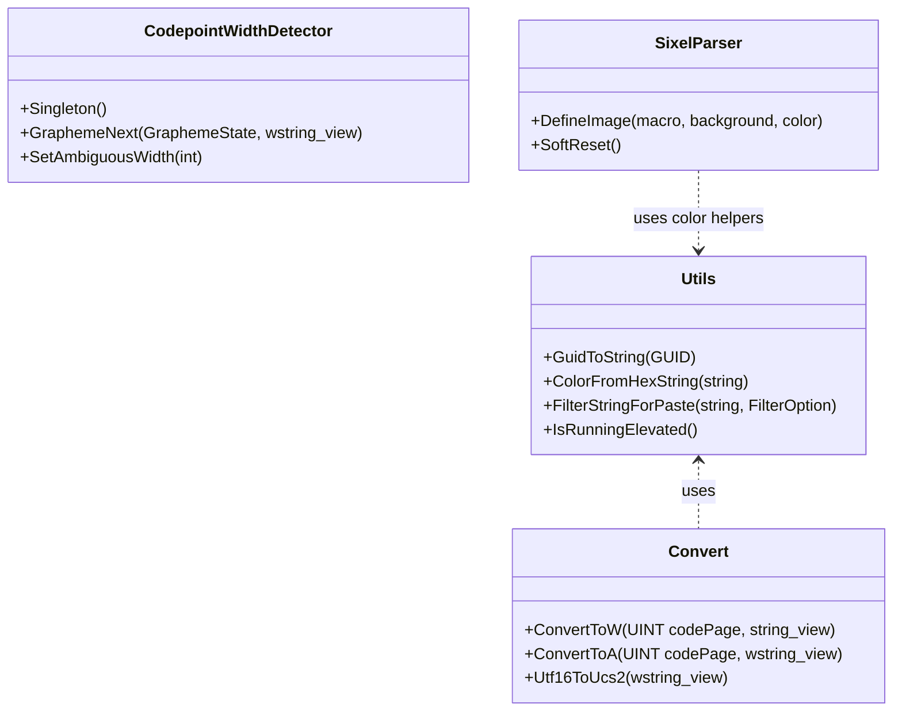

<!-- source: DeepWiki mcp.deepwiki.com · repo microsoft/intelligent-terminal · page 10.2 Types Library: Colors, Glyphs, and Utilities · fetched 2026-10-26 -->

# Types Library: Colors, Glyphs, and Utilities

Relevant source files

The following files were used as context for generating this wiki page:

- [src/buffer/out/ImageSlice.cpp](src/buffer/out/ImageSlice.cpp)
- [src/buffer/out/ImageSlice.hpp](src/buffer/out/ImageSlice.hpp)
- [src/buffer/out/TextAttribute.cpp](src/buffer/out/TextAttribute.cpp)
- [src/buffer/out/TextAttribute.hpp](src/buffer/out/TextAttribute.hpp)
- [src/buffer/out/TextColor.cpp](src/buffer/out/TextColor.cpp)
- [src/buffer/out/TextColor.h](src/buffer/out/TextColor.h)
- [src/buffer/out/ut_textbuffer/TextAttributeTests.cpp](src/buffer/out/ut_textbuffer/TextAttributeTests.cpp)
- [src/host/settings.cpp](src/host/settings.cpp)
- [src/host/settings.hpp](src/host/settings.hpp)
- [src/host/ut_host/ClipboardTests.cpp](src/host/ut_host/ClipboardTests.cpp)
- [src/inc/conattrs.hpp](src/inc/conattrs.hpp)
- [src/inc/til/static_map.h](src/inc/til/static_map.h)
- [src/interactivity/base/EventSynthesis.cpp](src/interactivity/base/EventSynthesis.cpp)
- [src/interactivity/base/lib/InteractivityBase.vcxproj](src/interactivity/base/lib/InteractivityBase.vcxproj)
- [src/interactivity/base/lib/InteractivityBase.vcxproj.filters](src/interactivity/base/lib/InteractivityBase.vcxproj.filters)
- [src/interactivity/base/sources.inc](src/interactivity/base/sources.inc)
- [src/interactivity/inc/EventSynthesis.hpp](src/interactivity/inc/EventSynthesis.hpp)
- [src/interactivity/win32/menu.cpp](src/interactivity/win32/menu.cpp)
- [src/renderer/base/RenderSettings.cpp](src/renderer/base/RenderSettings.cpp)
- [src/renderer/inc/RenderSettings.hpp](src/renderer/inc/RenderSettings.hpp)
- [src/terminal/adapter/SixelParser.cpp](src/terminal/adapter/SixelParser.cpp)
- [src/terminal/adapter/SixelParser.hpp](src/terminal/adapter/SixelParser.hpp)
- [src/terminal/adapter/adaptDispatchGraphics.cpp](src/terminal/adapter/adaptDispatchGraphics.cpp)
- [src/terminal/adapter/charsets.hpp](src/terminal/adapter/charsets.hpp)
- [src/til/ut_til/StaticMapTests.cpp](src/til/ut_til/StaticMapTests.cpp)
- [src/tools/GraphemeTableGen/Program.cs](src/tools/GraphemeTableGen/Program.cs)
- [src/types/CodepointWidthDetector.cpp](src/types/CodepointWidthDetector.cpp)
- [src/types/GlyphWidth.cpp](src/types/GlyphWidth.cpp)
- [src/types/colorTable.cpp](src/types/colorTable.cpp)
- [src/types/convert.cpp](src/types/convert.cpp)
- [src/types/inc/CodepointWidthDetector.hpp](src/types/inc/CodepointWidthDetector.hpp)
- [src/types/inc/GlyphWidth.hpp](src/types/inc/GlyphWidth.hpp)
- [src/types/inc/colorTable.hpp](src/types/inc/colorTable.hpp)
- [src/types/inc/convert.hpp](src/types/inc/convert.hpp)
- [src/types/inc/utils.hpp](src/types/inc/utils.hpp)
- [src/types/ut_types/CodepointWidthDetectorTests.cpp](src/types/ut_types/CodepointWidthDetectorTests.cpp)
- [src/types/ut_types/UtilsTests.cpp](src/types/ut_types/UtilsTests.cpp)
- [src/types/utils.cpp](src/types/utils.cpp)
- [tools/Generate-CodepointWidthsFromUCD.ps1](tools/Generate-CodepointWidthsFromUCD.ps1)

The `types` library provides the foundational data structures and utility routines used across the Intelligent Terminal stack, including the console host (`conhost`), the terminal core, and the rendering engines. It manages how text attributes (colors and styles) are stored, how Unicode codepoints are measured for layout, and how various data formats (GUIDs, Hex strings, UTF encodings) are converted.

## TextAttribute and TextColor

`TextAttribute` is the primary structure for representing the visual state of a character in the `TextBuffer`. It is designed to be extremely compact (18 bytes) to minimize memory overhead in the circular buffer [src/buffer/out/TextAttribute.cpp:10-15]().

### Implementation Details
- **Storage**: It stores foreground, background, and underline colors using the `TextColor` abstraction, along with `CharacterAttributes` (e.g., Bold, Italic, Blinking) [src/buffer/out/TextAttribute.hpp:50-93]().
- **Legacy Compatibility**: It maintains mapping tables (`s_legacyForegroundColorMap` and `s_legacyBackgroundColorMap`) to convert between classic 4-bit Windows Console attributes and modern 24-bit RGB or 256-color indexed values [src/buffer/out/TextAttribute.cpp:39-41]().
- **Hyperlinks**: Supports embedded hyperlink IDs for terminal-native link hovering [src/buffer/out/TextAttribute.cpp:92-97]().

### Color Resolution Data Flow
The `RenderSettings` class (found in the renderer) uses `TextAttribute` to resolve final display colors by looking up indexed values in the `colorTable`.

Title: Color Resolution Flow

Sources: [src/buffer/out/TextAttribute.hpp:50-160](), [src/buffer/out/TextAttribute.cpp:48-81](), [src/types/colorTable.cpp:10-50]()

## CodepointWidthDetector

The `CodepointWidthDetector` is responsible for determining the visual width (columns) of Unicode grapheme clusters. This is critical for cursor positioning and text wrapping.

### Key Features
- **Measurement Modes**: Supports `Graphemes` (UAX #29), `Wcswidth` (Unix-style), and `Console` (Legacy UCS-2) modes [src/types/inc/CodepointWidthDetector.hpp:6-17]().
- **Trie-based Lookup**: Uses a multi-stage lookup table (Trie) to classify codepoints rapidly. The implementation deduplicates chunks of codepoints to minimize the memory footprint of the Unicode database [src/types/CodepointWidthDetector.cpp:17-31]().
- **SIMD Acceleration**: The lookup logic is optimized for high-throughput processing of text streams [src/types/CodepointWidthDetector.cpp:12-15]().
- **Grapheme State**: The `GraphemeState` struct tracks the boundaries of a cluster across string fragments, allowing the detector to handle clusters split across buffer reads [src/types/inc/CodepointWidthDetector.hpp:22-48]().

### Implementation Functions
- `GraphemeNext`: Advances to the next grapheme cluster in a string view [src/types/CodepointWidthDetector.cpp:55-56]().
- `_graphemeNext`: Internal implementation that selects the algorithm based on the current `TextMeasurementMode` [src/types/inc/CodepointWidthDetector.hpp:65-70]().

Sources: [src/types/CodepointWidthDetector.cpp:17-48](), [src/types/inc/CodepointWidthDetector.hpp:50-78]()

## SixelParser

The `SixelParser` implements the DEC Sixel graphics protocol, allowing the terminal to render bitmap images within the text flow.

- **Coordinate System**: Translates sixel "rows" (6 vertical pixels per character) into an internal image buffer [src/terminal/adapter/SixelParser.cpp:111-122]().
- **Color Mapping**: Maintains a private color map that can be modified via the `#` command. It initializes with the VT340 palette [src/terminal/adapter/SixelParser.cpp:52-57]().
- **State Machine**: Processes incoming characters through states such as `Normal`, `Color`, `Repeat`, and `Attributes` [src/terminal/adapter/SixelParser.cpp:135-185]().

Sources: [src/terminal/adapter/SixelParser.cpp:45-109](), [src/terminal/adapter/SixelParser.hpp:20-40]()

## Utility and Conversion Functions

The library includes several static utility classes for common terminal operations.

### convert.cpp
Provides robust UTF-16 (`std::wstring`) to Multi-byte (`std::string`) conversions using Windows Code Pages.
- `ConvertToW`: Converts a string to UTF-16 wide characters [src/types/convert.cpp:20-54]().
- `ConvertToA`: Converts a wide string to a specific codepage [src/types/convert.cpp:65-98]().
- `Utf16ToUcs2`: Specifically handles the conversion of surrogates to the UCS-2 plane for legacy internal components [src/types/convert.cpp:133-144]().

### utils.cpp
General-purpose helpers for the terminal emulator:
- **Color Parsing**: `ColorFromHexString` and `ColorFromXTermColor` handle various color specification formats (e.g., `#RRGGBB`, `rgb:RRRR/GGGG/BBBB`) [src/types/utils.cpp:106-164]().
- **GUID Management**: Helpers to convert between `GUID` structures and string representations used in settings [src/types/utils.cpp:37-75]().
- **Paste Filtering**: `FilterStringForPaste` strips or replaces dangerous control characters and normalizes line endings for clipboard operations [src/types/utils.cpp:82-83]().

Title: Utility Library Organization

Sources: [src/types/utils.cpp:37-145](), [src/types/inc/utils.hpp:16-139](), [src/types/convert.cpp:20-144]()

## UiaTracing

`UiaTracing` provides specialized diagnostic logging for UI Automation (Accessibility) events. It allows developers to track how terminal buffer changes are exposed to screen readers.

- **Event Logging**: Tracks `RuntimeId`, `Name`, and `BoundingRect` of terminal elements [src/types/utils.cpp:32-34]().
- **Integration**: Heavily used by the `UiaRenderer` and `UiaTextRange` classes to debug selection and focus issues in the accessibility tree.

Sources: [src/types/utils.cpp:28-34](), [src/types/inc/utils.hpp:52-56]()

---

