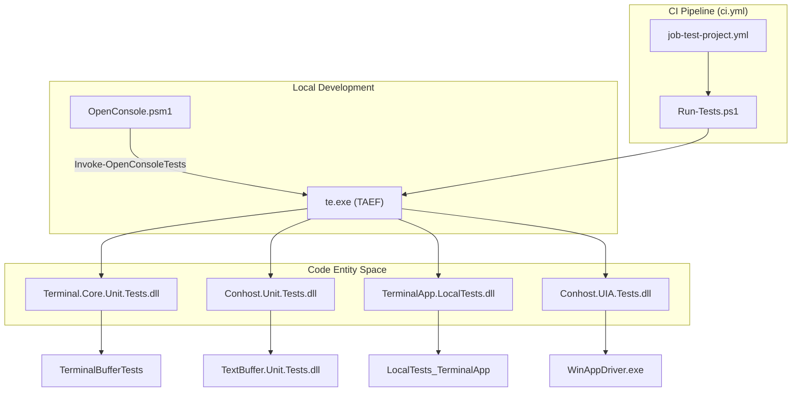
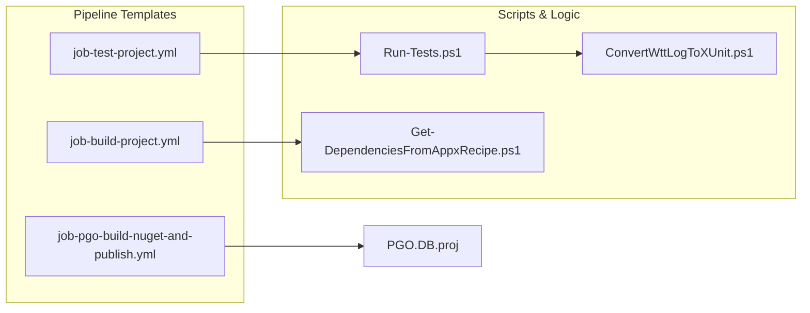

<!-- source: DeepWiki mcp.deepwiki.com · repo microsoft/intelligent-terminal · page 11 Testing Infrastructure · fetched 2026-10-26 -->

# Testing Infrastructure

Relevant source files

The following files were used as context for generating this wiki page:

- [Directory.Build.props](Directory.Build.props)
- [Directory.Build.targets](Directory.Build.targets)
- [build/Helix/ConvertWttLogToXUnit.ps1](build/Helix/ConvertWttLogToXUnit.ps1)
- [build/Helix/HelixTestHelpers.cs](build/Helix/HelixTestHelpers.cs)
- [build/Helix/OutputTestErrorsForAzureDevops.ps1](build/Helix/OutputTestErrorsForAzureDevops.ps1)
- [build/packages.config](build/packages.config)
- [build/pipelines/ci-caching.yml](build/pipelines/ci-caching.yml)
- [build/pipelines/ci.yml](build/pipelines/ci.yml)
- [build/pipelines/pgo.yml](build/pipelines/pgo.yml)
- [build/pipelines/templates-v2/job-pgo-build-nuget-and-publish.yml](build/pipelines/templates-v2/job-pgo-build-nuget-and-publish.yml)
- [build/pipelines/templates-v2/job-run-pgo-tests.yml](build/pipelines/templates-v2/job-run-pgo-tests.yml)
- [build/pipelines/templates-v2/job-test-project.yml](build/pipelines/templates-v2/job-test-project.yml)
- [build/pipelines/templates-v2/steps-ensure-nuget-version.yml](build/pipelines/templates-v2/steps-ensure-nuget-version.yml)
- [build/pipelines/templates-v2/steps-restore-nuget.yml](build/pipelines/templates-v2/steps-restore-nuget.yml)
- [build/scripts/Get-DependenciesFromAppxRecipe.ps1](build/scripts/Get-DependenciesFromAppxRecipe.ps1)
- [build/scripts/Run-Tests.ps1](build/scripts/Run-Tests.ps1)
- [common.openconsole.props](common.openconsole.props)
- [dep/nuget/packages.config](dep/nuget/packages.config)
- [src/cascadia/UnitTests_Control/Control.UnitTests.vcxproj](src/cascadia/UnitTests_Control/Control.UnitTests.vcxproj)
- [src/cascadia/UnitTests_Control/UnitTests_Control.def](src/cascadia/UnitTests_Control/UnitTests_Control.def)
- [src/cascadia/UnitTests_Control/pch.cpp](src/cascadia/UnitTests_Control/pch.cpp)
- [src/cascadia/WindowsTerminal_UIATests/Init.cs](src/cascadia/WindowsTerminal_UIATests/Init.cs)
- [src/cascadia/WindowsTerminal_UIATests/WindowsTerminal.UIA.Tests.csproj](src/cascadia/WindowsTerminal_UIATests/WindowsTerminal.UIA.Tests.csproj)
- [src/cascadia/WindowsTerminal_UIATests/app.config](src/cascadia/WindowsTerminal_UIATests/app.config)
- [src/common.build.tests.props](src/common.build.tests.props)
- [src/common.nugetversions.props](src/common.nugetversions.props)
- [src/common.nugetversions.targets](src/common.nugetversions.targets)
- [src/host/ft_uia/Host.Tests.UIA.csproj](src/host/ft_uia/Host.Tests.UIA.csproj)
- [src/host/ft_uia/Init.cs](src/host/ft_uia/Init.cs)
- [src/host/ft_uia/app.config](src/host/ft_uia/app.config)
- [src/terminal/parser/ut_parser/Parser.UnitTests.vcxproj](src/terminal/parser/ut_parser/Parser.UnitTests.vcxproj)
- [src/terminal/parser/ut_parser/Parser.UnitTests.vcxproj.filters](src/terminal/parser/ut_parser/Parser.UnitTests.vcxproj.filters)
- [src/tools/vtapp/App.config](src/tools/vtapp/App.config)
- [src/tools/vtapp/VTApp.csproj](src/tools/vtapp/VTApp.csproj)
- [tools/OpenConsole.psm1](tools/OpenConsole.psm1)
- [tools/runft.cmd](tools/runft.cmd)
- [tools/runuia.cmd](tools/runuia.cmd)
- [tools/runut.cmd](tools/runut.cmd)
- [tools/tests.xml](tools/tests.xml)

The Intelligent Terminal project employs a multi-layered testing strategy to ensure the stability of the terminal core, the WinUI-based application layer, and the console host (`conhost`). This infrastructure spans from low-level C++ unit tests to high-level UI Automation (UIA) functional tests, all integrated into a modern CI/CD pipeline.

The testing philosophy is divided into three primary categories:
1.  **Unit Tests**: Focused on individual libraries (e.g., `til`, `types`, `terminalCore`).
2.  **Feature/Functional Tests (FT)**: End-to-end tests for the console host and ConPTY.
3.  **UI Automation (UIA) Tests**: Interaction tests using WinAppDriver to simulate user input in the Terminal UI.

## Test Runner Architecture

The primary test runner for the repository is the **Test Authoring and Execution Framework (TAEF)**, specifically the `te.exe` engine [tools/OpenConsole.psm1:203](). TAEF allows for executing tests written in C++, C#, and managed code across different isolation levels.

### Developer Tooling: OpenConsole.psm1
For local development, the `OpenConsole.psm1` PowerShell module provides the `Invoke-OpenConsoleTests` function [tools/OpenConsole.psm1:163](). This cmdlet automates the discovery of test binaries based on a configuration file at `tools/tests.xml` [tools/tests.xml:1-18]().

| Test Category | Target Type | Cmdlet Argument | Description |
| :--- | :--- | :--- | :--- |
| **Unit** | `unit` | `-Test <name>` | Runs isolated logic tests for specific modules. |
| **Feature** | `ft` | `-FTOnly` | Runs integration tests for conhost and ConPTY. |
| **UIA** | `ft` | `-Test uia` | Launches WinAppDriver to test the UI. |

**Sources:** [tools/OpenConsole.psm1:163-234](), [tools/tests.xml:1-18]()

## System Overview: Test Orchestration

The following diagram illustrates how the testing infrastructure bridges the gap between high-level build pipelines and the low-level code entities being validated.

### Test Execution Flow

**Sources:** [build/pipelines/ci.yml:98-110](), [build/pipelines/templates-v2/job-test-project.yml:44-50](), [tools/tests.xml:1-18]()

## Test Categories

### Unit and Integration Tests
These tests target the core logic of the terminal without requiring the full application UI.
*   **Terminal Core**: Validates the state machine and buffer management in `Terminal.Core.Unit.Tests.dll` [tools/tests.xml:5]().
*   **Settings Model**: Tests the serialization and inheritance of `settings.json` via `SettingsModel.Unit.Tests.dll` [tools/tests.xml:8]().
*   **Terminal Control**: Validates the rendering bridge and interactivity in `Control.Unit.Tests.dll` [src/cascadia/UnitTests_Control/Control.UnitTests.vcxproj:1-20]().

For details, see [Unit and Integration Tests](#11.1).

### UIA and Functional Tests
Functional tests (FT) ensure that the console host and the Terminal UI respond correctly to external events and user input.
*   **Console Host UIA**: Located in `Conhost.UIA.Tests.dll`, these tests use `appium-dotnet-driver` to validate the legacy console window [src/host/ft_uia/Host.Tests.UIA.csproj:49-51]().
*   **Terminal UIA**: Located in `WindowsTerminal.UIA.Tests.dll`, these tests validate the WinUI 2/3 interface, including tab management and pane splitting [src/cascadia/WindowsTerminal_UIATests/WindowsTerminal.UIA.Tests.csproj:7-9]().

### Fuzz Testing
The repository includes fuzzing projects (typically targeting the VT parser) to ensure the `OutputStateMachineEngine` can gracefully handle malformed or malicious escape sequences.

## CI/CD and Cloud Infrastructure

The testing infrastructure is fully integrated into Azure DevOps pipelines. The `ci.yml` pipeline defines stages for auditing, building, and testing across `x64`, `x86`, and `arm64` architectures [build/pipelines/ci.yml:42-47]().

### Helix Cloud Runner
For high-scale testing, the project uses the **Helix** test runner. Helix allows for:
1.  **Massive Parallelization**: Running the test suite across hundreds of virtual machines.
2.  **Log Conversion**: Converting TAEF `.wtl` logs into standard xUnit `.xml` format for Azure DevOps reporting [build/pipelines/templates-v2/job-test-project.yml:80-86]().
3.  **PGO Data Collection**: Collecting Profile-Guided Optimization data during test runs to optimize the final production binaries [build/pipelines/templates-v2/job-pgo-build-nuget-and-publish.yml:63-68]().

### Build Pipeline Entity Mapping

**Sources:** [build/pipelines/templates-v2/job-test-project.yml:49-84](), [build/pipelines/templates-v2/job-pgo-build-nuget-and-publish.yml:66-67](), [build/pipelines/ci.yml:92-94]()

For details on the pipeline configuration and packaging, see [Build Pipelines and Release Engineering](#11.2).

## Sub-Pages
*   [Unit and Integration Tests](#11.1) — Detailed breakdown of test projects for Core, Control, and Settings.
*   [Build Pipelines and Release Engineering](#11.2) — Overview of Azure DevOps, PGO, and MSIX packaging.

---
**Sources:**
*   [tools/OpenConsole.psm1]()
*   [build/pipelines/ci.yml]()
*   [tools/tests.xml]()
*   [build/pipelines/templates-v2/job-test-project.yml]()
*   [src/cascadia/WindowsTerminal_UIATests/WindowsTerminal.UIA.Tests.csproj]()

---

