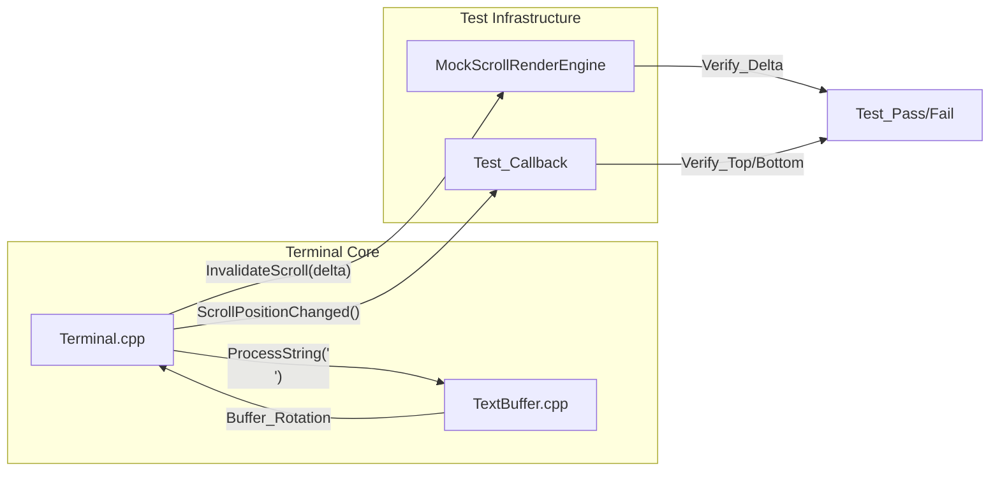

<!-- source: DeepWiki mcp.deepwiki.com · repo microsoft/intelligent-terminal · page 11.1 Unit and Integration Tests · fetched 2026-10-26 -->

# Unit and Integration Tests

<details>
<summary>Relevant source files</summary>

The following files were used as context for generating this wiki page:

- [src/cascadia/LocalTests_TerminalApp/SettingsTests.cpp](src/cascadia/LocalTests_TerminalApp/SettingsTests.cpp)
- [src/cascadia/TerminalControl/ControlInteractivity.cpp](src/cascadia/TerminalControl/ControlInteractivity.cpp)
- [src/cascadia/TerminalControl/ControlInteractivity.h](src/cascadia/TerminalControl/ControlInteractivity.h)
- [src/cascadia/TerminalControl/ControlInteractivity.idl](src/cascadia/TerminalControl/ControlInteractivity.idl)
- [src/cascadia/TerminalCore/ITerminalInput.hpp](src/cascadia/TerminalCore/ITerminalInput.hpp)
- [src/cascadia/UnitTests_Control/ControlCoreTests.cpp](src/cascadia/UnitTests_Control/ControlCoreTests.cpp)
- [src/cascadia/UnitTests_Control/ControlInteractivityTests.cpp](src/cascadia/UnitTests_Control/ControlInteractivityTests.cpp)
- [src/cascadia/UnitTests_TerminalCore/InputTest.cpp](src/cascadia/UnitTests_TerminalCore/InputTest.cpp)
- [src/cascadia/UnitTests_TerminalCore/ScreenSizeLimitsTest.cpp](src/cascadia/UnitTests_TerminalCore/ScreenSizeLimitsTest.cpp)
- [src/cascadia/UnitTests_TerminalCore/ScrollTest.cpp](src/cascadia/UnitTests_TerminalCore/ScrollTest.cpp)
- [src/cascadia/UnitTests_TerminalCore/SelectionTest.cpp](src/cascadia/UnitTests_TerminalCore/SelectionTest.cpp)
- [src/cascadia/UnitTests_TerminalCore/TerminalBufferTests.cpp](src/cascadia/UnitTests_TerminalCore/TerminalBufferTests.cpp)
- [src/host/ft_host/API_AliasTests.cpp](src/host/ft_host/API_AliasTests.cpp)
- [src/host/ft_host/API_BufferTests.cpp](src/host/ft_host/API_BufferTests.cpp)
- [src/host/ft_host/API_DimensionsTests.cpp](src/host/ft_host/API_DimensionsTests.cpp)
- [src/host/ft_host/API_FileTests.cpp](src/host/ft_host/API_FileTests.cpp)
- [src/host/ft_host/API_FillOutputTests.cpp](src/host/ft_host/API_FillOutputTests.cpp)
- [src/host/ft_host/API_FontTests.cpp](src/host/ft_host/API_FontTests.cpp)
- [src/host/ft_host/API_InputTests.cpp](src/host/ft_host/API_InputTests.cpp)
- [src/host/ft_host/API_OutputTests.cpp](src/host/ft_host/API_OutputTests.cpp)
- [src/host/ft_host/API_PolicyTests.cpp](src/host/ft_host/API_PolicyTests.cpp)
- [src/host/ft_host/API_TitleTests.cpp](src/host/ft_host/API_TitleTests.cpp)
- [src/host/ft_host/CJK_DbcsTests.cpp](src/host/ft_host/CJK_DbcsTests.cpp)
- [src/host/ft_host/CanaryTests.cpp](src/host/ft_host/CanaryTests.cpp)
- [src/host/ft_host/InitTests.cpp](src/host/ft_host/InitTests.cpp)
- [src/host/ft_host/Message_KeyPressTests.cpp](src/host/ft_host/Message_KeyPressTests.cpp)

</details>


This page describes the multi-layered testing infrastructure for the Intelligent Terminal codebase. The project utilizes the **Windows Execution Experience (WEX)** and **Test Authoring and Execution Framework (TAEF)** to perform unit and integration testing across the application lifecycle, terminal emulation engine, and console host.

## Overview of Test Projects

The testing strategy is divided into several specialized projects targeting different layers of the architecture:

| Project | Target Area | Key Test Classes |
| :--- | :--- | :--- |
| `LocalTests_TerminalApp` | UI and App Logic | `SettingsTests`, `TabTests`, `CommandlineTest` |
| `UnitTests_TerminalCore` | Emulation Engine | `TerminalBufferTests`, `SelectionTest`, `InputTest`, `ScrollTest` |
| `UnitTests_Control` | XAML Control Bridge | `ControlInteractivityTests`, `ControlCoreTests` |
| `UnitTests_SettingsModel` | Settings & Profiles | `SerializationTests`, `DeserializationTests` |
| `ft_host` (Host Tests) | Console Host (conhost) | `ScreenBufferTests`, `TextBufferTests`, `InputBufferTests` |

---

## 1. LocalTests_TerminalApp

This project tests the high-level application logic, specifically focusing on how settings are processed and how the terminal page handles commands.

### Settings and Command Expansion
The `SettingsTests` class validates the `CascadiaSettings` object and the `ActionMap`. A critical area of testing is **Iterable Commands**, where a single command definition in JSON is expanded into multiple commands (e.g., creating a "Split Pane" action for every available profile).

*   **Implementation**: Tests use a custom `AppxManifest` (`TestHostAppXManifest.xml`) to allow activation of WinRT types within the TAEF environment [src/cascadia/LocalTests_TerminalApp/SettingsTests.cpp:51-61]().
*   **Key Logic**: `TestIterateCommands` verifies that using `${profile.name}` in an action correctly generates a unique command for every profile in the settings [src/cascadia/LocalTests_TerminalApp/SettingsTests.cpp:125-182]().

**Sources**: [src/cascadia/LocalTests_TerminalApp/SettingsTests.cpp:1-182]()

---

## 2. UnitTests_TerminalCore

These tests target the `Terminal` class and its underlying buffers, bypassing the UI layer.

### Terminal Buffer and Wrapping
`TerminalBufferTests` validates the `TextBuffer` and `StateMachine` interactions.
*   **Buffer Writing**: `TestSimpleBufferWriting` ensures that `ProcessString` correctly populates the `TextBuffer` and updates the viewport [src/cascadia/UnitTests_TerminalCore/TerminalBufferTests.cpp:80-97]().
*   **Forced Wrapping**: `TestWrappingCharByChar` verifies that the `ROW` objects are marked with `WasWrapForced()` when text exceeds the viewport width [src/cascadia/UnitTests_TerminalCore/TerminalBufferTests.cpp:99-136]().

### Selection and Expansion
`SelectionTest` validates the linear selection logic and expansion granularities (Cell, Word, Line).
*   **Clamping**: Tests ensure that selection anchors are clamped to the valid viewport range even when provided with extreme coordinates like `SHRT_MAX` [src/cascadia/UnitTests_TerminalCore/SelectionTest.cpp:87-143]().
*   **Expansion**: `MultiClickSelection` is tested to ensure "Word" expansion correctly identifies word boundaries in the buffer [src/cascadia/UnitTests_TerminalCore/SelectionTest.cpp:106-113]().

### Input Handling
`InputTest` validates the translation of key events into VT sequences.
*   **Alt/Shift Modifiers**: Verifies that combinations like `Alt+Shift+A` generate the correct `\x1bA` sequence [src/cascadia/UnitTests_TerminalCore/InputTest.cpp:37-46]().

**Sources**: [src/cascadia/UnitTests_TerminalCore/TerminalBufferTests.cpp:26-170](), [src/cascadia/UnitTests_TerminalCore/SelectionTest.cpp:24-166](), [src/cascadia/UnitTests_TerminalCore/InputTest.cpp:27-55]()

---

## 3. UnitTests_Control

This project tests the interaction between the WinUI/WPF hosting layer and the core emulation engine.

### ControlInteractivity and ControlCore
The tests focus on `ControlInteractivity`, which handles mouse and keyboard input, and `ControlCore`, which manages the rendering bridge.

*   **Transparency/Acrylic**: `TestAdjustAcrylic` validates that opacity changes (e.g., via Ctrl+Shift+Scroll) correctly trigger `TransparencyChanged` events and update the `ControlCore` state without modifying the base settings [src/cascadia/UnitTests_Control/ControlInteractivityTests.cpp:123-170]().
*   **Selection Markers**: `ControlInteractivity` listens for `UpdateSelectionMarkers` from the core to set `_selectionNeedsToBeCopied` [src/cascadia/TerminalControl/ControlInteractivity.cpp:62-70]().

### Interaction Data Flow
The following diagram illustrates how tests simulate input to verify the interactivity layer.

**Test Input Data Flow**
```mermaid
graph TD
    subgraph "Test Space"
        "Test_Method" -- "PointerPressed()" --> "ControlInteractivity"
    end

    subgraph "Code Entity Space"
        "ControlInteractivity" -- "_numberOfClicks()" --> "Click_Counter"
        "ControlInteractivity" -- "SetSelectionAnchor()" --> "ControlCore"
        "ControlCore" -- "UpdateSelectionMarkers()" --> "Terminal_Selection"
        "Terminal_Selection" -- "raise_event" --> "ControlInteractivity"
    end

    "ControlInteractivity"["ControlInteractivity.cpp"]
    "ControlCore"["ControlCore.cpp"]
    "Terminal_Selection"["TerminalSelection.cpp"]
```
**Sources**: [src/cascadia/UnitTests_Control/ControlInteractivityTests.cpp:73-100](), [src/cascadia/TerminalControl/ControlInteractivity.cpp:39-71]()

---

## 4. Host Unit Tests (ft_host)

The `ft_host` project contains functional tests for the `conhost.exe` (Console Host). These tests often involve launching a "Nihilist" process (a dummy application) to test API behavior.

### DBCS and CJK Support
`CJK_DbcsTests` provides extensive coverage for Double-Byte Character Sets (DBCS), specifically for Japanese (CP 932).
*   **Write/Read Consistency**: Tests verify that strings written via `WriteConsoleOutput` are retrieved identically via `ReadConsoleOutput`, handling the "lead byte" and "trail byte" logic of DBCS [src/host/ft_host/CJK_DbcsTests.cpp:41-102]().
*   **Font Dependency**: Many DBCS tests verify that the system has "MS Gothic" or similar fonts before proceeding, as the console host's CJK behavior is font-dependent [src/host/ft_host/CJK_DbcsTests.cpp:179-197]().

### Module Setup and Job Objects
The host tests use `MODULE_SETUP` to initialize the environment.
*   **Process Isolation**: Tests are launched inside a Windows Job Object with `JOB_OBJECT_LIMIT_KILL_ON_JOB_CLOSE` to ensure that `OpenConsole.exe` and its children are terminated when the test finishes [src/host/ft_host/InitTests.cpp:134-162]().
*   **V1 vs V2**: The `CommonV1V2Helper` is used to toggle between the legacy console engine and the modern "V2" engine [src/host/ft_host/InitTests.cpp:91-103]().

**Sources**: [src/host/ft_host/CJK_DbcsTests.cpp:104-163](), [src/host/ft_host/InitTests.cpp:69-163]()

---

## 5. Integration: Scroll and Buffer Rotation

Integration tests in `ScrollTest.cpp` verify that the buffer rotation logic correctly notifies the UI.

### Buffer Rotation Notification
A specific test for **GH#5540** ensures that when the buffer rotates (newlines added), the terminal sends a `NotifyScroll` event even if the internal scroll delta is large.
*   **Mock Engine**: `MockScrollRenderEngine` implements `InvalidateScroll` to capture the delta sent by the `Terminal` [src/cascadia/UnitTests_TerminalCore/ScrollTest.cpp:21-46]().
*   **Callback Verification**: The test sets a `ScrollPositionChangedCallback` and verifies that `ViewportTop`, `ViewportHeight`, and `BufferHeight` are updated correctly during high-volume output [src/cascadia/UnitTests_TerminalCore/ScrollTest.cpp:102-109]().

**Terminal-to-Renderer Integration**

**Sources**: [src/cascadia/UnitTests_TerminalCore/ScrollTest.cpp:21-129]()

---

