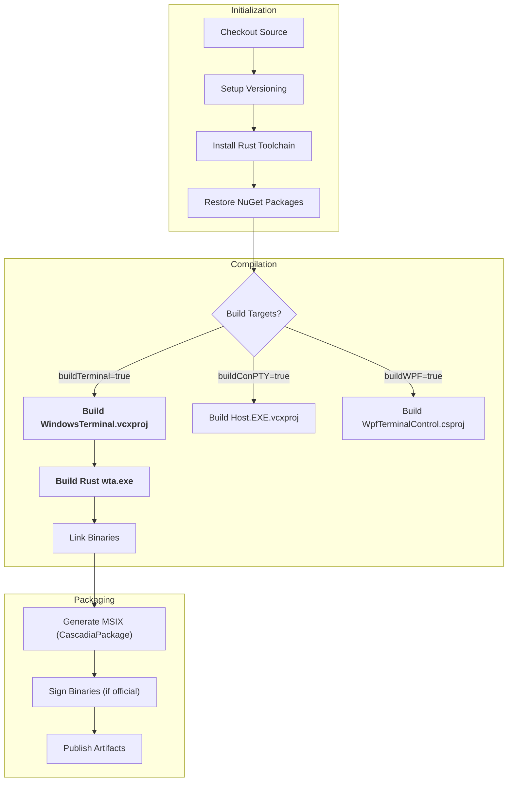
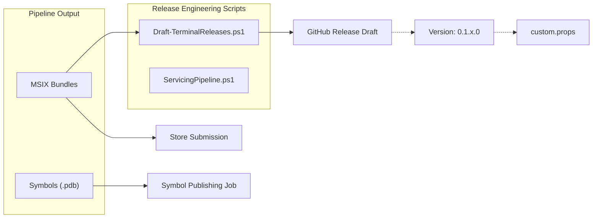

<!-- source: DeepWiki mcp.deepwiki.com · repo microsoft/intelligent-terminal · page 11.2 Build Pipelines and Release Engineering · fetched 2026-10-26 -->

# Build Pipelines and Release Engineering

Relevant source files

The following files were used as context for generating this wiki page:

- [.cargo/config.toml](.cargo/config.toml)
- [.vsconfig](.vsconfig)
- [Directory.Build.props](Directory.Build.props)
- [Directory.Build.targets](Directory.Build.targets)
- [build/Helix/ConvertWttLogToXUnit.ps1](build/Helix/ConvertWttLogToXUnit.ps1)
- [build/Helix/HelixTestHelpers.cs](build/Helix/HelixTestHelpers.cs)
- [build/Helix/OutputTestErrorsForAzureDevops.ps1](build/Helix/OutputTestErrorsForAzureDevops.ps1)
- [build/config/GitCheckin.json](build/config/GitCheckin.json)
- [build/config/release.gdnbaselines](build/config/release.gdnbaselines)
- [build/config/tsa.json](build/config/tsa.json)
- [build/packages.config](build/packages.config)
- [build/pipelines/1espt-nightly.yml](build/pipelines/1espt-nightly.yml)
- [build/pipelines/ci-caching.yml](build/pipelines/ci-caching.yml)
- [build/pipelines/ci.yml](build/pipelines/ci.yml)
- [build/pipelines/ob-nightly.yml](build/pipelines/ob-nightly.yml)
- [build/pipelines/ob-release.yml](build/pipelines/ob-release.yml)
- [build/pipelines/pgo.yml](build/pipelines/pgo.yml)
- [build/pipelines/templates-v2/job-build-package-wpf.yml](build/pipelines/templates-v2/job-build-package-wpf.yml)
- [build/pipelines/templates-v2/job-build-project.yml](build/pipelines/templates-v2/job-build-project.yml)
- [build/pipelines/templates-v2/job-merge-msix-into-bundle.yml](build/pipelines/templates-v2/job-merge-msix-into-bundle.yml)
- [build/pipelines/templates-v2/job-package-conpty.yml](build/pipelines/templates-v2/job-package-conpty.yml)
- [build/pipelines/templates-v2/job-pgo-build-nuget-and-publish.yml](build/pipelines/templates-v2/job-pgo-build-nuget-and-publish.yml)
- [build/pipelines/templates-v2/job-publish-symbols-using-symbolrequestprod-api.yml](build/pipelines/templates-v2/job-publish-symbols-using-symbolrequestprod-api.yml)
- [build/pipelines/templates-v2/job-publish-symbols.yml](build/pipelines/templates-v2/job-publish-symbols.yml)
- [build/pipelines/templates-v2/job-run-pgo-tests.yml](build/pipelines/templates-v2/job-run-pgo-tests.yml)
- [build/pipelines/templates-v2/job-submit-windows-vpack.yml](build/pipelines/templates-v2/job-submit-windows-vpack.yml)
- [build/pipelines/templates-v2/job-test-project.yml](build/pipelines/templates-v2/job-test-project.yml)
- [build/pipelines/templates-v2/pipeline-1espt-full-release-build.yml](build/pipelines/templates-v2/pipeline-1espt-full-release-build.yml)
- [build/pipelines/templates-v2/pipeline-full-release-build.yml](build/pipelines/templates-v2/pipeline-full-release-build.yml)
- [build/pipelines/templates-v2/pipeline-onebranch-full-release-build.yml](build/pipelines/templates-v2/pipeline-onebranch-full-release-build.yml)
- [build/pipelines/templates-v2/steps-ensure-nuget-version.yml](build/pipelines/templates-v2/steps-ensure-nuget-version.yml)
- [build/pipelines/templates-v2/steps-esrp-signing.yml](build/pipelines/templates-v2/steps-esrp-signing.yml)
- [build/pipelines/templates-v2/steps-install-terrapin.yml](build/pipelines/templates-v2/steps-install-terrapin.yml)
- [build/pipelines/templates-v2/steps-restore-nuget.yml](build/pipelines/templates-v2/steps-restore-nuget.yml)
- [build/pipelines/templates-v2/steps-setup-versioning.yml](build/pipelines/templates-v2/steps-setup-versioning.yml)
- [build/pipelines/templates-v2/variables-nuget-package-version.yml](build/pipelines/templates-v2/variables-nuget-package-version.yml)
- [build/pipelines/templates-v2/variables-onebranch-config.yml](build/pipelines/templates-v2/variables-onebranch-config.yml)
- [build/scripts/Create-AppxBundle.ps1](build/scripts/Create-AppxBundle.ps1)
- [build/scripts/Get-DependenciesFromAppxRecipe.ps1](build/scripts/Get-DependenciesFromAppxRecipe.ps1)
- [build/scripts/New-WtaLocalInstaller.ps1](build/scripts/New-WtaLocalInstaller.ps1)
- [build/scripts/Run-Tests.ps1](build/scripts/Run-Tests.ps1)
- [build/scripts/Set-LatestVCToolsVersion.ps1](build/scripts/Set-LatestVCToolsVersion.ps1)
- [build/scripts/Test-WindowsTerminalPackage.ps1](build/scripts/Test-WindowsTerminalPackage.ps1)
- [common.openconsole.props](common.openconsole.props)
- [custom.props](custom.props)
- [dep/nuget/packages.config](dep/nuget/packages.config)
- [doc/cascadia/Unittesting-CppWinRT-Xaml.md](doc/cascadia/Unittesting-CppWinRT-Xaml.md)
- [samples/ConPTY/EchoCon/EchoCon/EchoCon.vcxproj](samples/ConPTY/EchoCon/EchoCon/EchoCon.vcxproj)
- [scratch/ScratchIslandApp/Package/Package.appxmanifest](scratch/ScratchIslandApp/Package/Package.appxmanifest)
- [src/cascadia/CascadiaPackage/CascadiaPackage.wapproj](src/cascadia/CascadiaPackage/CascadiaPackage.wapproj)
- [src/cascadia/CascadiaPackage/Package-Can.appxmanifest](src/cascadia/CascadiaPackage/Package-Can.appxmanifest)
- [src/cascadia/CascadiaPackage/Package-Dev.appxmanifest](src/cascadia/CascadiaPackage/Package-Dev.appxmanifest)
- [src/cascadia/CascadiaPackage/Package-Pre.appxmanifest](src/cascadia/CascadiaPackage/Package-Pre.appxmanifest)
- [src/cascadia/CascadiaPackage/Package.appxmanifest](src/cascadia/CascadiaPackage/Package.appxmanifest)
- [src/cascadia/CascadiaPackage/Resources/Resources.resw](src/cascadia/CascadiaPackage/Resources/Resources.resw)
- [src/cascadia/LocalTests_TerminalApp/TerminalApp.LocalTests.AppxManifest.prototype.xml](src/cascadia/LocalTests_TerminalApp/TerminalApp.LocalTests.AppxManifest.prototype.xml)
- [src/cascadia/LocalTests_TerminalApp/TerminalApp.LocalTests.vcxproj](src/cascadia/LocalTests_TerminalApp/TerminalApp.LocalTests.vcxproj)
- [src/cascadia/LocalTests_TerminalApp/TestHostApp/Package.appxmanifest](src/cascadia/LocalTests_TerminalApp/TestHostApp/Package.appxmanifest)
- [src/cascadia/LocalTests_TerminalApp/TestHostApp/TestHostApp.vcxproj](src/cascadia/LocalTests_TerminalApp/TestHostApp/TestHostApp.vcxproj)
- [src/cascadia/TerminalApp/Resources/en-US/ContextMenu.resw](src/cascadia/TerminalApp/Resources/en-US/ContextMenu.resw)
- [src/cascadia/TerminalApp/TerminalAppLib.vcxproj](src/cascadia/TerminalApp/TerminalAppLib.vcxproj)
- [src/cascadia/TerminalApp/TerminalAppLib.vcxproj.filters](src/cascadia/TerminalApp/TerminalAppLib.vcxproj.filters)
- [src/cascadia/TerminalApp/dll/TerminalApp.vcxproj](src/cascadia/TerminalApp/dll/TerminalApp.vcxproj)
- [src/cascadia/WindowsTerminal/WindowsTerminal.vcxproj](src/cascadia/WindowsTerminal/WindowsTerminal.vcxproj)
- [src/cascadia/WindowsTerminal_UIATests/Init.cs](src/cascadia/WindowsTerminal_UIATests/Init.cs)
- [src/cascadia/WindowsTerminal_UIATests/WindowsTerminal.UIA.Tests.csproj](src/cascadia/WindowsTerminal_UIATests/WindowsTerminal.UIA.Tests.csproj)
- [src/cascadia/WindowsTerminal_UIATests/app.config](src/cascadia/WindowsTerminal_UIATests/app.config)
- [src/cascadia/ut_app/TerminalApp.Unit.Tests.AppxManifest.xml](src/cascadia/ut_app/TerminalApp.Unit.Tests.AppxManifest.xml)
- [src/cascadia/ut_app/TerminalApp.UnitTests.vcxproj](src/cascadia/ut_app/TerminalApp.UnitTests.vcxproj)
- [src/common.build.tests.props](src/common.build.tests.props)
- [src/common.nugetversions.props](src/common.nugetversions.props)
- [src/common.nugetversions.targets](src/common.nugetversions.targets)
- [src/host/ft_uia/Host.Tests.UIA.csproj](src/host/ft_uia/Host.Tests.UIA.csproj)
- [src/host/ft_uia/Init.cs](src/host/ft_uia/Init.cs)
- [src/host/ft_uia/app.config](src/host/ft_uia/app.config)
- [src/host/proxy/Host.Proxy.vcxproj](src/host/proxy/Host.Proxy.vcxproj)
- [src/host/proxy/Host.Proxy.vcxproj.filters](src/host/proxy/Host.Proxy.vcxproj.filters)
- [src/interactivity/onecore/SystemConfigurationProvider.cpp](src/interactivity/onecore/SystemConfigurationProvider.cpp)
- [src/terminal/parser/ut_parser/Parser.UnitTests.vcxproj](src/terminal/parser/ut_parser/Parser.UnitTests.vcxproj)
- [src/terminal/parser/ut_parser/Parser.UnitTests.vcxproj.filters](src/terminal/parser/ut_parser/Parser.UnitTests.vcxproj.filters)
- [src/tools/vtapp/App.config](src/tools/vtapp/App.config)
- [src/tools/vtapp/VTApp.csproj](src/tools/vtapp/VTApp.csproj)
- [tools/Get-OSSConhostLog.ps1](tools/Get-OSSConhostLog.ps1)
- [tools/ReleaseEngineering/Draft-TerminalReleases.ps1](tools/ReleaseEngineering/Draft-TerminalReleases.ps1)
- [tools/ReleaseEngineering/New-TerminalStackedChangelog.ps1](tools/ReleaseEngineering/New-TerminalStackedChangelog.ps1)
- [tools/ReleaseEngineering/ServicingPipeline.ps1](tools/ReleaseEngineering/ServicingPipeline.ps1)
- [tools/wta/Cargo.lock](tools/wta/Cargo.lock)
- [tools/wta/build.rs](tools/wta/build.rs)

This page details the infrastructure used to build, package, and release Intelligent Terminal. The project utilizes a multi-stage Azure DevOps pipeline architecture integrated with Microsoft OneBranch for official releases. This includes MSIX packaging logic, Profile-Guided Optimization (PGO), and automated release engineering scripts.

## CI/CD Pipeline Architecture

The build system is divided into three primary tiers: continuous integration (CI) for pull requests, nightly builds for internal validation, and release pipelines for public distribution.

### Core Build Job (`job-build-project.yml`)

The central building block of all pipelines is the `job-build-project.yml` template. This job handles:
1.  **Environment Setup**: Configures the Rust toolchain for `wta.exe` and installs C++ build dependencies via NuGet [build/pipelines/templates-v2/job-build-project.yml:186-191]().
2.  **Target Selection**: Dynamically determines which projects to build (Terminal, ConPTY, or WPF controls) based on parameters [build/pipelines/templates-v2/job-build-project.yml:137-161]().
3.  **Compilation**: Executes MSBuild with specific configurations (Debug, Release, AuditMode) and platforms (x64, x86, ARM64) [build/pipelines/templates-v2/job-build-project.yml:97-108]().
4.  **Packaging**: Generates MSIX/MSIXBundle outputs using `MakeAppx.exe` [build/pipelines/templates-v2/job-build-project.yml:110-111]().

### Pipeline Variants

| Pipeline | File | Purpose |
| :--- | :--- | :--- |
| **CI** | `ci.yml` | Validates PRs and `main` branch. Runs `AuditMode` for x64 and standard `Release` builds with unit tests [build/pipelines/ci.yml:1-50](). |
| **Nightly** | `ob-nightly.yml` | OneBranch-hosted nightly builds for internal dogfooding. |
| **Release** | `ob-release.yml` | Official signed builds for Store and GitHub releases [build/pipelines/templates-v2/pipeline-onebranch-full-release-build.yml:1-45](). |

### Build Pipeline Logic Flow

The following diagram illustrates how the `job-build-project.yml` template orchestrates the build process across different languages and project types.

**Build Orchestration Flow**

Sources: [build/pipelines/templates-v2/job-build-project.yml:130-210](), [src/cascadia/CascadiaPackage/CascadiaPackage.wapproj:87-109]()

---

## MSIX Packaging and Branding

Intelligent Terminal uses the Windows Application Packaging (WAP) project (`CascadiaPackage.wapproj`) to bundle the application. A key feature is the support for multiple branding "channels" (Dev, Preview, Canary, and Release), each with distinct identities and capabilities.

### Manifest Variants
The build system selects the appropriate `.appxmanifest` based on the `$(WindowsTerminalBranding)` MSBuild property [src/cascadia/CascadiaPackage/CascadiaPackage.wapproj:53-66]().

*   **Dev**: Uses `Package-Dev.appxmanifest`. Identity: `IntelligentTerminal` [src/cascadia/CascadiaPackage/Package-Dev.appxmanifest:20-23]().
*   **Preview**: Uses `Package-Pre.appxmanifest`. Identity: `Microsoft.WindowsTerminalPreview` [src/cascadia/CascadiaPackage/Package-Pre.appxmanifest:21-24]().
*   **Canary**: Uses `Package-Can.appxmanifest`. Identity: `Microsoft.WindowsTerminalCanary` [src/cascadia/CascadiaPackage/Package-Can.appxmanifest:20-23]().
*   **Stable**: Uses `Package.appxmanifest`. Identity: `Microsoft.IntelligentTerminal` [src/cascadia/CascadiaPackage/Package.appxmanifest:21-24]().

### Metadata Based Marshaling (MBM)
To allow `wtcli.exe` and other tools to communicate with the main terminal process via COM, the package includes `Microsoft.Terminal.Protocol.winmd`. This enables the WinRT runtime to marshal the `IProtocolServer` interface across process boundaries without a manual proxy/stub registration [src/cascadia/CascadiaPackage/CascadiaPackage.wapproj:110-117]().

### Rust Integration (`wta.exe`)
The `CascadiaPackage.wapproj` includes logic to find and include the Rust-built `wta.exe` binary. It maps MSBuild platforms to Rust target triples (e.g., `x64` to `x86_64-pc-windows-msvc`) to ensure the correct architecture is bundled [src/cascadia/CascadiaPackage/CascadiaPackage.wapproj:24-27]().

---

## Profile-Guided Optimization (PGO)

For official releases, the terminal undergoes Profile-Guided Optimization to improve performance. This is controlled via the `pgoBuildMode` parameter [build/pipelines/templates-v2/job-build-project.yml:24-27]().

1.  **Instrument**: The code is compiled with instrumentation hooks using the `Microsoft.Internal.PGO-Helpers.Cpp` package [dep/nuget/packages.config:5]().
2.  **Training**: Automated tests (TAEF) run against the instrumented build to generate `.pgc` profile data.
3.  **Optimize**: The compiler uses the collected profile data to perform more efficient code layout, inlining, and register allocation.

Projects like `WindowsTerminal.vcxproj` explicitly enable PGO support via the `<PgoTarget>true</PgoTarget>` property [src/cascadia/WindowsTerminal/WindowsTerminal.vcxproj:17]().

---

## Release Engineering Scripts

Automated scripts in `tools/ReleaseEngineering/` manage the final stages of the release lifecycle.

### Servicing and Drafting
*   **`ServicingPipeline.ps1`**: Automates the ingestion of new builds into the servicing branches.
*   **`Draft-TerminalReleases.ps1`**: Automates the creation of GitHub release drafts. It collects the MSIX bundles, standalone ZIPs (unpackaged distribution), and generates the changelog.

### Versioning Logic
Versioning is managed through `custom.props`, which defines the major and minor versions used by OneStore versioning [custom.props:4-13](). During the build, `steps-setup-versioning.yml` applies these versions to the manifests and resource files [build/pipelines/templates-v2/pipeline-onebranch-full-release-build.yml:142-143]().

**Release Asset Generation Flow**

Sources: [tools/ReleaseEngineering/Draft-TerminalReleases.ps1](), [custom.props:7-8](), [build/pipelines/templates-v2/job-publish-symbols-using-symbolrequestprod-api.yml]()

---

## Symbol Publishing and Store Assets

Official pipelines publish symbols to the Microsoft Public Symbol Server to assist in third-party debugging and crash dump analysis [build/pipelines/templates-v2/pipeline-onebranch-full-release-build.yml:46-51]().

The `CascadiaPackage` project also includes various Store assets (logos, splash screens) located in the `Images\` directory. These are suffixed by branding (e.g., `StoreLogo-Dev.png`) and resolved at build time using the `WindowsTerminalAssetSuffix` property [src/cascadia/CascadiaPackage/CascadiaPackage.wapproj:75-85]().

Sources:
- [build/pipelines/templates-v2/job-build-project.yml]()
- [src/cascadia/CascadiaPackage/CascadiaPackage.wapproj]()
- [src/cascadia/CascadiaPackage/Package-Dev.appxmanifest]()
- [src/cascadia/WindowsTerminal/WindowsTerminal.vcxproj]()
- [custom.props]()
- [dep/nuget/packages.config]()

---

