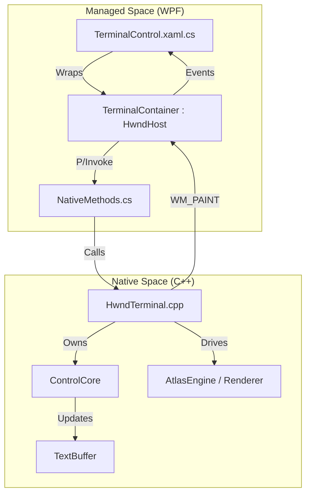
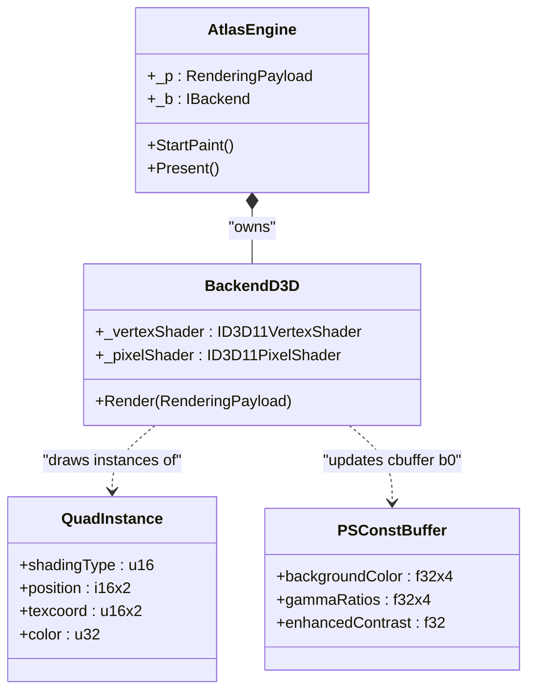

<!-- source: DeepWiki mcp.deepwiki.com · repo microsoft/intelligent-terminal · page 12 Samples and Developer Tools · fetched 2026-10-26 -->

# Samples and Developer Tools

Relevant source files

The following files were used as context for generating this wiki page:

- [scratch/ScratchIslandApp/Package/Package.wapproj](scratch/ScratchIslandApp/Package/Package.wapproj)
- [scratch/ScratchIslandApp/SampleApp/SampleAppLib.vcxproj](scratch/ScratchIslandApp/SampleApp/SampleAppLib.vcxproj)
- [scratch/ScratchIslandApp/SampleApp/dll/SampleApp.vcxproj](scratch/ScratchIslandApp/SampleApp/dll/SampleApp.vcxproj)
- [scratch/ScratchIslandApp/SampleApp/packages.config](scratch/ScratchIslandApp/SampleApp/packages.config)
- [scratch/ScratchIslandApp/WindowExe/WindowExe.vcxproj](scratch/ScratchIslandApp/WindowExe/WindowExe.vcxproj)
- [scratch/ScratchIslandApp/WindowExe/packages.config](scratch/ScratchIslandApp/WindowExe/packages.config)
- [src/cascadia/TerminalControl/HwndTerminal.cpp](src/cascadia/TerminalControl/HwndTerminal.cpp)
- [src/cascadia/TerminalControl/HwndTerminal.hpp](src/cascadia/TerminalControl/HwndTerminal.hpp)
- [src/cascadia/TerminalControl/dll/Microsoft.Terminal.Control.def](src/cascadia/TerminalControl/dll/Microsoft.Terminal.Control.def)
- [src/cascadia/WpfTerminalControl/NativeMethods.cs](src/cascadia/WpfTerminalControl/NativeMethods.cs)
- [src/cascadia/WpfTerminalControl/TerminalContainer.cs](src/cascadia/WpfTerminalControl/TerminalContainer.cs)
- [src/cascadia/WpfTerminalControl/TerminalControl.xaml.cs](src/cascadia/WpfTerminalControl/TerminalControl.xaml.cs)
- [src/cascadia/WpfTerminalControl/TerminalTheme.cs](src/cascadia/WpfTerminalControl/TerminalTheme.cs)
- [src/cascadia/WpfTerminalTestNetCore/MainWindow.xaml.cs](src/cascadia/WpfTerminalTestNetCore/MainWindow.xaml.cs)
- [src/renderer/atlas/AtlasEngine.api.cpp](src/renderer/atlas/AtlasEngine.api.cpp)
- [src/renderer/atlas/AtlasEngine.cpp](src/renderer/atlas/AtlasEngine.cpp)
- [src/renderer/atlas/AtlasEngine.h](src/renderer/atlas/AtlasEngine.h)
- [src/renderer/atlas/AtlasEngine.r.cpp](src/renderer/atlas/AtlasEngine.r.cpp)
- [src/renderer/atlas/BackendD2D.cpp](src/renderer/atlas/BackendD2D.cpp)
- [src/renderer/atlas/BackendD2D.h](src/renderer/atlas/BackendD2D.h)
- [src/renderer/atlas/BackendD3D.cpp](src/renderer/atlas/BackendD3D.cpp)
- [src/renderer/atlas/BackendD3D.h](src/renderer/atlas/BackendD3D.h)
- [src/renderer/atlas/common.h](src/renderer/atlas/common.h)
- [src/renderer/atlas/shader_ps.hlsl](src/renderer/atlas/shader_ps.hlsl)
- [src/tools/RenderingTests/main.cpp](src/tools/RenderingTests/main.cpp)
- [src/tsf/Handle.cpp](src/tsf/Handle.cpp)
- [src/tsf/Handle.h](src/tsf/Handle.h)
- [src/tsf/Implementation.cpp](src/tsf/Implementation.cpp)
- [src/tsf/Implementation.h](src/tsf/Implementation.h)

The Intelligent Terminal repository includes a suite of samples and developer tools designed to test the underlying ConPTY infrastructure, experiment with new UI hosting models, and validate rendering performance. These tools range from low-level VT protocol validators to high-level library wrappers for embedding the terminal in external applications.

## ConPTY Samples

The ConPTY samples demonstrate how to use the Pseudoconsole API to host command-line applications. These are essential for testing the handoff between a terminal "frontend" and the console "backend."

*   **EchoCon**: A minimal sample that illustrates the basic lifecycle of a Pseudoconsole: creating pipes, calling `CreatePseudoConsole`, and pumping data between `stdin`/`stdout` and the PTY.
*   **GUIConsole**: Demonstrates hosting a ConPTY session within a Win32 GUI application, handling window resizing, and basic VT sequence processing.
*   **MiniTerm**: A more robust example of a terminal emulator built on ConPTY, used to validate complex terminal behaviors without the full overhead of the Cascadia UI.

## WpfTerminalControl

The `WpfTerminalControl` is a library designed to allow third-party WPF applications to embed the Intelligent Terminal engine. It bridges the Managed (C#) WPF environment with the Native (C++) terminal core.

### Implementation and Data Flow
The control is composed of a XAML `UserControl` (`TerminalControl.xaml.cs`) which hosts a `TerminalContainer`. The `TerminalContainer` inherits from `HwndHost` to bridge the Win32 HWND-based terminal renderer into the WPF visual tree [src/cascadia/WpfTerminalControl/TerminalContainer.cs:21-22]().

**Key Components:**
1.  **TerminalContainer**: Manages the `HwndTerminal` instance and handles the lifecycle of the `ITerminalConnection` [src/cascadia/WpfTerminalControl/TerminalContainer.cs:89-121]().
2.  **NativeMethods**: P/Invoke wrappers that call into `Microsoft.Terminal.Control.dll` to trigger terminal actions like `TerminalTriggerResize` and `TerminalSetTheme` [src/cascadia/WpfTerminalControl/TerminalContainer.cs:138-142]().
3.  **TerminalControl**: The public-facing WPF control that provides high-level APIs for resizing, theme application, and scroll management [src/cascadia/WpfTerminalControl/TerminalControl.xaml.cs:81-103]().

### WpfTerminalControl Architecture
The following diagram shows the data flow from the WPF UI down to the native terminal engine.

Title: WpfTerminalControl Data Flow

**Sources:** [src/cascadia/WpfTerminalControl/TerminalControl.xaml.cs:20-36](), [src/cascadia/WpfTerminalControl/TerminalContainer.cs:21-28](), [src/cascadia/TerminalControl/HwndTerminal.cpp:107-124]()

## AtlasEngine and Pixel Shaders

The `AtlasEngine` is the primary hardware-accelerated renderer. It supports custom HLSL pixel shaders for "retro" effects and experimentation.

### Rendering Pipeline
The `AtlasEngine` uses a dedicated render thread. During `Present()`, it coordinates with the `BackendD3D` to draw the terminal buffer [src/renderer/atlas/AtlasEngine.r.cpp:32-53]().

*   **Shading Types**: The engine defines several shading models in `ShadingType`, including `TextGrayscale`, `TextClearType`, and `TextBuiltinGlyph` [src/renderer/atlas/BackendD3D.h:61-83]().
*   **Pixel Shader (`shader_ps.hlsl`)**: Implements the actual drawing logic for different types. For example, `SHADING_TYPE_TEXT_CLEARTYPE` performs alpha correction and contrast adjustment using DWrite helpers [src/renderer/atlas/shader_ps.hlsl:59-70]().
*   **Built-in Glyphs**: The shader can procedurally generate patterns for "Powerline" or "Nerd Font" symbols using bitmask logic in `SHADING_TYPE_TEXT_BUILTIN_GLYPH` [src/renderer/atlas/shader_ps.hlsl:71-151]().

### Renderer Entity Mapping
This diagram maps rendering concepts to specific code entities.

Title: AtlasEngine Entity Mapping

**Sources:** [src/renderer/atlas/AtlasEngine.h:16-50](), [src/renderer/atlas/BackendD3D.h:13-100](), [src/renderer/atlas/shader_ps.hlsl:7-18]()

## Developer Tools

*   **ColorTool**: A utility for applying `.itermcolors` or `.ini` schemes to the Windows Console. It is used to test the color parsing logic shared with the terminal.
*   **vtpipeterm**: A tool that pipes VT sequences into a terminal instance, useful for debugging the parser and renderer without a shell.
*   **benchcat**: A performance benchmarking tool that "cats" large amounts of text to the terminal to measure throughput and rendering latency.
*   **RenderingTests**: A test suite that performs "Golden Image" comparisons. It renders a set of VT sequences using the `Renderer` and compares the output pixel-by-pixel against a known good reference [src/tools/RenderingTests/main.cpp]().

## ScratchIslandApp Prototype

`ScratchIslandApp` is a prototype located in the `scratch/` directory. It is used to test **XAML Islands** hosting in a decoupled environment. It allows developers to test the `TerminalPage` and `TerminalControl` inside a bare-bones Win32 application before integrating changes into the main `WindowsTerminal.exe`.

*   **Project Structure**: Includes `WindowExe` (the Win32 host) and `SampleApp` (the XAML content) [scratch/ScratchIslandApp/WindowExe/WindowExe.vcxproj](), [scratch/ScratchIslandApp/SampleApp/SampleAppLib.vcxproj]().
*   **Purpose**: Validating DPI scaling, focus handoff, and WinUI 3 compatibility in a controlled environment.

**Sources:**
*   `src/cascadia/WpfTerminalControl/TerminalContainer.cs`
*   `src/cascadia/WpfTerminalControl/TerminalControl.xaml.cs`
*   `src/renderer/atlas/AtlasEngine.cpp`
*   `src/renderer/atlas/AtlasEngine.r.cpp`
*   `src/renderer/atlas/BackendD3D.h`
*   `src/renderer/atlas/shader_ps.hlsl`
*   `src/cascadia/TerminalControl/HwndTerminal.cpp`

---

