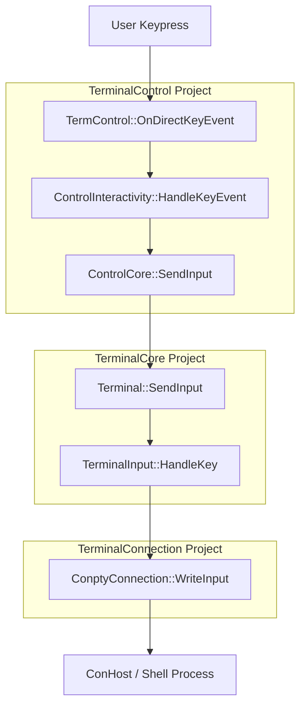
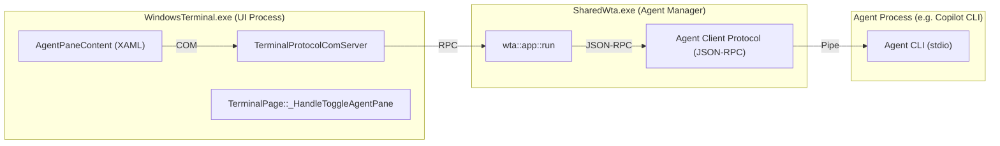

<!-- source: DeepWiki mcp.deepwiki.com · repo microsoft/intelligent-terminal · page 13 Glossary · fetched 2026-10-26 -->

# Glossary

Relevant source files

The following files were used as context for generating this wiki page:

- [.github/actions/spelling/allow/allow.txt](.github/actions/spelling/allow/allow.txt)
- [.github/actions/spelling/allow/apis.txt](.github/actions/spelling/allow/apis.txt)
- [.github/actions/spelling/allow/microsoft.txt](.github/actions/spelling/allow/microsoft.txt)
- [.github/actions/spelling/allow/names.txt](.github/actions/spelling/allow/names.txt)
- [.github/actions/spelling/expect/expect.txt](.github/actions/spelling/expect/expect.txt)
- [NOTICE.md](NOTICE.md)
- [README.md](README.md)
- [build/scripts/Generate-WtaThirdPartyNotices.ps1](build/scripts/Generate-WtaThirdPartyNotices.ps1)
- [doc/cascadia/SettingsSchema.md](doc/cascadia/SettingsSchema.md)
- [doc/cascadia/profiles.schema.json](doc/cascadia/profiles.schema.json)
- [doc/faq.md](doc/faq.md)
- [doc/roadmap-2022.md](doc/roadmap-2022.md)
- [doc/roadmap-2023.md](doc/roadmap-2023.md)
- [doc/specs/#1571 - New Tab Menu Customization/#1571 - New Tab Menu Customization.md](doc/specs/#1571 - New Tab Menu Customization/#1571 - New Tab Menu Customization.md)
- [doc/specs/#1571 - New Tab Menu Customization/Menu-Customization-000.png](doc/specs/#1571 - New Tab Menu Customization/Menu-Customization-000.png)
- [doc/specs/#1595 - Suggestions UI/Suggestions-UI.md](doc/specs/#1595 - Suggestions UI/Suggestions-UI.md)
- [doc/specs/#2046 - Command Palette.md](doc/specs/#2046 - Command Palette.md)
- [doc/specs/#2046 - Unified keybindings and commands, and synthesized action names.md](doc/specs/#2046 - Unified keybindings and commands, and synthesized action names.md)
- [doc/specs/#4066 - Theme-controlled color scheme switch.md](doc/specs/#4066 - Theme-controlled color scheme switch.md)
- [doc/specs/#653 - Quake Mode/#653 - Quake Mode.md](doc/specs/#653 - Quake Mode/#653 - Quake Mode.md)
- [doc/specs/#6899 - Action IDs/#6899 - Action IDs.md](doc/specs/#6899 - Action IDs/#6899 - Action IDs.md)
- [doc/specs/#6899 - Action IDs/data-mockup-actions-ids-keys-maps.png](doc/specs/#6899 - Action IDs/data-mockup-actions-ids-keys-maps.png)
- [doc/terminal-a11y-2023.md](doc/terminal-a11y-2023.md)
- [doc/terminal-v2-roadmap.md](doc/terminal-v2-roadmap.md)
- [images/intelligent-terminal-agent-focus.png](images/intelligent-terminal-agent-focus.png)
- [src/buffer/out/Row.cpp](src/buffer/out/Row.cpp)
- [src/buffer/out/Row.hpp](src/buffer/out/Row.hpp)
- [src/buffer/out/lib/bufferout.vcxproj](src/buffer/out/lib/bufferout.vcxproj)
- [src/buffer/out/sources.inc](src/buffer/out/sources.inc)
- [src/buffer/out/textBuffer.cpp](src/buffer/out/textBuffer.cpp)
- [src/buffer/out/textBuffer.hpp](src/buffer/out/textBuffer.hpp)
- [src/buffer/out/ut_textbuffer/ReflowTests.cpp](src/buffer/out/ut_textbuffer/ReflowTests.cpp)
- [src/cascadia/LocalTests_TerminalApp/CommandlineTest.cpp](src/cascadia/LocalTests_TerminalApp/CommandlineTest.cpp)
- [src/cascadia/LocalTests_TerminalApp/TabTests.cpp](src/cascadia/LocalTests_TerminalApp/TabTests.cpp)
- [src/cascadia/TerminalApp/AgentPaneContent.cpp](src/cascadia/TerminalApp/AgentPaneContent.cpp)
- [src/cascadia/TerminalApp/AgentPaneContent.idl](src/cascadia/TerminalApp/AgentPaneContent.idl)
- [src/cascadia/TerminalApp/AppActionHandlers.cpp](src/cascadia/TerminalApp/AppActionHandlers.cpp)
- [src/cascadia/TerminalApp/AppCommandlineArgs.cpp](src/cascadia/TerminalApp/AppCommandlineArgs.cpp)
- [src/cascadia/TerminalApp/AppCommandlineArgs.h](src/cascadia/TerminalApp/AppCommandlineArgs.h)
- [src/cascadia/TerminalApp/Pane.cpp](src/cascadia/TerminalApp/Pane.cpp)
- [src/cascadia/TerminalApp/Pane.h](src/cascadia/TerminalApp/Pane.h)
- [src/cascadia/TerminalApp/Resources/en-US/Resources.resw](src/cascadia/TerminalApp/Resources/en-US/Resources.resw)
- [src/cascadia/TerminalApp/Tab.cpp](src/cascadia/TerminalApp/Tab.cpp)
- [src/cascadia/TerminalApp/Tab.h](src/cascadia/TerminalApp/Tab.h)
- [src/cascadia/TerminalApp/Tab.idl](src/cascadia/TerminalApp/Tab.idl)
- [src/cascadia/TerminalApp/TabManagement.cpp](src/cascadia/TerminalApp/TabManagement.cpp)
- [src/cascadia/TerminalApp/TerminalPage.Protocol.cpp](src/cascadia/TerminalApp/TerminalPage.Protocol.cpp)
- [src/cascadia/TerminalApp/TerminalPage.cpp](src/cascadia/TerminalApp/TerminalPage.cpp)
- [src/cascadia/TerminalApp/TerminalPage.h](src/cascadia/TerminalApp/TerminalPage.h)
- [src/cascadia/TerminalApp/TerminalPage.idl](src/cascadia/TerminalApp/TerminalPage.idl)
- [src/cascadia/TerminalApp/TerminalPage.xaml](src/cascadia/TerminalApp/TerminalPage.xaml)
- [src/cascadia/TerminalApp/TerminalWindow.cpp](src/cascadia/TerminalApp/TerminalWindow.cpp)
- [src/cascadia/TerminalApp/TerminalWindow.h](src/cascadia/TerminalApp/TerminalWindow.h)
- [src/cascadia/TerminalApp/TerminalWindow.idl](src/cascadia/TerminalApp/TerminalWindow.idl)
- [src/cascadia/TerminalConnection/ConptyConnection.cpp](src/cascadia/TerminalConnection/ConptyConnection.cpp)
- [src/cascadia/TerminalConnection/ConptyConnection.h](src/cascadia/TerminalConnection/ConptyConnection.h)
- [src/cascadia/TerminalConnection/ConptyConnection.idl](src/cascadia/TerminalConnection/ConptyConnection.idl)
- [src/cascadia/TerminalControl/ControlCore.cpp](src/cascadia/TerminalControl/ControlCore.cpp)
- [src/cascadia/TerminalControl/ControlCore.h](src/cascadia/TerminalControl/ControlCore.h)
- [src/cascadia/TerminalControl/ControlCore.idl](src/cascadia/TerminalControl/ControlCore.idl)
- [src/cascadia/TerminalControl/TermControl.cpp](src/cascadia/TerminalControl/TermControl.cpp)
- [src/cascadia/TerminalControl/TermControl.h](src/cascadia/TerminalControl/TermControl.h)
- [src/cascadia/TerminalControl/TermControl.idl](src/cascadia/TerminalControl/TermControl.idl)
- [src/cascadia/TerminalCore/Terminal.cpp](src/cascadia/TerminalCore/Terminal.cpp)
- [src/cascadia/TerminalCore/Terminal.hpp](src/cascadia/TerminalCore/Terminal.hpp)
- [src/cascadia/TerminalCore/TerminalApi.cpp](src/cascadia/TerminalCore/TerminalApi.cpp)
- [src/cascadia/TerminalCore/TerminalSelection.cpp](src/cascadia/TerminalCore/TerminalSelection.cpp)
- [src/cascadia/TerminalProtocol/TerminalProtocol.idl](src/cascadia/TerminalProtocol/TerminalProtocol.idl)
- [src/cascadia/TerminalSettingsModel/ActionAndArgs.cpp](src/cascadia/TerminalSettingsModel/ActionAndArgs.cpp)
- [src/cascadia/TerminalSettingsModel/ActionArgs.cpp](src/cascadia/TerminalSettingsModel/ActionArgs.cpp)
- [src/cascadia/TerminalSettingsModel/ActionArgs.h](src/cascadia/TerminalSettingsModel/ActionArgs.h)
- [src/cascadia/TerminalSettingsModel/ActionArgs.idl](src/cascadia/TerminalSettingsModel/ActionArgs.idl)
- [src/cascadia/TerminalSettingsModel/AllShortcutActions.h](src/cascadia/TerminalSettingsModel/AllShortcutActions.h)
- [src/cascadia/TerminalSettingsModel/CascadiaSettings.cpp](src/cascadia/TerminalSettingsModel/CascadiaSettings.cpp)
- [src/cascadia/TerminalSettingsModel/CascadiaSettings.h](src/cascadia/TerminalSettingsModel/CascadiaSettings.h)
- [src/cascadia/TerminalSettingsModel/CascadiaSettings.idl](src/cascadia/TerminalSettingsModel/CascadiaSettings.idl)
- [src/cascadia/TerminalSettingsModel/CascadiaSettingsSerialization.cpp](src/cascadia/TerminalSettingsModel/CascadiaSettingsSerialization.cpp)
- [src/cascadia/TerminalSettingsModel/Profile.cpp](src/cascadia/TerminalSettingsModel/Profile.cpp)
- [src/cascadia/TerminalSettingsModel/Profile.h](src/cascadia/TerminalSettingsModel/Profile.h)
- [src/cascadia/TerminalSettingsModel/Profile.idl](src/cascadia/TerminalSettingsModel/Profile.idl)
- [src/cascadia/TerminalSettingsModel/Resources/en-US/Resources.resw](src/cascadia/TerminalSettingsModel/Resources/en-US/Resources.resw)
- [src/cascadia/TerminalSettingsModel/TerminalSettingsSerializationHelpers.h](src/cascadia/TerminalSettingsModel/TerminalSettingsSerializationHelpers.h)
- [src/cascadia/TerminalSettingsModel/defaults.json](src/cascadia/TerminalSettingsModel/defaults.json)
- [src/cascadia/WindowsTerminal/TerminalProtocolComServer.cpp](src/cascadia/WindowsTerminal/TerminalProtocolComServer.cpp)
- [src/cascadia/WindowsTerminal/TerminalProtocolComServer.h](src/cascadia/WindowsTerminal/TerminalProtocolComServer.h)
- [src/cascadia/WindowsTerminal/WindowEmperor.cpp](src/cascadia/WindowsTerminal/WindowEmperor.cpp)
- [src/cascadia/WindowsTerminal/WindowEmperor.h](src/cascadia/WindowsTerminal/WindowEmperor.h)
- [src/cascadia/WindowsTerminal/main.cpp](src/cascadia/WindowsTerminal/main.cpp)
- [src/host/outputStream.cpp](src/host/outputStream.cpp)
- [src/host/outputStream.hpp](src/host/outputStream.hpp)
- [src/host/ut_host/ScreenBufferTests.cpp](src/host/ut_host/ScreenBufferTests.cpp)
- [src/host/ut_host/TextBufferTests.cpp](src/host/ut_host/TextBufferTests.cpp)
- [src/inc/conpty-static.h](src/inc/conpty-static.h)
- [src/inc/til/rle.h](src/inc/til/rle.h)
- [src/renderer/atlas/AtlasEngine.api.cpp](src/renderer/atlas/AtlasEngine.api.cpp)
- [src/renderer/atlas/AtlasEngine.cpp](src/renderer/atlas/AtlasEngine.cpp)
- [src/renderer/atlas/AtlasEngine.h](src/renderer/atlas/AtlasEngine.h)
- [src/renderer/atlas/AtlasEngine.r.cpp](src/renderer/atlas/AtlasEngine.r.cpp)
- [src/renderer/atlas/BackendD2D.cpp](src/renderer/atlas/BackendD2D.cpp)
- [src/renderer/atlas/BackendD2D.h](src/renderer/atlas/BackendD2D.h)
- [src/renderer/atlas/BackendD3D.cpp](src/renderer/atlas/BackendD3D.cpp)
- [src/renderer/atlas/BackendD3D.h](src/renderer/atlas/BackendD3D.h)
- [src/renderer/atlas/common.h](src/renderer/atlas/common.h)
- [src/renderer/atlas/shader_ps.hlsl](src/renderer/atlas/shader_ps.hlsl)
- [src/terminal/adapter/DispatchTypes.hpp](src/terminal/adapter/DispatchTypes.hpp)
- [src/terminal/adapter/ITermDispatch.hpp](src/terminal/adapter/ITermDispatch.hpp)
- [src/terminal/adapter/ITerminalApi.hpp](src/terminal/adapter/ITerminalApi.hpp)
- [src/terminal/adapter/adaptDispatch.cpp](src/terminal/adapter/adaptDispatch.cpp)
- [src/terminal/adapter/adaptDispatch.hpp](src/terminal/adapter/adaptDispatch.hpp)
- [src/terminal/adapter/termDispatch.hpp](src/terminal/adapter/termDispatch.hpp)
- [src/terminal/adapter/ut_adapter/adapterTest.cpp](src/terminal/adapter/ut_adapter/adapterTest.cpp)
- [src/terminal/parser/OutputStateMachineEngine.cpp](src/terminal/parser/OutputStateMachineEngine.cpp)
- [src/terminal/parser/OutputStateMachineEngine.hpp](src/terminal/parser/OutputStateMachineEngine.hpp)
- [src/terminal/parser/ut_parser/OutputEngineTest.cpp](src/terminal/parser/ut_parser/OutputEngineTest.cpp)
- [src/tools/RenderingTests/main.cpp](src/tools/RenderingTests/main.cpp)
- [src/tools/wtcli/Formatting.cpp](src/tools/wtcli/Formatting.cpp)
- [src/tools/wtcli/main.cpp](src/tools/wtcli/main.cpp)
- [src/winconpty/dll/winconpty.def](src/winconpty/dll/winconpty.def)
- [src/winconpty/ft_pty/ConPtyTests.cpp](src/winconpty/ft_pty/ConPtyTests.cpp)
- [src/winconpty/winconpty.cpp](src/winconpty/winconpty.cpp)
- [src/winconpty/winconpty.h](src/winconpty/winconpty.h)
- [tools/wta/AGENTS.md](tools/wta/AGENTS.md)
- [tools/wta/Cargo.toml](tools/wta/Cargo.toml)
- [tools/wta/cgmanifest.json](tools/wta/cgmanifest.json)
- [tools/wta/src/agent_pane_origin.rs](tools/wta/src/agent_pane_origin.rs)
- [tools/wta/src/agent_sessions.rs](tools/wta/src/agent_sessions.rs)
- [tools/wta/src/app.rs](tools/wta/src/app.rs)
- [tools/wta/src/history_loader.rs](tools/wta/src/history_loader.rs)
- [tools/wta/src/main.rs](tools/wta/src/main.rs)
- [tools/wta/src/master/mod.rs](tools/wta/src/master/mod.rs)
- [tools/wta/src/protocol/acp/client.rs](tools/wta/src/protocol/acp/client.rs)
- [tools/wta/src/runtime_paths.rs](tools/wta/src/runtime_paths.rs)
- [tools/wta/src/session_mgmt.rs](tools/wta/src/session_mgmt.rs)
- [tools/wta/src/session_registry.rs](tools/wta/src/session_registry.rs)
- [tools/wta/src/shell/wt_channel/cli_channel.rs](tools/wta/src/shell/wt_channel/cli_channel.rs)
- [tools/wta/src/shell/wt_channel/mod.rs](tools/wta/src/shell/wt_channel/mod.rs)
- [tools/wta/src/ui/agents_view.rs](tools/wta/src/ui/agents_view.rs)
- [tools/wta/src/ui/layout.rs](tools/wta/src/ui/layout.rs)

This page provides definitions for codebase-specific terminology, abbreviations, and domain concepts used throughout the Intelligent Terminal project. It serves as a technical reference for onboarding engineers to understand the mapping between conceptual terms and their concrete implementations.

## Core Architectural Concepts

### ACP (Agent Client Protocol)
The standardized JSON-RPC over stdio protocol used by the terminal to communicate with AI agents. It allows the terminal to remain agnostic of the specific LLM or agent implementation.
*   **Implementation**: Handled primarily by the `wta` binary which acts as a bridge.
*   **Sources**: [README.md:43-43](), [README.md:117-117]()

### ConPTY (Pseudo Console)
The Windows infrastructure that allows "headless" console applications to run by providing a virtualized console environment. It translates console API calls into VT sequences for the terminal.
*   **Implementation**: `ConptyConnection` manages the lifecycle of the PTY process.
*   **Sources**: [src/cascadia/TerminalConnection/ConptyConnection.cpp:1-20]()

### ControlCore
The non-UI logic layer of the terminal emulator. it bridges the `Terminal` (state) and the `Renderer` (output), handling font measurements and dispatcher throttling.
*   **Class**: `winrt::Microsoft::Terminal::Control::implementation::ControlCore`
*   **Sources**: [src/cascadia/TerminalControl/ControlCore.cpp:68-100](), [src/cascadia/TerminalControl/ControlCore.h:1-30]()

### TermControl
The XAML UserControl that represents a single terminal instance in the UI. It handles WinUI input events (mouse, keyboard, touch) and hosts the swap chain for rendering.
*   **Class**: `winrt::Microsoft::Terminal::Control::implementation::TermControl`
*   **Sources**: [src/cascadia/TerminalControl/TermControl.cpp:46-53](), [src/cascadia/TerminalControl/TermControl.h:46-50]()

---

## Domain Terminology

| Term | Definition | Code Pointer |
| :--- | :--- | :--- |
| **ActionMap** | A mapping of `KeyChord` (keyboard shortcuts) to `ActionAndArgs` (commands). | [src/cascadia/TerminalSettingsModel/CascadiaSettings.cpp:1-50]() |
| **AtlasEngine** | The hardware-accelerated Direct3D renderer backend. | [src/renderer/atlas/AtlasEngine.cpp:1-20]() |
| **Cascadia** | The internal codename for the Windows Terminal project. | [doc/cascadia/profiles.schema.json:2-2]() |
| **IslandWindow** | The Win32 window hosting the XAML Island content. | [src/cascadia/WindowsTerminal/WindowEmperor.cpp:1-50]() |
| **Pane** | A subdivision of a Tab; can be a leaf (hosting a `TermControl`) or a branch. | [src/cascadia/TerminalApp/Pane.cpp:1-30]() |
| **SGR** | Select Graphic Rendition; VT sequences (e.g., `\x1b[31m`) that change text attributes. | [src/terminal/adapter/adaptDispatch.cpp:40-100]() |
| **til** | Terminal Implementation Library; a header-only utility library for terminal-specific types. | [src/cascadia/TerminalCore/Terminal.cpp:14-15]() |
| **WTA** | Windows Terminal Agent; the Rust-based binary managing AI agent sessions. | [tools/wta/src/main.rs:1-10]() |

---

## Data Flow & System Mapping

The following diagrams illustrate the relationship between high-level concepts and the specific classes/functions that implement them.

### Input Data Flow: From Keypress to Shell
This diagram bridges the "Natural Language Space" of user interaction to the "Code Entity Space" of input processing.

**Sources**: [src/cascadia/TerminalControl/TermControl.cpp:147-147](), [src/cascadia/TerminalControl/ControlCore.cpp:107-109](), [src/cascadia/TerminalApp/AppActionHandlers.cpp:181-196]()

### AI Integration: Agent Pane & WTA
This diagram maps the AI feature names to the internal protocol and process boundaries.

**Sources**: [src/cascadia/TerminalApp/TerminalPage.cpp:23-33](), [src/cascadia/WindowsTerminal/TerminalProtocolComServer.cpp:1-50](), [tools/wta/src/app.rs:1-20]()

---

## Technical Details

### TextBuffer & ROW Storage
The `TextBuffer` is a circular buffer of `ROW` objects. Each `ROW` contains the character data and associated `TextAttribute` metadata.
*   **Implementation**: `TextBuffer` uses a virtual memory arena to handle large scrollback without frequent reallocations.
*   **Key Functions**: `TextBuffer::GetRowByOffset`, `ROW::Replace`.
*   **Sources**: [src/buffer/out/textBuffer.cpp:1-100](), [src/buffer/out/textBuffer.hpp:1-50]()

### VT Parsing Pipeline
When data arrives from the shell, it is processed by the `StateMachine`.
1.  **OutputStateMachineEngine**: Parses raw bytes into VT commands (CSI, OSC, etc.).
2.  **AdaptDispatch**: Implements the `ITermDispatch` interface to translate those commands into operations on the `Terminal` state or `TextBuffer`.
*   **Sources**: [src/terminal/parser/OutputStateMachineEngine.cpp:1-50](), [src/terminal/adapter/adaptDispatch.cpp:40-60]()

### Settings Layering
Settings are resolved through a hierarchy defined in `CascadiaSettings`.
1.  **Defaults**: Hardcoded in `defaults.json`.
2.  **User**: Found in `settings.json`.
3.  **Fragments**: Provided by third-party extensions or dynamic profile generators (e.g., WSL, PowerShell).
*   **Sources**: [src/cascadia/TerminalSettingsModel/CascadiaSettings.cpp:1-100](), [src/cascadia/TerminalSettingsModel/defaults.json:1-50]()