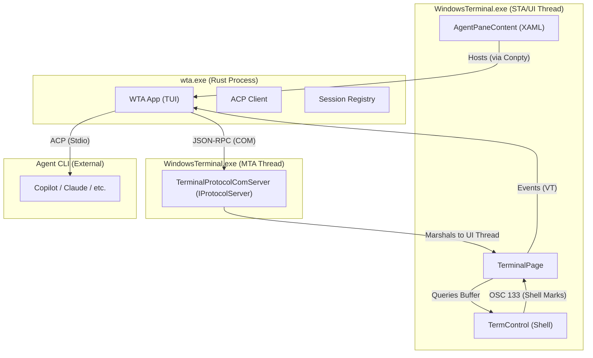
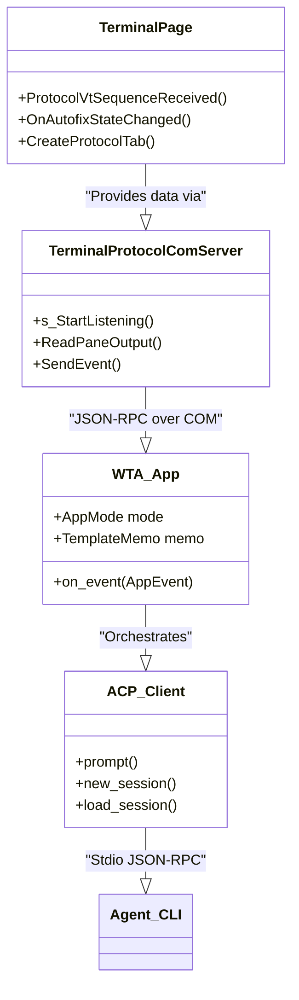

<!-- source: DeepWiki mcp.deepwiki.com · repo microsoft/intelligent-terminal · page 2 AI Agent Integration · fetched 2026-10-26 -->

# AI Agent Integration

Relevant source files

The following files were used as context for generating this wiki page:

- [.github/actions/spelling/allow/allow.txt](.github/actions/spelling/allow/allow.txt)
- [.github/actions/spelling/allow/apis.txt](.github/actions/spelling/allow/apis.txt)
- [.github/actions/spelling/allow/microsoft.txt](.github/actions/spelling/allow/microsoft.txt)
- [.github/actions/spelling/allow/names.txt](.github/actions/spelling/allow/names.txt)
- [.github/actions/spelling/expect/expect.txt](.github/actions/spelling/expect/expect.txt)
- [NOTICE.md](NOTICE.md)
- [README.md](README.md)
- [build/scripts/Generate-WtaThirdPartyNotices.ps1](build/scripts/Generate-WtaThirdPartyNotices.ps1)
- [doc/faq.md](doc/faq.md)
- [doc/roadmap-2022.md](doc/roadmap-2022.md)
- [doc/roadmap-2023.md](doc/roadmap-2023.md)
- [doc/specs/#1571 - New Tab Menu Customization/#1571 - New Tab Menu Customization.md](doc/specs/#1571 - New Tab Menu Customization/#1571 - New Tab Menu Customization.md)
- [doc/specs/#1571 - New Tab Menu Customization/Menu-Customization-000.png](doc/specs/#1571 - New Tab Menu Customization/Menu-Customization-000.png)
- [doc/specs/#1595 - Suggestions UI/Suggestions-UI.md](doc/specs/#1595 - Suggestions UI/Suggestions-UI.md)
- [doc/specs/#2046 - Command Palette.md](doc/specs/#2046 - Command Palette.md)
- [doc/specs/#2046 - Unified keybindings and commands, and synthesized action names.md](doc/specs/#2046 - Unified keybindings and commands, and synthesized action names.md)
- [doc/specs/#4066 - Theme-controlled color scheme switch.md](doc/specs/#4066 - Theme-controlled color scheme switch.md)
- [doc/specs/#653 - Quake Mode/#653 - Quake Mode.md](doc/specs/#653 - Quake Mode/#653 - Quake Mode.md)
- [doc/specs/#6899 - Action IDs/#6899 - Action IDs.md](doc/specs/#6899 - Action IDs/#6899 - Action IDs.md)
- [doc/specs/#6899 - Action IDs/data-mockup-actions-ids-keys-maps.png](doc/specs/#6899 - Action IDs/data-mockup-actions-ids-keys-maps.png)
- [doc/terminal-a11y-2023.md](doc/terminal-a11y-2023.md)
- [doc/terminal-v2-roadmap.md](doc/terminal-v2-roadmap.md)
- [images/intelligent-terminal-agent-focus.png](images/intelligent-terminal-agent-focus.png)
- [src/cascadia/TerminalApp/AgentPaneContent.cpp](src/cascadia/TerminalApp/AgentPaneContent.cpp)
- [src/cascadia/TerminalApp/AgentPaneContent.idl](src/cascadia/TerminalApp/AgentPaneContent.idl)
- [src/cascadia/TerminalApp/TerminalPage.Protocol.cpp](src/cascadia/TerminalApp/TerminalPage.Protocol.cpp)
- [src/cascadia/TerminalApp/TerminalPage.idl](src/cascadia/TerminalApp/TerminalPage.idl)
- [src/cascadia/TerminalProtocol/TerminalProtocol.idl](src/cascadia/TerminalProtocol/TerminalProtocol.idl)
- [src/cascadia/WindowsTerminal/TerminalProtocolComServer.cpp](src/cascadia/WindowsTerminal/TerminalProtocolComServer.cpp)
- [src/cascadia/WindowsTerminal/TerminalProtocolComServer.h](src/cascadia/WindowsTerminal/TerminalProtocolComServer.h)
- [src/tools/wtcli/Formatting.cpp](src/tools/wtcli/Formatting.cpp)
- [src/tools/wtcli/main.cpp](src/tools/wtcli/main.cpp)
- [tools/wta/AGENTS.md](tools/wta/AGENTS.md)
- [tools/wta/Cargo.toml](tools/wta/Cargo.toml)
- [tools/wta/cgmanifest.json](tools/wta/cgmanifest.json)
- [tools/wta/src/agent_pane_origin.rs](tools/wta/src/agent_pane_origin.rs)
- [tools/wta/src/agent_sessions.rs](tools/wta/src/agent_sessions.rs)
- [tools/wta/src/app.rs](tools/wta/src/app.rs)
- [tools/wta/src/history_loader.rs](tools/wta/src/history_loader.rs)
- [tools/wta/src/main.rs](tools/wta/src/main.rs)
- [tools/wta/src/master/mod.rs](tools/wta/src/master/mod.rs)
- [tools/wta/src/protocol/acp/client.rs](tools/wta/src/protocol/acp/client.rs)
- [tools/wta/src/runtime_paths.rs](tools/wta/src/runtime_paths.rs)
- [tools/wta/src/session_mgmt.rs](tools/wta/src/session_mgmt.rs)
- [tools/wta/src/session_registry.rs](tools/wta/src/session_registry.rs)
- [tools/wta/src/shell/wt_channel/cli_channel.rs](tools/wta/src/shell/wt_channel/cli_channel.rs)
- [tools/wta/src/shell/wt_channel/mod.rs](tools/wta/src/shell/wt_channel/mod.rs)
- [tools/wta/src/ui/agents_view.rs](tools/wta/src/ui/agents_view.rs)
- [tools/wta/src/ui/layout.rs](tools/wta/src/ui/layout.rs)

The Intelligent Terminal extends the standard Windows Terminal with a native AI agent subsystem. This integration allows users to interact with Large Language Models (LLMs) through Agent Client Protocol (ACP) compatible CLI tools directly within the terminal interface.

The architecture is built around a split-process model: the **Windows Terminal (WindowsTerminal.exe)** handles the UI and terminal emulation, while the **Windows Terminal Agent (wta.exe)** acts as a middleware that orchestrates agent processes and manages session state.

### System Architecture Overview

The integration consists of four major components communicating via COM and VT sequences:

1.  **Agent Pane (`AgentPaneContent`)**: A XAML-based side-pane within the Terminal UI that hosts a `wta.exe` instance.
2.  **Windows Terminal Agent (`wta.exe`)**: A Rust-based binary that manages ACP agent CLIs (e.g., GitHub Copilot, Claude Code) and provides a TUI for chat and session management.
3.  **Terminal Protocol COM Server**: A high-performance bridge inside the terminal process that allows `wta.exe` to read terminal buffers and automate actions.
4.  **Shell Integration**: OSC 133 sequences that mark command boundaries, enabling features like automatic error detection and "Auto-fix".

#### Component Interaction Diagram

Sources: [README.md:39-47](), [src/cascadia/WindowsTerminal/TerminalProtocolComServer.cpp:44-68](), [tools/wta/src/app.rs:109-116]()

---

### Key Subsystems

#### 1. Windows Terminal Agent (WTA)
The `wta.exe` binary is the core orchestrator. It operates in three primary modes: a TUI client for the agent pane, a session manager, and a background helper. It implements the **Agent Client Protocol (ACP)** to communicate with agents via JSON-RPC over stdio.

*   **Master/Helper Architecture**: WTA uses a "master" process to track global session state and "helper" processes for individual panes.
*   **Session Management**: Maintains a history of conversations and allows resuming sessions across different terminal tabs.

For details, see [WTA: Windows Terminal Agent Binary](#2.1).

Sources: [tools/wta/src/main.rs:120-183](), [tools/wta/src/app.rs:38-52]()

#### 2. Terminal Protocol COM Server
To provide agents with context (like the contents of the terminal buffer), the terminal hosts a COM server implementing `IProtocolServer`. This interface allows external processes to:
*   List windows, tabs, and panes.
*   Read output from specific sessions.
*   Inject input or create new tabs.

The `wtcli.exe` utility is a command-line consumer of this interface, used for testing and automation.

For details, see [Terminal Protocol COM Server and wtcli](#2.2).

Sources: [src/cascadia/WindowsTerminal/TerminalProtocolComServer.h:51-90](), [src/tools/wtcli/main.cpp:40-75]()

#### 3. Agent Pane and UI Integration
The **Agent Pane** is a specialized `TerminalPaneContent` that hosts the WTA TUI. It is context-aware, automatically associating itself with the "active" shell pane in a tab.

*   **Onboarding (FRE)**: A First-Run Experience wizard helps users select and install their preferred agent (e.g., via WinGet).
*   **Settings**: Managed via the `AIAgents` settings page, allowing configuration of model overrides and pane placement.

For details, see [Agent Pane, FRE Onboarding, and AI Settings](#2.3).

Sources: [src/cascadia/TerminalApp/TerminalPage.idl:110-125](), [README.md:113-122]()

#### 4. Shell Integration and Auto-Fix
Intelligent Terminal uses **OSC 133** shell marks to understand the structure of the shell (prompt, command, and output). This allows the terminal to detect when a command finishes with a non-zero exit code.

*   **Auto-Fix**: When an error is detected, the terminal can automatically send the error context to the agent to suggest a fix.
*   **Security**: Agent-suggested commands are not executed automatically; they require user confirmation.

For details, see [Shell Integration and Auto-Fix](#2.4).

Sources: [tools/wta/src/app.rs:31-34](), [tools/wta/src/protocol/acp/client.rs:82-87]()

---

### Code Mapping: Logic to Entities

The following diagram maps the high-level integration logic to specific classes and files in the repository.

Sources: [src/cascadia/TerminalApp/TerminalPage.idl:110-128](), [src/cascadia/WindowsTerminal/TerminalProtocolComServer.h:51-90](), [tools/wta/src/app.rs:108-116](), [tools/wta/src/protocol/acp/client.rs:77-173]()

---

