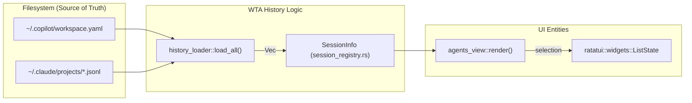

<!-- source: DeepWiki mcp.deepwiki.com · repo microsoft/intelligent-terminal · page 2.1 WTA: Windows Terminal Agent Binary · fetched 2026-10-26 -->

# WTA: Windows Terminal Agent Binary

<details>
<summary>Relevant source files</summary>

The following files were used as context for generating this wiki page:

- [NOTICE.md](NOTICE.md)
- [build/scripts/Generate-WtaThirdPartyNotices.ps1](build/scripts/Generate-WtaThirdPartyNotices.ps1)
- [doc/security-model.md](doc/security-model.md)
- [doc/specs/rtl-investigation.md](doc/specs/rtl-investigation.md)
- [src/cascadia/TerminalApp/AgentPaneContent.cpp](src/cascadia/TerminalApp/AgentPaneContent.cpp)
- [src/cascadia/TerminalApp/AgentPaneContent.idl](src/cascadia/TerminalApp/AgentPaneContent.idl)
- [src/cascadia/TerminalApp/AgentPaneLog.h](src/cascadia/TerminalApp/AgentPaneLog.h)
- [src/cascadia/inc/IntelligentTerminalPaths.h](src/cascadia/inc/IntelligentTerminalPaths.h)
- [src/cascadia/inc/RtlHelper.h](src/cascadia/inc/RtlHelper.h)
- [src/cascadia/ut_app/RtlHelperTests.cpp](src/cascadia/ut_app/RtlHelperTests.cpp)
- [tools/wta/AGENTS.md](tools/wta/AGENTS.md)
- [tools/wta/Cargo.toml](tools/wta/Cargo.toml)
- [tools/wta/README.md](tools/wta/README.md)
- [tools/wta/cgmanifest.json](tools/wta/cgmanifest.json)
- [tools/wta/locales/ar-SA.yml](tools/wta/locales/ar-SA.yml)
- [tools/wta/locales/as-IN.yml](tools/wta/locales/as-IN.yml)
- [tools/wta/locales/az-Latn-AZ.yml](tools/wta/locales/az-Latn-AZ.yml)
- [tools/wta/locales/bg-BG.yml](tools/wta/locales/bg-BG.yml)
- [tools/wta/locales/bs-Latn-BA.yml](tools/wta/locales/bs-Latn-BA.yml)
- [tools/wta/locales/cs-CZ.yml](tools/wta/locales/cs-CZ.yml)
- [tools/wta/locales/de-DE.yml](tools/wta/locales/de-DE.yml)
- [tools/wta/locales/en-US.yml](tools/wta/locales/en-US.yml)
- [tools/wta/locales/es-ES.yml](tools/wta/locales/es-ES.yml)
- [tools/wta/locales/es-MX.yml](tools/wta/locales/es-MX.yml)
- [tools/wta/locales/fa-IR.yml](tools/wta/locales/fa-IR.yml)
- [tools/wta/prompts/auto-fix.md](tools/wta/prompts/auto-fix.md)
- [tools/wta/prompts/terminal-agent.md](tools/wta/prompts/terminal-agent.md)
- [tools/wta/src/agent_check.rs](tools/wta/src/agent_check.rs)
- [tools/wta/src/agent_hooks_installer.rs](tools/wta/src/agent_hooks_installer.rs)
- [tools/wta/src/agent_pane_origin.rs](tools/wta/src/agent_pane_origin.rs)
- [tools/wta/src/agent_sessions.rs](tools/wta/src/agent_sessions.rs)
- [tools/wta/src/app.rs](tools/wta/src/app.rs)
- [tools/wta/src/app/turn_state.rs](tools/wta/src/app/turn_state.rs)
- [tools/wta/src/commands.rs](tools/wta/src/commands.rs)
- [tools/wta/src/coordinator.rs](tools/wta/src/coordinator.rs)
- [tools/wta/src/event.rs](tools/wta/src/event.rs)
- [tools/wta/src/history_loader.rs](tools/wta/src/history_loader.rs)
- [tools/wta/src/logging.rs](tools/wta/src/logging.rs)
- [tools/wta/src/main.rs](tools/wta/src/main.rs)
- [tools/wta/src/master/mod.rs](tools/wta/src/master/mod.rs)
- [tools/wta/src/protocol/acp/client.rs](tools/wta/src/protocol/acp/client.rs)
- [tools/wta/src/protocol/acp/probe.rs](tools/wta/src/protocol/acp/probe.rs)
- [tools/wta/src/protocol/acp/spawn.rs](tools/wta/src/protocol/acp/spawn.rs)
- [tools/wta/src/rtl.rs](tools/wta/src/rtl.rs)
- [tools/wta/src/runtime_paths.rs](tools/wta/src/runtime_paths.rs)
- [tools/wta/src/session_mgmt.rs](tools/wta/src/session_mgmt.rs)
- [tools/wta/src/session_registry.rs](tools/wta/src/session_registry.rs)
- [tools/wta/src/shell/wt_channel/cli_channel.rs](tools/wta/src/shell/wt_channel/cli_channel.rs)
- [tools/wta/src/shell/wt_channel/mod.rs](tools/wta/src/shell/wt_channel/mod.rs)
- [tools/wta/src/slash_command_tests.rs](tools/wta/src/slash_command_tests.rs)
- [tools/wta/src/theme.rs](tools/wta/src/theme.rs)
- [tools/wta/src/ui/agents_view.rs](tools/wta/src/ui/agents_view.rs)
- [tools/wta/src/ui/auth.rs](tools/wta/src/ui/auth.rs)
- [tools/wta/src/ui/card.rs](tools/wta/src/ui/card.rs)
- [tools/wta/src/ui/chat.rs](tools/wta/src/ui/chat.rs)
- [tools/wta/src/ui/input.rs](tools/wta/src/ui/input.rs)
- [tools/wta/src/ui/layout.rs](tools/wta/src/ui/layout.rs)
- [tools/wta/src/ui/mod.rs](tools/wta/src/ui/mod.rs)
- [tools/wta/src/ui/permission.rs](tools/wta/src/ui/permission.rs)
- [tools/wta/src/ui/recommendations.rs](tools/wta/src/ui/recommendations.rs)
- [tools/wta/src/ui/setup.rs](tools/wta/src/ui/setup.rs)
- [tools/wta/wt-agent-hooks/claude/.claude-plugin/marketplace.json](tools/wta/wt-agent-hooks/claude/.claude-plugin/marketplace.json)
- [tools/wta/wt-agent-hooks/claude/wt-agent-hooks/.claude-plugin/plugin.json](tools/wta/wt-agent-hooks/claude/wt-agent-hooks/.claude-plugin/plugin.json)
- [tools/wta/wt-agent-hooks/claude/wt-agent-hooks/hooks/send-event.ps1](tools/wta/wt-agent-hooks/claude/wt-agent-hooks/hooks/send-event.ps1)
- [tools/wta/wt-agent-hooks/codex/wt-agent-hooks/.codex-plugin/plugin.json](tools/wta/wt-agent-hooks/codex/wt-agent-hooks/.codex-plugin/plugin.json)
- [tools/wta/wt-agent-hooks/codex/wt-agent-hooks/hooks/send-event.ps1](tools/wta/wt-agent-hooks/codex/wt-agent-hooks/hooks/send-event.ps1)
- [tools/wta/wt-agent-hooks/copilot/.claude-plugin/marketplace.json](tools/wta/wt-agent-hooks/copilot/.claude-plugin/marketplace.json)
- [tools/wta/wt-agent-hooks/copilot/wt-agent-hooks/.claude-plugin/plugin.json](tools/wta/wt-agent-hooks/copilot/wt-agent-hooks/.claude-plugin/plugin.json)
- [tools/wta/wt-agent-hooks/copilot/wt-agent-hooks/hooks/send-event.ps1](tools/wta/wt-agent-hooks/copilot/wt-agent-hooks/hooks/send-event.ps1)
- [tools/wta/wt-agent-hooks/gemini-extension/gemini-extension.json](tools/wta/wt-agent-hooks/gemini-extension/gemini-extension.json)
- [tools/wta/wt-agent-hooks/gemini-extension/hooks/send-event.ps1](tools/wta/wt-agent-hooks/gemini-extension/hooks/send-event.ps1)

</details>


The **Windows Terminal Agent (WTA)** is a Rust-based binary (`wta.exe`) that serves as the primary orchestration layer between Windows Terminal and AI Agent CLIs. It implements the **Agent Client Protocol (ACP)** to communicate with agents (like Copilot, Claude, or Gemini) and provides a terminal-native user interface built on `ratatui`.

## Operating Modes

`wta` operates in three distinct modes depending on its launch arguments:

1.  **ACP Client (TUI Mode)**: The default mode used in the Agent Pane. It hosts the chat interface, handles user input, and manages the lifecycle of the Agent CLI [tools/wta/src/main.rs:120-190]().
2.  **WTA Master**: A singleton multiplexer that spawns a single Agent CLI subprocess and allows multiple "helper" panes to connect to it via named pipes [tools/wta/src/master/mod.rs:3-16]().
3.  **CLI Helpers**: Utility commands (e.g., `wta sessions list`, `wta hooks install`) that interact with the session registry or perform environment setup [tools/wta/src/main.rs:200-260]().

### Data Flow: Master/Helper Architecture

To support multiple terminal windows sharing a single AI agent instance, WTA uses a master/helper split.

| Component | Role | Communication |
| :--- | :--- | :--- |
| **WTA Master** | Owns the Agent CLI process; manages the authoritative `SessionId` registry. | Named Pipe (Server) |
| **WTA Helper** | Hosts the TUI for a specific pane; forwards user prompts to Master. | Named Pipe (Client) |
| **Agent CLI** | The actual LLM-backed process (e.g., `copilot.exe`). | Stdio (JSON-RPC) |

Sources: [tools/wta/src/master/mod.rs:18-35](), [tools/wta/src/protocol/acp/client.rs:124-149]()

## Core Components

### 1. Session Registry and History Loader
WTA maintains a runtime registry of both live and historical sessions. 
*   **`AgentSessionRegistry`**: Tracks active sessions by `pane_session_id` (the WT pane GUID) and `AgentKey` (the CLI's internal ID) [tools/wta/src/agent_sessions.rs:10-27]().
*   **`history_loader`**: Scans on-disk metadata for various CLIs (e.g., `~/.claude/projects/`, `~/.copilot/session-state/`) to reconstruct past conversations for the "Agent Sessions" view [tools/wta/src/history_loader.rs:1-59]().

### 2. The Ratatui UI
The interface is rendered using the `ratatui` crate. The layout is dynamically calculated based on the pane's dimensions and current state (Chat, Auth, or Setup) [tools/wta/src/ui/layout.rs:9-40]().

*   **Chat View**: Renders the message history and streaming chunks from the agent [tools/wta/src/ui/layout.rs:135-155]().
*   **Agents View**: A session management list (triggered by `Ctrl+Shift+/`) that allows users to resume historical sessions [tools/wta/src/ui/layout.rs:48-82]().
*   **Setup View**: Handles first-run experiences, including `winget` installation of missing agents [tools/wta/src/app.rs:158-200]().

### 3. Agent Hooks Bridge
To detect activity in standard shell panes (where WTA is not the parent), WTA installs PowerShell-based hooks into agent CLIs. These hooks (`send-event.ps1`) invoke `wtcli.exe` to broadcast events to the Terminal's COM server, which WTA then observes to update the session registry [tools/wta/src/agent_hooks_installer.rs:9-14](), [tools/wta/wt-agent-hooks/copilot/wt-agent-hooks/hooks/send-event.ps1:1-33]().

## Implementation Diagrams

### Agent Communication Stack
This diagram shows how code entities bridge the gap between the user's Natural Language prompt and the execution of commands.

```mermaid
graph TD
    subgraph "Natural Language Space"
        UserPrompt["User Prompt (String)"]
    end

    subgraph "WTA Binary (Code Entity Space)"
        App["App (app.rs)"]
        AcpClient["AcpClient (protocol/acp/client.rs)"]
        TurnState["TurnState (app/turn_state.rs)"]
        ShellMgr["ShellManager (shell/mod.rs)"]
    end

    subgraph "External Agent"
        AgentCLI["Agent CLI (e.g. Copilot/Claude)"]
    end

    UserPrompt -->|KeyCode::Enter| App
    App -->|PromptSubmission| AcpClient
    AcpClient -->|JSON-RPC 'session/prompt'| AgentCLI
    AgentCLI -->|'session/updated' (Chunks)| AcpClient
    AcpClient -->|AppEvent::Chunk| TurnState
    AgentCLI -->|'terminal/write'| ShellMgr
    ShellMgr -->|IProtocolServer::SendInput| WT["Windows Terminal"]
```
Sources: [tools/wta/src/app.rs:12-28](), [tools/wta/src/protocol/acp/client.rs:77-87](), [tools/wta/src/master/mod.rs:18-35]()

### Session Management & History Discovery
This diagram illustrates how WTA discovers historical data from the filesystem and maps it to UI components.


Sources: [tools/wta/src/history_loader.rs:7-52](), [tools/wta/src/agent_sessions.rs:136-150](), [tools/wta/src/ui/agents_view.rs:27-52]()

## Key Functions

| Function | File | Description |
| :--- | :--- | :--- |
| `main()` | [tools/wta/src/main.rs:120]() | Entry point; parses CLI arguments and determines operating mode. |
| `render()` | [tools/wta/src/ui/layout.rs:9]() | The main UI loop that composes the chat, input, and agent views. |
| `load_all()` | [tools/wta/src/history_loader.rs:82]() | Scans the user's home directory for agent-specific session logs. |
| `should_ship()` | [tools/wta/src/protocol/acp/client.rs:65]() | Determines if a prompt template needs to be re-sent to the agent (memoization). |
| `ensure_installed()` | [tools/wta/src/agent_hooks_installer.rs:92]() | Orchestrates the installation of the `wt-agent-hooks` into third-party CLIs. |

Sources: [tools/wta/src/main.rs](), [tools/wta/src/ui/layout.rs](), [tools/wta/src/history_loader.rs](), [tools/wta/src/protocol/acp/client.rs](), [tools/wta/src/agent_hooks_installer.rs]()

---

