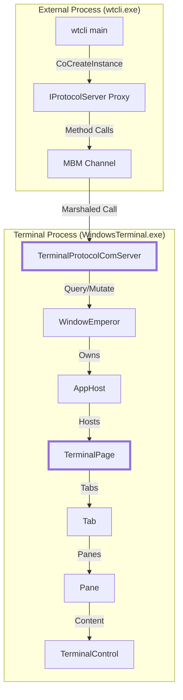
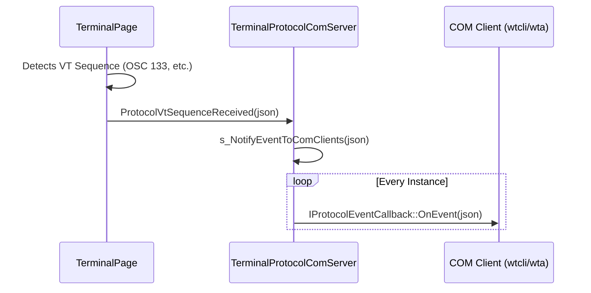
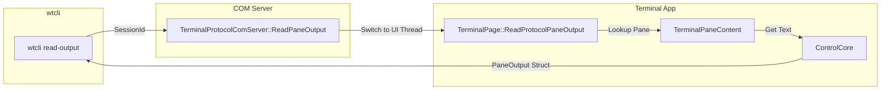

<!-- source: DeepWiki mcp.deepwiki.com · repo microsoft/intelligent-terminal · page 2.2 Terminal Protocol COM Server and wtcli · fetched 2026-10-26 -->

# Terminal Protocol COM Server and wtcli

Relevant source files

The following files were used as context for generating this wiki page:

- [OpenConsole.slnx](OpenConsole.slnx)
- [build/pipelines/fuzz.yml](build/pipelines/fuzz.yml)
- [src/cascadia/TerminalApp/TerminalPage.Protocol.cpp](src/cascadia/TerminalApp/TerminalPage.Protocol.cpp)
- [src/cascadia/TerminalApp/TerminalPage.idl](src/cascadia/TerminalApp/TerminalPage.idl)
- [src/cascadia/TerminalProtocol/ProtocolParsing.h](src/cascadia/TerminalProtocol/ProtocolParsing.h)
- [src/cascadia/TerminalProtocol/TerminalProtocol.idl](src/cascadia/TerminalProtocol/TerminalProtocol.idl)
- [src/cascadia/TerminalProtocol/TerminalProtocol.vcxproj](src/cascadia/TerminalProtocol/TerminalProtocol.vcxproj)
- [src/cascadia/TerminalProtocol/ft_fuzzer/ProtocolFuzzer.vcxproj](src/cascadia/TerminalProtocol/ft_fuzzer/ProtocolFuzzer.vcxproj)
- [src/cascadia/TerminalProtocol/ft_fuzzer/fuzzmain.cpp](src/cascadia/TerminalProtocol/ft_fuzzer/fuzzmain.cpp)
- [src/cascadia/TerminalProtocol/ft_fuzzer/precomp.cpp](src/cascadia/TerminalProtocol/ft_fuzzer/precomp.cpp)
- [src/cascadia/TerminalProtocol/ft_fuzzer/precomp.h](src/cascadia/TerminalProtocol/ft_fuzzer/precomp.h)
- [src/cascadia/WindowsTerminal/TerminalProtocolComServer.cpp](src/cascadia/WindowsTerminal/TerminalProtocolComServer.cpp)
- [src/cascadia/WindowsTerminal/TerminalProtocolComServer.h](src/cascadia/WindowsTerminal/TerminalProtocolComServer.h)
- [src/tools/wtcli/Formatting.cpp](src/tools/wtcli/Formatting.cpp)
- [src/tools/wtcli/Formatting.h](src/tools/wtcli/Formatting.h)
- [src/tools/wtcli/ft_fuzzer/fuzzmain.cpp](src/tools/wtcli/ft_fuzzer/fuzzmain.cpp)
- [src/tools/wtcli/main.cpp](src/tools/wtcli/main.cpp)
- [src/tools/wtcli/wtcli.vcxproj](src/tools/wtcli/wtcli.vcxproj)
- [src/tools/wtcli/wtcli_functions.h](src/tools/wtcli/wtcli_functions.h)

The Terminal Protocol provides a cross-process interface for querying and mutating the state of Windows Terminal. It is primarily used by `wtcli.exe` and the AI agent infrastructure to inspect window/tab hierarchies, read pane content, and inject input.

## Architecture Overview

The system consists of a COM server hosted within `WindowsTerminal.exe` and clients (like `wtcli.exe` or `wta.exe`) that consume the `IProtocolServer` interface.

### Key Components

*   **`IProtocolServer`**: The primary WinRT/COM interface defining the protocol's capabilities [src/cascadia/TerminalProtocol/TerminalProtocol.idl:97-127]().
*   **`TerminalProtocolComServer`**: The C++ implementation of the server inside the terminal process [src/cascadia/WindowsTerminal/TerminalProtocolComServer.cpp:52-53]().
*   **`wtcli.exe`**: A command-line utility that acts as a reference client for the protocol [src/tools/wtcli/main.cpp:124-125]().
*   **Metadata Based Marshaling (MBM)**: Used to handle cross-process communication without requiring a custom proxy/stub DLL [src/cascadia/WindowsTerminal/TerminalProtocolComServer.h:24-26]().

### Entity Relationship Diagram

The following diagram illustrates how the COM server bridges the gap between external CLI tools and the internal Terminal UI hierarchy.

Title: Terminal Protocol Entity Mapping

Sources: [src/cascadia/WindowsTerminal/TerminalProtocolComServer.cpp:23-37](), [src/cascadia/TerminalApp/TerminalPage.Protocol.cpp:9-12](), [src/tools/wtcli/main.cpp:58-59]()

---

## The COM Server Implementation

### Threading Model
The COM server uses a dedicated **MTA (Multithreaded Apartment)** thread to listen for incoming requests [src/cascadia/WindowsTerminal/TerminalProtocolComServer.cpp:44-46](). This prevents external COM calls from blocking the main UI thread during initial dispatch.

However, since most terminal operations (querying tabs, splitting panes) must interact with XAML elements, the server methods are implemented as coroutines that marshal to the **UI Thread** using `wil::resume_foreground(Dispatcher())` [src/cascadia/TerminalApp/TerminalPage.Protocol.cpp:9-12]().

### Identifier Hierarchy
The protocol uses a specific hierarchy to identify UI elements:
1.  **WindowId**: A `uint64_t` identifying the top-level window [src/cascadia/TerminalProtocol/TerminalProtocol.idl:10]().
2.  **TabId**: A `uint32_t` identifying a tab within a specific window [src/cascadia/TerminalProtocol/TerminalProtocol.idl:18]().
3.  **SessionId**: A `GUID` uniquely identifying a specific terminal connection (pane) across all windows [src/cascadia/TerminalProtocol/TerminalProtocol.idl:27]().

### Event Fan-out
The server supports a push-based event model via `IProtocolEventCallback` [src/cascadia/TerminalProtocol/TerminalProtocol.idl:89-92]().
*   **Subscription**: Clients call `Subscribe()` to register their callback [src/cascadia/WindowsTerminal/TerminalProtocolComServer.cpp:227-233]().
*   **VT Sequence Forwarding**: `TerminalPage` emits `ProtocolVtSequenceReceived` when special VT sequences (like agent attachments) are detected [src/cascadia/TerminalApp/TerminalPage.idl:124]().
*   **Notification**: The server maintains a static list of active COM instances and broadcasts events to all subscribed clients [src/cascadia/WindowsTerminal/TerminalProtocolComServer.cpp:217-225]().

Title: Event Dispatch Flow

Sources: [src/cascadia/WindowsTerminal/TerminalProtocolComServer.cpp:200-205](), [src/cascadia/WindowsTerminal/TerminalProtocolComServer.cpp:217-225]()

---

## wtcli: The Protocol Client

`wtcli.exe` provides a command-line interface to all `IProtocolServer` methods.

### Connection Logic
`wtcli` locates the terminal instance using the `WT_COM_CLSID` environment variable, which is set by Windows Terminal in every pane's environment [src/tools/wtcli/main.cpp:42-47](). It then performs a simple handshake via `Authenticate()` [src/tools/wtcli/main.cpp:59]().

### Key Commands
| Command | Implementation | Description |
| :--- | :--- | :--- |
| `list-panes` | `ListPanes` | Lists all panes in a tab, including PID and dimensions [src/tools/wtcli/main.cpp:204-220](). |
| `read-output` | `ReadPaneOutput` | Captures text from the scrollback or screen [src/tools/wtcli/main.cpp:323-335](). |
| `send-keys` | `SendInput` | Injects text or control characters into a pane [src/tools/wtcli/main.cpp:448-460](). |
| `listen` | `Subscribe` | Blocks and prints events as they occur in the terminal [src/tools/wtcli/main.cpp:511-525](). |

### Key Translation
`wtcli` includes a `TranslateKeys` helper that maps tmux-style strings (e.g., `"C-c"`, `"Enter"`, `"Tab"`) to their respective ASCII/UTF-16 byte sequences before calling `SendInput` [src/tools/wtcli/wtcli_functions.h:58-95]().

---

## Data Flow: ReadPaneOutput

The `ReadPaneOutput` method is a critical path for AI agents to "see" the terminal.

Title: ReadPaneOutput Data Pipeline

Sources: [src/cascadia/TerminalProtocol/TerminalProtocol.idl:108](), [src/cascadia/TerminalApp/TerminalPage.Protocol.cpp:212-225](), [src/cascadia/WindowsTerminal/TerminalProtocolComServer.cpp:115-119]()

### Source Routing
The protocol supports different sources for reading output, parsed via `ClassifyPaneOutputSource` [src/cascadia/TerminalProtocol/ProtocolParsing.h:186-198]():
*   **`scrollback`**: Reads from the circular buffer.
*   **`screen`**: Reads only the currently visible viewport.
*   **`last_prompt`**: Uses OSC 133 shell integration marks to slice exactly the last command's output [src/cascadia/TerminalProtocol/TerminalProtocol.idl:49-53]().

---

## Security and Authentication

Currently, the `Authenticate` method provides a basic placeholder for security. The client must pass a token (currently unused) to set the `_authenticated` state on the COM instance [src/cascadia/WindowsTerminal/TerminalProtocolComServer.cpp:78-83](). All other methods check this flag before proceeding.

The `WT_COM_CLSID` is used as a rudimentary form of isolation, ensuring that a client connects to the specific terminal instance that spawned it [src/tools/wtcli/main.cpp:42-47]().

Sources: [src/cascadia/WindowsTerminal/TerminalProtocolComServer.cpp:78-83](), [src/tools/wtcli/main.cpp:42-47]()

---

