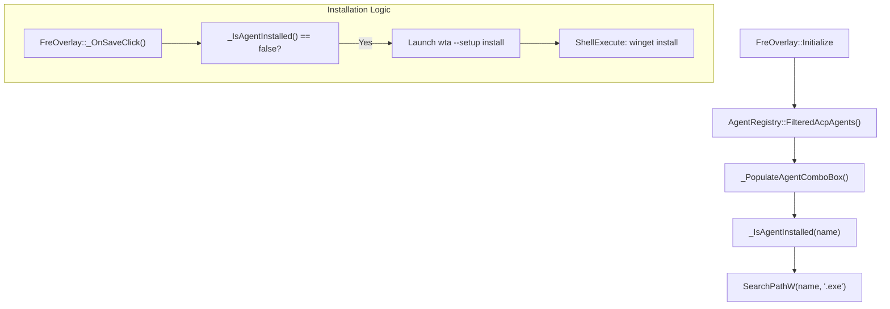

<!-- source: DeepWiki mcp.deepwiki.com · repo microsoft/intelligent-terminal · page 2.3 Agent Pane, FRE Onboarding, and AI Settings · fetched 2026-10-26 -->

# Agent Pane, FRE Onboarding, and AI Settings

Relevant source files

The following files were used as context for generating this wiki page:

- [NOTICE.md](NOTICE.md)
- [build/scripts/Generate-WtaThirdPartyNotices.ps1](build/scripts/Generate-WtaThirdPartyNotices.ps1)
- [src/cascadia/TerminalApp/AgentPaneContent.cpp](src/cascadia/TerminalApp/AgentPaneContent.cpp)
- [src/cascadia/TerminalApp/AgentPaneContent.idl](src/cascadia/TerminalApp/AgentPaneContent.idl)
- [src/cascadia/TerminalApp/FreOverlay.cpp](src/cascadia/TerminalApp/FreOverlay.cpp)
- [src/cascadia/TerminalApp/FreOverlay.h](src/cascadia/TerminalApp/FreOverlay.h)
- [src/cascadia/TerminalApp/FreOverlay.idl](src/cascadia/TerminalApp/FreOverlay.idl)
- [src/cascadia/TerminalApp/FreOverlay.xaml](src/cascadia/TerminalApp/FreOverlay.xaml)
- [src/cascadia/TerminalApp/SharedWta.cpp](src/cascadia/TerminalApp/SharedWta.cpp)
- [src/cascadia/TerminalApp/SharedWta.h](src/cascadia/TerminalApp/SharedWta.h)
- [src/cascadia/TerminalSettingsEditor/AIAgents.cpp](src/cascadia/TerminalSettingsEditor/AIAgents.cpp)
- [src/cascadia/TerminalSettingsEditor/AIAgents.h](src/cascadia/TerminalSettingsEditor/AIAgents.h)
- [src/cascadia/TerminalSettingsEditor/AIAgents.idl](src/cascadia/TerminalSettingsEditor/AIAgents.idl)
- [src/cascadia/TerminalSettingsEditor/AIAgents.xaml](src/cascadia/TerminalSettingsEditor/AIAgents.xaml)
- [src/cascadia/TerminalSettingsEditor/AIAgentsViewModel.cpp](src/cascadia/TerminalSettingsEditor/AIAgentsViewModel.cpp)
- [src/cascadia/TerminalSettingsEditor/AIAgentsViewModel.h](src/cascadia/TerminalSettingsEditor/AIAgentsViewModel.h)
- [src/cascadia/TerminalSettingsEditor/AIAgentsViewModel.idl](src/cascadia/TerminalSettingsEditor/AIAgentsViewModel.idl)
- [src/cascadia/inc/WtaProcess.h](src/cascadia/inc/WtaProcess.h)
- [tools/wta/AGENTS.md](tools/wta/AGENTS.md)
- [tools/wta/Cargo.toml](tools/wta/Cargo.toml)
- [tools/wta/cgmanifest.json](tools/wta/cgmanifest.json)
- [tools/wta/src/agent_pane_origin.rs](tools/wta/src/agent_pane_origin.rs)
- [tools/wta/src/agent_sessions.rs](tools/wta/src/agent_sessions.rs)
- [tools/wta/src/app.rs](tools/wta/src/app.rs)
- [tools/wta/src/history_loader.rs](tools/wta/src/history_loader.rs)
- [tools/wta/src/main.rs](tools/wta/src/main.rs)
- [tools/wta/src/master/mod.rs](tools/wta/src/master/mod.rs)
- [tools/wta/src/protocol/acp/client.rs](tools/wta/src/protocol/acp/client.rs)
- [tools/wta/src/runtime_paths.rs](tools/wta/src/runtime_paths.rs)
- [tools/wta/src/session_mgmt.rs](tools/wta/src/session_mgmt.rs)
- [tools/wta/src/session_registry.rs](tools/wta/src/session_registry.rs)
- [tools/wta/src/shell/wt_channel/cli_channel.rs](tools/wta/src/shell/wt_channel/cli_channel.rs)
- [tools/wta/src/shell/wt_channel/mod.rs](tools/wta/src/shell/wt_channel/mod.rs)
- [tools/wta/src/ui/agents_view.rs](tools/wta/src/ui/agents_view.rs)
- [tools/wta/src/ui/layout.rs](tools/wta/src/ui/layout.rs)

This section details the user-facing AI integration components within Intelligent Terminal. It covers the Agent Pane UI, the First Run Experience (FRE) wizard, the settings infrastructure for AI agents, and the background process management that ensures a seamless connection between the terminal and the Rust-based `wta` binary.

## Agent Pane UI and Lifecycle

The **Agent Pane** is the primary interface for interacting with AI agents. It is implemented as the `AgentPaneContent` XAML control, which hosts a specialized terminal instance running the `wta` helper process.

### Implementation: AgentPaneContent
The `AgentPaneContent` class manages the lifecycle of the agent-specific UI. When a user opens the agent pane (e.g., via `Ctrl+Shift+I`), the terminal creates an `AgentPaneContent` instance that initiates a connection to the AI backend.

- **Initialization**: It determines the appropriate agent command and model from the global settings.
- **View Switching**: It handles transitions between the chat view and the session management view (`/sessions`).
- **Log Integration**: Uses `AgentPaneLog.h` for diagnostic tracing of pane-specific events.

### SharedWta Process Management
To optimize resource usage and maintain session state across multiple windows, Intelligent Terminal uses a singleton process management strategy via `SharedWta`.

- **Role**: Manages the lifetime of the `wta` process.
- **Master/Helper Architecture**: `wta` can run in "master" mode (singleton multiplexer) or "helper" mode (per-pane UI). `SharedWta` ensures that a master process is available to coordinate between different terminal windows [tools/wta/src/master/mod.rs:1-17]().
- **Named Pipes**: Communication between the C++ terminal host and the Rust `wta` process occurs over Windows Named Pipes [tools/wta/src/master/mod.rs:11-12]().

**Sources**: [src/cascadia/TerminalApp/AgentPaneContent.cpp:1-50](), [src/cascadia/TerminalApp/SharedWta.cpp:1-40](), [tools/wta/src/master/mod.rs:1-35]().

---

## First Run Experience (FRE) Onboarding

The `FreOverlay` provides a guided setup wizard for new users. It is a two-step XAML-based overlay that replaces the terminal content until the user has configured their preferred AI agent.

### The Onboarding Wizard
The wizard is defined in `FreOverlay.xaml` and consists of:
1.  **Welcome Page**: Highlights features like Error Detection and Session Management [src/cascadia/TerminalApp/FreOverlay.xaml:59-136]().
2.  **Settings Page**: Allows users to select an agent and triggers dependency installation if necessary [src/cascadia/TerminalApp/FreOverlay.xaml:164-210]().

### Dependency Detection and Installation
`FreOverlay` performs real-time checks to see if required binaries are present on the system:
- **Agent Probing**: Uses `SearchPathW` to look for agent executables (e.g., `copilot.exe`, `claude.cmd`) on the system `PATH` [src/cascadia/TerminalApp/FreOverlay.cpp:37-53]().
- **Environment Checks**: Verifies if `node`/`npx` and `winget` are installed [src/cascadia/TerminalApp/FreOverlay.cpp:55-74]().
- **WinGet Integration**: If an agent is selected but not found, the UI offers to install it via `winget`. The `wta` process itself handles the execution of `winget install` and streams the log back to the UI [tools/wta/src/app.rs:188-200]().

### Diagram: FRE Detection and Installation Flow

Title: "FRE Onboarding Logic"

**Sources**: [src/cascadia/TerminalApp/FreOverlay.cpp:37-147](), [src/cascadia/TerminalApp/FreOverlay.xaml:13-210](), [tools/wta/src/app.rs:159-200]().

---

## AI Settings and AIAgentsViewModel

The `AIAgents` page in the Settings UI provides centralized configuration for AI integrations. It is backed by the `AIAgentsViewModel`, which bridges the `CascadiaSettings` model with the XAML view.

### Configuration Capabilities
- **ACP Agent Selection**: Choose the primary agent for the Agent Pane (e.g., GitHub Copilot, Anthropic Claude).
- **Model Overrides**: Select specific LLM models (e.g., `gpt-4o`, `claude-3-5-sonnet`) advertised by the agent via the Agent Client Protocol (ACP) [tools/wta/src/protocol/acp/client.rs:145-148]().
- **Custom Agents**: Users can define custom agent commands. The system derives a unique ID for these using `DeriveCustomAgentId` [src/cascadia/TerminalSettingsEditor/AIAgentsViewModel.cpp:69-73]().

### GPO Policy Enforcement
The settings page respects Group Policy Object (GPO) restrictions:
- **Policy Locking**: If an administrator has locked AI settings, the UI displays a "Managed by your organization" indicator and disables changes [src/cascadia/TerminalSettingsEditor/AIAgents.xaml:111-114]().
- **Filtered Agents**: The `AgentRegistry::FilteredAcpAgents()` function returns only those agents permitted by active policy [src/cascadia/TerminalSettingsEditor/AIAgentsViewModel.cpp:128-130]().

### Data Flow: Settings to Runtime
The following diagram illustrates how a settings change propagates from the UI to the running `wta` process.

Title: "AI Settings Propagation"

```mermaid
graph LR
    UI["AIAgents.xaml (ComboBox)"] -- "TwoWay Bind" --> VM["AIAgentsViewModel::CurrentAcpAgent"]
    VM -- "Update" --> Global["GlobalAppSettings::AcpAgent()"]
    Global -- "Notify" --> AppLogic["AppLogic::_ApplyLanguageSettingChange"]
    AppLogic -- "Restart/Signal" --> SharedWta["SharedWta::Restart()"]
    SharedWta -- "CLI Arg" --> WtaMain["wta.exe --agent <id>"]
```

**Sources**: [src/cascadia/TerminalSettingsEditor/AIAgents.xaml:106-114](), [src/cascadia/TerminalSettingsEditor/AIAgentsViewModel.cpp:108-147](), [tools/wta/src/protocol/acp/client.rs:124-149]().

---

## Session Management and History

Intelligent Terminal tracks both live and historical AI sessions. This allows users to resume conversations even after the terminal has been closed.

### History Loading
The `history_loader` module in `wta` scans well-known on-disk locations for various CLI agents to reconstruct the session list [tools/wta/src/history_loader.rs:7-57]().

| Agent | Location | Metadata Source |
| :--- | :--- | :--- |
| **Copilot** | `~/.copilot/session-state/` | `workspace.yaml` |
| **Claude** | `~/.claude/projects/` | `.jsonl` filename/content |
| **Gemini** | `~/.gemini/tmp/` | `projects.json` + `.jsonl` |
| **Codex** | `~/.codex/sessions/` | `session_meta` in `.jsonl` |

### Session Origin Tracking
Sessions are tagged with a `SessionOrigin` to distinguish between those started manually in a shell and those created via the Intelligent Terminal Agent Pane (`AgentPane`) [tools/wta/src/agent_sessions.rs:137-145](). This allows the UI to filter or badge sessions appropriately in the `/sessions` view [tools/wta/src/ui/agents_view.rs:122-129]().

**Sources**: [tools/wta/src/history_loader.rs:1-81](), [tools/wta/src/agent_sessions.rs:71-124](), [tools/wta/src/ui/agents_view.rs:109-138]().

---

