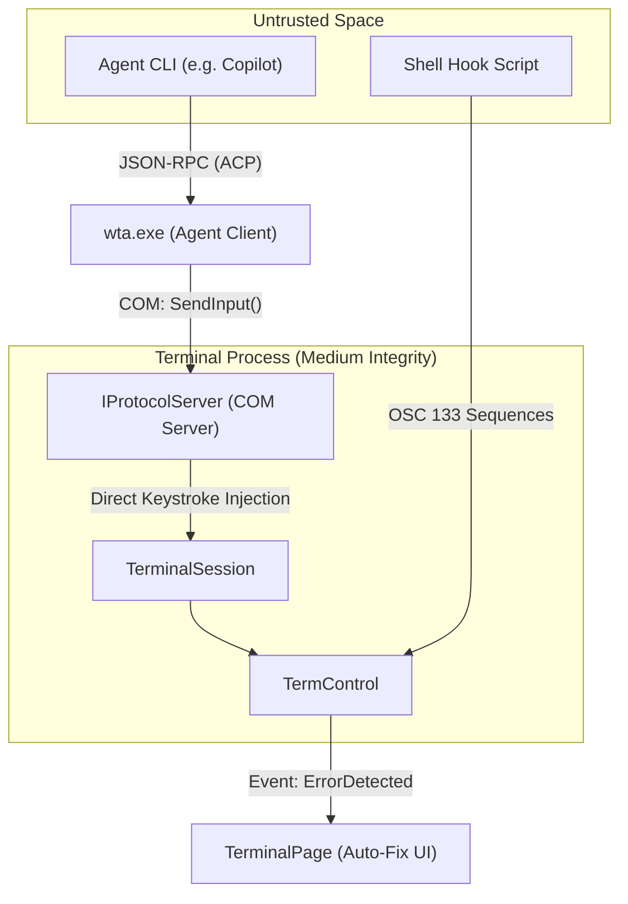

<!-- source: DeepWiki mcp.deepwiki.com · repo microsoft/intelligent-terminal · page 2.4 Shell Integration and Auto-Fix · fetched 2026-10-26 -->

# Shell Integration and Auto-Fix

<details>
<summary>Relevant source files</summary>

The following files were used as context for generating this wiki page:

- [.github/actions/spelling/allow/allow.txt](.github/actions/spelling/allow/allow.txt)
- [.github/actions/spelling/allow/apis.txt](.github/actions/spelling/allow/apis.txt)
- [.github/actions/spelling/allow/microsoft.txt](.github/actions/spelling/allow/microsoft.txt)
- [.github/actions/spelling/allow/names.txt](.github/actions/spelling/allow/names.txt)
- [.github/actions/spelling/expect/expect.txt](.github/actions/spelling/expect/expect.txt)
- [README.md](README.md)
- [doc/faq.md](doc/faq.md)
- [doc/roadmap-2022.md](doc/roadmap-2022.md)
- [doc/roadmap-2023.md](doc/roadmap-2023.md)
- [doc/security-model.md](doc/security-model.md)
- [doc/specs/#1571 - New Tab Menu Customization/#1571 - New Tab Menu Customization.md](doc/specs/#1571 - New Tab Menu Customization/#1571 - New Tab Menu Customization.md)
- [doc/specs/#1571 - New Tab Menu Customization/Menu-Customization-000.png](doc/specs/#1571 - New Tab Menu Customization/Menu-Customization-000.png)
- [doc/specs/#1595 - Suggestions UI/Suggestions-UI.md](doc/specs/#1595 - Suggestions UI/Suggestions-UI.md)
- [doc/specs/#2046 - Command Palette.md](doc/specs/#2046 - Command Palette.md)
- [doc/specs/#2046 - Unified keybindings and commands, and synthesized action names.md](doc/specs/#2046 - Unified keybindings and commands, and synthesized action names.md)
- [doc/specs/#4066 - Theme-controlled color scheme switch.md](doc/specs/#4066 - Theme-controlled color scheme switch.md)
- [doc/specs/#653 - Quake Mode/#653 - Quake Mode.md](doc/specs/#653 - Quake Mode/#653 - Quake Mode.md)
- [doc/specs/#6899 - Action IDs/#6899 - Action IDs.md](doc/specs/#6899 - Action IDs/#6899 - Action IDs.md)
- [doc/specs/#6899 - Action IDs/data-mockup-actions-ids-keys-maps.png](doc/specs/#6899 - Action IDs/data-mockup-actions-ids-keys-maps.png)
- [doc/terminal-a11y-2023.md](doc/terminal-a11y-2023.md)
- [doc/terminal-v2-roadmap.md](doc/terminal-v2-roadmap.md)
- [images/intelligent-terminal-agent-focus.png](images/intelligent-terminal-agent-focus.png)
- [src/cascadia/ShellExtension/WindowsTerminalShellExt.vcxproj](src/cascadia/ShellExtension/WindowsTerminalShellExt.vcxproj)
- [src/cascadia/TerminalApp/AgentPaneLog.h](src/cascadia/TerminalApp/AgentPaneLog.h)
- [src/cascadia/TerminalControl/dll/TerminalControl.vcxproj](src/cascadia/TerminalControl/dll/TerminalControl.vcxproj)
- [src/cascadia/UnitTests_TerminalCore/ShellIntegrationTests.cpp](src/cascadia/UnitTests_TerminalCore/ShellIntegrationTests.cpp)
- [src/cascadia/UnitTests_TerminalCore/UnitTests.vcxproj](src/cascadia/UnitTests_TerminalCore/UnitTests.vcxproj)
- [src/cascadia/inc/IntelligentTerminalPaths.h](src/cascadia/inc/IntelligentTerminalPaths.h)
- [src/cascadia/inc/ShellIntegration.h](src/cascadia/inc/ShellIntegration.h)
- [src/host/dbcs.h](src/host/dbcs.h)
- [src/host/exe/Host.EXE.vcxproj](src/host/exe/Host.EXE.vcxproj)
- [src/host/exe/openconsole.exe.manifest](src/host/exe/openconsole.exe.manifest)
- [src/host/ut_host/Host.UnitTests.vcxproj](src/host/ut_host/Host.UnitTests.vcxproj)
- [src/host/ut_host/Host.UnitTests.vcxproj.filters](src/host/ut_host/Host.UnitTests.vcxproj.filters)
- [src/host/ut_host/sources](src/host/ut_host/sources)
- [src/interactivity/win32/ut_interactivity_win32/Interactivity.Win32.UnitTests.vcxproj](src/interactivity/win32/ut_interactivity_win32/Interactivity.Win32.UnitTests.vcxproj)
- [tools/wta/README.md](tools/wta/README.md)
- [tools/wta/src/agent_check.rs](tools/wta/src/agent_check.rs)
- [tools/wta/src/coordinator.rs](tools/wta/src/coordinator.rs)
- [tools/wta/src/logging.rs](tools/wta/src/logging.rs)
- [tools/wta/src/protocol/acp/spawn.rs](tools/wta/src/protocol/acp/spawn.rs)

</details>


Intelligent Terminal leverages **OSC 133** shell integration marks to bridge the gap between the raw text buffer and semantic command execution. By instrumenting the shell prompt, the terminal can identify command boundaries, detect non-zero exit codes, and proactively trigger the **Auto-Fix** workflow via the agent status bar.

## OSC 133 Shell Integration Marks

The terminal recognizes a subset of the Final Term Shell Integration (FTCS) protocol. These sequences allow the shell to notify the terminal of its internal state transitions.

### Supported Sequences
The integration script, typically installed into the shell profile, wraps the user's prompt to emit the following sequences:

| Sequence | Meaning | Usage in Intelligent Terminal |
|:---|:---|:---|
| `OSC 133 ; A ST` | Prompt Started | Marks the beginning of the shell prompt. |
| `OSC 133 ; B ST` | Command Start | Marks the end of the prompt and the start of user input. |
| `OSC 133 ; D ; <exit_code> ST` | Command Finished | Reports the completion of a command and its exit status. |
| `OSC 9 ; 9 ; "<cwd>" ST` | Working Directory | Synchronizes the terminal's knowledge of the current directory. |

The `OSC 133 ; D` sequence is the primary trigger for the Auto-Fix system. When an exit code other than `0` is received, the terminal flags the preceding command block as a candidate for AI-assisted repair `[src/cascadia/inc/ShellIntegration.h:11-14]()`.

### Implementation Data Flow
The following diagram illustrates how OSC sequences move from the shell process into the terminal core to trigger the Auto-Fix indicator.

**Figure 1: Shell Integration Data Flow**
```mermaid
sequenceDiagram
    participant S as Shell (pwsh/cmd)
    participant P as VT Parser (OutputStateMachineEngine)
    participant T as Terminal Core (Terminal)
    participant UI as TerminalPage (UI Layer)

    S->>P: Write OSC 133;D;1 (Exit Code 1)
    P->>T: Dispatch CommandFinished(exitCode=1)
    T->>T: Mark Command Range in TextBuffer
    T-->>UI: Raise AutoFixIndicatorRequested
    UI->>UI: Light up Auto-Fix Icon in Status Bar
```
**Sources:** `[src/cascadia/inc/ShellIntegration.h:10-15]()`, `[src/cascadia/UnitTests_TerminalCore/UnitTests.vcxproj:28-28]()`.

## PowerShell Profile Installation

Shell integration is primarily delivered via PowerShell scripts. The terminal provides a mechanism to automatically inject these hooks into the user's PowerShell profiles (`Microsoft.PowerShell_profile.ps1` for PowerShell 7 and `Microsoft.PowerShell_profile.ps1` for Windows PowerShell 5.1).

### Execution Policy Gating
Before installation, the terminal performs a diagnostic probe to ensure the integration will not be blocked by the system's execution policy.

1.  **Policy Query**: The terminal runs `<exe> -NoProfile -NonInteractive -Command Get-ExecutionPolicy` `[src/cascadia/inc/ShellIntegration.h:48-52]()`.
2.  **Validation**: It checks if the policy is `Restricted` or `AllSigned`. If the script is unsigned and the policy is restrictive, the installation is flagged as blocked `[src/cascadia/inc/ShellIntegration.h:160-164]()`.
3.  **Timeout**: The probe is bounded by a 5-second wall-clock timeout to prevent hung processes from blocking the UI `[src/cascadia/inc/ShellIntegration.h:125-131]()`.

### Installation Logic
The `Microsoft::Terminal::ShellIntegration` namespace contains the logic for writing these scripts. The installation is idempotent; if the marks are already detected in the profile, the step is skipped `[src/cascadia/inc/ShellIntegration.h:38-44]()`.

**Sources:** `[src/cascadia/inc/ShellIntegration.h:6-15]()`, `[src/cascadia/inc/ShellIntegration.h:59-170]()`.

## Auto-Fix Detection and Triggering

The **Auto-Fix** feature is a reactive AI assistant that appears when a command fails.

### Detection Mechanism
1.  **Terminal Core**: The `Terminal` class tracks the "Current Command" state. When `OSC 133 ; B` is received, it records the current cursor position as the start of the command input `[src/cascadia/inc/ShellIntegration.h:13-13]()`.
2.  **Exit Code Processing**: Upon receiving `OSC 133 ; D ; <exit_code>`, the terminal evaluates the code. Any non-zero value triggers the "Error Detected" state `[src/cascadia/inc/ShellIntegration.h:11-11]()`.
3.  **Context Capture**: The terminal captures the text between the last `OSC 133 ; B` and the current `OSC 133 ; D`. This captured text, along with the exit code, forms the context sent to the agent `[doc/security-model.md:38-38]()`.

### Status Bar Integration
The `TerminalPage` hosts the agent status bar. When an error is detected, the `AutoFixIndicator` lights up (hotkey: `Ctrl+Alt+.`). Clicking this icon opens the Agent Pane and automatically submits the error context for analysis `[README.md:133-133]()`.

**Sources:** `[README.md:104-104]()`, `[README.md:119-120]()`, `[doc/security-model.md:38-38]()`.

## Security Model and Command Execution

Executing agent-suggested commands presents a significant security boundary. The terminal implements a tiered trust model to mitigate risks like prompt injection.

### Agent-Suggested Commands
When an agent suggests a fix, it can use the `SendInput` COM method to inject keystrokes into the shell.

*   **COM Control Plane**: `SendInput(sessionId, text)` is exposed via the `IProtocolServer` interface `[doc/security-model.md:10-10]()`.
*   **Gating**: Any process that can activate the terminal's COM server (knowing the per-launch `WT_COM_CLSID`) can call this method. There is no longer a separate capability boundary for shell input as of the 2026-05-21 architectural revert `[doc/security-model.md:10-11]()`.
*   **Confirmation**: While settings like `autoFixEnabled` exist, the system defaults to requiring user interaction (clicking the Auto-Fix icon) before the agent's analysis begins `[doc/security-model.md:38-38]()`.

### Security Boundary Diagram
This diagram maps the security components to the code entities responsible for managing command execution.

**Figure 2: Security and Execution Boundary**


### Risk Mitigations
*   **Context Disclosure**: Crafted OSC 133 marks could theoretically trigger an Auto-Fix analysis that sends sensitive scrollback to an LLM. Users are encouraged to review the `autoFixEnabled` setting if working with highly sensitive data `[doc/security-model.md:38-38]()`.
*   **Environment Scrubbing**: When spawning agent processes, the terminal scrubs the `CLAUDECODE` environment variable to prevent recursion guards from blocking the agent host `[tools/wta/src/protocol/acp/spawn.rs:74-78]()`.
*   **Path Resolution**: The terminal rebuilds the `PATH` from the registry when spawning agents to ensure that newly installed CLI tools are visible without a terminal restart `[tools/wta/src/protocol/acp/spawn.rs:80-91]()`.

**Sources:** `[doc/security-model.md:10-18]()`, `[doc/security-model.md:34-38]()`, `[tools/wta/src/protocol/acp/spawn.rs:74-91]()`.

---

