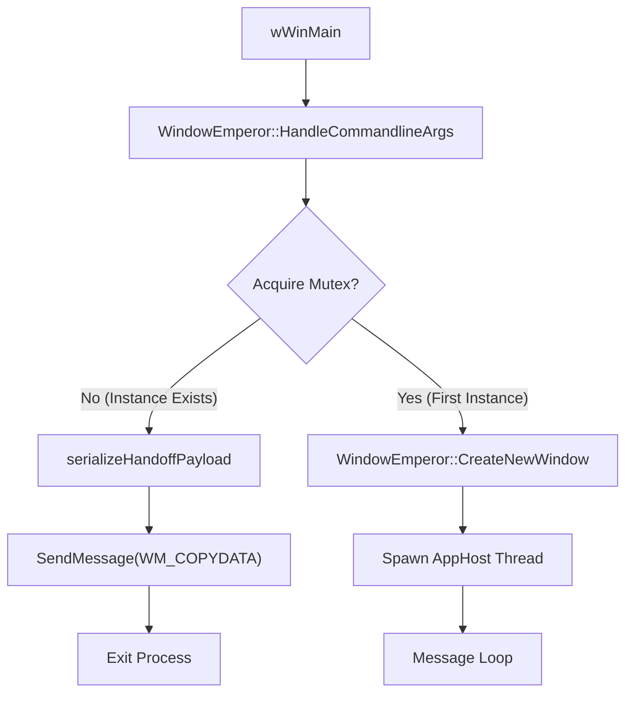
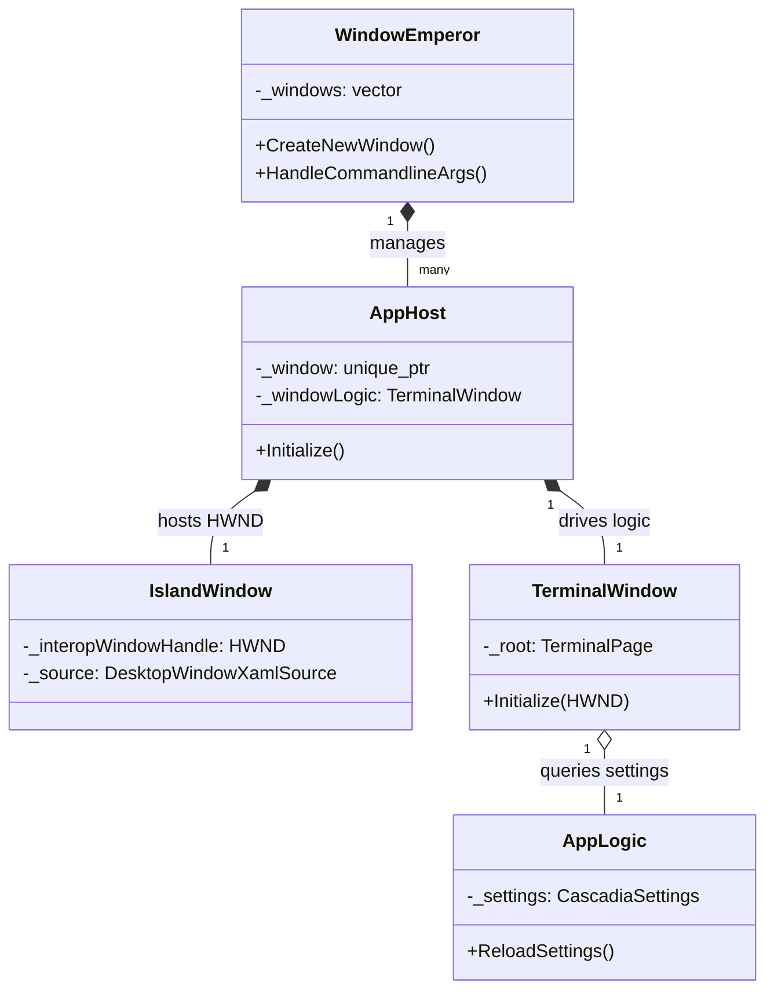

<!-- source: DeepWiki mcp.deepwiki.com · repo microsoft/intelligent-terminal · page 3 Application Lifecycle and Window Management · fetched 2026-10-26 -->

# Application Lifecycle and Window Management

Relevant source files

The following files were used as context for generating this wiki page:

- [src/cascadia/TerminalApp/AppLogic.cpp](src/cascadia/TerminalApp/AppLogic.cpp)
- [src/cascadia/TerminalApp/AppLogic.h](src/cascadia/TerminalApp/AppLogic.h)
- [src/cascadia/TerminalApp/AppLogic.idl](src/cascadia/TerminalApp/AppLogic.idl)
- [src/cascadia/TerminalApp/TerminalWindow.cpp](src/cascadia/TerminalApp/TerminalWindow.cpp)
- [src/cascadia/TerminalApp/TerminalWindow.h](src/cascadia/TerminalApp/TerminalWindow.h)
- [src/cascadia/TerminalApp/TerminalWindow.idl](src/cascadia/TerminalApp/TerminalWindow.idl)
- [src/cascadia/WindowsTerminal/AppHost.cpp](src/cascadia/WindowsTerminal/AppHost.cpp)
- [src/cascadia/WindowsTerminal/AppHost.h](src/cascadia/WindowsTerminal/AppHost.h)
- [src/cascadia/WindowsTerminal/BaseWindow.h](src/cascadia/WindowsTerminal/BaseWindow.h)
- [src/cascadia/WindowsTerminal/IslandWindow.cpp](src/cascadia/WindowsTerminal/IslandWindow.cpp)
- [src/cascadia/WindowsTerminal/IslandWindow.h](src/cascadia/WindowsTerminal/IslandWindow.h)
- [src/cascadia/WindowsTerminal/NonClientIslandWindow.cpp](src/cascadia/WindowsTerminal/NonClientIslandWindow.cpp)
- [src/cascadia/WindowsTerminal/NonClientIslandWindow.h](src/cascadia/WindowsTerminal/NonClientIslandWindow.h)
- [src/cascadia/WindowsTerminal/WindowEmperor.cpp](src/cascadia/WindowsTerminal/WindowEmperor.cpp)
- [src/cascadia/WindowsTerminal/WindowEmperor.h](src/cascadia/WindowsTerminal/WindowEmperor.h)
- [src/cascadia/WindowsTerminal/main.cpp](src/cascadia/WindowsTerminal/main.cpp)

This page provides a high-level overview of how the Intelligent Terminal manages its process lifecycle, windowing infrastructure, and the coordination between Win32 hosting and XAML UI layers. The architecture is designed to support single-instancing, multi-window orchestration, and high-performance XAML Island hosting.

## Process Orchestration

The application entry point is managed by the `WindowEmperor`, which acts as a process-wide singleton. It is responsible for determining whether a new process should become the "monarch" (the primary process hosting all windows) or hand off its command-line arguments to an existing instance.

### Single-Instancing and Handoff
When the terminal starts, it attempts to acquire a system-wide mutex based on its class name [src/cascadia/WindowsTerminal/WindowEmperor.cpp:164-177](). If the mutex is already held, the new process serializes its command line, environment variables, and working directory into a `WM_COPYDATA` payload and sends it to the existing window [src/cascadia/WindowsTerminal/WindowEmperor.cpp:183-200]().

### Global Responsibilities
The `WindowEmperor` manages several global features that persist regardless of how many windows are open:
*   **Global Hotkeys**: Registration and dispatch of "Summon" hotkeys [src/cascadia/WindowsTerminal/WindowEmperor.h:75-77]().
*   **System Tray**: Management of the notification area icon and its context menu [src/cascadia/WindowsTerminal/WindowEmperor.h:92-95]().
*   **Session Persistence**: Periodic saving of window state to `state.json` to allow restoration after a reboot or crash [src/cascadia/WindowsTerminal/WindowEmperor.h:78-80]().

For details, see [WindowEmperor: Process Orchestration](#3.1).

**Process Startup Flow**

Sources: [src/cascadia/WindowsTerminal/WindowEmperor.cpp:164-200](), [src/cascadia/WindowsTerminal/WindowEmperor.h:35-43]()

---

## Win32 Hosting Layer (AppHost & IslandWindow)

Every terminal window runs in its own thread and is managed by an `AppHost` instance [src/cascadia/WindowsTerminal/AppHost.cpp:48-51](). The `AppHost` bridges the Win32 world (HWNDs, DPI scaling, system menus) with the WinRT/XAML world.

### The Window Stack
The windowing logic is split into three primary layers:
1.  **IslandWindow**: The base class that wraps a standard Win32 HWND and hosts a `DesktopWindowXamlSource` (XAML Island) [src/cascadia/WindowsTerminal/IslandWindow.cpp:123-162]().
2.  **NonClientIslandWindow**: Extends the base window to support custom titlebars. it uses `DwmExtendFrameIntoClientArea` to allow XAML content to be drawn in the non-client area [src/cascadia/WindowsTerminal/NonClientIslandWindow.h:8-14]().
3.  **AppHost**: The orchestrator that owns the window instance and handles high-level window events like "Summon", "Quake Mode" toggles, and taskbar progress updates [src/cascadia/WindowsTerminal/AppHost.cpp:104-113]().

### Specialized Modes
The hosting layer implements several advanced Windows features:
*   **Quake Mode**: A specialized "dropdown" window behavior that pins the terminal to the top of a monitor [src/cascadia/WindowsTerminal/IslandWindow.cpp:147-148]().
*   **Snap Layouts**: Custom handling of `WM_NCHITTEST` in `NonClientIslandWindow` to support the Windows 11 maximize button hover menu [src/cascadia/WindowsTerminal/NonClientIslandWindow.cpp:155-163]().

For details, see [AppHost and IslandWindow: Win32 Hosting Layer](#3.2).

Sources: [src/cascadia/WindowsTerminal/AppHost.h:38-41](), [src/cascadia/WindowsTerminal/IslandWindow.h:13-15](), [src/cascadia/WindowsTerminal/NonClientIslandWindow.h:23-24]()

---

## Settings and UI Bridge (AppLogic & TerminalWindow)

The `AppLogic` and `TerminalWindow` classes represent the transition from the "Host" (Win32) to the "App" (XAML/WinRT).

### Global Logic and Settings
`AppLogic` is a singleton that manages the lifecycle of `CascadiaSettings`. It uses a `ThrottledFunc` to reload settings from disk when `settings.json` is modified, ensuring that multiple rapid saves do not cause performance issues [src/cascadia/TerminalApp/AppLogic.cpp:137-149](). It also provides the `CreateNewWindow` factory method used by the `WindowEmperor` [src/cascadia/TerminalApp/AppLogic.h:48]().

### Window-Specific Logic
`TerminalWindow` is the WinRT object that represents the logical state of a single window. It implements `IInitializeWithWindow` to associate itself with the HWND created by the `AppHost` [src/cascadia/TerminalApp/TerminalWindow.cpp:150-151](). Its primary role is to host the `TerminalPage`, which contains the actual tabs, panes, and terminal controls.

**Entity Association Map**
| System Layer | Code Entity | Responsibility |
| :--- | :--- | :--- |
| **Orchestration** | `WindowEmperor` | Process singleton, mutex management, global hotkeys. |
| **Win32 Host** | `AppHost` | Per-window thread management and event routing. |
| **Win32 Window** | `IslandWindow` | HWND management and XAML Island hosting. |
| **UI Bridge** | `TerminalWindow` | WinRT logic for a single window; owns the `TerminalPage`. |
| **Global State** | `AppLogic` | Settings lifecycle and global app state. |

For details, see [AppLogic and TerminalWindow: Settings and UI Bridge](#3.3).

**Lifecycle Class Relationships**

Sources: [src/cascadia/WindowsTerminal/WindowEmperor.h:85-86](), [src/cascadia/WindowsTerminal/AppHost.h:38-41](), [src/cascadia/TerminalApp/TerminalWindow.h:131-136](), [src/cascadia/TerminalApp/AppLogic.h:27-28]()

Sources:
* [src/cascadia/WindowsTerminal/WindowEmperor.cpp:164-200]()
* [src/cascadia/WindowsTerminal/AppHost.cpp:48-51]()
* [src/cascadia/WindowsTerminal/IslandWindow.cpp:123-162]()
* [src/cascadia/TerminalApp/AppLogic.cpp:137-149]()
* [src/cascadia/TerminalApp/TerminalWindow.cpp:150-151]()

---

