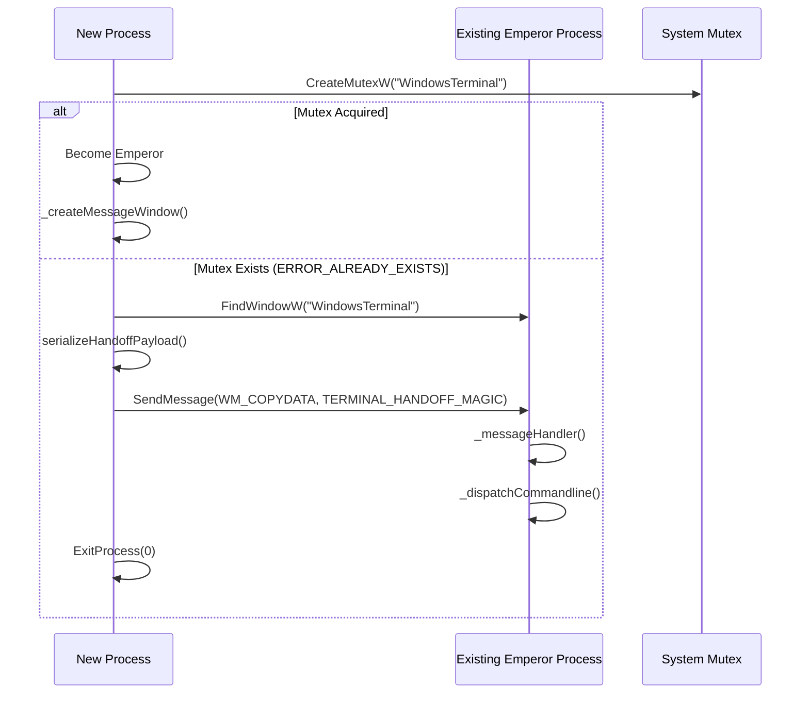
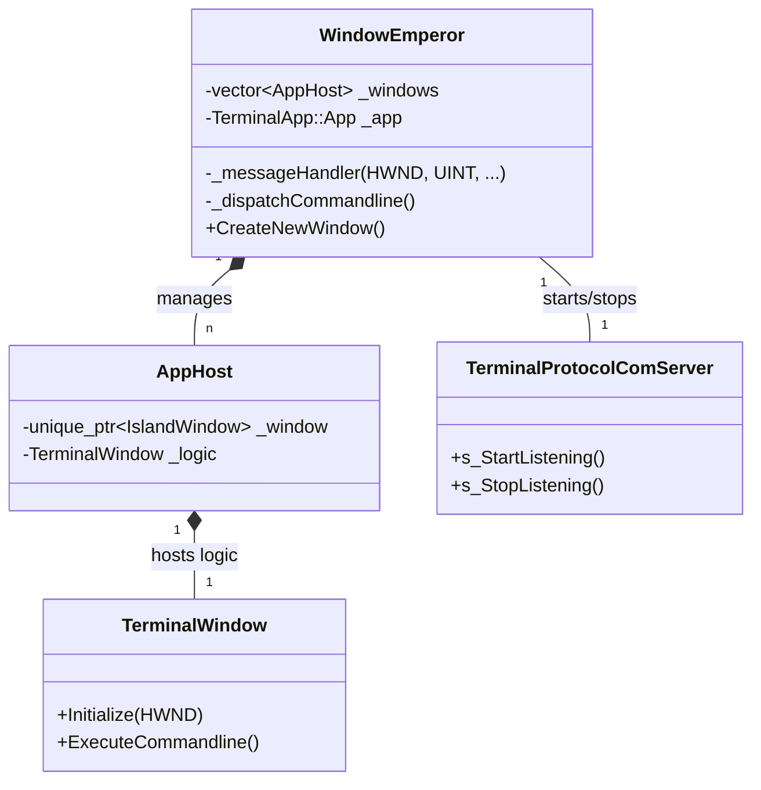

<!-- source: DeepWiki mcp.deepwiki.com · repo microsoft/intelligent-terminal · page 3.1 WindowEmperor: Process Orchestration · fetched 2026-10-26 -->

# WindowEmperor: Process Orchestration

Relevant source files

The following files were used as context for generating this wiki page:

- [src/cascadia/TerminalApp/App.cpp](src/cascadia/TerminalApp/App.cpp)
- [src/cascadia/TerminalApp/App.h](src/cascadia/TerminalApp/App.h)
- [src/cascadia/TerminalApp/App.idl](src/cascadia/TerminalApp/App.idl)
- [src/cascadia/TerminalApp/AppKeyBindings.cpp](src/cascadia/TerminalApp/AppKeyBindings.cpp)
- [src/cascadia/TerminalApp/AppKeyBindings.h](src/cascadia/TerminalApp/AppKeyBindings.h)
- [src/cascadia/TerminalApp/AppKeyBindings.idl](src/cascadia/TerminalApp/AppKeyBindings.idl)
- [src/cascadia/TerminalApp/TerminalWindow.cpp](src/cascadia/TerminalApp/TerminalWindow.cpp)
- [src/cascadia/TerminalApp/TerminalWindow.h](src/cascadia/TerminalApp/TerminalWindow.h)
- [src/cascadia/TerminalApp/TerminalWindow.idl](src/cascadia/TerminalApp/TerminalWindow.idl)
- [src/cascadia/WindowsTerminal/WindowEmperor.cpp](src/cascadia/WindowsTerminal/WindowEmperor.cpp)
- [src/cascadia/WindowsTerminal/WindowEmperor.h](src/cascadia/WindowsTerminal/WindowEmperor.h)
- [src/cascadia/WindowsTerminal/main.cpp](src/cascadia/WindowsTerminal/main.cpp)

The `WindowEmperor` is the central singleton responsible for managing the application lifecycle of Intelligent Terminal. It orchestrates single-instance enforcement, command-line handoff between processes, global hotkey management, and session persistence. While each terminal window runs its own UI thread, the `WindowEmperor` lives on the main process thread to coordinate global state across all windows [src/cascadia/WindowsTerminal/WindowEmperor.h:8-14]().

## Process Entry Point and Initialization

The application entry point is `wWinMain` in `main.cpp`. It performs critical environment checks and initializes the WinRT COM apartment as a Single-Threaded Apartment (STA) before instantiating the `WindowEmperor` [src/cascadia/WindowsTerminal/main.cpp:85-125]().

### Startup Sequence
1.  **Architecture Validation**: `EnsureNativeArchitecture` checks if the process architecture (x64, ARM64, etc.) matches the native system architecture to ensure `conhost.exe` compatibility [src/cascadia/WindowsTerminal/main.cpp:62-83]().
2.  **STA Initialization**: `winrt::init_apartment(winrt::apartment_type::single_threaded)` is called to support XAML and UIAutomation [src/cascadia/WindowsTerminal/main.cpp:112-121]().
3.  **Emperor Creation**: The `WindowEmperor` is instantiated, which triggers the startup of the `TerminalProtocolComServer` [src/cascadia/WindowsTerminal/WindowEmperor.cpp:36-41]().
4.  **Command-line Handling**: `HandleCommandlineArgs` determines if this process should become the "Emperor" (primary instance) or hand off its arguments to an existing one [src/cascadia/WindowsTerminal/WindowEmperor.cpp:124]().

**Sources:** [src/cascadia/WindowsTerminal/main.cpp:62-125](), [src/cascadia/WindowsTerminal/WindowEmperor.cpp:36-41]()

## Single-Instance Handoff

Intelligent Terminal uses a named mutex and `WM_COPYDATA` to maintain a single primary process for all windows.

### Mutex Logic
`WindowEmperor` attempts to acquire a mutex named after the window class. If the mutex already exists, the new process serializes its command-line arguments, environment variables, and current working directory into a `Handoff` payload [src/cascadia/WindowsTerminal/WindowEmperor.cpp:124-160]().

### Communication via WM_COPYDATA
If an existing instance is found via `FindWindowW`, the secondary process sends the payload using `SendMessageTimeoutW` with the `TERMINAL_HANDOFF_MAGIC` identifier [src/cascadia/WindowsTerminal/WindowEmperor.cpp:183-205](). The primary instance receives this in its `_messageHandler` and dispatches the command-line to the appropriate window or creates a new one [src/cascadia/WindowsTerminal/WindowEmperor.cpp:68-122]().

### Process Orchestration Flow
Title: Command-line Handoff and Process Logic

**Sources:** [src/cascadia/WindowsTerminal/WindowEmperor.cpp:124-205](), [src/cascadia/WindowsTerminal/WindowEmperor.h:68]()

## Global State Management

### Hotkey Registration
The Emperor registers global "Summon" hotkeys defined in the settings. It uses the Win32 `RegisterHotKey` API and handles the `WM_HOTKEY` message in the main message loop [src/cascadia/WindowsTerminal/WindowEmperor.cpp:75-77](). When a hotkey is pressed, `_hotkeyPressed` identifies the target window (or all windows) and brings them to the foreground [src/cascadia/WindowsTerminal/WindowEmperor.cpp:74]().

### System Tray (Notification Area)
If enabled in settings, the Emperor maintains a `NOTIFYICONDATA` structure and handles `WM_NOTIFY_FROM_NOTIFICATION_AREA`. This allows the terminal to run in the background even when all windows are closed, provided the "Always show notification icon" or "Minimize to tray" settings are active [src/cascadia/WindowsTerminal/WindowEmperor.cpp:32-33](), [src/cascadia/WindowsTerminal/WindowEmperor.h:92-95]().

### Session Persistence
The Emperor manages the lifecycle of `state.json`. It uses a `SafeDispatcherTimer` (`_persistStateTimer`) to periodically trigger `_persistState`, which saves the current window layout, tab state, and buffer locations [src/cascadia/WindowsTerminal/WindowEmperor.h:78-80](), [src/cascadia/WindowsTerminal/WindowEmperor.h:98]().

**Sources:** [src/cascadia/WindowsTerminal/WindowEmperor.cpp:32-77](), [src/cascadia/WindowsTerminal/WindowEmperor.h:74-98]()

## Protocol Server and AUMID Logic

### AI Agent Protocol Bridge
The `WindowEmperor` initializes the `TerminalProtocolComServer`, which enables external AI agents (via `wtcli.exe` or `wta.exe`) to communicate with terminal sessions. It generates a unique CLSID for the COM server and stores it in the `WT_COM_CLSID` environment variable so child processes can locate the protocol bridge [src/cascadia/WindowsTerminal/WindowEmperor.h:89-90]().

### AppUserModelID (AUMID) Stamping
To ensure correct taskbar grouping and "Pin to Taskbar" behavior, the Emperor implements deferred AUMID stamping. It uses `_setupAumid` to associate the process with the correct `AppUserModelID`, which is crucial for distinguishing between different release channels (Stable vs. Preview vs. Dev) [src/cascadia/WindowsTerminal/WindowEmperor.h:82](), [src/cascadia/WindowsTerminal/WindowEmperor.h:102-103]().

### Entity Mapping: Window Management
Title: WindowEmperor Entity Relationships

**Sources:** [src/cascadia/WindowsTerminal/WindowEmperor.h:18-116](), [src/cascadia/TerminalApp/TerminalWindow.h:63-66](), [src/cascadia/WindowsTerminal/WindowEmperor.cpp:36-41]()

## Key Functions and Data Structures

| Function/Member | Description |
| :--- | :--- |
| `_wndProc` | The static Win32 window procedure for the hidden message window [src/cascadia/WindowsTerminal/WindowEmperor.h:59](). |
| `_dispatchCommandline` | Parses `CommandlineArgs` and either routes them to an existing window or creates a new one [src/cascadia/WindowsTerminal/WindowEmperor.h:65](). |
| `_createMessageWindow` | Creates the hidden HWND used for `WM_COPYDATA`, hotkeys, and tray icon notifications [src/cascadia/WindowsTerminal/WindowEmperor.h:69](). |
| `_persistState` | Serializes the `ApplicationState` to `state.json` [src/cascadia/WindowsTerminal/WindowEmperor.h:79](). |
| `TERMINAL_HANDOFF_MAGIC` | A magic constant (0x4c414e494d524554) used to validate handoff messages [src/cascadia/WindowsTerminal/WindowEmperor.cpp:43-47](). |

**Sources:** [src/cascadia/WindowsTerminal/WindowEmperor.h:59-79](), [src/cascadia/WindowsTerminal/WindowEmperor.cpp:43-47]()

---

