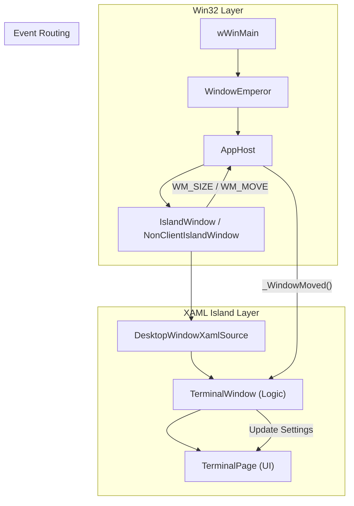
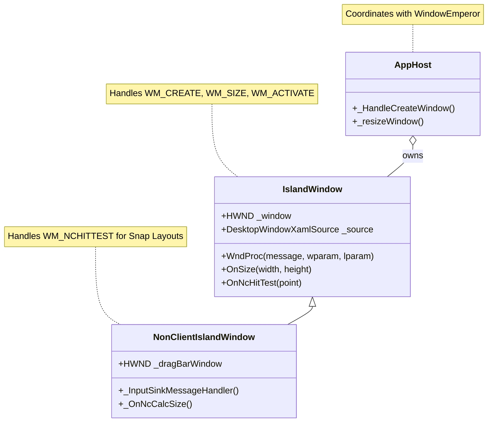

<!-- source: DeepWiki mcp.deepwiki.com · repo microsoft/intelligent-terminal · page 3.2 AppHost and IslandWindow: Win32 Hosting Layer · fetched 2026-10-26 -->

# AppHost and IslandWindow: Win32 Hosting Layer

Relevant source files

The following files were used as context for generating this wiki page:

- [src/cascadia/TerminalApp/App.xaml](src/cascadia/TerminalApp/App.xaml)
- [src/cascadia/TerminalApp/AppLogic.cpp](src/cascadia/TerminalApp/AppLogic.cpp)
- [src/cascadia/TerminalApp/AppLogic.h](src/cascadia/TerminalApp/AppLogic.h)
- [src/cascadia/TerminalApp/AppLogic.idl](src/cascadia/TerminalApp/AppLogic.idl)
- [src/cascadia/TerminalApp/MinMaxCloseControl.cpp](src/cascadia/TerminalApp/MinMaxCloseControl.cpp)
- [src/cascadia/TerminalApp/MinMaxCloseControl.h](src/cascadia/TerminalApp/MinMaxCloseControl.h)
- [src/cascadia/TerminalApp/MinMaxCloseControl.idl](src/cascadia/TerminalApp/MinMaxCloseControl.idl)
- [src/cascadia/TerminalApp/MinMaxCloseControl.xaml](src/cascadia/TerminalApp/MinMaxCloseControl.xaml)
- [src/cascadia/TerminalApp/TabRowControl.cpp](src/cascadia/TerminalApp/TabRowControl.cpp)
- [src/cascadia/TerminalApp/TabRowControl.h](src/cascadia/TerminalApp/TabRowControl.h)
- [src/cascadia/TerminalApp/TabRowControl.idl](src/cascadia/TerminalApp/TabRowControl.idl)
- [src/cascadia/TerminalApp/TabRowControl.xaml](src/cascadia/TerminalApp/TabRowControl.xaml)
- [src/cascadia/TerminalApp/TitlebarControl.cpp](src/cascadia/TerminalApp/TitlebarControl.cpp)
- [src/cascadia/TerminalApp/TitlebarControl.h](src/cascadia/TerminalApp/TitlebarControl.h)
- [src/cascadia/TerminalApp/TitlebarControl.idl](src/cascadia/TerminalApp/TitlebarControl.idl)
- [src/cascadia/WindowsTerminal/AppHost.cpp](src/cascadia/WindowsTerminal/AppHost.cpp)
- [src/cascadia/WindowsTerminal/AppHost.h](src/cascadia/WindowsTerminal/AppHost.h)
- [src/cascadia/WindowsTerminal/BaseWindow.h](src/cascadia/WindowsTerminal/BaseWindow.h)
- [src/cascadia/WindowsTerminal/IslandWindow.cpp](src/cascadia/WindowsTerminal/IslandWindow.cpp)
- [src/cascadia/WindowsTerminal/IslandWindow.h](src/cascadia/WindowsTerminal/IslandWindow.h)
- [src/cascadia/WindowsTerminal/NonClientIslandWindow.cpp](src/cascadia/WindowsTerminal/NonClientIslandWindow.cpp)
- [src/cascadia/WindowsTerminal/NonClientIslandWindow.h](src/cascadia/WindowsTerminal/NonClientIslandWindow.h)

The Win32 Hosting Layer provides the bridge between the traditional Windows desktop environment and the modern XAML-based UI. It manages the Win32 window lifecycle, handles high-DPI scaling, and hosts the XAML Islands that contain the terminal's user interface.

## AppHost: The Window Orchestrator

`AppHost` is the per-window orchestrator that links the `WindowEmperor` (process-level manager) to the specific `IslandWindow` and `TerminalWindow` (logic layer) instances [src/cascadia/WindowsTerminal/AppHost.h:12-15](). It handles the initial command-line parsing for a window and determines whether to use a standard or non-client area window based on settings [src/cascadia/WindowsTerminal/AppHost.cpp:48-64]().

### Key Responsibilities
*   **Initialization**: Sets up the XAML Island environment and connects logic callbacks [src/cascadia/WindowsTerminal/AppHost.cpp:176-181]().
*   **Virtual Desktop Integration**: Tracks and retrieves the Virtual Desktop ID for the window to support session persistence [src/cascadia/WindowsTerminal/AppHost.cpp:31-46]().
*   **Taskbar Integration**: Proxies progress state from the terminal panes to the Win32 Taskbar via `ITaskbarList3` [src/cascadia/WindowsTerminal/AppHost.cpp:104-113]().
*   **Command Dispatch**: Routes new command-line arguments to existing windows [src/cascadia/WindowsTerminal/AppHost.cpp:28-29]().

### Window Hosting Data Flow
The following diagram illustrates how `AppHost` mediates between the Win32 OS messages and the XAML UI logic.

**Diagram: AppHost Orchestration Flow**

Sources: [src/cascadia/WindowsTerminal/AppHost.cpp:48-86](), [src/cascadia/WindowsTerminal/AppHost.h:38-41]().

## IslandWindow and XAML Hosting

`IslandWindow` is the base class for a Win32 window (`HWND`) that hosts a `DesktopWindowXamlSource` [src/cascadia/WindowsTerminal/IslandWindow.h:13-15](). It encapsulates the complexity of hosting UWP XAML controls in a desktop application.

### Window Styles and Modes
*   **Focus Mode**: Removes the titlebar and tabs for a distraction-free experience [src/cascadia/WindowsTerminal/IslandWindow.cpp:49-50]().
*   **Quake Mode**: A special state where the window is pinned to the top of a monitor and slides down/up using a global hotkey [src/cascadia/WindowsTerminal/IslandWindow.cpp:144-148]().
*   **Fullscreen**: Manages the transition between windowed and fullscreen styles, including saving and restoring window placement [src/cascadia/WindowsTerminal/IslandWindow.cpp:110-123]().

### Input and Cursor Management
`IslandWindow` implements a "hide cursor on typing" feature to mimic modern Windows app behavior, using `ShowCursor` and tracking `WM_POINTERUPDATE` [src/cascadia/WindowsTerminal/IslandWindow.cpp:42-72]().

Sources: [src/cascadia/WindowsTerminal/IslandWindow.cpp:123-165](), [src/cascadia/WindowsTerminal/IslandWindow.h:110-117]().

## NonClientIslandWindow: Custom Titlebar

When `showTabsInTitlebar` is enabled, the terminal uses `NonClientIslandWindow`. This class extends the XAML island into the non-client area (the frame) using `DwmExtendFrameIntoClientArea` [src/cascadia/WindowsTerminal/NonClientIslandWindow.h:8-14]().

### Input Sink and Drag Bar
Because XAML Islands "steal" mouse messages, `NonClientIslandWindow` creates a transparent child Win32 window (`_dragBarWindow`) specifically to handle dragging and window controls [src/cascadia/WindowsTerminal/NonClientIslandWindow.cpp:92-103]().

### Snap Layouts and Hit Testing
To support Windows 11 Snap Layouts, the `_InputSinkMessageHandler` intercepts `WM_NCHITTEST`. It manually calculates if the mouse is over the maximize button and returns `HTMAXBUTTON` [src/cascadia/WindowsTerminal/NonClientIslandWindow.cpp:170-173]().

| Hit Test Region | Logic | Return Value |
| :--- | :--- | :--- |
| Close Button | Within `CaptionButtonWidth` from right | `HTCLOSE` |
| Maximize Button | Within 2x `CaptionButtonWidth` | `HTMAXBUTTON` |
| Top Border | Within `_GetResizeHandleHeight` | `HTTOP` |
| Titlebar | Anywhere else in drag bar | `HTCAPTION` |

Sources: [src/cascadia/WindowsTerminal/NonClientIslandWindow.cpp:107-147](), [src/cascadia/WindowsTerminal/NonClientIslandWindow.cpp:164-167]().

## DPI Scaling and Resizing

The terminal handles DPI changes dynamically. When a window moves between monitors with different scales, `IslandWindow` receives `WM_DPICHANGED`.

*   **Snap to Grid**: During resize (`WM_SIZING`), the window can "snap" its dimensions to match the character grid of the active terminal [src/cascadia/WindowsTerminal/IslandWindow.cpp:184-187]().
*   **Non-Client Calculation**: `GetNonClientFrame` calculates the size of borders and titlebars based on the current DPI to ensure the XAML content is positioned correctly [src/cascadia/WindowsTerminal/NonClientIslandWindow.cpp:38-39]().

**Diagram: Window Message to Code Entity Mapping**

Sources: [src/cascadia/WindowsTerminal/IslandWindow.h:13-16](), [src/cascadia/WindowsTerminal/NonClientIslandWindow.h:23-24](), [src/cascadia/WindowsTerminal/AppHost.h:38-41]().

## Virtual Desktop Integration

`AppHost` uses the `IVirtualDesktopManager` to manage window placement across virtual desktops [src/cascadia/WindowsTerminal/AppHost.cpp:31-46]().
*   **`GetVirtualDesktopId()`**: An asynchronous operation that retrieves the GUID of the desktop the window currently resides on [src/cascadia/WindowsTerminal/AppHost.h:21]().
*   **Summoning**: When a window is "summoned" (e.g., via Quake mode or global hotkey), `AppHost` can move the window to the current virtual desktop or the monitor where the mouse is located [src/cascadia/WindowsTerminal/AppHost.cpp:27]().

Sources: [src/cascadia/WindowsTerminal/AppHost.cpp:31-46](), [src/cascadia/WindowsTerminal/IslandWindow.cpp:58-68]().

---

