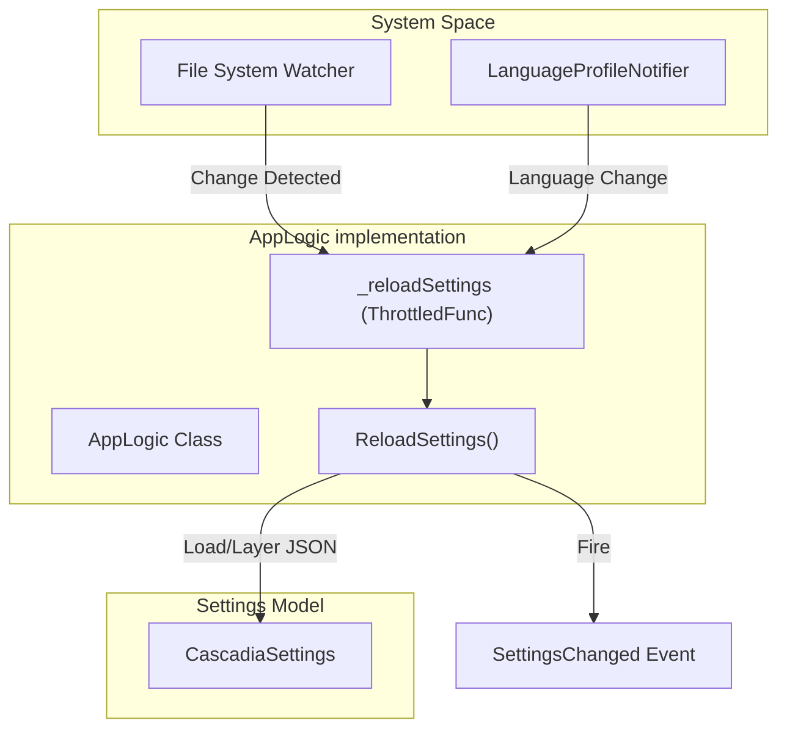
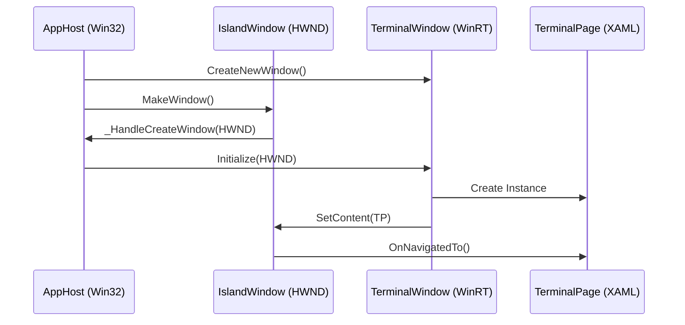

<!-- source: DeepWiki mcp.deepwiki.com · repo microsoft/intelligent-terminal · page 3.3 AppLogic and TerminalWindow: Settings and UI Bridge · fetched 2026-10-26 -->

# AppLogic and TerminalWindow: Settings and UI Bridge

Relevant source files

The following files were used as context for generating this wiki page:

- [src/cascadia/TerminalApp/AppLogic.cpp](src/cascadia/TerminalApp/AppLogic.cpp)
- [src/cascadia/TerminalApp/AppLogic.h](src/cascadia/TerminalApp/AppLogic.h)
- [src/cascadia/TerminalApp/AppLogic.idl](src/cascadia/TerminalApp/AppLogic.idl)
- [src/cascadia/TerminalApp/TerminalWindow.cpp](src/cascadia/TerminalApp/TerminalWindow.cpp)
- [src/cascadia/TerminalApp/TerminalWindow.h](src/cascadia/TerminalApp/TerminalWindow.h)
- [src/cascadia/TerminalApp/TerminalWindow.idl](src/cascadia/TerminalApp/TerminalWindow.idl)
- [src/cascadia/WindowsTerminal/AppHost.cpp](src/cascadia/WindowsTerminal/AppHost.cpp)
- [src/cascadia/WindowsTerminal/AppHost.h](src/cascadia/WindowsTerminal/AppHost.h)
- [src/cascadia/WindowsTerminal/BaseWindow.h](src/cascadia/WindowsTerminal/BaseWindow.h)
- [src/cascadia/WindowsTerminal/IslandWindow.cpp](src/cascadia/WindowsTerminal/IslandWindow.cpp)
- [src/cascadia/WindowsTerminal/IslandWindow.h](src/cascadia/WindowsTerminal/IslandWindow.h)
- [src/cascadia/WindowsTerminal/NonClientIslandWindow.cpp](src/cascadia/WindowsTerminal/NonClientIslandWindow.cpp)
- [src/cascadia/WindowsTerminal/NonClientIslandWindow.h](src/cascadia/WindowsTerminal/NonClientIslandWindow.h)
- [src/cascadia/WindowsTerminal/WindowEmperor.cpp](src/cascadia/WindowsTerminal/WindowEmperor.cpp)
- [src/cascadia/WindowsTerminal/WindowEmperor.h](src/cascadia/WindowsTerminal/WindowEmperor.h)
- [src/cascadia/WindowsTerminal/main.cpp](src/cascadia/WindowsTerminal/main.cpp)

The communication between global application state (settings, lifecycle) and individual window instances is managed by two primary entities: `AppLogic` and `TerminalWindow`. `AppLogic` serves as the singleton orchestrator for settings and shared resources, while `TerminalWindow` acts as the WinRT/XAML bridge for a specific window instance.

## AppLogic: Global State and Settings Lifecycle

`AppLogic` is the central hub for the Terminal's global logic. It is responsible for loading `CascadiaSettings`, monitoring the settings file for changes, and notifying all active windows when a reload is required.

### Settings Management and Throttling
`AppLogic` manages the lifecycle of `CascadiaSettings` [src/cascadia/TerminalApp/AppLogic.h:59](). Because file system events can be chatty, `AppLogic` utilizes a `ThrottledFunc` to debounce settings reloads [src/cascadia/TerminalApp/AppLogic.cpp:137-149]().

*   **File Watching**: It uses `wil::unique_folder_change_reader_nothrow` to monitor the settings directory [src/cascadia/TerminalApp/AppLogic.h:75]().
*   **Propagation**: When settings change, `AppLogic` fires the `SettingsChanged` event [src/cascadia/TerminalApp/AppLogic.h:52](). `AppHost` instances subscribe to this event to trigger UI updates in their respective `TerminalWindow` objects [src/cascadia/WindowsTerminal/AppHost.cpp:557-563]().

### Global Resources
`AppLogic` also handles:
*   **Elevation Status**: Detects if the process is running as Administrator [src/cascadia/TerminalApp/AppLogic.cpp:134]().
*   **Content Management**: Manages the `ContentManager` for terminal sessions [src/cascadia/TerminalApp/AppLogic.h:77]().
*   **Language Changes**: Monitors system language changes via `LanguageProfileNotifier` to refresh localized resources [src/cascadia/TerminalApp/AppLogic.cpp:151-155]().

### Code Entity Mapping: AppLogic Lifecycle
The following diagram illustrates how `AppLogic` bridges global system events to the Terminal's settings model.

Title: AppLogic Settings Pipeline

Sources: [src/cascadia/TerminalApp/AppLogic.h:27-90](), [src/cascadia/TerminalApp/AppLogic.cpp:137-155]()

---

## TerminalWindow: The UI Bridge

`TerminalWindow` is the WinRT implementation of the window's logic. It hosts the `TerminalPage` and implements several interfaces required for Win32 integration within a XAML Island.

### Key Interfaces
*   **IInitializeWithWindow**: Allows the window to receive its parent `HWND` to facilitate dialog hosting and shell integration [src/cascadia/TerminalApp/TerminalWindow.cpp:150-151]().
*   **IDirectKeyListener**: Processes raw keyboard input before it is consumed by the XAML focus system, allowing for global hotkeys and terminal-specific input handling [src/cascadia/WindowsTerminal/AppHost.cpp:88-95]().

### Window Dimension Mapping
`TerminalWindow` handles the complex mapping between character-grid dimensions and pixel sizes. It provides callbacks to the `IslandWindow` to ensure that when a user resizes the window, it "snaps" to the nearest character width/height [src/cascadia/WindowsTerminal/IslandWindow.cpp:178-187]().

### Startup Sequence
1.  **Creation**: `AppHost` calls `AppLogic::CreateNewWindow()` [src/cascadia/WindowsTerminal/AppHost.cpp:134]().
2.  **Initialization**: `AppHost` passes the `HWND` to `TerminalWindow::Initialize()` [src/cascadia/WindowsTerminal/AppHost.cpp:181]().
3.  **Content Hosting**: `TerminalWindow` creates the `TerminalPage` and sets it as the root XAML element [src/cascadia/TerminalApp/TerminalWindow.cpp:153]().

### Data Flow: Window Initialization
This diagram maps the interaction between the Win32 `AppHost` and the WinRT `TerminalWindow`.

Title: Window Hosting Bridge

Sources: [src/cascadia/WindowsTerminal/AppHost.cpp:48-86](), [src/cascadia/TerminalApp/TerminalWindow.cpp:150-175](), [src/cascadia/WindowsTerminal/IslandWindow.cpp:123-165]()

---

## Settings Propagation

When settings are updated (e.g., a user saves `settings.json`), the change must propagate through the hierarchy to update the UI (fonts, colors, keybindings).

| Component | Responsibility in Propagation |
| :--- | :--- |
| `AppLogic` | Detects file change, reloads `CascadiaSettings`, and fires `SettingsChanged`. [src/cascadia/TerminalApp/AppLogic.cpp:144-149]() |
| `AppHost` | Listens to `AppLogic::SettingsChanged` and calls `TerminalWindow::UpdateSettings`. [src/cascadia/WindowsTerminal/AppHost.cpp:557-563]() |
| `TerminalWindow` | Updates its internal `_settings` reference and notifies `TerminalPage`. [src/cascadia/TerminalApp/TerminalWindow.cpp:131-136]() |
| `TerminalPage` | Iterates through all Tabs and Panes to apply new styles and settings. |

### Launch Dimensions and Coordinates
During startup, `AppHost` queries `TerminalWindow` for the requested launch mode (e.g., Default, Maximized, Fullscreen) and initial position [src/cascadia/WindowsTerminal/AppHost.cpp:47-48](). 
*   **Coordinate Mapping**: Win32 coordinates are mapped to XAML DIPs (Device Independent Pixels) using the current monitor's DPI scale [src/cascadia/WindowsTerminal/NonClientIslandWindow.cpp:114]().
*   **Quake Mode**: If the window is designated as a "Quake" window, `IslandWindow` applies specific styles and positioning logic to anchor it to the top of a monitor [src/cascadia/WindowsTerminal/IslandWindow.cpp:144-148]().

Sources: [src/cascadia/WindowsTerminal/AppHost.cpp:48-163](), [src/cascadia/TerminalApp/AppLogic.cpp:137-149](), [src/cascadia/WindowsTerminal/IslandWindow.cpp:123-165](), [src/cascadia/TerminalApp/TerminalWindow.cpp:131-175]()

---

