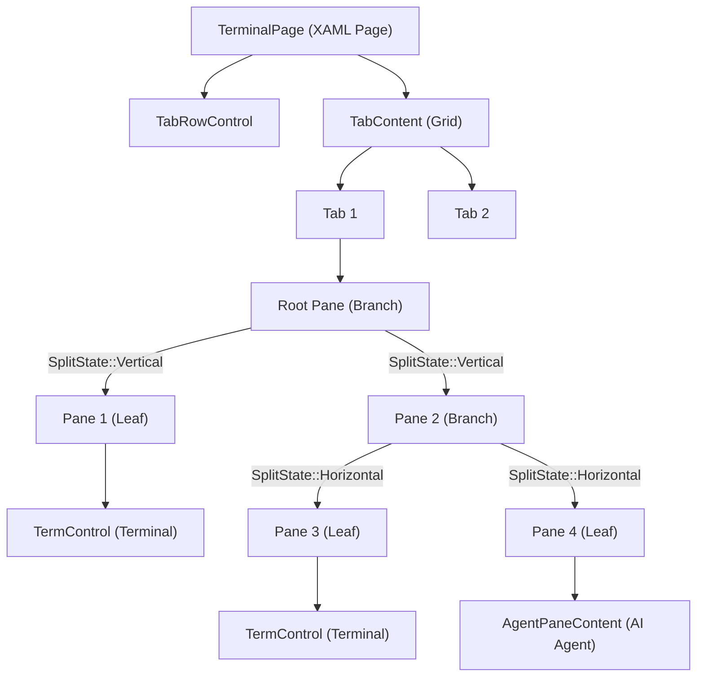

<!-- source: DeepWiki mcp.deepwiki.com · repo microsoft/intelligent-terminal · page 4 Terminal UI: Pages, Tabs, and Panes · fetched 2026-10-26 -->

# Terminal UI: Pages, Tabs, and Panes

Relevant source files

The following files were used as context for generating this wiki page:

- [doc/cascadia/SettingsSchema.md](doc/cascadia/SettingsSchema.md)
- [doc/cascadia/profiles.schema.json](doc/cascadia/profiles.schema.json)
- [src/cascadia/LocalTests_TerminalApp/CommandlineTest.cpp](src/cascadia/LocalTests_TerminalApp/CommandlineTest.cpp)
- [src/cascadia/LocalTests_TerminalApp/TabTests.cpp](src/cascadia/LocalTests_TerminalApp/TabTests.cpp)
- [src/cascadia/TerminalApp/AppActionHandlers.cpp](src/cascadia/TerminalApp/AppActionHandlers.cpp)
- [src/cascadia/TerminalApp/AppCommandlineArgs.cpp](src/cascadia/TerminalApp/AppCommandlineArgs.cpp)
- [src/cascadia/TerminalApp/AppCommandlineArgs.h](src/cascadia/TerminalApp/AppCommandlineArgs.h)
- [src/cascadia/TerminalApp/Pane.cpp](src/cascadia/TerminalApp/Pane.cpp)
- [src/cascadia/TerminalApp/Pane.h](src/cascadia/TerminalApp/Pane.h)
- [src/cascadia/TerminalApp/Resources/en-US/Resources.resw](src/cascadia/TerminalApp/Resources/en-US/Resources.resw)
- [src/cascadia/TerminalApp/Tab.cpp](src/cascadia/TerminalApp/Tab.cpp)
- [src/cascadia/TerminalApp/Tab.h](src/cascadia/TerminalApp/Tab.h)
- [src/cascadia/TerminalApp/Tab.idl](src/cascadia/TerminalApp/Tab.idl)
- [src/cascadia/TerminalApp/TabManagement.cpp](src/cascadia/TerminalApp/TabManagement.cpp)
- [src/cascadia/TerminalApp/TerminalPage.cpp](src/cascadia/TerminalApp/TerminalPage.cpp)
- [src/cascadia/TerminalApp/TerminalPage.h](src/cascadia/TerminalApp/TerminalPage.h)
- [src/cascadia/TerminalApp/TerminalPage.xaml](src/cascadia/TerminalApp/TerminalPage.xaml)
- [src/cascadia/TerminalSettingsModel/ActionAndArgs.cpp](src/cascadia/TerminalSettingsModel/ActionAndArgs.cpp)
- [src/cascadia/TerminalSettingsModel/ActionArgs.cpp](src/cascadia/TerminalSettingsModel/ActionArgs.cpp)
- [src/cascadia/TerminalSettingsModel/ActionArgs.h](src/cascadia/TerminalSettingsModel/ActionArgs.h)
- [src/cascadia/TerminalSettingsModel/ActionArgs.idl](src/cascadia/TerminalSettingsModel/ActionArgs.idl)
- [src/cascadia/TerminalSettingsModel/AllShortcutActions.h](src/cascadia/TerminalSettingsModel/AllShortcutActions.h)
- [src/cascadia/TerminalSettingsModel/Resources/en-US/Resources.resw](src/cascadia/TerminalSettingsModel/Resources/en-US/Resources.resw)
- [src/cascadia/TerminalSettingsModel/TerminalSettingsSerializationHelpers.h](src/cascadia/TerminalSettingsModel/TerminalSettingsSerializationHelpers.h)
- [src/cascadia/TerminalSettingsModel/defaults.json](src/cascadia/TerminalSettingsModel/defaults.json)

The Terminal UI layer is the primary WinRT/XAML interface of the application. It is responsible for orchestrating the visual layout of terminal sessions, managing user interactions through tabs and panes, and providing high-level UI components like the Command Palette and the AI Agent toolbar.

The architecture follows a hierarchical structure where a single `TerminalPage` hosts multiple `Tab` objects, each of which contains a recursive tree of `Pane` objects.

## TerminalPage: The UI Orchestrator

`TerminalPage` is the root XAML control for a terminal window [src/cascadia/TerminalApp/TerminalPage.xaml:5-14](). It serves as the central hub for action dispatching, settings application, and window-level UI elements.

- **Action Dispatching**: It initializes a `ShortcutActionDispatch` and registers handlers (prefixed with `_Handle`) for all keyboard shortcuts and commands [src/cascadia/TerminalApp/TerminalPage.cpp:64-64]().
- **Startup Logic**: It processes command-line arguments via `AppCommandlineArgs` and executes the resulting `ActionAndArgs` to restore tabs and panes [src/cascadia/TerminalApp/TerminalPage.cpp:175-177]().
- **Agent Integration**: It hosts the `BottomBar`, which provides a window-wide interface for AI agent interactions, including the agent toggle and auto-fix diagnostics [src/cascadia/TerminalApp/TerminalPage.xaml:91-118]().

For details, see [TerminalPage: Main UI Page and Action Dispatch](#4.1).

### Natural Language to Code Entity Mapping: Terminal Window Root

| Concept | Code Entity | File |
| :--- | :--- | :--- |
| Main UI Container | `class TerminalPage` | [src/cascadia/TerminalApp/TerminalPage.h:108-108]() |
| XAML Root Grid | `x:Name="Root"` | [src/cascadia/TerminalApp/TerminalPage.xaml:16-16]() |
| Tab Container | `x:Name="TabContent"` | [src/cascadia/TerminalApp/TerminalPage.xaml:70-70]() |
| Action Hub | `_actionDispatch` | [src/cascadia/TerminalApp/TerminalPage.h:1120-1120]() |

Sources: [src/cascadia/TerminalApp/TerminalPage.h:108-1120](), [src/cascadia/TerminalApp/TerminalPage.xaml:16-118]()

## Tab and Pane Management

The UI organizes terminal sessions into a flexible, tiled layout.

- **Tabs**: The `Tab` class encapsulates a `TabViewItem` and manages the lifecycle of the panes within it [src/cascadia/TerminalApp/Tab.h:34-34](). It tracks the Most Recently Used (MRU) pane for focus management.
- **Panes**: Panes are structured as a binary tree. A `Pane` is either a **leaf** (hosting `IPaneContent`, usually a `TermControl`) or a **branch** (hosting two child `Pane` objects split horizontally or vertically) [src/cascadia/Pane.h:63-73]().
- **Layout**: Branch panes use XAML `Grid` definitions with `ColumnDefinition` or `RowDefinition` to provide interactive resizing via splitters [src/cascadia/Pane.cpp:72-84]().

For details, see [Tab and Pane Management](#4.2).

### UI Hierarchy Diagram

This diagram illustrates how the code entities represent the nested structure of the terminal interface.

Sources: [src/cascadia/TerminalApp/Pane.h:48-73](), [src/cascadia/TerminalApp/Tab.h:34-40](), [src/cascadia/TerminalApp/TerminalPage.xaml:70-77]()

## Command Palette and Suggestions

The terminal provides an "Omnibox" style interface for discovering actions and receiving context-aware suggestions.

- **Command Palette**: Hosted by `TerminalPage`, the `CommandPalette` control allows users to search through all available `Command` objects defined in `settings.json` [src/cascadia/TerminalApp/TerminalPage.h:136-136]().
- **Suggestions UI**: The `SuggestionsControl` provides an IntelliSense-like overlay for command history and directory history, appearing relative to the cursor position in the active terminal [src/cascadia/TerminalApp/TerminalPage.h:137-137]().

For details, see [Command Palette and Suggestions UI](#4.3).

## Titlebar and Chrome

Intelligent Terminal reclaims the non-client area of the window to provide a custom integrated look.

- **Tab Row**: The `TabRowControl` is hosted in the top-most row of the `TerminalPage` [src/cascadia/TerminalApp/TerminalPage.xaml:25-27]().
- **Custom Chrome**: Elements like the `TitlebarControl` and `MinMaxCloseControl` allow the terminal to draw into the titlebar while maintaining standard window management behaviors like dragging and Snap Layouts.

For details, see [Titlebar, Tab Row, and Chrome Controls](#4.4).

### Key Component Relationships

| Component | Responsibility | Primary Files |
| :--- | :--- | :--- |
| **TerminalPage** | Window lifecycle, Global Actions, AI Toolbar | `TerminalPage.cpp`, `TerminalPage.xaml` |
| **Tab** | Grouping panes, TabView integration | `Tab.cpp`, `Tab.h` |
| **Pane** | Recursive tiling, Resizing, Content hosting | `Pane.cpp`, `Pane.h` |
| **CommandPalette** | Fuzzy search for actions and commands | `CommandPalette.cpp` |
| **TabRowControl** | Rendering the list of tabs in the titlebar | `TabRowControl.cpp` |

Sources: [src/cascadia/TerminalApp/TerminalPage.h:108-200](), [src/cascadia/TerminalApp/Pane.h:63-165](), [src/cascadia/TerminalApp/Tab.h:34-100]()

---

