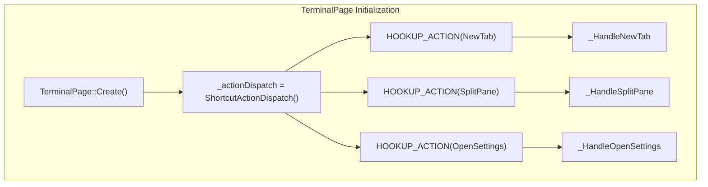
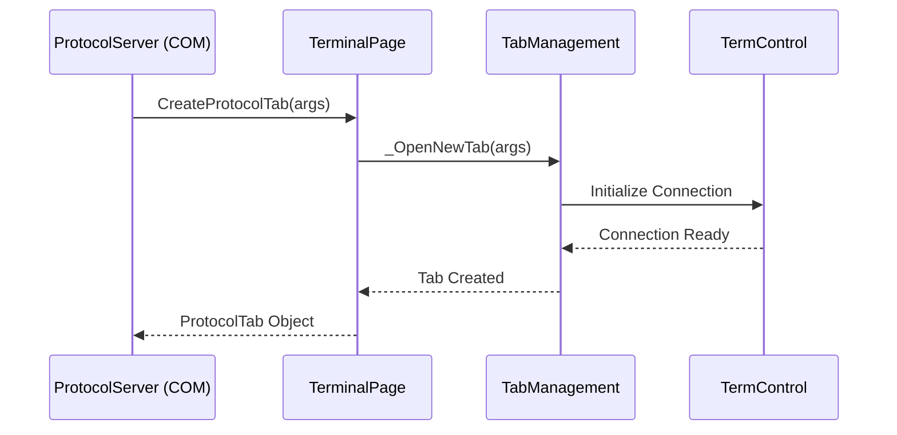

<!-- source: DeepWiki mcp.deepwiki.com · repo microsoft/intelligent-terminal · page 4.1 TerminalPage: Main UI Page and Action Dispatch · fetched 2026-10-26 -->

# TerminalPage: Main UI Page and Action Dispatch

Relevant source files

The following files were used as context for generating this wiki page:

- [doc/cascadia/SettingsSchema.md](doc/cascadia/SettingsSchema.md)
- [doc/cascadia/profiles.schema.json](doc/cascadia/profiles.schema.json)
- [src/cascadia/LocalTests_TerminalApp/CommandlineTest.cpp](src/cascadia/LocalTests_TerminalApp/CommandlineTest.cpp)
- [src/cascadia/LocalTests_TerminalApp/TabTests.cpp](src/cascadia/LocalTests_TerminalApp/TabTests.cpp)
- [src/cascadia/TerminalApp/AppActionHandlers.cpp](src/cascadia/TerminalApp/AppActionHandlers.cpp)
- [src/cascadia/TerminalApp/AppCommandlineArgs.cpp](src/cascadia/TerminalApp/AppCommandlineArgs.cpp)
- [src/cascadia/TerminalApp/AppCommandlineArgs.h](src/cascadia/TerminalApp/AppCommandlineArgs.h)
- [src/cascadia/TerminalApp/Resources/en-US/Resources.resw](src/cascadia/TerminalApp/Resources/en-US/Resources.resw)
- [src/cascadia/TerminalApp/ShortcutActionDispatch.cpp](src/cascadia/TerminalApp/ShortcutActionDispatch.cpp)
- [src/cascadia/TerminalApp/ShortcutActionDispatch.h](src/cascadia/TerminalApp/ShortcutActionDispatch.h)
- [src/cascadia/TerminalApp/ShortcutActionDispatch.idl](src/cascadia/TerminalApp/ShortcutActionDispatch.idl)
- [src/cascadia/TerminalApp/TabManagement.cpp](src/cascadia/TerminalApp/TabManagement.cpp)
- [src/cascadia/TerminalApp/TerminalPage.cpp](src/cascadia/TerminalApp/TerminalPage.cpp)
- [src/cascadia/TerminalApp/TerminalPage.h](src/cascadia/TerminalApp/TerminalPage.h)
- [src/cascadia/TerminalApp/TerminalPage.xaml](src/cascadia/TerminalApp/TerminalPage.xaml)
- [src/cascadia/TerminalSettingsModel/ActionAndArgs.cpp](src/cascadia/TerminalSettingsModel/ActionAndArgs.cpp)
- [src/cascadia/TerminalSettingsModel/ActionArgs.cpp](src/cascadia/TerminalSettingsModel/ActionArgs.cpp)
- [src/cascadia/TerminalSettingsModel/ActionArgs.h](src/cascadia/TerminalSettingsModel/ActionArgs.h)
- [src/cascadia/TerminalSettingsModel/ActionArgs.idl](src/cascadia/TerminalSettingsModel/ActionArgs.idl)
- [src/cascadia/TerminalSettingsModel/AllShortcutActions.h](src/cascadia/TerminalSettingsModel/AllShortcutActions.h)
- [src/cascadia/TerminalSettingsModel/Resources/en-US/Resources.resw](src/cascadia/TerminalSettingsModel/Resources/en-US/Resources.resw)
- [src/cascadia/TerminalSettingsModel/TerminalSettingsSerializationHelpers.h](src/cascadia/TerminalSettingsModel/TerminalSettingsSerializationHelpers.h)
- [src/cascadia/TerminalSettingsModel/defaults.json](src/cascadia/TerminalSettingsModel/defaults.json)

`TerminalPage` is the primary XAML-based hosting container for the Intelligent Terminal user interface. It serves as the root of the terminal's visual tree, orchestrating the lifecycle of tabs, panes, and the AI agent infrastructure. It acts as the central hub for dispatching user actions (keyboard shortcuts, menu items) and provides a bridge between the Win32 application host and the WinRT-based terminal controls.

## Architecture and Visual Hierarchy

`TerminalPage` is defined in `TerminalPage.xaml` and managed by `TerminalPage.cpp`. It uses a `Grid` layout to partition the window into functional zones.

### Visual Tree Structure
*   **TabRow (Row 0):** Hosts the `TabRowControl`, which contains the `TabView` for tab management [src/cascadia/TerminalApp/TerminalPage.xaml:25-27]().
*   **InfoBars (Row 1):** A container for system-level notifications, such as the `KeyboardServiceWarningInfoBar` [src/cascadia/TerminalApp/TerminalPage.xaml:29-58]().
*   **TabContent (Row 2):** The main content area where the active `Tab` and its associated `Pane` tree are rendered [src/cascadia/TerminalApp/TerminalPage.xaml:70-77]().
*   **BottomBar (Row 3):** The Intelligent Terminal agent bar, providing window-level AI controls and status indicators [src/cascadia/TerminalApp/TerminalPage.xaml:91-118]().

### Component Association: Natural Language to Code Entities

| System Concept | Code Entity | File Path |
| :--- | :--- | :--- |
| **Main UI Page** | `winrt::TerminalApp::implementation::TerminalPage` | [src/cascadia/TerminalApp/TerminalPage.h:108]() |
| **Action Hub** | `ShortcutActionDispatch` | [src/cascadia/TerminalApp/ShortcutActionDispatch.h:15]() |
| **Tab Management** | `winrt::TerminalApp::implementation::Tab` | [src/cascadia/TerminalApp/Tab.h:35]() |
| **CLI Parser** | `AppCommandlineArgs` | [src/cascadia/TerminalApp/AppCommandlineArgs.h:16]() |
| **AI Agent Bar** | `BottomBar` (XAML element) | [src/cascadia/TerminalApp/TerminalPage.xaml:106]() |

**Sources:** [src/cascadia/TerminalApp/TerminalPage.xaml:16-118](), [src/cascadia/TerminalApp/TerminalPage.h:108-112]()

---

## Startup Sequence and Settings Application

The initialization of `TerminalPage` involves setting up the environment, registering for system events, and applying user settings.

1.  **Constructor:** Initializes window properties and content managers [src/cascadia/TerminalApp/TerminalPage.cpp:258-285]().
2.  **Initialize (HWND):** Implements `IInitializeWithWindow` to associate the XAML page with the Win32 window handle [src/cascadia/TerminalApp/TerminalPage.cpp:305-312]().
3.  **SetSettings:** Updates the internal `CascadiaSettings` object. If `needRefreshUI` is true, it triggers a global UI refresh, updating themes, keybindings, and tab styles [src/cascadia/TerminalApp/TerminalPage.cpp:446-512]().
4.  **Create:** Finalizes the setup, including hooking up the `ShortcutActionDispatch` handlers [src/cascadia/TerminalApp/TerminalPage.cpp:319-354]().

### Action Handler Registration
`TerminalPage` uses the `HOOKUP_ACTION` macro to register private methods as handlers for actions defined in the settings model [src/cascadia/TerminalApp/TerminalPage.cpp:64]().

**Sources:** [src/cascadia/TerminalApp/TerminalPage.cpp:319-354](), [src/cascadia/TerminalApp/TerminalPage.cpp:64]()

---

## Action Dispatch and Command Execution

The `ShortcutActionDispatch` class is the engine that converts `ActionAndArgs` (from keybindings or the command palette) into functional calls within `TerminalPage`.

### Action Handling Flow
When a user triggers an action (e.g., `Ctrl+Shift+T`), the following flow occurs:
1.  The `ActionMap` identifies the `ShortcutAction` and its `IActionArgs`.
2.  `ShortcutActionDispatch::DoAction` is called with the `ActionAndArgs` [src/cascadia/TerminalApp/ShortcutActionDispatch.cpp:24-42]().
3.  The registered `_HandleX` method in `TerminalPage` (e.g., `_HandleNewTab`) is invoked [src/cascadia/TerminalApp/AppActionHandlers.cpp:337-342]().
4.  The handler extracts arguments and calls the appropriate internal logic (e.g., `_OpenNewTab`) [src/cascadia/TerminalApp/TabManagement.cpp:69-97]().

### Common Handlers in AppActionHandlers.cpp
*   `_HandleNewTab`: Creates a new tab based on `NewTabArgs` [src/cascadia/TerminalApp/AppActionHandlers.cpp:337]().
*   `_HandleSplitPane`: Splits the active pane [src/cascadia/TerminalApp/AppActionHandlers.cpp:358]().
*   `_HandleScrollUp`/`_HandleScrollDown`: Sends scroll commands to the active control [src/cascadia/TerminalApp/AppActionHandlers.cpp:138-157]().

**Sources:** [src/cascadia/TerminalApp/ShortcutActionDispatch.cpp:24-42](), [src/cascadia/TerminalApp/AppActionHandlers.cpp:337-360]()

---

## CLI Parsing with AppCommandlineArgs

`TerminalPage` handles command-line arguments passed during startup or via `wt.exe` execution through the `AppCommandlineArgs` class.

### Key Logic
*   **Parsing:** Uses a subcommand-based parser (similar to `git` or `docker`) to handle `new-tab`, `split-pane`, and global options like `--window` [src/cascadia/TerminalApp/AppCommandlineArgs.cpp:446-550]().
*   **Action Generation:** The parser generates a list of `ActionAndArgs` which are then executed by `TerminalPage::ProcessStartupActions` [src/cascadia/TerminalApp/TerminalPage.cpp:2205-2250]().

**Sources:** [src/cascadia/TerminalApp/AppCommandlineArgs.cpp:446-550](), [src/cascadia/TerminalApp/TerminalPage.cpp:2205-2250]()

---

## Protocol Bridge API

Intelligent Terminal introduces a "Protocol Bridge" to allow external COM clients (like `wtcli.exe`) to interact with the UI. `TerminalPage` implements several methods to facilitate this.

### Key Protocol Methods
*   **GetProtocolTabs:** Returns a list of `ProtocolTab` objects representing the current UI state [src/cascadia/TerminalApp/TerminalPage.cpp:2585-2605]().
*   **CreateProtocolTab:** Allows external creation of tabs via the COM server [src/cascadia/TerminalApp/TerminalPage.cpp:2607-2620]().
*   **GetProtocolActiveTab:** Retrieves the currently focused tab for the protocol server [src/cascadia/TerminalApp/TerminalPage.cpp:2622-2630]().

### Bridge Interaction Diagram

**Sources:** [src/cascadia/TerminalApp/TerminalPage.cpp:2585-2630](), [src/cascadia/TerminalApp/TabManagement.cpp:69-97]()

---

## Agent Bar Integration

The `BottomBar` in `TerminalPage.xaml` is the primary interface for the AI Agent features.

*   **AgentToggleButton:** Toggles the visibility of the `AgentPaneContent` for the active tab [src/cascadia/TerminalApp/TerminalPage.xaml:121-128]().
*   **State Management:** The visibility and state of the bar are updated in `_UpdateBottomBar` based on whether the active tab has an associated agent session [src/cascadia/TerminalApp/TerminalPage.cpp:3050-3100]().
*   **Autofix Integration:** When a shell error is detected, `TerminalPage` updates the `BottomBar` status to show the "Quick Fix" availability [src/cascadia/TerminalApp/TerminalPage.cpp:3120-3150]().

**Sources:** [src/cascadia/TerminalApp/TerminalPage.xaml:91-151](), [src/cascadia/TerminalApp/TerminalPage.cpp:3050-3150]()

---

