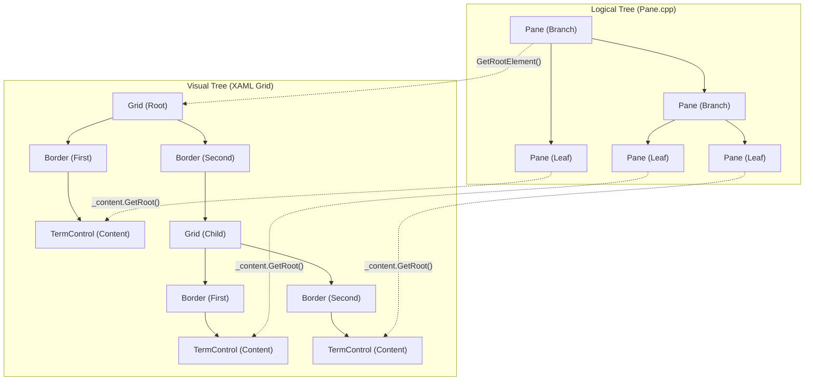
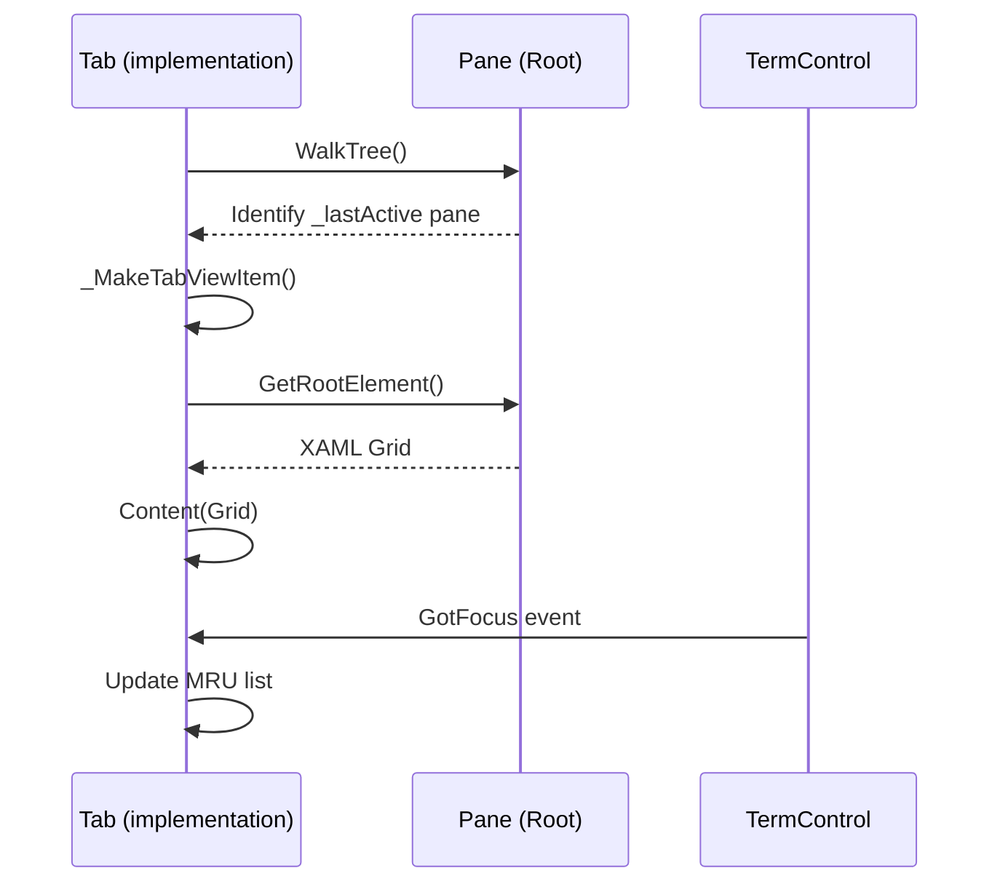

<!-- source: DeepWiki mcp.deepwiki.com · repo microsoft/intelligent-terminal · page 4.2 Tab and Pane Management · fetched 2026-10-26 -->

# Tab and Pane Management

Relevant source files

The following files were used as context for generating this wiki page:

- [src/cascadia/TerminalApp/IPaneContent.idl](src/cascadia/TerminalApp/IPaneContent.idl)
- [src/cascadia/TerminalApp/Pane.cpp](src/cascadia/TerminalApp/Pane.cpp)
- [src/cascadia/TerminalApp/Pane.h](src/cascadia/TerminalApp/Pane.h)
- [src/cascadia/TerminalApp/Tab.cpp](src/cascadia/TerminalApp/Tab.cpp)
- [src/cascadia/TerminalApp/Tab.h](src/cascadia/TerminalApp/Tab.h)
- [src/cascadia/TerminalApp/Tab.idl](src/cascadia/TerminalApp/Tab.idl)
- [src/cascadia/TerminalApp/TabHeaderControl.cpp](src/cascadia/TerminalApp/TabHeaderControl.cpp)
- [src/cascadia/TerminalApp/TabHeaderControl.h](src/cascadia/TerminalApp/TabHeaderControl.h)
- [src/cascadia/TerminalApp/TabHeaderControl.idl](src/cascadia/TerminalApp/TabHeaderControl.idl)
- [src/cascadia/TerminalApp/TabHeaderControl.xaml](src/cascadia/TerminalApp/TabHeaderControl.xaml)
- [src/cascadia/TerminalApp/TerminalPaneContent.cpp](src/cascadia/TerminalApp/TerminalPaneContent.cpp)
- [src/cascadia/TerminalApp/TerminalPaneContent.h](src/cascadia/TerminalApp/TerminalPaneContent.h)
- [src/cascadia/TerminalApp/TerminalPaneContent.idl](src/cascadia/TerminalApp/TerminalPaneContent.idl)
- [src/cascadia/TerminalApp/TerminalSettingsCache.cpp](src/cascadia/TerminalApp/TerminalSettingsCache.cpp)
- [src/cascadia/TerminalApp/TerminalSettingsCache.h](src/cascadia/TerminalApp/TerminalSettingsCache.h)
- [src/cascadia/TerminalApp/TerminalTabStatus.h](src/cascadia/TerminalApp/TerminalTabStatus.h)
- [src/cascadia/TerminalApp/TerminalTabStatus.idl](src/cascadia/TerminalApp/TerminalTabStatus.idl)

This page details the implementation of the recursive layout system used to manage multiple terminal sessions within a single window. It covers the hierarchical relationship between tabs and panes, the XAML-based layout engine, and the lifecycle of these components.

## The Recursive Pane Tree

The `Pane` class represents either a single terminal session (a **Leaf**) or a container for two other panes (a **Branch**). This recursive structure allows for arbitrary nesting of vertical and horizontal splits.

### Leaf vs Branch Panes
*   **Leaf Panes**: Contain an `IPaneContent` (typically a `TerminalPaneContent` hosting a `TermControl`) and are assigned a unique `ContentId` [src/cascadia/TerminalApp/Pane.cpp:40-44]().
*   **Branch Panes**: Contain two child `Pane` objects (`_firstChild` and `_secondChild`), a `SplitState` (Horizontal or Vertical), and a `_desiredSplitPosition` [src/cascadia/TerminalApp/Pane.cpp:61-71]().

### XAML Layout and Grid Logic
The `Pane` tree is rendered using a XAML `Grid` control. When a pane is split, the `Grid` is configured with either two `RowDefinitions` or two `ColumnDefinitions` [src/cascadia/TerminalApp/Pane.cpp:72-83]().

| Entity | Role in Pane Tree |
| :--- | :--- |
| `Pane` | The recursive node class managing layout and child life [src/cascadia/TerminalApp/Pane.h:63](). |
| `SplitState` | Enum defining `None`, `Horizontal`, or `Vertical` orientation [src/cascadia/TerminalApp/Pane.h:48-53](). |
| `IPaneContent` | Interface for content hosted inside a leaf pane [src/cascadia/TerminalApp/Pane.h:66](). |
| `TerminalPaneContent` | Implementation of `IPaneContent` that wraps a `TermControl` [src/cascadia/TerminalApp/TerminalPaneContent.h:34](). |

### Code Entity Space: Pane Hierarchy
The following diagram illustrates how the logical pane tree maps to the XAML visual tree.

**Sources:** [src/cascadia/TerminalApp/Pane.cpp:61-83](), [src/cascadia/TerminalApp/Pane.h:96-97](), [src/cascadia/TerminalApp/TerminalPaneContent.cpp:51-54]()

---

## Tab Management

The `Tab` class encapsulates a collection of panes, managing the `TabViewItem` UI and coordinating focus across the pane tree.

### Key Responsibilities
*   **TabViewItem Integration**: Each `Tab` owns a `TabViewItem` for display in the tab row [src/cascadia/TerminalApp/Tab.cpp:138-140]().
*   **MRU Pane List**: Maintains a list of pane IDs in Most Recently Used order to support directional navigation and "last active" pane restoration [src/cascadia/TerminalApp/Tab.cpp:69-73]().
*   **Focus Propagation**: When a tab is focused, it propagates that focus to the `_activePane` [src/cascadia/TerminalApp/Tab.cpp:63-68]().
*   **Title Management**: Coordinates between the `TermControl`'s dynamic title and user-defined tab renames via the `TabHeaderControl` [src/cascadia/TerminalApp/Tab.cpp:98-104]().

### Tab and Pane Interaction

**Sources:** [src/cascadia/TerminalApp/Tab.cpp:47-75](), [src/cascadia/TerminalApp/Tab.cpp:138-141]()

---

## Lifecycle and Initialization

Tab and Pane creation is orchestrated primarily in `TabManagement.cpp` (part of the `TerminalPage` logic).

### `_OpenNewTab` and `_InitializeTab`
When a new tab is requested:
1.  `_OpenNewTab` determines the profile and settings to use.
2.  `_InitializeTab` creates the `Pane` and `Tab` objects.
3.  The `Tab` is added to the `_tabs` collection and its `TabViewItem` is inserted into the `TabView` control.

### Agent Pane Pre-warming
To improve responsiveness, the Intelligent Terminal can "pre-warm" agent panes. The `AgentPaneContent` is often created in the background before being attached to a specific pane in the tree [src/cascadia/TerminalApp/Tab.h:105-111]().

### Serialization via `BuildStartupActions`
The terminal supports persisting the layout of tabs and panes.
*   `Pane::BuildStartupActions` recursively walks the tree and generates a list of `ActionAndArgs` (like `SplitPane`) that can recreate the layout [src/cascadia/TerminalApp/Pane.cpp:125-152]().
*   `BuildStartupKind` determines if the serialization is for a window move, session persistence, or content duplication [src/cascadia/TerminalApp/Pane.cpp:145-150]().

| Function | Purpose |
| :--- | :--- |
| `GetTerminalArgsForPane` | Extracts profile, directory, and command-line for a specific pane [src/cascadia/TerminalApp/Pane.cpp:98-103](). |
| `Split` | Logic for dividing a pane into two children [src/cascadia/TerminalApp/Pane.h:124-126](). |
| `AttachPane` | Moves an existing pane tree into a new split position [src/cascadia/TerminalApp/Pane.h:136-137](). |

**Sources:** [src/cascadia/TerminalApp/Pane.cpp:98-152](), [src/cascadia/TerminalApp/Tab.cpp:911-920]() (implied by BuildStartupActions usage)

---

## Agent Pane Integration

The Intelligent Terminal introduces specialized handling for the Agent Pane (the AI interface).

*   **Stashing**: The agent pane can be "stashed" (hidden without destruction). This involves rewriting the parent pane's split so the terminal sibling occupies the full area while the `TermControl` and its underlying `conpty` session remain alive [src/cascadia/TerminalApp/Tab.h:117-123]().
*   **Agent Chip**: The `Tab` manages the "Agent" status indicator (chip) in the pane header, which can be overridden to follow specific sessions [src/cascadia/TerminalApp/Tab.h:130-131]().
*   **Cross-Window Moves**: During a pane drag-and-drop between windows, the `ContentId` mechanism is used to reattach the existing terminal session and its associated AI agent helper process [src/cascadia/TerminalApp/Pane.cpp:142-150]().

**Sources:** [src/cascadia/TerminalApp/Pane.cpp:142-150](), [src/cascadia/TerminalApp/Tab.h:117-131]()

---

