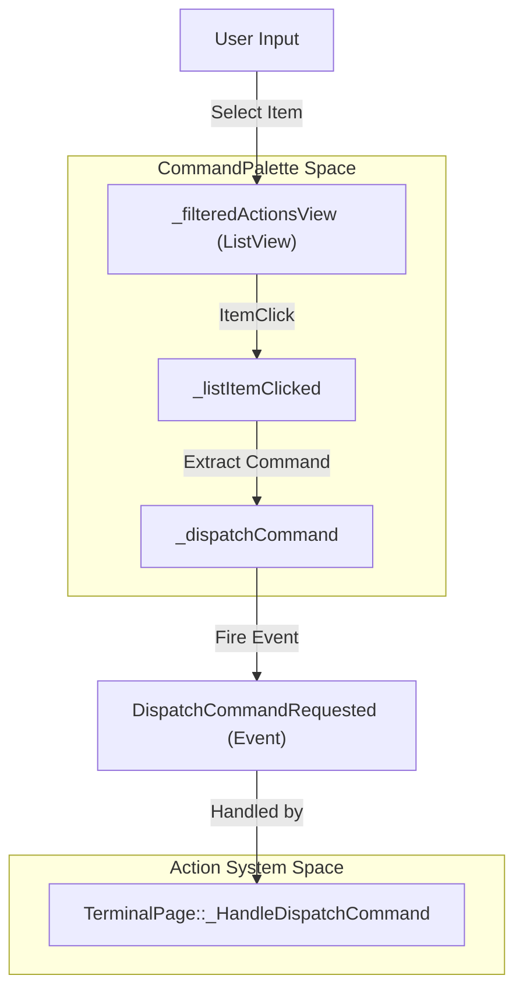
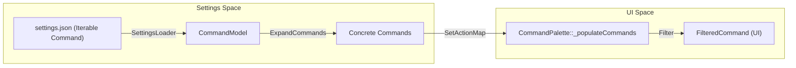

<!-- source: DeepWiki mcp.deepwiki.com · repo microsoft/intelligent-terminal · page 4.3 Command Palette and Suggestions UI · fetched 2026-10-26 -->

# Command Palette and Suggestions UI

Relevant source files

The following files were used as context for generating this wiki page:

- [.github/actions/spelling/allow/allow.txt](.github/actions/spelling/allow/allow.txt)
- [.github/actions/spelling/allow/apis.txt](.github/actions/spelling/allow/apis.txt)
- [.github/actions/spelling/allow/microsoft.txt](.github/actions/spelling/allow/microsoft.txt)
- [.github/actions/spelling/allow/names.txt](.github/actions/spelling/allow/names.txt)
- [.github/actions/spelling/expect/expect.txt](.github/actions/spelling/expect/expect.txt)
- [README.md](README.md)
- [doc/faq.md](doc/faq.md)
- [doc/roadmap-2022.md](doc/roadmap-2022.md)
- [doc/roadmap-2023.md](doc/roadmap-2023.md)
- [doc/specs/#1571 - New Tab Menu Customization/#1571 - New Tab Menu Customization.md](doc/specs/#1571 - New Tab Menu Customization/#1571 - New Tab Menu Customization.md)
- [doc/specs/#1571 - New Tab Menu Customization/Menu-Customization-000.png](doc/specs/#1571 - New Tab Menu Customization/Menu-Customization-000.png)
- [doc/specs/#1595 - Suggestions UI/Suggestions-UI.md](doc/specs/#1595 - Suggestions UI/Suggestions-UI.md)
- [doc/specs/#2046 - Command Palette.md](doc/specs/#2046 - Command Palette.md)
- [doc/specs/#2046 - Unified keybindings and commands, and synthesized action names.md](doc/specs/#2046 - Unified keybindings and commands, and synthesized action names.md)
- [doc/specs/#4066 - Theme-controlled color scheme switch.md](doc/specs/#4066 - Theme-controlled color scheme switch.md)
- [doc/specs/#653 - Quake Mode/#653 - Quake Mode.md](doc/specs/#653 - Quake Mode/#653 - Quake Mode.md)
- [doc/specs/#6899 - Action IDs/#6899 - Action IDs.md](doc/specs/#6899 - Action IDs/#6899 - Action IDs.md)
- [doc/specs/#6899 - Action IDs/data-mockup-actions-ids-keys-maps.png](doc/specs/#6899 - Action IDs/data-mockup-actions-ids-keys-maps.png)
- [doc/terminal-a11y-2023.md](doc/terminal-a11y-2023.md)
- [doc/terminal-v2-roadmap.md](doc/terminal-v2-roadmap.md)
- [images/intelligent-terminal-agent-focus.png](images/intelligent-terminal-agent-focus.png)
- [src/cascadia/TerminalApp/CommandPalette.cpp](src/cascadia/TerminalApp/CommandPalette.cpp)
- [src/cascadia/TerminalApp/CommandPalette.h](src/cascadia/TerminalApp/CommandPalette.h)
- [src/cascadia/TerminalApp/CommandPalette.idl](src/cascadia/TerminalApp/CommandPalette.idl)
- [src/cascadia/TerminalApp/CommandPalette.xaml](src/cascadia/TerminalApp/CommandPalette.xaml)
- [src/cascadia/TerminalSettingsEditor/Actions.cpp](src/cascadia/TerminalSettingsEditor/Actions.cpp)
- [src/cascadia/TerminalSettingsEditor/Actions.h](src/cascadia/TerminalSettingsEditor/Actions.h)
- [src/cascadia/TerminalSettingsEditor/Actions.idl](src/cascadia/TerminalSettingsEditor/Actions.idl)
- [src/cascadia/TerminalSettingsEditor/Actions.xaml](src/cascadia/TerminalSettingsEditor/Actions.xaml)
- [src/cascadia/TerminalSettingsEditor/ActionsViewModel.cpp](src/cascadia/TerminalSettingsEditor/ActionsViewModel.cpp)
- [src/cascadia/TerminalSettingsEditor/ActionsViewModel.h](src/cascadia/TerminalSettingsEditor/ActionsViewModel.h)
- [src/cascadia/TerminalSettingsEditor/ActionsViewModel.idl](src/cascadia/TerminalSettingsEditor/ActionsViewModel.idl)

The Command Palette and Suggestions UI provide a centralized interface for executing actions, switching tabs, and interacting with AI agents. These components bridge user input with the internal action dispatch system, supporting fuzzy search, nested command structures, and cursor-relative suggestions.

## CommandPalette Control

The `CommandPalette` is a XAML-based `UserControl` that operates in several distinct modes to handle different user workflows. It is defined in `src/cascadia/TerminalApp/CommandPalette.cpp` and `src/cascadia/TerminalApp/CommandPalette.xaml`.

### Operational Modes
The palette switches between modes using `_switchToMode(CommandPaletteMode mode)` [src/cascadia/TerminalApp/CommandPalette.cpp:37]().

| Mode | Purpose | Activation Method |
| :--- | :--- | :--- |
| `ActionMode` | Default fuzzy search for all bound actions. | `EnableCommandPaletteMode(CommandPaletteLaunchMode::Action)` |
| `CommandlineMode` | Direct execution of `wt` command lines. | Triggered by `>` prefix in search box. |
| `TabSearchMode` | Fuzzy search across open tabs. | `EnableTabSearchMode()` |
| `TabSwitchMode` | MRU or sequential tab switching (Alt+Tab style). | `EnableTabSwitcherMode()` |
| `AgentForegroundMode` | Sending prompts directly to the AI agent. | Triggered by `ai` or similar agent prefixes. |

### Search and Filtering
The palette uses a fuzzy search algorithm to filter commands.
- **Data Source**: It consumes an `IActionMapView` to populate available commands [src/cascadia/TerminalApp/CommandPalette.cpp:37]().
- **FilteredCommand**: Each item is wrapped in a `FilteredCommand` object which stores highlight information for the UI [src/cascadia/TerminalApp/CommandPalette.h:6]().
- **Dynamic Updates**: The `_filterTextChanged` handler triggers `_updateFilteredActions`, which re-calculates matches based on the current input [src/cascadia/TerminalApp/CommandPalette.cpp:91-120]().

### Action Execution Flow
When a command is selected, the palette dispatches it back to the `TerminalPage` via events.

Title: Command Palette Action Dispatch

Sources: [src/cascadia/TerminalApp/CommandPalette.cpp:110-147](), [src/cascadia/TerminalApp/CommandPalette.h:55]()

## Suggestions UI

The Suggestions UI (often referred to as the "IntelliSense-style" UI) provides context-aware command and directory history. Unlike the Command Palette, which is centered in the window, the Suggestions UI is positioned relative to the cursor in the active terminal buffer.

### Key Characteristics
- **Cursor Anchoring**: The control calculates its position based on the character coordinates of the terminal's text buffer.
- **History Integration**: It pulls from the shell's command history and directory history (if shell integration OSC marks are present).
- **Intelligent Terminal Additions**: In the Intelligent Terminal fork, this UI also surfaces AI-suggested fixes when a command fails with a non-zero exit code.

Sources: [doc/specs/#1595 - Suggestions UI/Suggestions-UI.md](), [README.md:133-141]()

## Command Lifecycle and Nesting

The Command Palette supports "Iterable Commands" and "Nested Commands," allowing for complex hierarchies (e.g., "Color Scheme..." leading to a list of available schemes).

### Nested Commands
- When a command with children is selected, the palette pushes the current view onto `_nestedActionStack` and populates the view with the children of the selected command [src/cascadia/TerminalApp/CommandPalette.cpp:31-81]().
- The `_updateUIForStackChange` function updates the "breadcrumb" or "Parent Command Name" displayed in the UI [src/cascadia/TerminalApp/CommandPalette.cpp:102]().

### ExpandCommands Lifecycle
Commands defined in `settings.json` can be "iterable" (e.g., `iterateOn: "profiles"`).
1. **Expansion**: During settings loading, these templates are expanded into concrete commands for every profile/scheme.
2. **Action IDs**: Every command is assigned a unique ID to facilitate tracking and rebinding [doc/specs/#6899 - Action IDs/#6899 - Action IDs.md]().
3. **Palette Integration**: The `CommandPalette` calls `_populateCommands` to flatten these into the searchable list [src/cascadia/TerminalApp/CommandPalette.cpp:89]().

Title: Command Expansion and Palette Population

Sources: [src/cascadia/TerminalApp/CommandPalette.cpp:37-89](), [doc/specs/#6899 - Action IDs/#6899 - Action IDs.md]()

## XAML Implementation Details

The UI is defined in `CommandPalette.xaml` using multiple `DataTemplate` objects to handle different item types.

- **PaletteItemTemplateSelector**: Selects between `GeneralItemTemplate`, `NestedItemTemplate`, and `TabSearchResultTemplate` [src/cascadia/TerminalApp/CommandPalette.xaml:27]().
- **HighlightedTextControl**: A custom control used within the templates to render fuzzy match highlights (bolding specific characters in the command name) [src/cascadia/TerminalApp/CommandPalette.xaml:83-85]().
- **KeyChordText**: Displays the keyboard shortcut associated with the action, styled with a border to look like a physical key [src/cascadia/TerminalApp/CommandPalette.xaml:27-37]().

Sources: [src/cascadia/TerminalApp/CommandPalette.xaml:24-132]()

## Action IDs and Rebinding

The system uses `ActionID`s to decouple the UI representation from the underlying implementation.
- **ActionMap**: A lookup table that maps `KeyChord`s to `Command` objects [src/cascadia/TerminalApp/CommandPalette.h:134]().
- **Rebinding**: Users can modify bindings in the "Actions" page of the Settings Editor (`src/cascadia/TerminalSettingsEditor/Actions.xaml`), which updates the `ActionMap` consumed by the palette [src/cascadia/TerminalSettingsEditor/Actions.xaml:5-130]().

Sources: [src/cascadia/TerminalSettingsEditor/Actions.xaml:123-130](), [doc/specs/#6899 - Action IDs/#6899 - Action IDs.md]()

---

