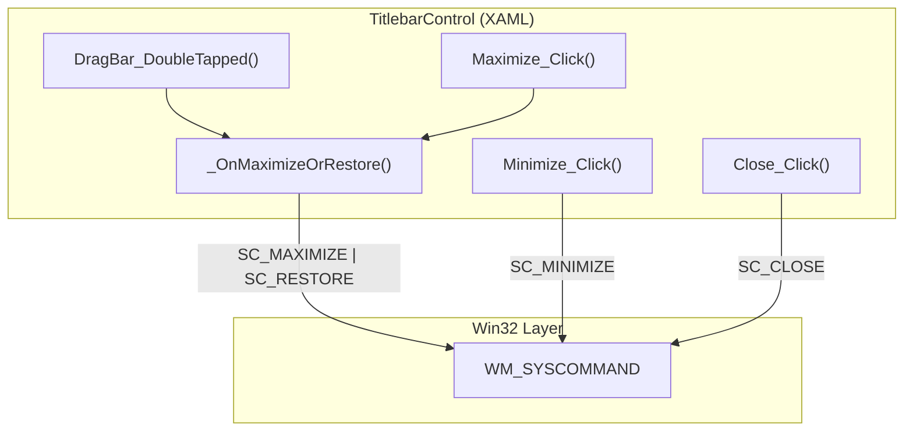
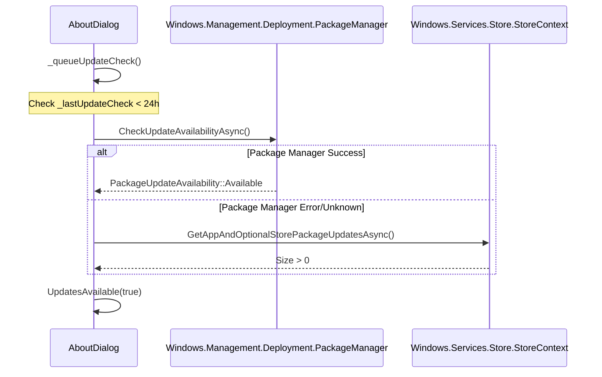

<!-- source: DeepWiki mcp.deepwiki.com · repo microsoft/intelligent-terminal · page 4.4 Titlebar, Tab Row, and Chrome Controls · fetched 2026-10-26 -->

# Titlebar, Tab Row, and Chrome Controls

Relevant source files

The following files were used as context for generating this wiki page:

- [src/buffer/out/precomp.h](src/buffer/out/precomp.h)
- [src/cascadia/TerminalApp/AboutDialog.cpp](src/cascadia/TerminalApp/AboutDialog.cpp)
- [src/cascadia/TerminalApp/AboutDialog.h](src/cascadia/TerminalApp/AboutDialog.h)
- [src/cascadia/TerminalApp/AboutDialog.idl](src/cascadia/TerminalApp/AboutDialog.idl)
- [src/cascadia/TerminalApp/AboutDialog.xaml](src/cascadia/TerminalApp/AboutDialog.xaml)
- [src/cascadia/TerminalApp/App.xaml](src/cascadia/TerminalApp/App.xaml)
- [src/cascadia/TerminalApp/MinMaxCloseControl.cpp](src/cascadia/TerminalApp/MinMaxCloseControl.cpp)
- [src/cascadia/TerminalApp/MinMaxCloseControl.h](src/cascadia/TerminalApp/MinMaxCloseControl.h)
- [src/cascadia/TerminalApp/MinMaxCloseControl.idl](src/cascadia/TerminalApp/MinMaxCloseControl.idl)
- [src/cascadia/TerminalApp/MinMaxCloseControl.xaml](src/cascadia/TerminalApp/MinMaxCloseControl.xaml)
- [src/cascadia/TerminalApp/TabRowControl.cpp](src/cascadia/TerminalApp/TabRowControl.cpp)
- [src/cascadia/TerminalApp/TabRowControl.h](src/cascadia/TerminalApp/TabRowControl.h)
- [src/cascadia/TerminalApp/TabRowControl.idl](src/cascadia/TerminalApp/TabRowControl.idl)
- [src/cascadia/TerminalApp/TabRowControl.xaml](src/cascadia/TerminalApp/TabRowControl.xaml)
- [src/cascadia/TerminalApp/TitlebarControl.cpp](src/cascadia/TerminalApp/TitlebarControl.cpp)
- [src/cascadia/TerminalApp/TitlebarControl.h](src/cascadia/TerminalApp/TitlebarControl.h)
- [src/cascadia/TerminalApp/TitlebarControl.idl](src/cascadia/TerminalApp/TitlebarControl.idl)
- [src/cascadia/TerminalApp/pch.h](src/cascadia/TerminalApp/pch.h)
- [src/cascadia/TerminalConnection/pch.h](src/cascadia/TerminalConnection/pch.h)
- [src/cascadia/TerminalControl/pch.h](src/cascadia/TerminalControl/pch.h)
- [src/cascadia/WinRTUtils/WinRTUtils.vcxproj](src/cascadia/WinRTUtils/WinRTUtils.vcxproj)
- [src/cascadia/WinRTUtils/WinRTUtils.vcxproj.filters](src/cascadia/WinRTUtils/WinRTUtils.vcxproj.filters)
- [src/cascadia/WindowsTerminal/pch.h](src/cascadia/WindowsTerminal/pch.h)

This page describes the XAML-based custom chrome components of the Intelligent Terminal. It covers the implementation of the titlebar, the tab strip, and the caption controls (Minimize, Maximize, Close), as well as the reclamation of the non-client area to support features like Snap Layouts and custom themes.

## Custom Chrome Architecture

Intelligent Terminal utilizes a custom-drawn titlebar to integrate tabs and the AI agent status directly into the window frame. This is achieved by extending the XAML content into the non-client area of the Win32 window.

### Non-Client Area Reclamation
The `IslandWindow` and `NonClientIslandWindow` classes (see Section 3.2) handle the low-level Win32 messages like `WM_NCHITTEST`. The XAML layer provides the visual representation, while the Win32 layer defines which regions act as the "drag bar" or "caption buttons" for the OS.

### App.xaml Resource Dictionary
`App.xaml` serves as the global repository for theme-dependent styles and brushes used across the chrome.
- **BackgroundGridThemeStyle**: A style applied to the root grid of the tab row to ensure it respects the `ApplicationPageBackgroundThemeBrush` regardless of the explicit `RequestedTheme` [src/cascadia/TerminalApp/App.xaml:34-37]().
- **ErrorTextBrush**: A theme-dependent `SolidColorBrush` mapping to `SystemErrorTextColor` [src/cascadia/TerminalApp/App.xaml:44-45]().
- **Performance Optimizations**: The `EntranceThemeTransition` is explicitly disabled for `TabViewListView` to reduce window startup latency by approximately 10% [src/cascadia/TerminalApp/App.xaml:53-67]().

**Sources:** [src/cascadia/TerminalApp/App.xaml:17-70]()

---

## TitlebarControl

The `TitlebarControl` is the top-level XAML container for the window's custom titlebar. It coordinates between the application content (tabs) and the system caption buttons.

### Key Components
- **ContentRoot**: A `ContentPresenter` that hosts the `TabRowControl` or other titlebar content [src/cascadia/TerminalApp/TitlebarControl.cpp:66-74]().
- **DragBar**: A region that allows the user to move the window. It handles `DoubleTapped` events to toggle maximization via `_OnMaximizeOrRestore` [src/cascadia/TerminalApp/TitlebarControl.cpp:118-122]().
- **MinMaxCloseControl**: Hosts the system caption buttons [src/cascadia/TerminalApp/TitlebarControl.cpp:24-26]().

### Visual Logic and Flow
The control dynamically calculates the available space for tabs. In `Root_SizeChanged`, it calculates `maxWidth` by subtracting the width of the `MinMaxCloseControl` and the minimum width of the `DragBar` from the total window width [src/cascadia/TerminalApp/TitlebarControl.cpp:76-89]().

### Titlebar Interaction Mapping
The following diagram maps Win32 events and user interactions to the `TitlebarControl` logic.

**Diagram: Titlebar Interaction Flow**

**Sources:** [src/cascadia/TerminalApp/TitlebarControl.cpp:113-134](), [src/cascadia/TerminalApp/TitlebarControl.h:9-30]()

---

## MinMaxCloseControl

The `MinMaxCloseControl` provides the Minimize, Maximize/Restore, and Close buttons. These are not standard system buttons but custom XAML `Button` controls styled to match the Windows 11 design language.

### Implementation Details
- **Throttled Tooltips**: To match system behavior, tooltips for caption buttons use a `ThrottledFunc` with a delay (default 400ms) fetched via `SPI_GETMOUSEHOVERTIME` [src/cascadia/TerminalApp/MinMaxCloseControl.cpp:33-69]().
- **State Management**: The control tracks whether the parent window is focused and updates button visual states accordingly via `SetWindowVisualState` [src/cascadia/TerminalApp/MinMaxCloseControl.cpp:91-101]().
- **Snap Layouts Integration**: While the buttons are XAML, the `IslandWindow` uses the geometry of these buttons to return `HTMAXBUTTON` during `WM_NCHITTEST`, allowing the Windows 11 Snap Layouts menu to appear when hovering the Maximize button.

### Visual States
The control uses `VisualStateManager` to switch between `WindowStateMaximized` and `WindowStateNormal`, which changes the glyph (e.g., from a square to overlapping squares) and the tooltip text [src/cascadia/TerminalApp/MinMaxCloseControl.cpp:134-157]().

**Sources:** [src/cascadia/TerminalApp/MinMaxCloseControl.xaml:5-116](), [src/cascadia/TerminalApp/MinMaxCloseControl.cpp:24-157]()

---

## TabRowControl

The `TabRowControl` encapsulates the `Microsoft.UI.Xaml.Controls.TabView` and the "New Tab" button.

### Components
- **TabView**: The core WinUI control for managing tab lifecycle [src/cascadia/TerminalApp/TabRowControl.xaml:27-35]().
- **TabStripHeader**: Displays the `ElevationShield` (glyph `\uEA18`) when the terminal is running with elevated privileges [src/cascadia/TerminalApp/TabRowControl.xaml:37-46]().
- **NewTabButton**: A `SplitButton` that allows for a simple click (default profile) or a dropdown menu to select specific profiles [src/cascadia/TerminalApp/TabRowControl.xaml:55-70]().

### Layout Adjustments
The control applies a `-1` bottom padding to the `TabView` to prevent a 1px gap often seen on 150% DPI scaling displays between the tab strip and the main terminal content [src/cascadia/TerminalApp/TabRowControl.xaml:21-25]().

**Sources:** [src/cascadia/TerminalApp/TabRowControl.xaml:5-125]()

---

## About Dialog

The `AboutDialog` is a `ContentDialog` that provides version information and update checks.

### Features
- **Dynamic Versioning**: Fetches application name and version from `CascadiaSettings` [src/cascadia/TerminalApp/AboutDialog.cpp:34-43]().
- **Update Checking**: Implements an asynchronous update check using `PackageManager` (for MSIX/Store builds) or `StoreContext` [src/cascadia/TerminalApp/AboutDialog.cpp:57-145]().
- **Branding**: In `WT_BRANDING_DEV` builds, the dialog simulates a 3-second check and always reports an update is available for testing purposes [src/cascadia/TerminalApp/AboutDialog.cpp:78-83]().

### Update Logic Flow
The check is throttled to once every 24 hours via `_lastUpdateCheck` [src/cascadia/TerminalApp/AboutDialog.cpp:60-65]().

**Diagram: AboutDialog Update Check**

**Sources:** [src/cascadia/TerminalApp/AboutDialog.cpp:57-145](), [src/cascadia/TerminalApp/AboutDialog.xaml:5-68]()

---

