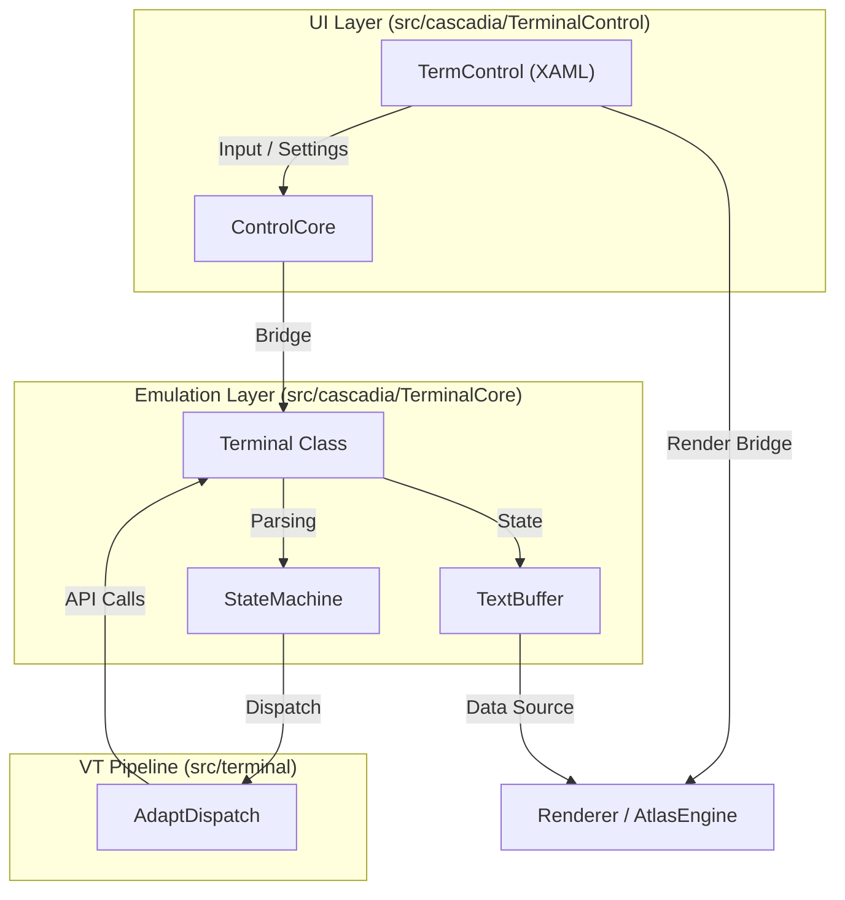

<!-- source: DeepWiki mcp.deepwiki.com · repo microsoft/intelligent-terminal · page 5 Terminal Emulation Engine · fetched 2026-10-26 -->

# Terminal Emulation Engine

Relevant source files

The following files were used as context for generating this wiki page:

- [src/cascadia/TerminalControl/ControlCore.cpp](src/cascadia/TerminalControl/ControlCore.cpp)
- [src/cascadia/TerminalControl/ControlCore.h](src/cascadia/TerminalControl/ControlCore.h)
- [src/cascadia/TerminalControl/ControlCore.idl](src/cascadia/TerminalControl/ControlCore.idl)
- [src/cascadia/TerminalControl/TermControl.cpp](src/cascadia/TerminalControl/TermControl.cpp)
- [src/cascadia/TerminalControl/TermControl.h](src/cascadia/TerminalControl/TermControl.h)
- [src/cascadia/TerminalControl/TermControl.idl](src/cascadia/TerminalControl/TermControl.idl)
- [src/cascadia/TerminalCore/Terminal.cpp](src/cascadia/TerminalCore/Terminal.cpp)
- [src/cascadia/TerminalCore/Terminal.hpp](src/cascadia/TerminalCore/Terminal.hpp)
- [src/cascadia/TerminalCore/TerminalApi.cpp](src/cascadia/TerminalCore/TerminalApi.cpp)
- [src/cascadia/TerminalCore/TerminalSelection.cpp](src/cascadia/TerminalCore/TerminalSelection.cpp)
- [src/cascadia/TerminalCore/terminalrenderdata.cpp](src/cascadia/TerminalCore/terminalrenderdata.cpp)
- [src/host/renderData.cpp](src/host/renderData.cpp)
- [src/host/renderData.hpp](src/host/renderData.hpp)
- [src/host/ut_host/VtIoTests.cpp](src/host/ut_host/VtIoTests.cpp)
- [src/renderer/inc/IRenderData.hpp](src/renderer/inc/IRenderData.hpp)

The Terminal Emulation Engine is the core architectural component of the Intelligent Terminal, responsible for managing the lifecycle of a terminal session from raw byte input to rendered UI. It is structured as a three-layer stack that bridges the gap between the low-level Virtual Terminal (VT) state machine and the high-level XAML-based user interface.

### Architecture Overview

The emulation engine operates as a pipeline where data flows from the connection (PTY) through a parser into a text buffer, which is then monitored by a rendering bridge to update the UI.

**Sources:**
- [src/cascadia/TerminalControl/ControlCore.h:8-11]()
- [src/cascadia/TerminalCore/Terminal.hpp:54-58]()
- [src/cascadia/TerminalCore/Terminal.cpp:53-55]()

---

### TermControl and ControlCore: UI and Rendering Bridge
The top layer consists of `TermControl`, a XAML `UserControl` that provides the visual surface for the terminal. It handles high-level UI concerns such as focus, mouse/touch input, and the integration of the Text Services Framework (TSF) for IME support [src/cascadia/TerminalControl/TermControl.cpp:182-189]().

`ControlCore` acts as the non-UI orchestrator. It manages the lifecycle of the `AtlasEngine` (the hardware-accelerated renderer) and the `Terminal` instance. It ensures that rendering is throttled appropriately and that the UI thread is not blocked by heavy terminal output [src/cascadia/TerminalControl/ControlCore.cpp:152-162]().

For details, see [TermControl and ControlCore: UI and Rendering Bridge](#5.1).

**Sources:**
- [src/cascadia/TerminalControl/TermControl.h:46-48]()
- [src/cascadia/TerminalControl/ControlCore.h:79-84]()
- [src/cascadia/TerminalControl/ControlCore.cpp:100-103]()

---

### Terminal Core: VT State Machine and Buffer Management
The `Terminal` class is the central entity of the emulation layer. It implements `ITerminalApi`, providing the interface that the VT parser uses to manipulate the terminal state [src/cascadia/TerminalCore/Terminal.hpp:54-58](). It maintains the `TextBuffer` (the grid of characters and attributes) and the `StateMachine` (the VT parser).

Key responsibilities include:
*   **Viewport Management**: Tracking the `mutableViewport` and handling scrollback history [src/cascadia/TerminalCore/Terminal.cpp:45-51]().
*   **Selection**: Managing `TerminalSelection` which supports block mode and various expansion granularities (char, word, line) [src/cascadia/TerminalCore/TerminalSelection.cpp:199-203]().
*   **Pattern Detection**: Using an interval tree to track URLs and other clickable patterns in the buffer [src/cascadia/TerminalCore/terminalrenderdata.cpp:80-101]().

For details, see [Terminal Core: VT State Machine and Buffer Management](#5.2).

**Sources:**
- [src/cascadia/TerminalCore/Terminal.cpp:28-56]()
- [src/cascadia/TerminalCore/TerminalApi.cpp:23-44]()
- [src/cascadia/TerminalCore/TerminalSelection.cpp:49-61]()

---

### VT Parser and Dispatch
The engine processes incoming text via the `StateMachine` and `OutputStateMachineEngine`. These components parse ANSI/VT escape sequences (CSI, OSC, DCS). The actual logic for these commands is implemented in `AdaptDispatch` [src/cascadia/TerminalCore/Terminal.cpp:53-54]().

`AdaptDispatch` translates generic VT commands (like "move cursor to x,y" or "set color to red") into specific operations on the `Terminal`'s internal state and `TextBuffer` via the `ITerminalApi` abstraction.

For details, see [VT Parser and Dispatch: AdaptDispatch and OutputStateMachineEngine](#5.3).

**Sources:**
- [src/cascadia/TerminalCore/Terminal.cpp:53-55]()
- [src/cascadia/TerminalCore/Terminal.hpp:133-170]()

---

### TextBuffer and ROW Storage
At the lowest level, the `TextBuffer` stores the terminal's content. It is a circular buffer designed for high-performance reflow and rendering. Data is stored in `ROW` objects, which manage character data and run-length encoded (RLE) attributes for efficiency.

The buffer supports:
*   **Reflow**: Dynamically recalculating character positions when the window is resized.
*   **Dirty Tracking**: Marking regions of the buffer as "dirty" to signal the renderer that only specific areas need to be redrawn [src/cascadia/TerminalControl/ControlCore.cpp:152-162]().

For details, see [TextBuffer and ROW Storage](#5.4).

**Sources:**
- [src/cascadia/TerminalCore/Terminal.cpp:47-51]()
- [src/cascadia/TerminalCore/terminalrenderdata.cpp:24-27]()

---

### Key Code Entities

| Class | File | Responsibility |
| :--- | :--- | :--- |
| `TermControl` | [src/cascadia/TerminalControl/TermControl.h:46]() | XAML UI Surface and Input Handling |
| `ControlCore` | [src/cascadia/TerminalControl/ControlCore.h:79]() | Bridge between UI and Terminal Logic |
| `Terminal` | [src/cascadia/TerminalCore/Terminal.hpp:54]() | Main emulation logic and API provider |
| `TextBuffer` | [src/buffer/out/textBuffer.hpp]() | Grid storage for text and attributes |
| `StateMachine` | [src/terminal/parser/StateMachine.hpp]() | VT Escape sequence parser |
| `AdaptDispatch` | [src/terminal/adapter/adaptDispatch.hpp]() | Implementation of VT command logic |

**Sources:**
- [src/cascadia/TerminalControl/TermControl.h:46-52]()
- [src/cascadia/TerminalControl/ControlCore.h:79-84]()
- [src/cascadia/TerminalCore/Terminal.hpp:54-58]()

---

