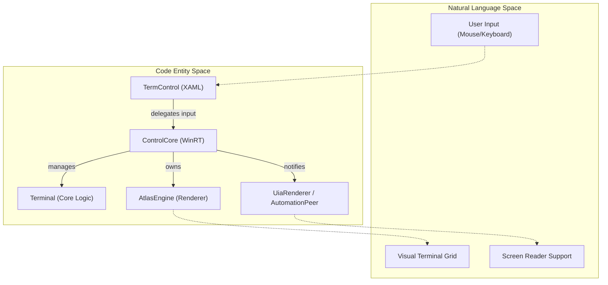
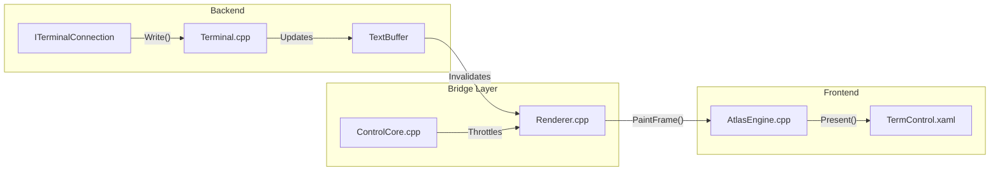

<!-- source: DeepWiki mcp.deepwiki.com · repo microsoft/intelligent-terminal · page 5.1 TermControl and ControlCore: UI and Rendering Bridge · fetched 2026-10-26 -->

# TermControl and ControlCore: UI and Rendering Bridge

Relevant source files

The following files were used as context for generating this wiki page:

- [src/cascadia/TerminalControl/ControlCore.cpp](src/cascadia/TerminalControl/ControlCore.cpp)
- [src/cascadia/TerminalControl/ControlCore.h](src/cascadia/TerminalControl/ControlCore.h)
- [src/cascadia/TerminalControl/ControlCore.idl](src/cascadia/TerminalControl/ControlCore.idl)
- [src/cascadia/TerminalControl/ControlInteractivity.cpp](src/cascadia/TerminalControl/ControlInteractivity.cpp)
- [src/cascadia/TerminalControl/ControlInteractivity.h](src/cascadia/TerminalControl/ControlInteractivity.h)
- [src/cascadia/TerminalControl/ControlInteractivity.idl](src/cascadia/TerminalControl/ControlInteractivity.idl)
- [src/cascadia/TerminalControl/InteractivityAutomationPeer.cpp](src/cascadia/TerminalControl/InteractivityAutomationPeer.cpp)
- [src/cascadia/TerminalControl/InteractivityAutomationPeer.h](src/cascadia/TerminalControl/InteractivityAutomationPeer.h)
- [src/cascadia/TerminalControl/InteractivityAutomationPeer.idl](src/cascadia/TerminalControl/InteractivityAutomationPeer.idl)
- [src/cascadia/TerminalControl/Resources/en-US/Resources.resw](src/cascadia/TerminalControl/Resources/en-US/Resources.resw)
- [src/cascadia/TerminalControl/SearchBoxControl.cpp](src/cascadia/TerminalControl/SearchBoxControl.cpp)
- [src/cascadia/TerminalControl/SearchBoxControl.h](src/cascadia/TerminalControl/SearchBoxControl.h)
- [src/cascadia/TerminalControl/SearchBoxControl.idl](src/cascadia/TerminalControl/SearchBoxControl.idl)
- [src/cascadia/TerminalControl/SearchBoxControl.xaml](src/cascadia/TerminalControl/SearchBoxControl.xaml)
- [src/cascadia/TerminalControl/TermControl.cpp](src/cascadia/TerminalControl/TermControl.cpp)
- [src/cascadia/TerminalControl/TermControl.h](src/cascadia/TerminalControl/TermControl.h)
- [src/cascadia/TerminalControl/TermControl.idl](src/cascadia/TerminalControl/TermControl.idl)
- [src/cascadia/TerminalControl/TermControl.xaml](src/cascadia/TerminalControl/TermControl.xaml)
- [src/cascadia/TerminalControl/TermControlAutomationPeer.cpp](src/cascadia/TerminalControl/TermControlAutomationPeer.cpp)
- [src/cascadia/TerminalControl/TermControlAutomationPeer.h](src/cascadia/TerminalControl/TermControlAutomationPeer.h)
- [src/cascadia/TerminalControl/XamlUiaTextRange.cpp](src/cascadia/TerminalControl/XamlUiaTextRange.cpp)
- [src/cascadia/TerminalCore/Terminal.cpp](src/cascadia/TerminalCore/Terminal.cpp)
- [src/cascadia/TerminalCore/Terminal.hpp](src/cascadia/TerminalCore/Terminal.hpp)
- [src/cascadia/TerminalCore/TerminalApi.cpp](src/cascadia/TerminalCore/TerminalApi.cpp)
- [src/cascadia/TerminalCore/TerminalSelection.cpp](src/cascadia/TerminalCore/TerminalSelection.cpp)
- [src/cascadia/TerminalSettingsModel/MediaResourceSupport.h](src/cascadia/TerminalSettingsModel/MediaResourceSupport.h)
- [src/cascadia/UIHelpers/TextMenuFlyout.cpp](src/cascadia/UIHelpers/TextMenuFlyout.cpp)
- [src/cascadia/UnitTests_Control/ControlCoreTests.cpp](src/cascadia/UnitTests_Control/ControlCoreTests.cpp)
- [src/cascadia/UnitTests_Control/ControlInteractivityTests.cpp](src/cascadia/UnitTests_Control/ControlInteractivityTests.cpp)
- [src/types/IControlAccessibilityInfo.h](src/types/IControlAccessibilityInfo.h)
- [src/types/TermControlUiaProvider.cpp](src/types/TermControlUiaProvider.cpp)
- [src/types/TermControlUiaProvider.hpp](src/types/TermControlUiaProvider.hpp)
- [src/types/TermControlUiaTextRange.cpp](src/types/TermControlUiaTextRange.cpp)
- [src/types/TermControlUiaTextRange.hpp](src/types/TermControlUiaTextRange.hpp)

The Terminal UI is built on a tiered architecture that separates XAML-based user interaction from the core terminal emulation logic. This bridge is primarily composed of `TermControl` (the UI layer) and `ControlCore` (the rendering and logic orchestrator).

## TermControl: The XAML Interface

`TermControl` is a XAML `UserControl` that serves as the primary interaction point for the user. It handles high-level UI concerns such as mouse input, touch gestures, focus management, and integration with Windows input services like TSF (Text Services Framework).

### Key Responsibilities
*   **Input Handling**: Captures keystrokes via `_KeyDownHandler` and `_CharacterHandler` [src/cascadia/TerminalControl/TermControl.xaml:22-30](), and mouse events via `_MouseWheelHandler` [src/cascadia/TerminalControl/TermControl.xaml:29]().
*   **TSF/IME Integration**: Implements `TsfDataProvider` to bridge terminal text input with the Windows Text Services Framework, allowing for complex script entry (IME) [src/cascadia/TerminalControl/TermControl.cpp:158-161]().
*   **UI Components**: Hosts the `SearchBoxControl` for buffer searching [src/cascadia/TerminalControl/TermControl.cpp:1063-1067]() and manages context menus (`CommandBarFlyout`) [src/cascadia/TerminalControl/TermControl.xaml:36-90]().
*   **Accessibility**: Provides a `TermControlAutomationPeer` to expose the terminal buffer to UI Automation (UIA) clients like screen readers [src/cascadia/TerminalControl/TermControl.cpp:153-155]().

### Data Pipeline: Keystroke to VT
1.  User presses a key; XAML triggers `_KeyDownHandler`.
2.  `TermControl` calls `ControlCore::TrySendKeyEvent` [src/cascadia/TerminalControl/ControlCore.idl:124-127]().
3.  `ControlCore` delegates to the `Terminal` instance's `SendKeyEvent` [src/cascadia/TerminalCore/Terminal.cpp:178-178]().
4.  The `Terminal` state machine translates the key into a VT sequence (e.g., `\x1b[A` for Up Arrow).
5.  The sequence is sent to the `ITerminalConnection` (ConPTY) to be consumed by the shell [src/cascadia/TerminalControl/ControlCore.cpp:107-109]().

**Sources**: [src/cascadia/TerminalControl/TermControl.cpp:5-155](), [src/cascadia/TerminalControl/TermControl.xaml:5-90](), [src/cascadia/TerminalControl/TermControl.idl:28-150]().

---

## ControlCore: The Logic Orchestrator

`ControlCore` is a non-UI class that encapsulates the lifecycle of a terminal session. It acts as the "brain" that connects the `Terminal` emulation engine, the `Renderer`, and the `ITerminalConnection`.

### Implementation Details
*   **Renderer Lifecycle**: Manages the `AtlasEngine` (DirectX-based GPU renderer) and coordinates with the `Renderer` class to ensure the swap chain is correctly attached to the XAML `SwapChainPanel` [src/cascadia/TerminalControl/ControlCore.cpp:152-165]().
*   **Throttling and Idle Detection**: Uses a `DispatcherQueue` to throttle UI updates, such as scrollbar movements (8ms interval) [src/cascadia/TerminalControl/TermControl.cpp:31-31](), ensuring the UI thread is not overwhelmed by high-velocity VT output.
*   **UIA Engine Attachment**: Attaches a `UiaRenderer` to the rendering pipeline, allowing screen readers to receive "dirty" region notifications when the buffer changes [src/cascadia/TerminalControl/ControlCore.cpp:170-175]().

### Control and Core Association
The following diagram illustrates how the "Natural Language" concepts of the UI map to the "Code Entity" space within the bridge.

**Diagram: UI to Core Entity Mapping**

**Sources**: [src/cascadia/TerminalControl/ControlCore.cpp:68-175](), [src/cascadia/TerminalControl/ControlCore.h:79-190](), [src/cascadia/TerminalControl/ControlCore.idl:87-200]().

---

## The Rendering Bridge

The bridge ensures that changes in the `TextBuffer` (located in `Terminal`) are efficiently reflected on screen via the `Renderer`.

### Output Data Flow
1.  **Output Arrival**: Data arrives from the `ITerminalConnection` and is written to the `Terminal` via `Terminal::Write` [src/cascadia/TerminalCore/Terminal.hpp:106-106]().
2.  **State Update**: The `StateMachine` parses VT sequences and updates the `TextBuffer` [src/cascadia/TerminalCore/Terminal.cpp:53-56]().
3.  **Invalidation**: The `Terminal` triggers a `Renderer::TriggerTeardown` or invalidates specific rectangles.
4.  **Throttled Rendering**: `ControlCore` listens for `OutputIdle` events. When the terminal is "idle" (no more output pending for a few milliseconds), it allows the renderer to present the frame to the `SwapChainPanel` [src/cascadia/TerminalControl/ControlCore.cpp:161-165]().

**Diagram: Rendering Pipeline Bridge**

### Key Functions and Classes
| Class | Function | Purpose |
| :--- | :--- | :--- |
| `TermControl` | `OnDirectKeyEvent` | Handles raw keyboard input before XAML translation [src/cascadia/TerminalControl/TermControl.cpp:1072-1074](). |
| `ControlCore` | `Initialize` | Sets up the renderer, font metrics, and dispatcher callbacks [src/cascadia/TerminalControl/ControlCore.cpp:87-95](). |
| `TsfDataProvider` | `HandleOutput` | Forwards text from the IME to the terminal connection [src/cascadia/TerminalControl/TermControl.cpp:218-221](). |
| `ControlInteractivity` | `PointerPressed` | Manages selection state and multi-click logic [src/cascadia/TerminalControl/ControlInteractivity.cpp:141-168](). |

**Sources**: [src/cascadia/TerminalControl/TermControl.cpp:1063-1080](), [src/cascadia/TerminalControl/ControlCore.cpp:82-165](), [src/cascadia/TerminalControl/ControlInteractivity.cpp:28-168](), [src/cascadia/TerminalCore/Terminal.cpp:43-56]().

---

