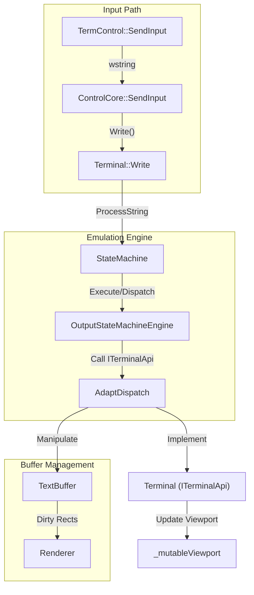
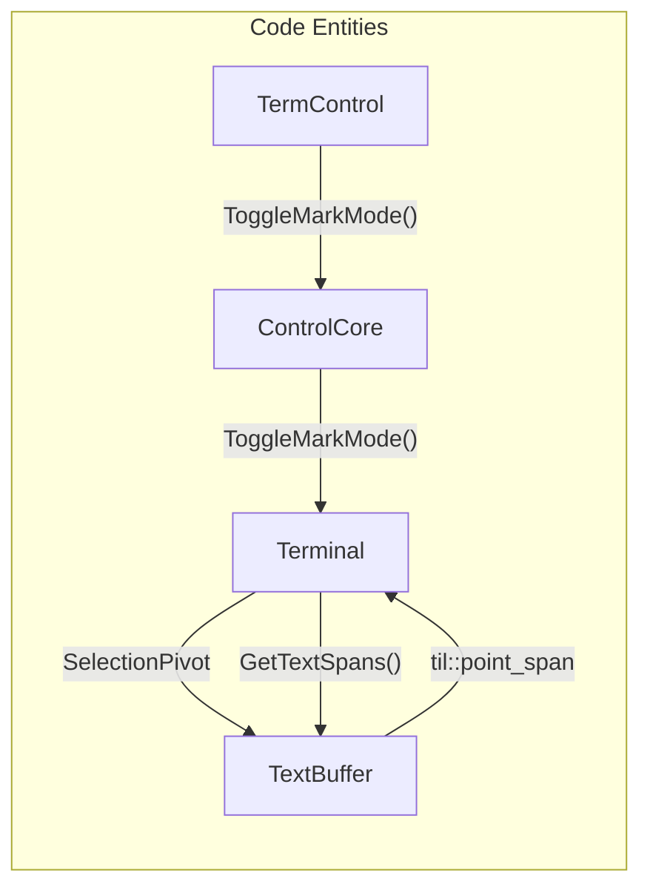

<!-- source: DeepWiki mcp.deepwiki.com · repo microsoft/intelligent-terminal · page 5.2 Terminal Core: VT State Machine and Buffer Management · fetched 2026-10-26 -->

# Terminal Core: VT State Machine and Buffer Management

Relevant source files

The following files were used as context for generating this wiki page:

- [src/cascadia/ShellExtension/WindowsTerminalShellExt.vcxproj](src/cascadia/ShellExtension/WindowsTerminalShellExt.vcxproj)
- [src/cascadia/TerminalControl/ControlCore.cpp](src/cascadia/TerminalControl/ControlCore.cpp)
- [src/cascadia/TerminalControl/ControlCore.h](src/cascadia/TerminalControl/ControlCore.h)
- [src/cascadia/TerminalControl/ControlCore.idl](src/cascadia/TerminalControl/ControlCore.idl)
- [src/cascadia/TerminalControl/TermControl.cpp](src/cascadia/TerminalControl/TermControl.cpp)
- [src/cascadia/TerminalControl/TermControl.h](src/cascadia/TerminalControl/TermControl.h)
- [src/cascadia/TerminalControl/TermControl.idl](src/cascadia/TerminalControl/TermControl.idl)
- [src/cascadia/TerminalControl/dll/TerminalControl.vcxproj](src/cascadia/TerminalControl/dll/TerminalControl.vcxproj)
- [src/cascadia/TerminalCore/ITerminalInput.hpp](src/cascadia/TerminalCore/ITerminalInput.hpp)
- [src/cascadia/TerminalCore/Terminal.cpp](src/cascadia/TerminalCore/Terminal.cpp)
- [src/cascadia/TerminalCore/Terminal.hpp](src/cascadia/TerminalCore/Terminal.hpp)
- [src/cascadia/TerminalCore/TerminalApi.cpp](src/cascadia/TerminalCore/TerminalApi.cpp)
- [src/cascadia/TerminalCore/TerminalSelection.cpp](src/cascadia/TerminalCore/TerminalSelection.cpp)
- [src/cascadia/UnitTests_TerminalCore/InputTest.cpp](src/cascadia/UnitTests_TerminalCore/InputTest.cpp)
- [src/cascadia/UnitTests_TerminalCore/ScreenSizeLimitsTest.cpp](src/cascadia/UnitTests_TerminalCore/ScreenSizeLimitsTest.cpp)
- [src/cascadia/UnitTests_TerminalCore/ScrollTest.cpp](src/cascadia/UnitTests_TerminalCore/ScrollTest.cpp)
- [src/cascadia/UnitTests_TerminalCore/SelectionTest.cpp](src/cascadia/UnitTests_TerminalCore/SelectionTest.cpp)
- [src/cascadia/UnitTests_TerminalCore/ShellIntegrationTests.cpp](src/cascadia/UnitTests_TerminalCore/ShellIntegrationTests.cpp)
- [src/cascadia/UnitTests_TerminalCore/TerminalBufferTests.cpp](src/cascadia/UnitTests_TerminalCore/TerminalBufferTests.cpp)
- [src/cascadia/UnitTests_TerminalCore/UnitTests.vcxproj](src/cascadia/UnitTests_TerminalCore/UnitTests.vcxproj)
- [src/cascadia/inc/ShellIntegration.h](src/cascadia/inc/ShellIntegration.h)
- [src/host/dbcs.h](src/host/dbcs.h)
- [src/host/exe/Host.EXE.vcxproj](src/host/exe/Host.EXE.vcxproj)
- [src/host/exe/openconsole.exe.manifest](src/host/exe/openconsole.exe.manifest)
- [src/host/ut_host/Host.UnitTests.vcxproj](src/host/ut_host/Host.UnitTests.vcxproj)
- [src/host/ut_host/Host.UnitTests.vcxproj.filters](src/host/ut_host/Host.UnitTests.vcxproj.filters)
- [src/host/ut_host/sources](src/host/ut_host/sources)
- [src/interactivity/win32/ut_interactivity_win32/Interactivity.Win32.UnitTests.vcxproj](src/interactivity/win32/ut_interactivity_win32/Interactivity.Win32.UnitTests.vcxproj)

The Terminal Core is the heart of the terminal emulation engine, responsible for maintaining the internal state of the terminal, managing text buffers, and processing Virtual Terminal (VT) sequences. It resides in the `Terminal` class, which implements several key interfaces to bridge VT dispatch operations with buffer manipulations.

## The Terminal Class

The `Terminal` class ([src/cascadia/TerminalCore/Terminal.hpp:54-58]()) is the central orchestrator of the emulation state. It inherits from:
*   `ITerminalApi`: The interface used by the VT engine to execute commands.
*   `ITerminalInput`: Handles key and mouse event translation into VT sequences.
*   `IRenderData`: Provides the renderer with access to the buffer for drawing.

### Core Components and Data Flow

The `Terminal` class manages the lifecycle of the text buffer and the state machine that drives it.

| Component | Class/Entity | Responsibility |
| :--- | :--- | :--- |
| **Buffer** | `TextBuffer` | Stores character data, attributes, and the cursor. |
| **Parser** | `StateMachine` | Orchestrates the parsing of incoming byte streams. |
| **Engine** | `OutputStateMachineEngine` | The logic for interpreting VT sequences (CSI, OSC, etc.). |
| **Dispatch** | `AdaptDispatch` | Implements the actual buffer operations requested by the engine. |

### Initialization and Settings
The terminal is typically initialized via `CreateFromSettings` ([src/cascadia/TerminalCore/Terminal.cpp:75-85]()), which configures the viewport size, scrollback history, and URL detection patterns.

### System Architecture: Core Emulation
This diagram illustrates how the `Terminal` class bridges the VT parser and the underlying data storage.

**Terminal Emulation Data Flow**

Sources: [src/cascadia/TerminalCore/Terminal.cpp:43-56](), [src/cascadia/TerminalControl/ControlCore.cpp:100-110](), [src/cascadia/TerminalCore/Terminal.hpp:54-58]()

## VT State Machine and TerminalApi

The `Terminal` class implements `ITerminalApi` to act as the bridge between the VT parser and the terminal's internal state. When the `OutputStateMachineEngine` identifies a command (e.g., "Set Cursor Position"), it calls a method on the `ITerminalApi` interface, which `Terminal` fulfills.

### Key Implementation Details
*   **Viewport Management**: The `Terminal` maintains a `_mutableViewport` ([src/cascadia/TerminalCore/Terminal.cpp:45]()) representing the visible area. Methods like `SetViewportPosition` ([src/cascadia/TerminalCore/TerminalApi.cpp:46-64]()) ensure the viewport remains within the bounds of the `TextBuffer` and handle scroll events.
*   **Taskbar Integration**: Implements `SetTaskbarProgress` ([src/cascadia/TerminalCore/TerminalApi.cpp:172-215]()) to handle OSC sequences that update the window's taskbar state (Progress, Error, Indeterminate).
*   **Shell Integration**: Handles OSC 133 sequences to mark prompt boundaries and command results ([src/cascadia/inc/ShellIntegration.h:10-15]()).

Sources: [src/cascadia/TerminalCore/TerminalApi.cpp:23-44](), [src/cascadia/TerminalCore/Terminal.hpp:133-170]()

## Buffer Management

The terminal uses a dual-buffer system: a **Main Buffer** and an **Alternate Buffer**.

*   **Main Buffer**: Used for standard operations, supports scrollback history defined by `_scrollbackLines` ([src/cascadia/TerminalCore/Terminal.cpp:46-51]()).
*   **Alternate Buffer**: Triggered by sequences like `DECSET 1049`. It has no scrollback and is typically used by full-screen applications like `vim` or `tmux`.

### URL and Pattern Detection
The terminal maintains a `pattern_interval_tree` to track URLs and other regex patterns in the buffer.
*   `_updateUrlDetection()`: Triggered on buffer changes or settings updates ([src/cascadia/TerminalCore/Terminal.cpp:146-148]()).
*   Throttled updates: In the UI layer, pattern locations are updated every 500ms to maintain performance ([src/cascadia/TerminalControl/TermControl.cpp:37-38]()).

Sources: [src/cascadia/TerminalCore/Terminal.cpp:43-56](), [src/cascadia/TerminalCore/Terminal.hpp:157-158]()

## Terminal Selection and Reflow

Selection logic is encapsulated within `TerminalSelection.cpp`. It supports various granularities and interaction modes.

### Selection Modes and Expansion
Selection can be expanded by character, word, or line ([src/cascadia/TerminalCore/TerminalSelection.cpp:168-183]()).
*   **Pivot**: A "pivot" point is maintained to allow the selection to be dragged "over itself" without losing the original anchor ([src/cascadia/TerminalCore/TerminalSelection.cpp:13-43]()).
*   **Mark Mode**: A keyboard-centric selection mode where a cursor can be moved to define selection boundaries ([src/cascadia/TerminalControl/TermControl.h:68]()).

### Reflow on Resize
When the terminal window is resized, the `Terminal` class handles the reflow of text within the `TextBuffer`. This involves recalculating character positions based on the new width while attempting to preserve the relative position of the viewport and cursor.

**Selection Interaction Logic**

Sources: [src/cascadia/TerminalCore/TerminalSelection.cpp:49-64](), [src/cascadia/TerminalControl/ControlCore.cpp:131-134](), [src/cascadia/TerminalControl/TermControl.cpp:151-155]()

## Threading and Locking

The `Terminal` core is not thread-safe by default and relies on a `recursive_ticket_lock` for synchronization between the UI thread, the PTY read thread, and the Render thread.

*   `LockForReading()`: Used by the Renderer to ensure the buffer doesn't change during a frame draw ([src/cascadia/TerminalCore/Terminal.hpp:110]()).
*   `LockForWriting()`: Used by the PTY thread when writing new data to the buffer ([src/cascadia/TerminalCore/Terminal.hpp:111]()).

Sources: [src/cascadia/TerminalCore/Terminal.hpp:108-112](), [src/cascadia/TerminalControl/ControlCore.cpp:101]()

---

