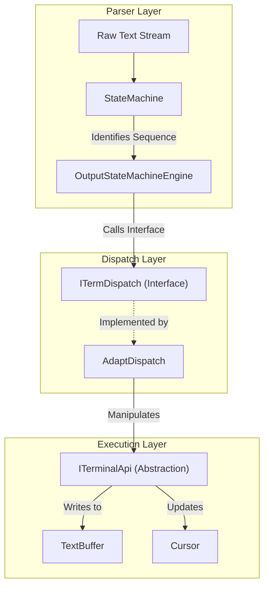
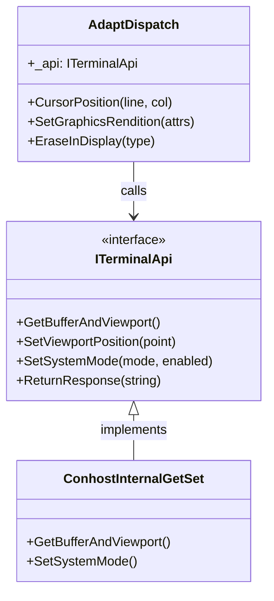

<!-- source: DeepWiki mcp.deepwiki.com · repo microsoft/intelligent-terminal · page 5.3 VT Parser and Dispatch: AdaptDispatch and OutputStateMachineEngine · fetched 2026-10-26 -->

# VT Parser and Dispatch: AdaptDispatch and OutputStateMachineEngine

Relevant source files

The following files were used as context for generating this wiki page:

- [src/host/input.cpp](src/host/input.cpp)
- [src/host/outputStream.cpp](src/host/outputStream.cpp)
- [src/host/outputStream.hpp](src/host/outputStream.hpp)
- [src/host/ut_host/ScreenBufferTests.cpp](src/host/ut_host/ScreenBufferTests.cpp)
- [src/interactivity/win32/windowio.cpp](src/interactivity/win32/windowio.cpp)
- [src/server/ApiDispatchersInternal.cpp](src/server/ApiDispatchersInternal.cpp)
- [src/server/ProcessList.cpp](src/server/ProcessList.cpp)
- [src/server/ProcessList.h](src/server/ProcessList.h)
- [src/terminal/adapter/DispatchTypes.hpp](src/terminal/adapter/DispatchTypes.hpp)
- [src/terminal/adapter/IInteractDispatch.hpp](src/terminal/adapter/IInteractDispatch.hpp)
- [src/terminal/adapter/ITermDispatch.hpp](src/terminal/adapter/ITermDispatch.hpp)
- [src/terminal/adapter/ITerminalApi.hpp](src/terminal/adapter/ITerminalApi.hpp)
- [src/terminal/adapter/InteractDispatch.cpp](src/terminal/adapter/InteractDispatch.cpp)
- [src/terminal/adapter/InteractDispatch.hpp](src/terminal/adapter/InteractDispatch.hpp)
- [src/terminal/adapter/adaptDispatch.cpp](src/terminal/adapter/adaptDispatch.cpp)
- [src/terminal/adapter/adaptDispatch.hpp](src/terminal/adapter/adaptDispatch.hpp)
- [src/terminal/adapter/termDispatch.hpp](src/terminal/adapter/termDispatch.hpp)
- [src/terminal/adapter/ut_adapter/MouseInputTest.cpp](src/terminal/adapter/ut_adapter/MouseInputTest.cpp)
- [src/terminal/adapter/ut_adapter/adapterTest.cpp](src/terminal/adapter/ut_adapter/adapterTest.cpp)
- [src/terminal/adapter/ut_adapter/inputTest.cpp](src/terminal/adapter/ut_adapter/inputTest.cpp)
- [src/terminal/input/mouseInput.cpp](src/terminal/input/mouseInput.cpp)
- [src/terminal/input/terminalInput.cpp](src/terminal/input/terminalInput.cpp)
- [src/terminal/input/terminalInput.hpp](src/terminal/input/terminalInput.hpp)
- [src/terminal/parser/IStateMachineEngine.hpp](src/terminal/parser/IStateMachineEngine.hpp)
- [src/terminal/parser/InputStateMachineEngine.cpp](src/terminal/parser/InputStateMachineEngine.cpp)
- [src/terminal/parser/InputStateMachineEngine.hpp](src/terminal/parser/InputStateMachineEngine.hpp)
- [src/terminal/parser/OutputStateMachineEngine.cpp](src/terminal/parser/OutputStateMachineEngine.cpp)
- [src/terminal/parser/OutputStateMachineEngine.hpp](src/terminal/parser/OutputStateMachineEngine.hpp)
- [src/terminal/parser/stateMachine.cpp](src/terminal/parser/stateMachine.cpp)
- [src/terminal/parser/stateMachine.hpp](src/terminal/parser/stateMachine.hpp)
- [src/terminal/parser/ut_parser/InputEngineTest.cpp](src/terminal/parser/ut_parser/InputEngineTest.cpp)
- [src/terminal/parser/ut_parser/OutputEngineTest.cpp](src/terminal/parser/ut_parser/OutputEngineTest.cpp)
- [src/terminal/parser/ut_parser/StateMachineTest.cpp](src/terminal/parser/ut_parser/StateMachineTest.cpp)

This section details the Virtual Terminal (VT) output processing pipeline. The pipeline is responsible for taking a stream of characters (typically UTF-16), parsing them into actionable commands (CSI, OSC, DCS, etc.), and dispatching those commands to an implementation that modifies the terminal state or text buffer.

## Architecture Overview

The output pipeline consists of three primary layers:
1.  **`StateMachine`**: The core state-based parser that identifies escape sequences and control characters [src/terminal/parser/stateMachine.cpp:14-32]().
2.  **`OutputStateMachineEngine`**: The "brains" of the output parser. It implements the `IStateMachineEngine` interface to handle specific VT actions (Execute, Print, EscDispatch, CsiDispatch) [src/terminal/parser/OutputStateMachineEngine.cpp:20-25]().
3.  **`AdaptDispatch`**: The Windows Console implementation of the `ITermDispatch` interface. It translates high-level VT commands into low-level buffer and state operations [src/terminal/adapter/adaptDispatch.cpp:40-49]().

### Data Flow Diagram

The following diagram illustrates how raw text flows from the input stream through the parser and into the buffer.

**VT Output Processing Pipeline**

Sources: [src/terminal/parser/stateMachine.cpp](), [src/terminal/parser/OutputStateMachineEngine.cpp](), [src/terminal/adapter/adaptDispatch.cpp]()

## OutputStateMachineEngine

The `OutputStateMachineEngine` is responsible for mapping the raw sequences identified by the `StateMachine` to specific methods on the `ITermDispatch` interface. It handles the complexity of VT52, ANSI, and private DEC sequences.

### Key Dispatch Logic
*   **`ActionPrint`**: Handles standard printable characters by passing them to the dispatcher's `Print` method [src/terminal/parser/OutputStateMachineEngine.cpp:132-143]().
*   **`ActionExecute`**: Handles C0 control codes like `BEL`, `BS`, `TAB`, `CR`, and `LF` [src/terminal/parser/OutputStateMachineEngine.cpp:54-108]().
*   **`ActionCsiDispatch`**: Uses a large switch statement based on the `VTID` (a packed representation of the sequence's final character and intermediates) to call methods like `CursorPosition` (CUP) or `SetGraphicsRendition` (SGR) [src/terminal/parser/OutputStateMachineEngine.hpp:93-170]().

### VTID Mechanism
The engine uses a `VTID` type, which allows for efficient compile-time representation of VT sequences as `uint64_t` values. For example, `CUP_CursorPosition` is defined as `VTID("H")` [src/terminal/parser/OutputStateMachineEngine.hpp:103]().

Sources: [src/terminal/parser/OutputStateMachineEngine.cpp](), [src/terminal/parser/OutputStateMachineEngine.hpp](), [src/terminal/adapter/DispatchTypes.hpp]()

## AdaptDispatch: The Terminal Implementation

`AdaptDispatch` is the primary implementation of `ITermDispatch`. It bridges the gap between the platform-agnostic parser and the Windows-specific console logic.

### Buffer Manipulation and Text Writing
The core of text output is `_WriteToBuffer`. This function handles:
*   **Auto-Wrap**: Managing the `DelayEOLWrap` state when the cursor reaches the end of a line [src/terminal/adapter/adaptDispatch.cpp:125-149]().
*   **Margins**: Respecting vertical and horizontal scrolling margins during output [src/terminal/adapter/adaptDispatch.cpp:109-116]().
*   **Insertion Mode**: Choosing between `TextBuffer::Insert` and `TextBuffer::Replace` based on the current mode [src/terminal/adapter/adaptDispatch.cpp:154-161]().

### Command Implementation Examples
| VT Command | Method | Logic |
| :--- | :--- | :--- |
| **SGR** | `SetGraphicsRendition` | Parses parameters for colors (3/4-bit, 8-bit, 24-bit RGB) and styles (Bold, Underline, etc.) [src/terminal/adapter/adaptDispatch.cpp:73-115](). |
| **CUP** | `CursorPosition` | Moves the cursor to a specific coordinate, adjusting for margins and origin mode [src/terminal/adapter/adaptDispatch.cpp:55](). |
| **ED** | `EraseInDisplay` | Clears parts of the buffer based on the `EraseType` (from cursor to end, start to cursor, or entire screen) [src/terminal/adapter/adaptDispatch.cpp:58](). |
| **DECSTBM**| `SetTopBottomScrollingMargins` | Restricts the scrolling region of the screen [src/terminal/adapter/adaptDispatch.cpp:105-106](). |

Sources: [src/terminal/adapter/adaptDispatch.cpp](), [src/terminal/adapter/adaptDispatch.hpp]()

## ITerminalApi Abstraction

`AdaptDispatch` does not talk to the `TextBuffer` or `Cursor` directly. Instead, it uses the `ITerminalApi` interface. This allows the same dispatch logic to be used in different contexts:
1.  **`TerminalApi`**: Used within `WindowsTerminal.exe` to modify the internal state of the `Terminal` class [src/terminal/adapter/ITerminalApi.hpp]().
2.  **`ConhostInternalGetSet`**: Used within `conhost.exe` to modify the global console state [src/host/outputStream.cpp:22-26]().

### Mapping VT to API Calls

**Code Entity Mapping: AdaptDispatch to ITerminalApi**

Sources: [src/terminal/adapter/adaptDispatch.hpp](), [src/terminal/adapter/ITerminalApi.hpp](), [src/host/outputStream.cpp]()

## Advanced VT Features

### Alternate Buffer
`AdaptDispatch` manages the switching between the main and alternate screen buffers via `ITerminalApi::UseAlternateScreenBuffer` and `UseMainScreenBuffer`. When switching to the alternate buffer, the current cursor state and attributes are often saved/restored [src/terminal/adapter/adaptDispatch.cpp:45]().

### Sixel and Image Support
The parser includes hooks for `SixelParser` through the `ActionDcsDispatch` method in `OutputStateMachineEngine`. This allows the terminal to handle bitmapped graphics by transitioning into a specialized sub-parser [src/terminal/adapter/adaptDispatch.cpp:7]().

### Macros and Soft Fonts
`AdaptDispatch` maintains `MacroBuffer` and `FontBuffer` instances to support DEC User Defined Keys (UDK) and Soft Fonts (DECDLD), allowing applications to redefine terminal behavior and character sets [src/terminal/adapter/adaptDispatch.hpp:19-20]().

Sources: [src/terminal/adapter/adaptDispatch.cpp](), [src/terminal/adapter/adaptDispatch.hpp](), [src/terminal/parser/OutputStateMachineEngine.cpp]()

---

