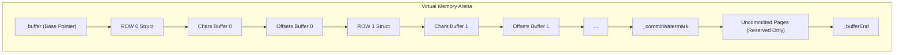
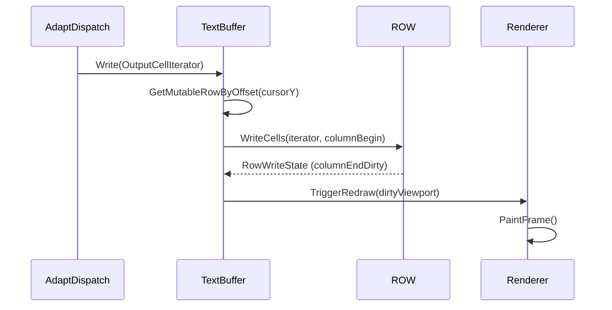

<!-- source: DeepWiki mcp.deepwiki.com · repo microsoft/intelligent-terminal · page 5.4 TextBuffer and ROW Storage · fetched 2026-10-26 -->

# TextBuffer and ROW Storage

Relevant source files

The following files were used as context for generating this wiki page:

- [src/buffer/out/OutputCell.cpp](src/buffer/out/OutputCell.cpp)
- [src/buffer/out/OutputCell.hpp](src/buffer/out/OutputCell.hpp)
- [src/buffer/out/OutputCellIterator.cpp](src/buffer/out/OutputCellIterator.cpp)
- [src/buffer/out/OutputCellIterator.hpp](src/buffer/out/OutputCellIterator.hpp)
- [src/buffer/out/OutputCellRect.cpp](src/buffer/out/OutputCellRect.cpp)
- [src/buffer/out/OutputCellRect.hpp](src/buffer/out/OutputCellRect.hpp)
- [src/buffer/out/OutputCellView.cpp](src/buffer/out/OutputCellView.cpp)
- [src/buffer/out/Row.cpp](src/buffer/out/Row.cpp)
- [src/buffer/out/Row.hpp](src/buffer/out/Row.hpp)
- [src/buffer/out/TextAttribute.cpp](src/buffer/out/TextAttribute.cpp)
- [src/buffer/out/TextAttribute.hpp](src/buffer/out/TextAttribute.hpp)
- [src/buffer/out/TextColor.cpp](src/buffer/out/TextColor.cpp)
- [src/buffer/out/TextColor.h](src/buffer/out/TextColor.h)
- [src/buffer/out/lib/bufferout.vcxproj](src/buffer/out/lib/bufferout.vcxproj)
- [src/buffer/out/sources.inc](src/buffer/out/sources.inc)
- [src/buffer/out/textBuffer.cpp](src/buffer/out/textBuffer.cpp)
- [src/buffer/out/textBuffer.hpp](src/buffer/out/textBuffer.hpp)
- [src/buffer/out/textBufferTextIterator.cpp](src/buffer/out/textBufferTextIterator.cpp)
- [src/buffer/out/ut_textbuffer/ReflowTests.cpp](src/buffer/out/ut_textbuffer/ReflowTests.cpp)
- [src/buffer/out/ut_textbuffer/TextAttributeTests.cpp](src/buffer/out/ut_textbuffer/TextAttributeTests.cpp)
- [src/host/settings.cpp](src/host/settings.cpp)
- [src/host/settings.hpp](src/host/settings.hpp)
- [src/host/ut_host/TextBufferTests.cpp](src/host/ut_host/TextBufferTests.cpp)
- [src/inc/conattrs.hpp](src/inc/conattrs.hpp)
- [src/inc/til/rle.h](src/inc/til/rle.h)
- [src/interactivity/win32/menu.cpp](src/interactivity/win32/menu.cpp)
- [src/renderer/base/RenderSettings.cpp](src/renderer/base/RenderSettings.cpp)
- [src/renderer/inc/RenderSettings.hpp](src/renderer/inc/RenderSettings.hpp)
- [src/terminal/adapter/adaptDispatchGraphics.cpp](src/terminal/adapter/adaptDispatchGraphics.cpp)

The `TextBuffer` is the core data structure of the terminal emulation engine, responsible for managing the grid of characters and their visual attributes. It is implemented as a circular buffer that supports high-performance text insertion, reflow during resize, and efficient memory management through virtual memory primitives.

## 1. TextBuffer Architecture

The `TextBuffer` manages a collection of `ROW` objects. To minimize memory overhead while supporting large scrollback buffers, it uses a custom memory allocation strategy involving `VirtualAlloc` and a commit watermark.

### 1.1 Virtual Memory Arena and Commit Watermark
Instead of allocating all rows on the heap immediately, `TextBuffer` reserves a large block of virtual address space and commits physical memory only as rows are actually used.

*   **Reservation**: `_reserve` calculates the total required size for `ROW` structs, character buffers, and offset buffers, then calls `VirtualAlloc` with `MEM_RESERVE` [[src/buffer/out/textBuffer.cpp:92-113]]().
*   **Commit Watermark**: The `_commitWatermark` pointer tracks how much of the reserved space has been backed by physical memory [[src/buffer/out/textBuffer.cpp:115-115]]().
*   **Lazy Commitment**: When `_getRowByOffsetDirect` (inlined) accesses a row beyond the watermark, `_commit` is called to perform a `MEM_COMMIT` and construct the `ROW` objects [[src/buffer/out/textBuffer.cpp:130-143]]().

### 1.2 Data Layout and Stride
Rows are stored contiguously in memory to improve cache locality. Each "row unit" consists of:
1.  The `ROW` structure itself.
2.  The character buffer (`wchar_t`).
3.  The character offsets buffer (`uint16_t`).

The `_bufferRowStride` ensures that each `ROW` is aligned correctly (16-byte alignment) for SIMD operations [[src/buffer/out/textBuffer.cpp:97-101]]().

### TextBuffer Memory Layout
Title: TextBuffer Memory Layout

Sources: [[src/buffer/out/textBuffer.cpp:92-122]](), [[src/buffer/out/textBuffer.hpp:68-122]]()

## 2. ROW Storage and CharOffsets

A `ROW` object represents a single line in the terminal. It handles complex glyph mapping (UTF-16 surrogates and combining characters) and stores visual attributes.

### 2.1 Character and Offset Mapping
The `ROW` maintains a fixed-width grid of cells, but the actual text can vary in length due to multi-unit UTF-16 characters or zero-width joiners.
*   **`_chars`**: A `wchar_t` buffer containing the raw UTF-16 data [[src/buffer/out/Row.hpp:169-169]]().
*   **`_charOffsets`**: A mapping array where each index corresponds to a visual column. It stores the index into `_chars` where that column's data begins [[src/buffer/out/Row.hpp:170-170]]().
*   **`CharOffsetsTrailer`**: A bit flag (`0x8000`) used in the offset array to indicate that a column is a continuation of a wide glyph (e.g., the second half of a full-width Emoji) [[src/buffer/out/Row.cpp:117-123]]().

### 2.2 SIMD Initialization
The `ROW::Reset` method is optimized using SIMD instructions to quickly clear character and offset buffers. It leverages 16-byte alignment to process multiple cells per instruction [[src/buffer/out/Row.hpp:101-106]](), [[src/buffer/out/Row.cpp:141-141]]().

Sources: [[src/buffer/out/Row.cpp:83-127]](), [[src/buffer/out/Row.hpp:98-175]]()

## 3. Visual Attributes and RLE

Attributes (colors, bold, underline, etc.) are stored separately from text to allow for efficient rendering and storage.

### 3.1 TextAttribute Structure
`TextAttribute` is a compact 18-byte structure containing foreground/background colors and metadata flags [[src/buffer/out/TextAttribute.cpp:10-11]]().
*   **Colors**: Stored as `TextColor`, which can represent legacy 16-color indices, 256-color indices, or full RGB COLORREFs [[src/buffer/out/TextColor.h:23-50]]().
*   **Metadata**: Includes `CharacterAttributes` (Bold, Italic, Underline styles) and `MarkKind` (Prompt, Command, Output) for shell integration [[src/buffer/out/TextAttribute.hpp:42-48]]().

### 3.2 Run-Length Encoding (RLE)
Because many cells often share the same attribute, `ROW` uses `til::small_rle` to store attributes.
*   **`RowAttributes`**: Defined as `til::small_rle<TextAttribute, uint16_t, 2>`, it stores attributes as a series of "runs" (e.g., "10 cells of Blue, 70 cells of Gray") [[src/buffer/out/Row.hpp:20-20]]().
*   This significantly reduces memory usage for lines with uniform styling.

Sources: [[src/buffer/out/TextAttribute.cpp:1-110]](), [[src/buffer/out/Row.hpp:14-20]](), [[src/buffer/out/TextColor.cpp:55-113]]()

## 4. Text Insertion and Invalidation

The `TextBuffer` provides high-level `Write` methods that handle coordinate wrapping and renderer notification.

### 4.1 Data Flow: From VT to Buffer
1.  **`AdaptDispatch`**: Receives VT sequences and calculates the required `TextAttribute` [[src/terminal/adapter/adaptDispatchGraphics.cpp:175-180]]().
2.  **`OutputCellIterator`**: Wraps the text and attributes into an iterator format [[src/buffer/out/OutputCellIterator.cpp:105-114]]().
3.  **`TextBuffer::Write`**: Consumes the iterator and updates the `ROW` objects [[src/buffer/out/textBuffer.cpp:525-535]]().

### 4.2 Dirty Regions and Invalidation
When text is modified, the `TextBuffer` calculates a "dirty" region.
*   **`TriggerRedraw`**: Notifies the `Renderer` that a specific `Viewport` area has changed [[src/buffer/out/textBuffer.cpp:1550-1554]]().
*   **`MutationId`**: Every modification increments a `_lastMutationId`. The renderer compares this ID to determine if a cached frame is still valid [[src/buffer/out/textBuffer.cpp:57-59]]().

### Write Operation Sequence
Title: Text Write and Invalidation Flow

Sources: [[src/buffer/out/textBuffer.cpp:525-550]](), [[src/buffer/out/Row.cpp:150-160]](), [[src/terminal/adapter/adaptDispatchGraphics.cpp:175-200]]()

## 5. Reflow Algorithm

When the terminal window is resized, the `TextBuffer` performs a "reflow" to ensure text wraps correctly to the new width.

*   **`ResizeTraditional`**: This method handles the logic of re-mapping existing rows to a new width [[src/buffer/out/textBuffer.cpp:1450-1460]]().
*   **Wrap Detection**: The algorithm checks `ROW::WasWrapForced()`. If a row was wrapped, it is merged with the following row during reflow; otherwise, it is treated as a hard line break [[src/buffer/out/Row.cpp:177-185]]().
*   **Preservation**: High Unicode characters (surrogates) are carefully preserved during the transfer between the old and new buffers to prevent corruption [[src/host/ut_host/TextBufferTests.cpp:132-133]]().

Sources: [[src/buffer/out/textBuffer.cpp:1450-1500]](), [[src/buffer/out/Row.cpp:177-185]](), [[src/host/ut_host/TextBufferTests.cpp:130-156]]()

---

