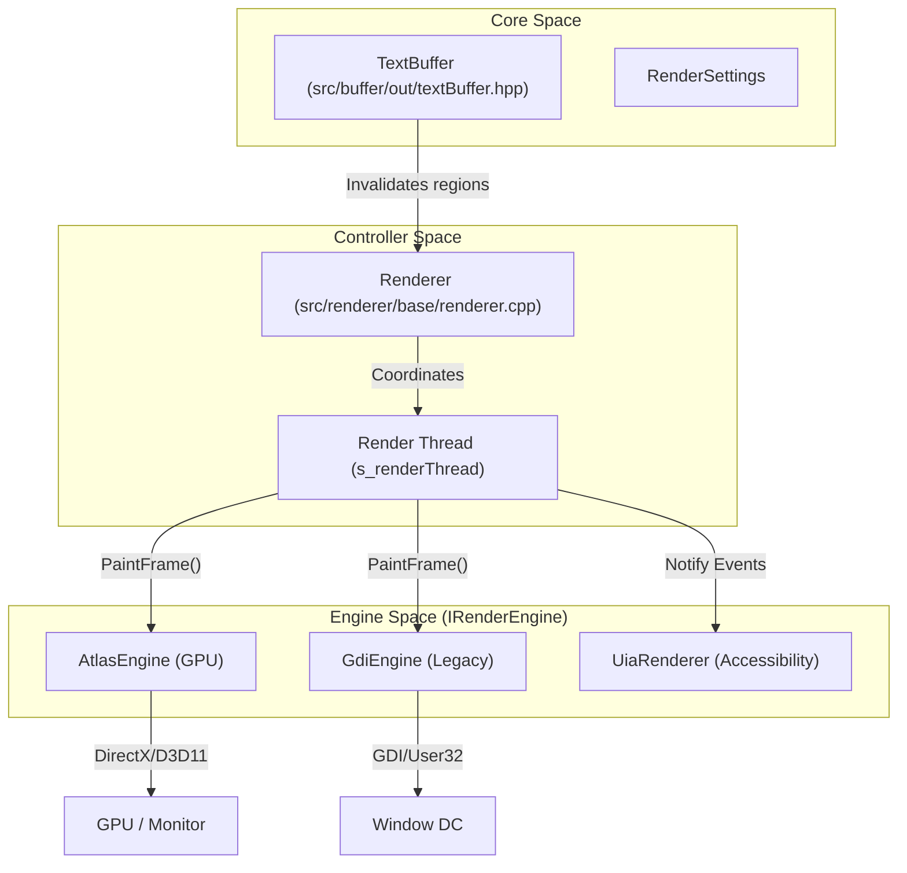
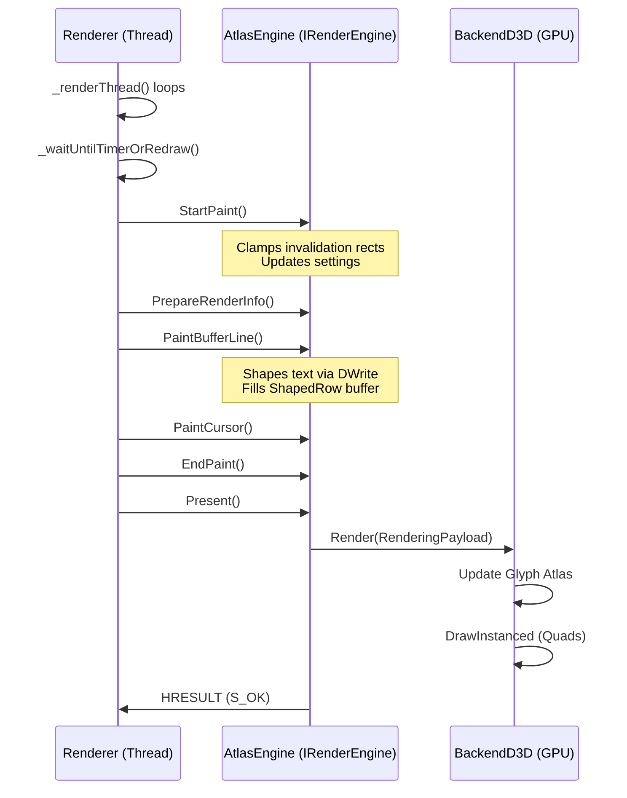

<!-- source: DeepWiki mcp.deepwiki.com · repo microsoft/intelligent-terminal · page 6 Rendering Pipeline · fetched 2026-10-26 -->

# Rendering Pipeline

Relevant source files

The following files were used as context for generating this wiki page:

- [src/interactivity/onecore/BgfxEngine.cpp](src/interactivity/onecore/BgfxEngine.cpp)
- [src/interactivity/onecore/BgfxEngine.hpp](src/interactivity/onecore/BgfxEngine.hpp)
- [src/renderer/atlas/AtlasEngine.api.cpp](src/renderer/atlas/AtlasEngine.api.cpp)
- [src/renderer/atlas/AtlasEngine.cpp](src/renderer/atlas/AtlasEngine.cpp)
- [src/renderer/atlas/AtlasEngine.h](src/renderer/atlas/AtlasEngine.h)
- [src/renderer/atlas/AtlasEngine.r.cpp](src/renderer/atlas/AtlasEngine.r.cpp)
- [src/renderer/atlas/BackendD2D.cpp](src/renderer/atlas/BackendD2D.cpp)
- [src/renderer/atlas/BackendD2D.h](src/renderer/atlas/BackendD2D.h)
- [src/renderer/atlas/BackendD3D.cpp](src/renderer/atlas/BackendD3D.cpp)
- [src/renderer/atlas/BackendD3D.h](src/renderer/atlas/BackendD3D.h)
- [src/renderer/atlas/common.h](src/renderer/atlas/common.h)
- [src/renderer/atlas/shader_ps.hlsl](src/renderer/atlas/shader_ps.hlsl)
- [src/renderer/base/RenderEngineBase.cpp](src/renderer/base/RenderEngineBase.cpp)
- [src/renderer/base/renderer.cpp](src/renderer/base/renderer.cpp)
- [src/renderer/base/renderer.hpp](src/renderer/base/renderer.hpp)
- [src/renderer/gdi/gdirenderer.hpp](src/renderer/gdi/gdirenderer.hpp)
- [src/renderer/gdi/paint.cpp](src/renderer/gdi/paint.cpp)
- [src/renderer/gdi/state.cpp](src/renderer/gdi/state.cpp)
- [src/renderer/inc/IRenderEngine.hpp](src/renderer/inc/IRenderEngine.hpp)
- [src/renderer/inc/RenderEngineBase.hpp](src/renderer/inc/RenderEngineBase.hpp)
- [src/renderer/uia/UiaRenderer.cpp](src/renderer/uia/UiaRenderer.cpp)
- [src/renderer/uia/UiaRenderer.hpp](src/renderer/uia/UiaRenderer.hpp)
- [src/renderer/wddmcon/WddmConRenderer.cpp](src/renderer/wddmcon/WddmConRenderer.cpp)
- [src/renderer/wddmcon/WddmConRenderer.hpp](src/renderer/wddmcon/WddmConRenderer.hpp)
- [src/tools/RenderingTests/main.cpp](src/tools/RenderingTests/main.cpp)

The rendering pipeline is responsible for transforming the contents of the `TextBuffer` into visual pixels on the screen. It is architected as a decoupled system where a central **Renderer** controller coordinates multiple **Render Engines** (backends) through a standardized interface.

## Architecture Overview

The pipeline follows a "Pull" model where the `Renderer` manages a dedicated thread to drive the frame lifecycle. Backends implement the `IRenderEngine` interface to handle the actual drawing commands.

### Core Components

| Component | Role | File |
| :--- | :--- | :--- |
| `Renderer` | Central controller; manages the render thread, timers, and engine fan-out. | [src/renderer/base/renderer.hpp:19-20]() |
| `IRenderEngine` | Interface defining the contract for backends (e.g., `PaintBufferLine`, `Present`). | [src/renderer/inc/IRenderEngine.hpp:1-1]() |
| `AtlasEngine` | Modern, hardware-accelerated GPU renderer using DirectX and a glyph atlas. | [src/renderer/atlas/AtlasEngine.h:16-17]() |
| `GdiEngine` | Legacy CPU-based renderer using GDI for compatibility and complex script shaping. | [src/renderer/gdi/gdirenderer.hpp:1-1]() |
| `UiaRenderer` | Accessibility "renderer" that notifies screen readers of buffer changes. | [src/renderer/uia/UiaRenderer.hpp:1-1]() |

### High-Level Data Flow

**Sources:** [src/renderer/base/renderer.cpp:26-37](), [src/renderer/base/renderer.hpp:19-20](), [src/renderer/atlas/AtlasEngine.h:16-17]()

---

## The Renderer Controller

The `Renderer` class is the orchestrator of the pipeline. It encapsulates a dedicated background thread (`s_renderThread`) to ensure that rendering operations do not block the UI or the terminal emulation logic.

*   **Thread Management**: Starts a "Rendering Output Thread" via `EnablePainting()` to handle the `PaintFrame` loop. [src/renderer/base/renderer.cpp:55-78]()
*   **Invalidation**: Instead of redrawing the entire screen every time, it tracks "dirty" regions (dirty rects). It uses `TriggerRedraw` and `TriggerRedrawAll` to mark regions for the next frame. [src/renderer/base/renderer.cpp:391-420]()
*   **Timers**: Manages internal timers for cursor blinking and rendition blinking (e.g., the CSS-like blink attribute). [src/renderer/base/renderer.cpp:26-37]()
*   **Engine Fan-out**: The `Renderer` can hold multiple engines (e.g., `AtlasEngine` for visuals and `UiaRenderer` for accessibility) and calls each engine's `StartPaint`, `PaintBufferLine`, and `EndPaint` in sequence. [src/renderer/base/renderer.cpp:655-680]()

For details, see [Renderer: Frame Composition and Engine Coordination](#6.1).

**Sources:** [src/renderer/base/renderer.cpp:115-140](), [src/renderer/base/renderer.hpp:100-115]()

---

## AtlasEngine: GPU Rendering

`AtlasEngine` is the primary high-performance renderer. It uses **Direct3D 11** to achieve hardware acceleration.

*   **Thread Separation**: It splits state into `ApiState` (modified by the `Renderer` thread) and `RenderingPayload` (used by the GPU during `Present`). [src/renderer/atlas/AtlasEngine.cpp:16-21]()
*   **Glyph Atlas**: Instead of drawing characters individually, it packs frequently used glyphs into a texture atlas using `stb_rect_pack`. [src/renderer/atlas/BackendD3D.cpp:71-85]()
*   **Shaders**: Uses custom HLSL pixel shaders (`shader_ps.hlsl`) to handle ClearType blending, retro terminal effects (scanlines/glow), and cursor rendering. [src/renderer/atlas/shader_ps.hlsl:30-44]()
*   **Performance**: Implements optimized scrolling by bit-blitting existing textures rather than re-rendering the entire buffer. [src/renderer/atlas/AtlasEngine.cpp:154-165]()

For details, see [AtlasEngine: Hardware-Accelerated GPU Renderer](#6.2).

**Sources:** [src/renderer/atlas/AtlasEngine.h:81-110](), [src/renderer/atlas/BackendD3D.cpp:69-100](), [src/renderer/atlas/AtlasEngine.r.cpp:32-53]()

---

## GDI and Legacy Engines

The `GdiEngine` serves as the fallback for environments where GPU acceleration is unavailable or for specific legacy features.

*   **Double Buffering**: Uses a memory DC (`_hdcMemoryContext`) and a bitmap surface to compose the frame before calling `BitBlt` to the window. [src/renderer/gdi/paint.cpp:44-60]()
*   **Complex Script Support**: Leverages GDI's `ScriptStringAnalyse` for shaping complex scripts that might not be fully handled by the GPU path.
*   **UIA Engine**: The `UiaRenderer` does not draw pixels; it implements the `IRenderEngine` interface to receive updates about what *would* have been drawn, allowing it to fire UI Automation events for screen readers. [src/renderer/uia/UiaRenderer.cpp:1-20]()

For details, see [GDI Engine and Accessibility Renderer](#6.3).

**Sources:** [src/renderer/gdi/paint.cpp:28-68](), [src/renderer/gdi/state.cpp:21-60]()

---

## Rendering Lifecycle

The following diagram bridges the high-level `Renderer` logic to the specific engine implementations during a single frame.

**Sources:** [src/renderer/base/renderer.cpp:120-137](), [src/renderer/atlas/AtlasEngine.cpp:58-125](), [src/renderer/atlas/AtlasEngine.r.cpp:32-53]()

---

