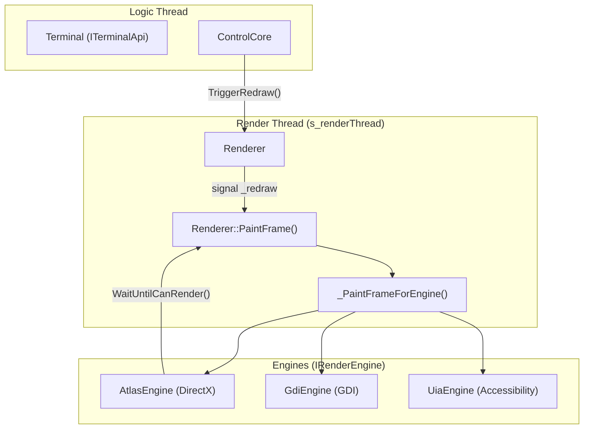
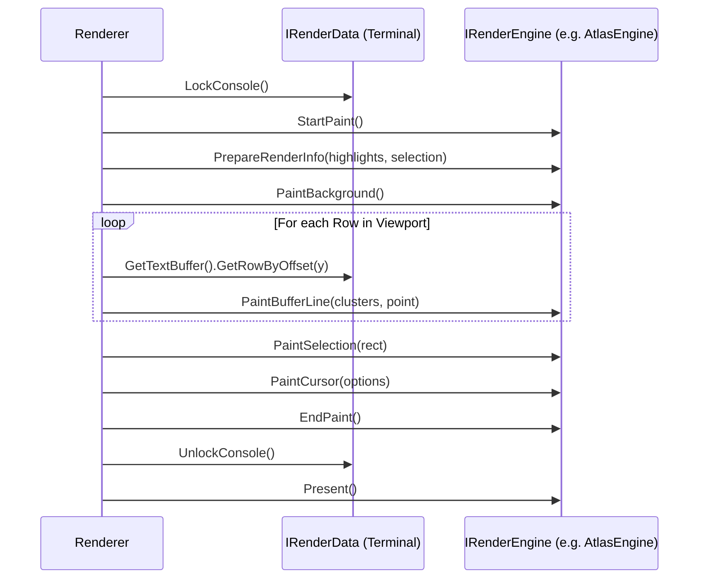

<!-- source: DeepWiki mcp.deepwiki.com · repo microsoft/intelligent-terminal · page 6.1 Renderer: Frame Composition and Engine Coordination · fetched 2026-10-26 -->

# Renderer: Frame Composition and Engine Coordination

Relevant source files

The following files were used as context for generating this wiki page:

- [src/cascadia/TerminalCore/terminalrenderdata.cpp](src/cascadia/TerminalCore/terminalrenderdata.cpp)
- [src/host/renderData.cpp](src/host/renderData.cpp)
- [src/host/renderData.hpp](src/host/renderData.hpp)
- [src/host/ut_host/VtIoTests.cpp](src/host/ut_host/VtIoTests.cpp)
- [src/interactivity/onecore/BgfxEngine.cpp](src/interactivity/onecore/BgfxEngine.cpp)
- [src/interactivity/onecore/BgfxEngine.hpp](src/interactivity/onecore/BgfxEngine.hpp)
- [src/renderer/base/RenderEngineBase.cpp](src/renderer/base/RenderEngineBase.cpp)
- [src/renderer/base/renderer.cpp](src/renderer/base/renderer.cpp)
- [src/renderer/base/renderer.hpp](src/renderer/base/renderer.hpp)
- [src/renderer/gdi/gdirenderer.hpp](src/renderer/gdi/gdirenderer.hpp)
- [src/renderer/gdi/paint.cpp](src/renderer/gdi/paint.cpp)
- [src/renderer/gdi/state.cpp](src/renderer/gdi/state.cpp)
- [src/renderer/inc/IRenderData.hpp](src/renderer/inc/IRenderData.hpp)
- [src/renderer/inc/IRenderEngine.hpp](src/renderer/inc/IRenderEngine.hpp)
- [src/renderer/inc/RenderEngineBase.hpp](src/renderer/inc/RenderEngineBase.hpp)
- [src/renderer/uia/UiaRenderer.cpp](src/renderer/uia/UiaRenderer.cpp)
- [src/renderer/uia/UiaRenderer.hpp](src/renderer/uia/UiaRenderer.hpp)
- [src/renderer/wddmcon/WddmConRenderer.cpp](src/renderer/wddmcon/WddmConRenderer.cpp)
- [src/renderer/wddmcon/WddmConRenderer.hpp](src/renderer/wddmcon/WddmConRenderer.hpp)

The `Renderer` class is the central orchestrator of the rendering pipeline. It manages a dedicated high-priority thread to decouple the terminal's internal state updates from the display refresh cycle. It coordinates multiple rendering engines (e.g., AtlasEngine, GdiEngine, UiaRenderer) and ensures that the visual representation of the `TextBuffer` is consistent, performant, and correctly synchronized with VT output.

## Core Architecture and Threading Model

The `Renderer` operates on a dedicated background thread to prevent UI or terminal logic from blocking on GPU/GDI operations.

*   **Render Thread (`s_renderThread`)**: Created in `EnablePainting`, this thread runs a loop that waits for redraw signals or timer expirations before calling `PaintFrame`. [src/renderer/base/renderer.cpp:115-137]()
*   **Engine Fan-out**: The `Renderer` maintains a list of `IRenderEngine` implementations. Each frame is painted into every registered engine (e.g., GDI for legacy support and UIA for screen readers). [src/renderer/base/renderer.cpp:144-148](), [src/renderer/base/renderer.cpp:256-273]()
*   **Throttling and Synchronization**: The loop uses `WaitUntilCanRender` to allow engines (like AtlasEngine) to throttle the frame rate to the monitor's refresh rate. [src/renderer/base/renderer.cpp:142-148]()

### Render Loop Entity Relationship

The following diagram illustrates how the `Renderer` bridges the high-level `Terminal` data with low-level hardware-specific engines.

Title: Renderer Coordination and Threading

Sources: [src/renderer/base/renderer.cpp:115-137](), [src/renderer/base/renderer.hpp:19-78](), [src/renderer/inc/IRenderEngine.hpp:56-97]()

## The PaintFrame Lifecycle

The `PaintFrame` method is the core execution block for a single frame. It follows a strict sequence of calls to the `IRenderEngine` interface.

1.  **StartPaint**: Engines prepare their back-buffers or graphics contexts. [src/renderer/base/renderer.cpp:328-333]()
2.  **ScrollFrame**: If a scroll operation was triggered, the renderer instructs engines to perform a bit-blit of existing pixels before painting new content. [src/renderer/base/renderer.cpp:335-338]()
3.  **PaintBackground**: Clears the frame or paints the default background color. [src/renderer/base/renderer.cpp:340-343]()
4.  **PaintBufferLine**: Iterates through the `TextBuffer` within the current `Viewport`. It groups text into `Cluster` objects based on identical attributes to minimize engine calls. [src/renderer/base/renderer.cpp:345-348](), [src/renderer/base/renderer.cpp:557-580]()
5.  **PaintSelection**: Renders the translucent selection overlays. [src/renderer/base/renderer.cpp:350-353]()
6.  **PaintCursor**: Renders the cursor (block, bar, etc.) if visible and currently "on" in the blink cycle. [src/renderer/base/renderer.cpp:355-358]()
7.  **EndPaint & Present**: Finalizes the frame and flips the buffers to the screen. [src/renderer/base/renderer.cpp:360-365]()

### Paint Sequence Data Flow

Title: PaintFrame Sequence and Engine Calls

Sources: [src/renderer/base/renderer.cpp:256-313](), [src/renderer/base/renderer.cpp:315-367](), [src/renderer/inc/IRenderEngine.hpp:62-85]()

## Invalidation and Dirty Rects

To optimize performance, the `Renderer` does not always redraw the entire screen. It uses a "dirty rect" system.

*   **TriggerRedraw**: When the `TextBuffer` changes, it calls `TriggerRedraw` for specific regions. [src/renderer/base/renderer.cpp:871-888]()
*   **Dirty Area Calculation**: Engines track which regions of the screen are invalid via `Invalidate`. During `PaintFrame`, the renderer queries `GetDirtyArea` to determine which rows need to be re-processed. [src/renderer/inc/IRenderEngine.hpp:68-74](), [src/renderer/base/renderer.cpp:453-468]()
*   **Synchronized Output (DECSET 2026)**: If a client application enables Synchronized Output, the renderer inhibits all painting until the client sends the "End Synchronization" signal, preventing "tearing" of complex UI updates. [src/renderer/base/renderer.cpp:1062-1081]()

## Blinking and Timers

The `Renderer` manages its own timer system for periodic visual updates.

*   **Cursor Blinker**: A timer registered during construction toggles `_cursorBlinkerOn`. If the cursor is currently in a "blink" state, the `Renderer` triggers a redraw. [src/renderer/base/renderer.cpp:30-32]()
*   **Rendition Blinker**: Handles the VT `Blink` attribute (SGR 5). It toggles the `ToggleBlinkRendition` state in `RenderSettings` and triggers a full redraw. [src/renderer/base/renderer.cpp:33-36]()
*   **Wait Mechanism**: The render thread uses `WaitOnAddress` (via `til::atomic_wait`) to sleep efficiently until either a timer expires or `NotifyPaintFrame` is called. [src/renderer/base/renderer.cpp:226-254]()

## Implementation Detail: Multi-Engine Fan-out

The `Renderer` supports multiple simultaneous engines. This is primarily used to support:
1.  **GdiEngine**: Used for legacy conhost windows and certain fallback scenarios. [src/renderer/gdi/paint.cpp:28-68]()
2.  **UiaRenderer**: A "virtual" engine that doesn't draw pixels but instead fires UI Automation events (like `UIA_Text_TextChangedEventId`) when it "paints" new text. [src/renderer/uia/UiaRenderer.cpp:190-202]()
3.  **AtlasEngine**: The modern, hardware-accelerated DirectX renderer.

| Function | Purpose | Implementation Detail |
| :--- | :--- | :--- |
| `AddRenderEngine` | Attaches a new output target. | Adds to `_engines` small_vector. [src/renderer/base/renderer.cpp:840-848]() |
| `TriggerRedrawAll` | Invalidates the entire viewport. | Calls `InvalidateAll` on all engines. [src/renderer/base/renderer.cpp:921-932]() |
| `_UpdateDrawingBrushes` | Synchronizes color state. | Resolves `TextAttribute` to `COLORREF` using `RenderSettings`. [src/renderer/base/renderer.cpp:663-685]() |

Sources: [src/renderer/base/renderer.cpp:1-100](), [src/renderer/base/renderer.hpp:19-160](), [src/renderer/uia/UiaRenderer.cpp:16-56]()

---

