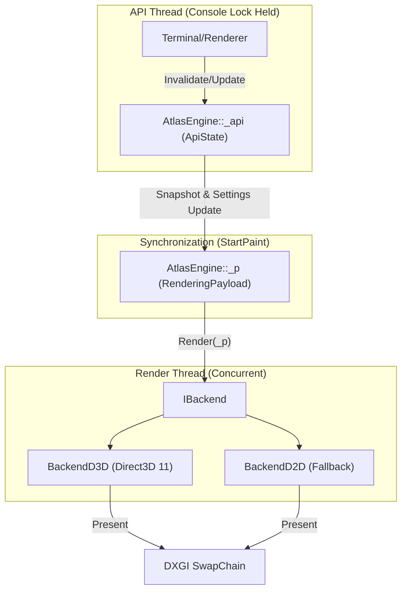
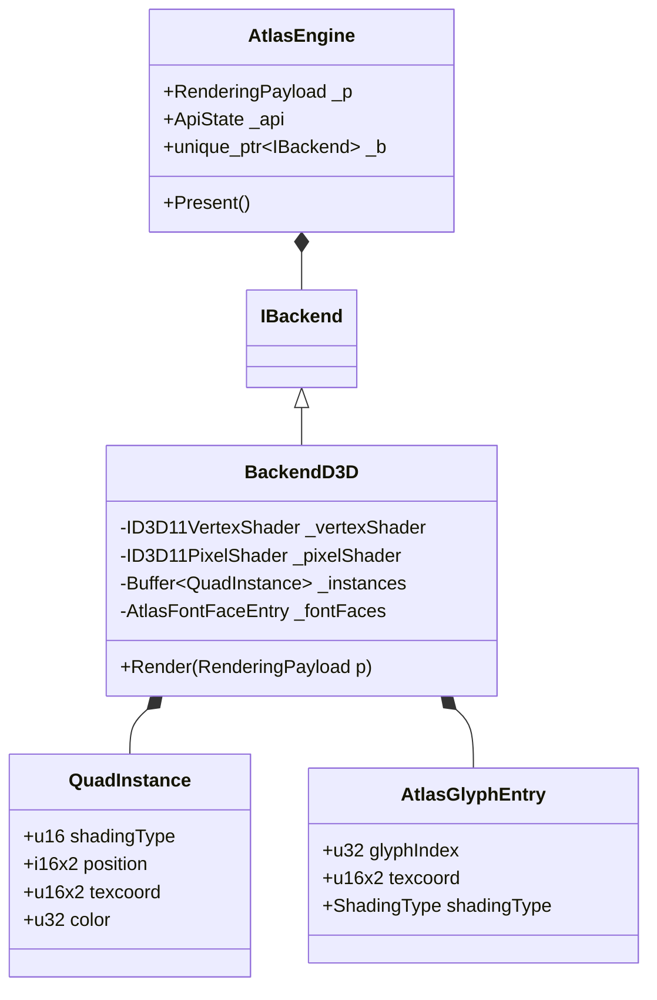

<!-- source: DeepWiki mcp.deepwiki.com · repo microsoft/intelligent-terminal · page 6.2 AtlasEngine: Hardware-Accelerated GPU Renderer · fetched 2026-10-26 -->

# AtlasEngine: Hardware-Accelerated GPU Renderer

Relevant source files

The following files were used as context for generating this wiki page:

- [src/renderer/atlas/AtlasEngine.api.cpp](src/renderer/atlas/AtlasEngine.api.cpp)
- [src/renderer/atlas/AtlasEngine.cpp](src/renderer/atlas/AtlasEngine.cpp)
- [src/renderer/atlas/AtlasEngine.h](src/renderer/atlas/AtlasEngine.h)
- [src/renderer/atlas/AtlasEngine.r.cpp](src/renderer/atlas/AtlasEngine.r.cpp)
- [src/renderer/atlas/BackendD2D.cpp](src/renderer/atlas/BackendD2D.cpp)
- [src/renderer/atlas/BackendD2D.h](src/renderer/atlas/BackendD2D.h)
- [src/renderer/atlas/BackendD3D.cpp](src/renderer/atlas/BackendD3D.cpp)
- [src/renderer/atlas/BackendD3D.h](src/renderer/atlas/BackendD3D.h)
- [src/renderer/atlas/common.h](src/renderer/atlas/common.h)
- [src/renderer/atlas/shader_ps.hlsl](src/renderer/atlas/shader_ps.hlsl)
- [src/tools/RenderingTests/main.cpp](src/tools/RenderingTests/main.cpp)

The `AtlasEngine` is a high-performance, hardware-accelerated implementation of the `IRenderEngine` interface. It is designed to replace legacy GDI-based rendering with a modern GPU pipeline that utilizes a glyph atlas for text and instanced drawing for terminal cells.

## Architecture and Threading Model

The `AtlasEngine` employs a strict separation between the state accessed by the Terminal's API thread and the state used by the background rendering thread. This is managed through two primary structures: `ApiState` (referred to as `_api`) and `RenderingPayload` (referred to as `_p`).

*   **ApiState (`_api`)**: Contains state modified by the `IRenderEngine` API methods (e.g., `Invalidate`, `UpdateViewport`). These methods are typically called while the console buffer lock is held [src/renderer/atlas/AtlasEngine.cpp:18-20]().
*   **RenderingPayload (`_p`)**: Contains the state required for the actual rendering process on the background thread. Data is synchronized from `_api` to `_p` during the `StartPaint()` call [src/renderer/atlas/AtlasEngine.cpp:74-77]().
*   **Synchronization**: `StartPaint()` serves as the synchronization point. It is called while the console buffer lock is held, ensuring a consistent snapshot of the terminal state is moved into the rendering payload [src/renderer/atlas/AtlasEngine.cpp:56-58]().

### Data Flow Diagram

The following diagram illustrates the flow of data from the Terminal API calls through the synchronization layer to the GPU backends.

**AtlasEngine Threading and Data Flow**

Sources: [src/renderer/atlas/AtlasEngine.h:81-110](), [src/renderer/atlas/AtlasEngine.cpp:16-21](), [src/renderer/atlas/AtlasEngine.r.cpp:32-52]()

## BackendD3D: The Primary GPU Pipeline

`BackendD3D` is the primary rendering path, utilizing Direct3D 11. It achieves high performance by treating the terminal as a grid of "quads" (instances) and using a texture atlas for glyphs.

### Glyph Atlas and Packing
The engine maintains a glyph atlas using `stb_rect_pack` to manage texture space [src/renderer/atlas/BackendD3D.h:6]().
*   **Atlas Management**: Glyphs are cached in `AtlasFontFaceEntry`, which maps font faces to a `til::linear_flat_set` of `AtlasGlyphEntry` [src/renderer/atlas/BackendD3D.h:144-153]().
*   **Caching Strategy**: Each entry stores the `glyphIndex`, `texcoord`, and `shadingType` (e.g., Grayscale vs ClearType) [src/renderer/atlas/BackendD3D.h:104-113]().

### Instanced Drawing (QuadInstance)
Every cell in the viewport is represented by a `QuadInstance` [src/renderer/atlas/BackendD3D.h:87-100](). This structure packs all necessary data for the GPU:
*   `shadingType`: Determines how the pixel shader interprets the data (Background, Text, Cursor, etc.) [src/renderer/atlas/BackendD3D.h:61-83]().
*   `position`: i16 coordinates for the cell [src/renderer/atlas/BackendD3D.h:96]().
*   `texcoord`: Coordinates into the Glyph Atlas [src/renderer/atlas/BackendD3D.h:98]().
*   `color`: 32-bit RGBA color [src/renderer/atlas/BackendD3D.h:99]().

### ClearType and Dual-Source Blending
The engine supports high-quality ClearType antialiasing.
*   **Algorithm**: The shader calculates RGB weights for subpixel rendering [src/renderer/atlas/shader_ps.hlsl:59-70]().
*   **Blending**: It uses dual-source color blending (`D3D11_BLEND_SRC1_COLOR` and `D3D11_BLEND_INV_SRC1_COLOR`) to correctly blend the foreground and background based on subpixel masks [src/renderer/atlas/BackendD3D.cpp:140-154]().

### HLSL Shaders and Effects
*   **Pixel Shader (`shader_ps.hlsl`)**: Handles various shading types, including `SHADING_TYPE_TEXT_CLEARTYPE`, `SHADING_TYPE_CURLY_LINE`, and `SHADING_TYPE_TEXT_BUILTIN_GLYPH` [src/renderer/atlas/shader_ps.hlsl:36-180]().
*   **Retro Terminal Effect**: Supports a custom HLSL effect (scanlines, curvature) when enabled via settings [src/renderer/atlas/AtlasEngine.h:73]().

**BackendD3D Code Entity Map**

Sources: [src/renderer/atlas/BackendD3D.h:13-113](), [src/renderer/atlas/AtlasEngine.h:16-110](), [src/renderer/atlas/shader_ps.hlsl:30-180]()

## Scrolling Optimization and Invalidation

AtlasEngine implements sophisticated scrolling to minimize GPU work.

*   **ShapedRow Bit-Blit**: The engine uses a bit-blit approach for scrolling. When the viewport scrolls, the engine calculates the `scrollOffset` and shifts the existing content in the swap chain [src/renderer/atlas/AtlasEngine.cpp:154-164]().
*   **Partial Invalidation**: Only "dirty" rows are updated. The `_api.invalidatedRows` range tracks which parts of the buffer have changed [src/renderer/atlas/AtlasEngine.api.cpp:46-54]().
*   **ScrollFrame()**: This method handles the movement of existing pixels on the screen before the new frame is painted [src/renderer/atlas/AtlasEngine.cpp:218-230]().

Sources: [src/renderer/atlas/AtlasEngine.cpp:96-117](), [src/renderer/atlas/AtlasEngine.api.cpp:122-146]()

## Font Metrics and Decorations

The engine handles complex text layout and terminal-specific decorations:
*   **Font Metrics**: `_resolveFontMetrics` calculates baseline positions, underline widths, and thin-line scales based on DPI and font design [src/renderer/atlas/AtlasEngine.api.cpp:98]().
*   **Decorations**: Underlines (single, double, curly, dotted, dashed) are rendered using specialized shading types in the pixel shader [src/renderer/atlas/shader_ps.hlsl:158-185]().
*   **Built-in Glyphs**: For certain block elements and box-drawing characters, the engine can generate them procedurally in the shader to ensure they perfectly align with cell boundaries without gaps [src/renderer/atlas/shader_ps.hlsl:71-151]().

Sources: [src/renderer/atlas/AtlasEngine.h:45-48](), [src/renderer/atlas/shader_ps.hlsl:158-185](), [src/renderer/atlas/BackendD3D.h:61-83]()

## BackendD2D Fallback

When hardware requirements for `BackendD3D` are not met (e.g., legacy hardware or specific software environments), the engine falls back to `BackendD2D`.
*   **Implementation**: Uses `ID2D1RenderTarget` and `ID2D1DeviceContext` to draw text and primitives [src/renderer/atlas/BackendD2D.cpp:93-100]().
*   **Resource Management**: Manages its own `_backgroundBitmap` and `_brush` cache [src/renderer/atlas/BackendD2D.h:47-63]().

Sources: [src/renderer/atlas/BackendD2D.cpp:29-71](), [src/renderer/atlas/BackendD2D.h:13-82]()

---

