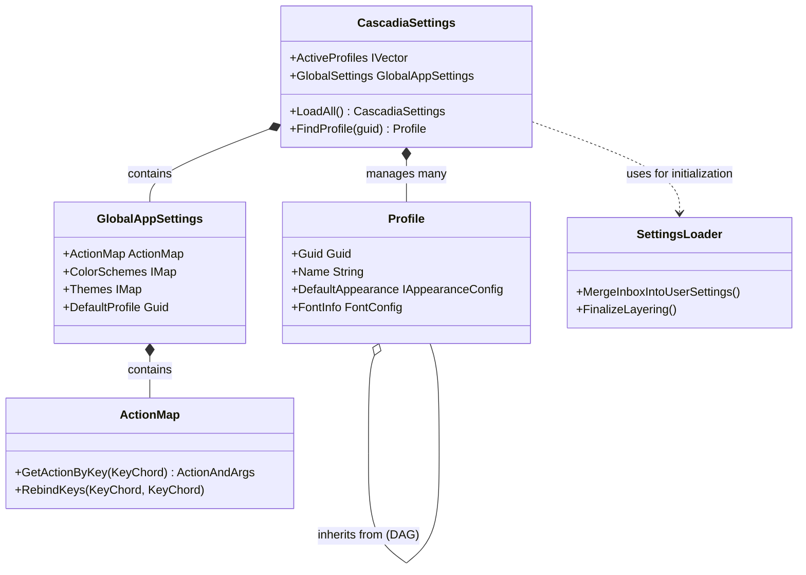
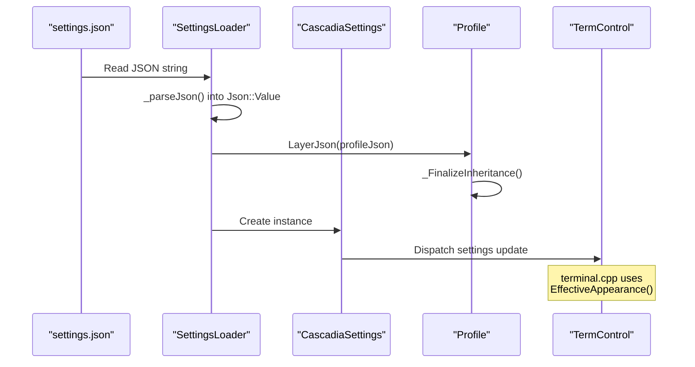

<!-- source: DeepWiki mcp.deepwiki.com · repo microsoft/intelligent-terminal · page 7 Settings Model · fetched 2026-10-26 -->

# Settings Model

Relevant source files

The following files were used as context for generating this wiki page:

- [src/cascadia/TerminalControl/IControlSettings.idl](src/cascadia/TerminalControl/IControlSettings.idl)
- [src/cascadia/TerminalSettingsEditor/Resources/en-US/Resources.resw](src/cascadia/TerminalSettingsEditor/Resources/en-US/Resources.resw)
- [src/cascadia/TerminalSettingsModel/ActionMap.cpp](src/cascadia/TerminalSettingsModel/ActionMap.cpp)
- [src/cascadia/TerminalSettingsModel/ActionMap.h](src/cascadia/TerminalSettingsModel/ActionMap.h)
- [src/cascadia/TerminalSettingsModel/ActionMap.idl](src/cascadia/TerminalSettingsModel/ActionMap.idl)
- [src/cascadia/TerminalSettingsModel/ActionMapSerialization.cpp](src/cascadia/TerminalSettingsModel/ActionMapSerialization.cpp)
- [src/cascadia/TerminalSettingsModel/CascadiaSettings.cpp](src/cascadia/TerminalSettingsModel/CascadiaSettings.cpp)
- [src/cascadia/TerminalSettingsModel/CascadiaSettings.h](src/cascadia/TerminalSettingsModel/CascadiaSettings.h)
- [src/cascadia/TerminalSettingsModel/CascadiaSettings.idl](src/cascadia/TerminalSettingsModel/CascadiaSettings.idl)
- [src/cascadia/TerminalSettingsModel/CascadiaSettingsSerialization.cpp](src/cascadia/TerminalSettingsModel/CascadiaSettingsSerialization.cpp)
- [src/cascadia/TerminalSettingsModel/Command.cpp](src/cascadia/TerminalSettingsModel/Command.cpp)
- [src/cascadia/TerminalSettingsModel/Command.h](src/cascadia/TerminalSettingsModel/Command.h)
- [src/cascadia/TerminalSettingsModel/Command.idl](src/cascadia/TerminalSettingsModel/Command.idl)
- [src/cascadia/TerminalSettingsModel/GlobalAppSettings.cpp](src/cascadia/TerminalSettingsModel/GlobalAppSettings.cpp)
- [src/cascadia/TerminalSettingsModel/GlobalAppSettings.h](src/cascadia/TerminalSettingsModel/GlobalAppSettings.h)
- [src/cascadia/TerminalSettingsModel/GlobalAppSettings.idl](src/cascadia/TerminalSettingsModel/GlobalAppSettings.idl)
- [src/cascadia/TerminalSettingsModel/MTSMSettings.h](src/cascadia/TerminalSettingsModel/MTSMSettings.h)
- [src/cascadia/TerminalSettingsModel/Profile.cpp](src/cascadia/TerminalSettingsModel/Profile.cpp)
- [src/cascadia/TerminalSettingsModel/Profile.h](src/cascadia/TerminalSettingsModel/Profile.h)
- [src/cascadia/TerminalSettingsModel/Profile.idl](src/cascadia/TerminalSettingsModel/Profile.idl)
- [src/cascadia/inc/ControlProperties.h](src/cascadia/inc/ControlProperties.h)

The Settings Model is the central configuration system for Intelligent Terminal. It manages the lifecycle of application settings, from loading JSON files on disk to providing a unified, layered view of properties to the UI and terminal core. The system is built around the `CascadiaSettings` class, which aggregates global application settings, terminal profiles, color schemes, and action mappings.

## System Architecture

The settings system follows a layered inheritance model. Settings are not just a single flat file; they are the result of merging multiple sources:
1.  **In-box Defaults**: Hardcoded `defaults.json` included with the application [src/cascadia/TerminalSettingsModel/CascadiaSettingsSerialization.cpp:36]().
2.  **User Settings**: The user's `settings.json` file [src/cascadia/TerminalSettingsModel/CascadiaSettingsSerialization.cpp:35]().
3.  **Dynamic Profiles**: Profiles generated at runtime (e.g., WSL distros, PowerShell Core, SSH hosts) [src/cascadia/TerminalSettingsModel/CascadiaSettingsSerialization.cpp:14-18]().
4.  **Fragments**: JSON snippets provided by third-party applications or extensions [src/cascadia/TerminalSettingsModel/CascadiaSettingsSerialization.cpp:61-64]().

### Code Entity Relationship

The following diagram illustrates the relationship between the primary classes in the `Microsoft::Terminal::Settings::Model` namespace.

**Sources:** [src/cascadia/TerminalSettingsModel/CascadiaSettings.h:144-154](), [src/cascadia/TerminalSettingsModel/GlobalAppSettings.h:45-56](), [src/cascadia/TerminalSettingsModel/Profile.h:40-43](), [src/cascadia/TerminalSettingsModel/ActionMap.h:20-25]().

---

## CascadiaSettings: Loading and Layering

The `CascadiaSettings` class acts as the root of the settings object graph. Initialization is handled by the `SettingsLoader`, which implements a complex pipeline to ensure that user preferences correctly override defaults while maintaining links to parent profiles for property inheritance.

*   **Origin Tracking**: Every setting is tagged with an `OriginTag` (User, InBox, Fragment, or Generated) to track where a value came from [src/cascadia/TerminalSettingsModel/CascadiaSettingsSerialization.cpp:148-152]().
*   **Inheritance DAG**: Profiles support a Directed Acyclic Graph (DAG) of inheritance. A profile can inherit from the "Base Layer" or other profiles, allowing for shared configuration across multiple shells [src/cascadia/TerminalSettingsModel/Profile.cpp:79-96]().
*   **Serialization**: The model uses `jsoncpp` for parsing and custom `JsonUtils` for type-safe deserialization [src/cascadia/TerminalSettingsModel/CascadiaSettingsSerialization.cpp:154-157]().

For details on the loading pipeline and fragment extensions, see [CascadiaSettings: Loading, Layering, and Serialization](#7.1).

---

## Globals, Actions, and Commands

Global settings apply to the entire application instance rather than specific terminal sessions. This includes windowing behavior, themes, and the interaction model.

*   **GlobalAppSettings**: Managed via `MTSM_GLOBAL_SETTINGS` X-macros, which automate the definition of properties, JSON keys, and default values [src/cascadia/TerminalSettingsModel/MTSMSettings.h:21-56]().
*   **ActionMap**: A specialized container that maps `KeyChord` (keyboard shortcuts) to `ActionAndArgs`. It handles conflict resolution when multiple keys are bound to the same action [src/cascadia/TerminalSettingsModel/ActionMap.cpp:19-61]().
*   **Command Model**: Represents an entry in the Command Palette. Commands can be "iterable" (automatically expanding into multiple entries for each profile) and can host nested sub-commands [src/cascadia/TerminalSettingsModel/Command.cpp:101-124]().

For details on keybindings and the command palette data model, see [GlobalAppSettings, ActionMap, and Command Model](#7.2).

---

## Settings Editor UI

The Settings Editor is a XAML-based interface for modifying the settings model without editing JSON directly. It is hosted as a separate page within the terminal window.

*   **MVVM Infrastructure**: The editor uses a heavy View-Model architecture (e.g., `ProfileViewModel`, `AppearanceViewModel`) to wrap the underlying `CascadiaSettings` objects, providing observable properties for the UI [src/cascadia/TerminalSettingsEditor/Resources/en-US/Resources.resw:120-140]().
*   **Validation**: The UI includes real-time validation for paths, GUIDs, and color strings.
*   **AI Settings**: A dedicated section for managing AI Agent integration, including coordinator command lines and security confirmation levels [src/cascadia/TerminalSettingsModel/GlobalAppSettings.idl:128-134]().

For details on the XAML implementation and view models, see [Settings Editor UI](#7.3).

---

## Data Flow: From Disk to Terminal

The following diagram bridges the "Natural Language" concept of a user setting to the "Code Entity" that processes it.

**Sources:** [src/cascadia/TerminalSettingsModel/CascadiaSettingsSerialization.cpp:146-158](), [src/cascadia/TerminalSettingsModel/Profile.cpp:170-175](), [src/cascadia/TerminalSettingsModel/CascadiaSettings.cpp:110-115]().

---

