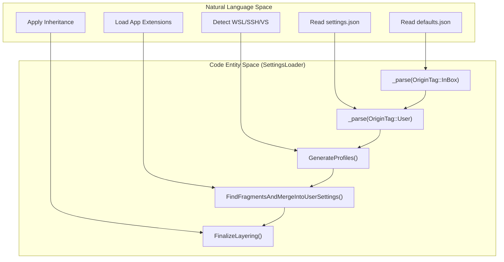
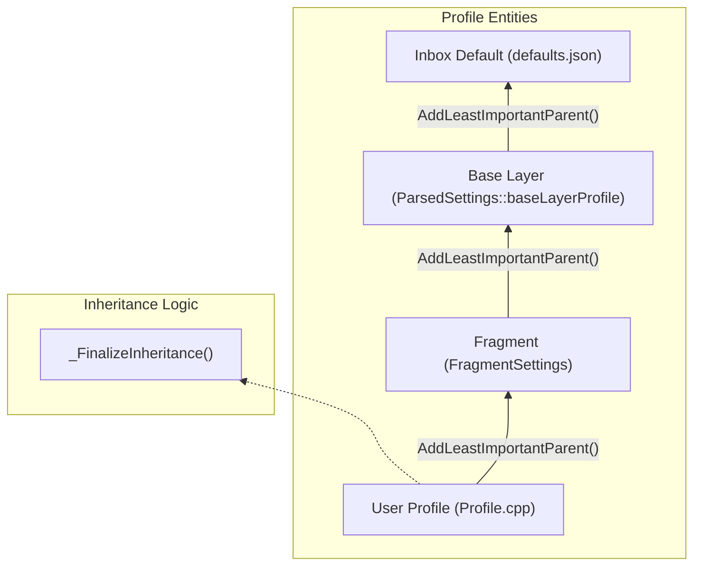

<!-- source: DeepWiki mcp.deepwiki.com · repo microsoft/intelligent-terminal · page 7.1 CascadiaSettings: Loading, Layering, and Serialization · fetched 2026-10-26 -->

# CascadiaSettings: Loading, Layering, and Serialization

Relevant source files

The following files were used as context for generating this wiki page:

- [src/cascadia/TerminalSettingsModel/ApplicationState.cpp](src/cascadia/TerminalSettingsModel/ApplicationState.cpp)
- [src/cascadia/TerminalSettingsModel/ApplicationState.h](src/cascadia/TerminalSettingsModel/ApplicationState.h)
- [src/cascadia/TerminalSettingsModel/ApplicationState.idl](src/cascadia/TerminalSettingsModel/ApplicationState.idl)
- [src/cascadia/TerminalSettingsModel/AzureCloudShellGenerator.cpp](src/cascadia/TerminalSettingsModel/AzureCloudShellGenerator.cpp)
- [src/cascadia/TerminalSettingsModel/CascadiaSettings.cpp](src/cascadia/TerminalSettingsModel/CascadiaSettings.cpp)
- [src/cascadia/TerminalSettingsModel/CascadiaSettings.h](src/cascadia/TerminalSettingsModel/CascadiaSettings.h)
- [src/cascadia/TerminalSettingsModel/CascadiaSettings.idl](src/cascadia/TerminalSettingsModel/CascadiaSettings.idl)
- [src/cascadia/TerminalSettingsModel/CascadiaSettingsSerialization.cpp](src/cascadia/TerminalSettingsModel/CascadiaSettingsSerialization.cpp)
- [src/cascadia/TerminalSettingsModel/FileUtils.cpp](src/cascadia/TerminalSettingsModel/FileUtils.cpp)
- [src/cascadia/TerminalSettingsModel/FileUtils.h](src/cascadia/TerminalSettingsModel/FileUtils.h)
- [src/cascadia/TerminalSettingsModel/JsonUtils.h](src/cascadia/TerminalSettingsModel/JsonUtils.h)
- [src/cascadia/TerminalSettingsModel/Microsoft.Terminal.Settings.Model.rc](src/cascadia/TerminalSettingsModel/Microsoft.Terminal.Settings.Model.rc)
- [src/cascadia/TerminalSettingsModel/Microsoft.Terminal.Settings.ModelLib.vcxproj](src/cascadia/TerminalSettingsModel/Microsoft.Terminal.Settings.ModelLib.vcxproj)
- [src/cascadia/TerminalSettingsModel/Microsoft.Terminal.Settings.ModelLib.vcxproj.filters](src/cascadia/TerminalSettingsModel/Microsoft.Terminal.Settings.ModelLib.vcxproj.filters)
- [src/cascadia/TerminalSettingsModel/PowershellCoreProfileGenerator.cpp](src/cascadia/TerminalSettingsModel/PowershellCoreProfileGenerator.cpp)
- [src/cascadia/TerminalSettingsModel/Profile.cpp](src/cascadia/TerminalSettingsModel/Profile.cpp)
- [src/cascadia/TerminalSettingsModel/Profile.h](src/cascadia/TerminalSettingsModel/Profile.h)
- [src/cascadia/TerminalSettingsModel/Profile.idl](src/cascadia/TerminalSettingsModel/Profile.idl)
- [src/cascadia/TerminalSettingsModel/VsDevCmdGenerator.cpp](src/cascadia/TerminalSettingsModel/VsDevCmdGenerator.cpp)
- [src/cascadia/TerminalSettingsModel/VsDevCmdGenerator.h](src/cascadia/TerminalSettingsModel/VsDevCmdGenerator.h)
- [src/cascadia/TerminalSettingsModel/VsDevShellGenerator.cpp](src/cascadia/TerminalSettingsModel/VsDevShellGenerator.cpp)
- [src/cascadia/TerminalSettingsModel/VsDevShellGenerator.h](src/cascadia/TerminalSettingsModel/VsDevShellGenerator.h)
- [src/cascadia/TerminalSettingsModel/VsSetupConfiguration.cpp](src/cascadia/TerminalSettingsModel/VsSetupConfiguration.cpp)
- [src/cascadia/TerminalSettingsModel/VsSetupConfiguration.h](src/cascadia/TerminalSettingsModel/VsSetupConfiguration.h)
- [src/cascadia/TerminalSettingsModel/WslDistroGenerator.cpp](src/cascadia/TerminalSettingsModel/WslDistroGenerator.cpp)
- [src/cascadia/TerminalSettingsModel/dll/Microsoft.Terminal.Settings.Model.vcxproj](src/cascadia/TerminalSettingsModel/dll/Microsoft.Terminal.Settings.Model.vcxproj)
- [src/cascadia/TerminalSettingsModel/pch.h](src/cascadia/TerminalSettingsModel/pch.h)
- [src/cascadia/TerminalSettingsModel/resource.h](src/cascadia/TerminalSettingsModel/resource.h)
- [src/cascadia/TerminalSettingsModel/userDefaults.json](src/cascadia/TerminalSettingsModel/userDefaults.json)
- [src/cascadia/UnitTests_SettingsModel/DeserializationTests.cpp](src/cascadia/UnitTests_SettingsModel/DeserializationTests.cpp)
- [src/cascadia/UnitTests_SettingsModel/MediaResourceTests.cpp](src/cascadia/UnitTests_SettingsModel/MediaResourceTests.cpp)
- [src/cascadia/UnitTests_SettingsModel/NewTabMenuTests.cpp](src/cascadia/UnitTests_SettingsModel/NewTabMenuTests.cpp)
- [src/cascadia/UnitTests_SettingsModel/ProfileTests.cpp](src/cascadia/UnitTests_SettingsModel/ProfileTests.cpp)
- [src/cascadia/UnitTests_SettingsModel/SerializationTests.cpp](src/cascadia/UnitTests_SettingsModel/SerializationTests.cpp)
- [src/cascadia/UnitTests_SettingsModel/ThemeTests.cpp](src/cascadia/UnitTests_SettingsModel/ThemeTests.cpp)

The `CascadiaSettings` class is the central container for all application settings in Intelligent Terminal. It manages the lifecycle of global application state and terminal profiles by aggregating data from multiple sources including built-in defaults, user configuration files, dynamic runtime generators, and side-loaded fragments.

### The SettingsLoader Pipeline

The loading process is orchestrated by the `SettingsLoader` struct, which implements a multi-stage pipeline to resolve the final state of settings. This pipeline ensures that settings are layered correctly, allowing user preferences to override system defaults while maintaining inheritance from dynamic sources.

#### Data Flow and Implementation
The primary entry point for loading settings is `CascadiaSettings::LoadAll()` [src/cascadia/TerminalSettingsModel/CascadiaSettings.h:148](), which instantiates a `SettingsLoader` to perform the following sequence:

1.  **Parse Inbox and User JSON**: The loader reads the read-only `defaults.json` (Inbox) and the writable `settings.json` (User). Parsing is handled by `SettingsLoader::_parse` [src/cascadia/TerminalSettingsModel/CascadiaSettingsSerialization.cpp:146-157]().
2.  **Dynamic Profile Generation**: Generators for WSL, PowerShell, Visual Studio, and SSH are executed via `SettingsLoader::GenerateProfiles()` [src/cascadia/TerminalSettingsModel/CascadiaSettingsSerialization.cpp:88]().
3.  **Fragment Merging**: JSON fragments located in `%ProgramData%` or app extension packages are discovered and merged using `FindFragmentsAndMergeIntoUserSettings` [src/cascadia/TerminalSettingsModel/CascadiaSettingsSerialization.cpp:130]().
4.  **Layering and Finalization**: The loader establishes the inheritance graph between profiles and applies the "Base Layer" settings to all profiles.

#### Settings Loading Pipeline Diagram
This diagram maps the logical loading stages to the internal functions of the `SettingsLoader` class.

Sources: [src/cascadia/TerminalSettingsModel/CascadiaSettingsSerialization.cpp:117-124](), [src/cascadia/TerminalSettingsModel/CascadiaSettingsSerialization.cpp:146-185]()

---

### Profile Inheritance and the DAG

Profiles in Intelligent Terminal are structured as a Directed Acyclic Graph (DAG) rather than a simple list. This allows a single profile to inherit settings from multiple "parents," such as the global `profiles.defaults` (Base Layer) and dynamic fragments.

#### Key Mechanisms
*   **IInheritable Interface**: Many setting types implement `IInheritable`, which allows them to track whether a value was explicitly set in the current layer or inherited from a parent [src/cascadia/TerminalSettingsModel/Profile.h:79]().
*   **OriginTag System**: Every setting and profile is stamped with an `OriginTag` (e.g., `InBox`, `User`, `Dynamic`, `Fragment`) to identify its source [src/cascadia/TerminalSettingsModel/CascadiaSettingsSerialization.cpp:148-152]().
*   **DAG Cloning**: When settings are copied, the `Profile::CopyInheritanceGraph` function uses a `visited` map to "intern" profile nodes, ensuring that the shared parent structure is preserved without duplication [src/cascadia/TerminalSettingsModel/Profile.cpp:79-96]().

#### Profile Inheritance Structure
The following diagram illustrates how a user profile resolves its final settings from multiple code entities.

Sources: [src/cascadia/TerminalSettingsModel/Profile.h:108](), [src/cascadia/TerminalSettingsModel/Profile.cpp:45-59](), [src/cascadia/TerminalSettingsModel/CascadiaSettings.cpp:82-93]()

---

### Fragments and Extension Packages

Fragments allow third-party applications (like WSL distributions or SSH clients) to inject profiles and color schemes into the terminal without modifying the user's `settings.json`.

*   **Discovery**: The loader looks in `%LOCALAPPDATA%\Microsoft\Windows Terminal\Fragments` and `%PROGRAMDATA%\Microsoft\Windows Terminal\Fragments` [src/cascadia/TerminalSettingsModel/CascadiaSettingsSerialization.cpp:61-62]().
*   **Extension Packages**: These are managed via the `ExtensionPackage` struct, which contains `FragmentSettings` and metadata like `DisplayName` and `Icon` [src/cascadia/TerminalSettingsModel/CascadiaSettings.h:46-66]().
*   **Registration**: `SettingsLoader::_registerFragment` is responsible for cataloging these side-loaded settings into the `extensionPackageMap` [src/cascadia/TerminalSettingsModel/CascadiaSettingsSerialization.cpp:102]().

Sources: [src/cascadia/TerminalSettingsModel/CascadiaSettingsSerialization.cpp:60-65](), [src/cascadia/TerminalSettingsModel/CascadiaSettings.idl:94-101]()

---

### Serialization and Disk I/O

The serialization logic converts the in-memory C++/WinRT objects back into JSON for persistence.

#### WriteSettingsToDisk
The `CascadiaSettings::WriteSettingsToDisk()` method [src/cascadia/TerminalSettingsModel/CascadiaSettingsSerialization.cpp:2416]() performs the following:
1.  Calls `ToJson()` on the `GlobalAppSettings` and `Profile` objects.
2.  Filters out settings that are identical to the defaults to keep the user's `settings.json` clean.
3.  Uses `Json::StreamWriterBuilder` to format the output with standard indentation [src/cascadia/TerminalSettingsModel/CascadiaSettingsSerialization.cpp:136]().
4.  Writes to the path returned by `CascadiaSettings::SettingsPath()` [src/cascadia/TerminalSettingsModel/CascadiaSettings.cpp:151]().

#### Validation Routines
Before and after loading, the system performs validation:
*   **JSON Schema**: The `$schema` property is automatically added to the output JSON to enable IntelliSense in editors [src/cascadia/UnitTests_SettingsModel/SerializationTests.cpp:97-104]().
*   **Fixups**: `SettingsLoader::FixupUserSettings()` identifies and corrects common configuration errors or migrates legacy settings (like old font formats) to the modern structure [src/cascadia/TerminalSettingsModel/CascadiaSettingsSerialization.cpp:98]().

| Function | Responsibility |
| :--- | :--- |
| `_parseJSON` | Converts raw string to `Json::Value` using `jsoncpp` [src/cascadia/TerminalSettingsModel/CascadiaSettingsSerialization.cpp:124](). |
| `LayerJson` | Merges a `Json::Value` into an existing `Profile` or `GlobalAppSettings` object [src/cascadia/TerminalSettingsModel/Profile.cpp:170](). |
| `ToJson` | Serializes an object back to `Json::Value` [src/cascadia/TerminalSettingsModel/Profile.cpp:99](). |
| `_rethrowSerializationExceptionWithLocationInfo` | Provides line/column data for JSON syntax errors [src/cascadia/TerminalSettingsModel/CascadiaSettingsSerialization.cpp:123](). |

Sources: [src/cascadia/TerminalSettingsModel/CascadiaSettingsSerialization.cpp:122-136](), [src/cascadia/TerminalSettingsModel/Profile.cpp:151-170](), [src/cascadia/TerminalSettingsModel/JsonUtils.h:141-153]()

---

