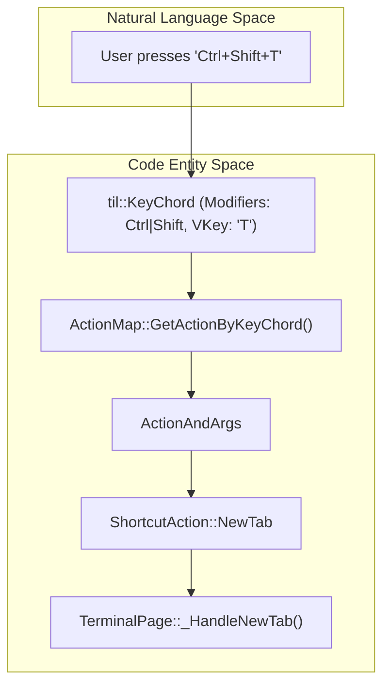
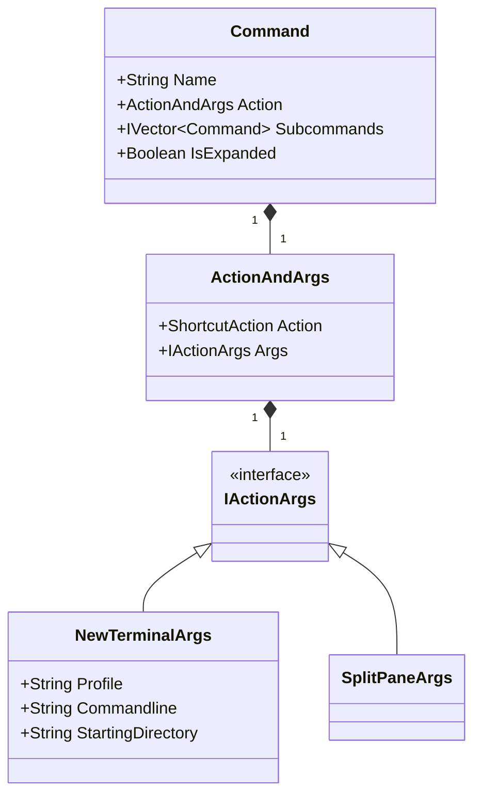

<!-- source: DeepWiki mcp.deepwiki.com · repo microsoft/intelligent-terminal · page 7.2 GlobalAppSettings, ActionMap, and Command Model · fetched 2026-10-26 -->

# GlobalAppSettings, ActionMap, and Command Model

Relevant source files

The following files were used as context for generating this wiki page:

- [doc/cascadia/SettingsSchema.md](doc/cascadia/SettingsSchema.md)
- [doc/cascadia/profiles.schema.json](doc/cascadia/profiles.schema.json)
- [src/cascadia/LocalTests_TerminalApp/CommandlineTest.cpp](src/cascadia/LocalTests_TerminalApp/CommandlineTest.cpp)
- [src/cascadia/LocalTests_TerminalApp/TabTests.cpp](src/cascadia/LocalTests_TerminalApp/TabTests.cpp)
- [src/cascadia/TerminalApp/AppActionHandlers.cpp](src/cascadia/TerminalApp/AppActionHandlers.cpp)
- [src/cascadia/TerminalApp/AppCommandlineArgs.cpp](src/cascadia/TerminalApp/AppCommandlineArgs.cpp)
- [src/cascadia/TerminalApp/AppCommandlineArgs.h](src/cascadia/TerminalApp/AppCommandlineArgs.h)
- [src/cascadia/TerminalApp/Resources/en-US/Resources.resw](src/cascadia/TerminalApp/Resources/en-US/Resources.resw)
- [src/cascadia/TerminalApp/TabManagement.cpp](src/cascadia/TerminalApp/TabManagement.cpp)
- [src/cascadia/TerminalApp/TerminalPage.cpp](src/cascadia/TerminalApp/TerminalPage.cpp)
- [src/cascadia/TerminalApp/TerminalPage.h](src/cascadia/TerminalApp/TerminalPage.h)
- [src/cascadia/TerminalApp/TerminalPage.xaml](src/cascadia/TerminalApp/TerminalPage.xaml)
- [src/cascadia/TerminalControl/IControlSettings.idl](src/cascadia/TerminalControl/IControlSettings.idl)
- [src/cascadia/TerminalSettingsEditor/Resources/en-US/Resources.resw](src/cascadia/TerminalSettingsEditor/Resources/en-US/Resources.resw)
- [src/cascadia/TerminalSettingsModel/ActionAndArgs.cpp](src/cascadia/TerminalSettingsModel/ActionAndArgs.cpp)
- [src/cascadia/TerminalSettingsModel/ActionArgs.cpp](src/cascadia/TerminalSettingsModel/ActionArgs.cpp)
- [src/cascadia/TerminalSettingsModel/ActionArgs.h](src/cascadia/TerminalSettingsModel/ActionArgs.h)
- [src/cascadia/TerminalSettingsModel/ActionArgs.idl](src/cascadia/TerminalSettingsModel/ActionArgs.idl)
- [src/cascadia/TerminalSettingsModel/ActionMap.cpp](src/cascadia/TerminalSettingsModel/ActionMap.cpp)
- [src/cascadia/TerminalSettingsModel/ActionMap.h](src/cascadia/TerminalSettingsModel/ActionMap.h)
- [src/cascadia/TerminalSettingsModel/ActionMap.idl](src/cascadia/TerminalSettingsModel/ActionMap.idl)
- [src/cascadia/TerminalSettingsModel/ActionMapSerialization.cpp](src/cascadia/TerminalSettingsModel/ActionMapSerialization.cpp)
- [src/cascadia/TerminalSettingsModel/AllShortcutActions.h](src/cascadia/TerminalSettingsModel/AllShortcutActions.h)
- [src/cascadia/TerminalSettingsModel/Command.cpp](src/cascadia/TerminalSettingsModel/Command.cpp)
- [src/cascadia/TerminalSettingsModel/Command.h](src/cascadia/TerminalSettingsModel/Command.h)
- [src/cascadia/TerminalSettingsModel/Command.idl](src/cascadia/TerminalSettingsModel/Command.idl)
- [src/cascadia/TerminalSettingsModel/GlobalAppSettings.cpp](src/cascadia/TerminalSettingsModel/GlobalAppSettings.cpp)
- [src/cascadia/TerminalSettingsModel/GlobalAppSettings.h](src/cascadia/TerminalSettingsModel/GlobalAppSettings.h)
- [src/cascadia/TerminalSettingsModel/GlobalAppSettings.idl](src/cascadia/TerminalSettingsModel/GlobalAppSettings.idl)
- [src/cascadia/TerminalSettingsModel/MTSMSettings.h](src/cascadia/TerminalSettingsModel/MTSMSettings.h)
- [src/cascadia/TerminalSettingsModel/Resources/en-US/Resources.resw](src/cascadia/TerminalSettingsModel/Resources/en-US/Resources.resw)
- [src/cascadia/TerminalSettingsModel/TerminalSettingsSerializationHelpers.h](src/cascadia/TerminalSettingsModel/TerminalSettingsSerializationHelpers.h)
- [src/cascadia/TerminalSettingsModel/Theme.cpp](src/cascadia/TerminalSettingsModel/Theme.cpp)
- [src/cascadia/TerminalSettingsModel/Theme.h](src/cascadia/TerminalSettingsModel/Theme.h)
- [src/cascadia/TerminalSettingsModel/Theme.idl](src/cascadia/TerminalSettingsModel/Theme.idl)
- [src/cascadia/TerminalSettingsModel/defaults.json](src/cascadia/TerminalSettingsModel/defaults.json)
- [src/cascadia/inc/ControlProperties.h](src/cascadia/inc/ControlProperties.h)

This page details the structural components of the Intelligent Terminal settings model that govern application-wide behavior, input mapping, and the execution of discrete actions.

## GlobalAppSettings

`GlobalAppSettings` encapsulates settings that apply to the entire application instance rather than specific profiles. This includes window dimensions, theme selection, and Group Policy Object (GPO) enforcement.

### X-Macro Implementation
The settings model utilizes X-macros to maintain consistency between class definitions, IDL interfaces, and JSON serialization. The `MTSM_GLOBAL_SETTINGS` macro defines the type, property name, and JSON key for every global setting [src/cascadia/TerminalSettingsModel/MTSMSettings.h:21-72]().

This macro is expanded in:
*   **`GlobalAppSettings.h`**: To generate private member variables and public property getters/setters [src/cascadia/TerminalSettingsModel/GlobalAppSettings.h:22-30]().
*   **`GlobalAppSettings.cpp`**: To handle JSON serialization and deserialization [src/cascadia/TerminalSettingsModel/GlobalAppSettings.cpp:15-40]().

### GPO and Effective Settings
Global settings support Group Policy overrides. The implementation provides "effective" getters that check if a policy is enforced before returning the user-defined value. For example, `InputServiceWarning` and `DebugFeaturesEnabled` are subject to organizational policies [src/cascadia/TerminalSettingsModel/MTSMSettings.h:47-56]().

### Themes and Color Schemes
*   **Themes**: Managed via the `Theme` class, which defines the visual appearance of the window chrome (tabs, title bar, window colors) [src/cascadia/TerminalSettingsModel/Theme.h:18-35](). Themes are serialized as a `ThemePair` to handle both dark and light mode variants [src/cascadia/TerminalSettingsModel/MTSMSettings.h:42]().
*   **Color Schemes**: Global settings maintain a map of named `ColorScheme` objects. These define the 16-color ANSI palette used within the terminal buffer [src/cascadia/TerminalSettingsModel/defaults.json:90-163]().

**Sources:** [src/cascadia/TerminalSettingsModel/MTSMSettings.h](), [src/cascadia/TerminalSettingsModel/GlobalAppSettings.h](), [src/cascadia/TerminalSettingsModel/GlobalAppSettings.cpp](), [src/cascadia/TerminalSettingsModel/Theme.h]()

---

## ActionMap and Input Binding

The `ActionMap` class is the central authority for mapping user input (KeyChords) to executable actions.

### Data Structures
`ActionMap` maintains several internal maps to facilitate fast lookups and UI rendering:
*   **KeyChord Map**: A hash map associating a `KeyChord` (modifiers + vkey) with a `ShortcutAction` [src/cascadia/TerminalSettingsModel/ActionMap.h:45-55]().
*   **Name Map**: Maps a human-readable string name to a `Command` object for use in the Command Palette [src/cascadia/TerminalSettingsModel/ActionMap.cpp:110-125]().
*   **Cumulative ID Cache**: To handle settings layering, the `ActionMap` tracks which actions were defined in which layer (defaults vs. user) to support the "unbind" functionality [src/cascadia/TerminalSettingsModel/ActionMap.cpp:140-160]().

### RebindKeys and Serialization
When settings are reloaded, `RebindKeys` is called to rebuild the internal lookup tables. It processes the `actions` array from the JSON settings, parsing strings like `"ctrl+shift+c"` into `KeyChord` structures [doc/cascadia/profiles.schema.json:6-10]().

### Action Logic Flow: Key to Execution
The following diagram illustrates how a physical keypress is translated into a functional code execution within the terminal.

**Input Translation Diagram**

**Sources:** [src/cascadia/TerminalSettingsModel/ActionMap.h](), [src/cascadia/TerminalSettingsModel/ActionMap.cpp](), [src/cascadia/TerminalApp/TerminalPage.cpp:64-65]()

---

## Command Model

The Command Model represents the "Action" itself, decoupled from the specific keybinding.

### Command Class
A `Command` object contains:
*   **ActionAndArgs**: A pair consisting of the `ShortcutAction` enum and the specific `IActionArgs` required for that action [src/cascadia/TerminalSettingsModel/Command.h:30-45]().
*   **UI Metadata**: Icon path, label (for palette), and visibility flags [src/cascadia/TerminalSettingsModel/Command.idl:10-25]().

### Iterable Commands and Expansion
Some commands are "iterable," meaning they expand into multiple entries in the UI. For example, a `NewTab` command with `iterateOn: "profiles"` will be expanded into a list of commands—one for each available profile [src/cascadia/TerminalSettingsModel/Command.cpp:210-230]().
*   **`ExpandCommands`**: This function is called during settings initialization to flatten these templates into the `ActionMap`'s command list [src/cascadia/TerminalSettingsModel/Command.cpp:240-260]().

### ActionArgs Serialization
`ActionArgs` are specialized WinRT objects that hold parameters for actions (e.g., `SplitPaneArgs` holds the split direction). These use a dedicated serialization helper to convert JSON sub-objects into the correct WinRT implementation [src/cascadia/TerminalSettingsModel/TerminalSettingsSerializationHelpers.h:15-30]().

**Command Structure Diagram**

**Sources:** [src/cascadia/TerminalSettingsModel/Command.h](), [src/cascadia/TerminalSettingsModel/ActionAndArgs.cpp](), [src/cascadia/TerminalSettingsModel/ActionArgs.cpp]()

---

## Data Flow: Settings Dispatch

When an action is triggered (via keybinding or palette), it is dispatched to the `TerminalPage` for execution.

1.  **Dispatch**: The `ActionMap` provides the `ActionAndArgs` to the `ShortcutActionDispatch` [src/cascadia/TerminalApp/TerminalPage.cpp:64-65]().
2.  **Handling**: `TerminalPage` registers handlers using the `HOOKUP_ACTION` macro, which maps `ShortcutAction` enums to `_Handle{Action}` methods [src/cascadia/TerminalApp/TerminalPage.h:19]().
3.  **Execution**: Handlers like `_HandleNewTab` or `_HandleSplitPane` extract parameters from the `IActionArgs` and modify the UI tree (tabs/panes) accordingly [src/cascadia/TerminalApp/AppActionHandlers.cpp:61-100]().

**Sources:** [src/cascadia/TerminalApp/TerminalPage.cpp](), [src/cascadia/TerminalApp/TerminalPage.h](), [src/cascadia/TerminalApp/AppActionHandlers.cpp]()

---

