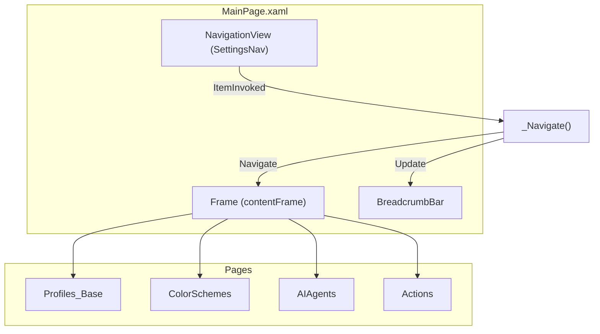

<!-- source: DeepWiki mcp.deepwiki.com · repo microsoft/intelligent-terminal · page 7.3 Settings Editor UI · fetched 2026-10-26 -->

# Settings Editor UI

<details>
<summary>Relevant source files</summary>

The following files were used as context for generating this wiki page:

- [src/cascadia/TerminalSettingsEditor/Appearances.cpp](src/cascadia/TerminalSettingsEditor/Appearances.cpp)
- [src/cascadia/TerminalSettingsEditor/Appearances.h](src/cascadia/TerminalSettingsEditor/Appearances.h)
- [src/cascadia/TerminalSettingsEditor/Appearances.idl](src/cascadia/TerminalSettingsEditor/Appearances.idl)
- [src/cascadia/TerminalSettingsEditor/Appearances.xaml](src/cascadia/TerminalSettingsEditor/Appearances.xaml)
- [src/cascadia/TerminalSettingsEditor/ColorSchemeViewModel.cpp](src/cascadia/TerminalSettingsEditor/ColorSchemeViewModel.cpp)
- [src/cascadia/TerminalSettingsEditor/ColorSchemeViewModel.h](src/cascadia/TerminalSettingsEditor/ColorSchemeViewModel.h)
- [src/cascadia/TerminalSettingsEditor/ColorSchemeViewModel.idl](src/cascadia/TerminalSettingsEditor/ColorSchemeViewModel.idl)
- [src/cascadia/TerminalSettingsEditor/ColorSchemes.cpp](src/cascadia/TerminalSettingsEditor/ColorSchemes.cpp)
- [src/cascadia/TerminalSettingsEditor/ColorSchemes.h](src/cascadia/TerminalSettingsEditor/ColorSchemes.h)
- [src/cascadia/TerminalSettingsEditor/ColorSchemes.idl](src/cascadia/TerminalSettingsEditor/ColorSchemes.idl)
- [src/cascadia/TerminalSettingsEditor/ColorSchemes.xaml](src/cascadia/TerminalSettingsEditor/ColorSchemes.xaml)
- [src/cascadia/TerminalSettingsEditor/ColorSchemesPageViewModel.cpp](src/cascadia/TerminalSettingsEditor/ColorSchemesPageViewModel.cpp)
- [src/cascadia/TerminalSettingsEditor/ColorSchemesPageViewModel.h](src/cascadia/TerminalSettingsEditor/ColorSchemesPageViewModel.h)
- [src/cascadia/TerminalSettingsEditor/ColorSchemesPageViewModel.idl](src/cascadia/TerminalSettingsEditor/ColorSchemesPageViewModel.idl)
- [src/cascadia/TerminalSettingsEditor/CommonResources.xaml](src/cascadia/TerminalSettingsEditor/CommonResources.xaml)
- [src/cascadia/TerminalSettingsEditor/EditColorScheme.xaml](src/cascadia/TerminalSettingsEditor/EditColorScheme.xaml)
- [src/cascadia/TerminalSettingsEditor/GlobalAppearance.cpp](src/cascadia/TerminalSettingsEditor/GlobalAppearance.cpp)
- [src/cascadia/TerminalSettingsEditor/GlobalAppearance.h](src/cascadia/TerminalSettingsEditor/GlobalAppearance.h)
- [src/cascadia/TerminalSettingsEditor/GlobalAppearance.idl](src/cascadia/TerminalSettingsEditor/GlobalAppearance.idl)
- [src/cascadia/TerminalSettingsEditor/GlobalAppearance.xaml](src/cascadia/TerminalSettingsEditor/GlobalAppearance.xaml)
- [src/cascadia/TerminalSettingsEditor/GlobalAppearanceViewModel.cpp](src/cascadia/TerminalSettingsEditor/GlobalAppearanceViewModel.cpp)
- [src/cascadia/TerminalSettingsEditor/GlobalAppearanceViewModel.h](src/cascadia/TerminalSettingsEditor/GlobalAppearanceViewModel.h)
- [src/cascadia/TerminalSettingsEditor/GlobalAppearanceViewModel.idl](src/cascadia/TerminalSettingsEditor/GlobalAppearanceViewModel.idl)
- [src/cascadia/TerminalSettingsEditor/Interaction.cpp](src/cascadia/TerminalSettingsEditor/Interaction.cpp)
- [src/cascadia/TerminalSettingsEditor/Interaction.h](src/cascadia/TerminalSettingsEditor/Interaction.h)
- [src/cascadia/TerminalSettingsEditor/Interaction.idl](src/cascadia/TerminalSettingsEditor/Interaction.idl)
- [src/cascadia/TerminalSettingsEditor/Interaction.xaml](src/cascadia/TerminalSettingsEditor/Interaction.xaml)
- [src/cascadia/TerminalSettingsEditor/InteractionViewModel.h](src/cascadia/TerminalSettingsEditor/InteractionViewModel.h)
- [src/cascadia/TerminalSettingsEditor/InteractionViewModel.idl](src/cascadia/TerminalSettingsEditor/InteractionViewModel.idl)
- [src/cascadia/TerminalSettingsEditor/Launch.cpp](src/cascadia/TerminalSettingsEditor/Launch.cpp)
- [src/cascadia/TerminalSettingsEditor/Launch.h](src/cascadia/TerminalSettingsEditor/Launch.h)
- [src/cascadia/TerminalSettingsEditor/Launch.idl](src/cascadia/TerminalSettingsEditor/Launch.idl)
- [src/cascadia/TerminalSettingsEditor/Launch.xaml](src/cascadia/TerminalSettingsEditor/Launch.xaml)
- [src/cascadia/TerminalSettingsEditor/LaunchViewModel.cpp](src/cascadia/TerminalSettingsEditor/LaunchViewModel.cpp)
- [src/cascadia/TerminalSettingsEditor/LaunchViewModel.h](src/cascadia/TerminalSettingsEditor/LaunchViewModel.h)
- [src/cascadia/TerminalSettingsEditor/LaunchViewModel.idl](src/cascadia/TerminalSettingsEditor/LaunchViewModel.idl)
- [src/cascadia/TerminalSettingsEditor/MainPage.cpp](src/cascadia/TerminalSettingsEditor/MainPage.cpp)
- [src/cascadia/TerminalSettingsEditor/MainPage.h](src/cascadia/TerminalSettingsEditor/MainPage.h)
- [src/cascadia/TerminalSettingsEditor/MainPage.idl](src/cascadia/TerminalSettingsEditor/MainPage.idl)
- [src/cascadia/TerminalSettingsEditor/MainPage.xaml](src/cascadia/TerminalSettingsEditor/MainPage.xaml)
- [src/cascadia/TerminalSettingsEditor/Microsoft.Terminal.Settings.Editor.vcxproj](src/cascadia/TerminalSettingsEditor/Microsoft.Terminal.Settings.Editor.vcxproj)
- [src/cascadia/TerminalSettingsEditor/Microsoft.Terminal.Settings.Editor.vcxproj.filters](src/cascadia/TerminalSettingsEditor/Microsoft.Terminal.Settings.Editor.vcxproj.filters)
- [src/cascadia/TerminalSettingsEditor/ProfileViewModel.cpp](src/cascadia/TerminalSettingsEditor/ProfileViewModel.cpp)
- [src/cascadia/TerminalSettingsEditor/ProfileViewModel.h](src/cascadia/TerminalSettingsEditor/ProfileViewModel.h)
- [src/cascadia/TerminalSettingsEditor/ProfileViewModel.idl](src/cascadia/TerminalSettingsEditor/ProfileViewModel.idl)
- [src/cascadia/TerminalSettingsEditor/Profiles_Advanced.xaml](src/cascadia/TerminalSettingsEditor/Profiles_Advanced.xaml)
- [src/cascadia/TerminalSettingsEditor/Profiles_Appearance.cpp](src/cascadia/TerminalSettingsEditor/Profiles_Appearance.cpp)
- [src/cascadia/TerminalSettingsEditor/Profiles_Appearance.h](src/cascadia/TerminalSettingsEditor/Profiles_Appearance.h)
- [src/cascadia/TerminalSettingsEditor/Profiles_Appearance.xaml](src/cascadia/TerminalSettingsEditor/Profiles_Appearance.xaml)
- [src/cascadia/TerminalSettingsEditor/Profiles_Base.cpp](src/cascadia/TerminalSettingsEditor/Profiles_Base.cpp)
- [src/cascadia/TerminalSettingsEditor/Profiles_Base.h](src/cascadia/TerminalSettingsEditor/Profiles_Base.h)
- [src/cascadia/TerminalSettingsEditor/Profiles_Base.xaml](src/cascadia/TerminalSettingsEditor/Profiles_Base.xaml)
- [src/cascadia/TerminalSettingsEditor/Resources/de-DE/Resources.resw](src/cascadia/TerminalSettingsEditor/Resources/de-DE/Resources.resw)
- [src/cascadia/TerminalSettingsEditor/Resources/es-ES/Resources.resw](src/cascadia/TerminalSettingsEditor/Resources/es-ES/Resources.resw)
- [src/cascadia/TerminalSettingsEditor/Resources/fr-FR/Resources.resw](src/cascadia/TerminalSettingsEditor/Resources/fr-FR/Resources.resw)
- [src/cascadia/TerminalSettingsEditor/Resources/it-IT/Resources.resw](src/cascadia/TerminalSettingsEditor/Resources/it-IT/Resources.resw)
- [src/cascadia/TerminalSettingsEditor/Resources/ja-JP/Resources.resw](src/cascadia/TerminalSettingsEditor/Resources/ja-JP/Resources.resw)
- [src/cascadia/TerminalSettingsEditor/Resources/ko-KR/Resources.resw](src/cascadia/TerminalSettingsEditor/Resources/ko-KR/Resources.resw)
- [src/cascadia/TerminalSettingsEditor/Resources/pt-BR/Resources.resw](src/cascadia/TerminalSettingsEditor/Resources/pt-BR/Resources.resw)
- [src/cascadia/TerminalSettingsEditor/Resources/qps-ploc/Resources.resw](src/cascadia/TerminalSettingsEditor/Resources/qps-ploc/Resources.resw)
- [src/cascadia/TerminalSettingsEditor/Resources/qps-ploca/Resources.resw](src/cascadia/TerminalSettingsEditor/Resources/qps-ploca/Resources.resw)
- [src/cascadia/TerminalSettingsEditor/Resources/qps-plocm/Resources.resw](src/cascadia/TerminalSettingsEditor/Resources/qps-plocm/Resources.resw)
- [src/cascadia/TerminalSettingsEditor/Resources/ru-RU/Resources.resw](src/cascadia/TerminalSettingsEditor/Resources/ru-RU/Resources.resw)
- [src/cascadia/TerminalSettingsEditor/Resources/zh-CN/Resources.resw](src/cascadia/TerminalSettingsEditor/Resources/zh-CN/Resources.resw)
- [src/cascadia/TerminalSettingsEditor/Resources/zh-TW/Resources.resw](src/cascadia/TerminalSettingsEditor/Resources/zh-TW/Resources.resw)
- [src/cascadia/TerminalSettingsEditor/SettingContainer.cpp](src/cascadia/TerminalSettingsEditor/SettingContainer.cpp)
- [src/cascadia/TerminalSettingsEditor/SettingContainer.h](src/cascadia/TerminalSettingsEditor/SettingContainer.h)
- [src/cascadia/TerminalSettingsEditor/SettingContainer.idl](src/cascadia/TerminalSettingsEditor/SettingContainer.idl)
- [src/cascadia/TerminalSettingsEditor/SettingContainerStyle.xaml](src/cascadia/TerminalSettingsEditor/SettingContainerStyle.xaml)
- [src/cascadia/TerminalSettingsEditor/Utils.h](src/cascadia/TerminalSettingsEditor/Utils.h)
- [src/cascadia/TerminalSettingsEditor/ViewModelHelpers.h](src/cascadia/TerminalSettingsEditor/ViewModelHelpers.h)

</details>


The Settings Editor UI is a WinRT/XAML application hosted within the Terminal process that provides a graphical interface for modifying `settings.json`. It is built using a modern MVVM (Model-View-ViewModel) architecture, utilizing XAML Islands for integration into the Win32-hosted terminal windows.

## Navigation and MainPage Structure

The `MainPage` serves as the primary shell for the settings experience. It utilizes a `muxc:NavigationView` to manage the primary navigation categories and a `Frame` named `contentFrame` to host individual settings pages [src/cascadia/TerminalSettingsEditor/MainPage.xaml:65-102]().

### Navigation Categories
The editor organizes settings into several distinct areas:
*   **Global Settings**: Launch, Interaction, Appearance, Rendering, and Compatibility.
*   **Profiles**: A dynamic list of terminal profiles (e.g., PowerShell, Command Prompt) plus a "Base Layer" for shared settings.
*   **Resources**: Color Schemes, Actions, and the New Tab Menu editor.
*   **Extensibility**: Extensions and AI Agents.

### Navigation Logic
When an item is selected in the `NavigationView`, `MainPage::SettingsNav_ItemInvoked` is triggered. The application uses "Nav Tags" (string identifiers) to determine which view model and page to load [src/cascadia/TerminalSettingsEditor/MainPage.cpp:71-78]().

### Breadcrumb Navigation
To support deep-linking (e.g., navigating from a profile's Appearance sub-page back to the main Profile page), the UI implements a `BreadcrumbBar`. The `_breadcrumbs` observable vector tracks the current navigation stack [src/cascadia/TerminalSettingsEditor/MainPage.xaml:82-99]().

**MainPage Navigation Flow**

Sources: [src/cascadia/TerminalSettingsEditor/MainPage.xaml:65-102](), [src/cascadia/TerminalSettingsEditor/MainPage.cpp:112-160]()

## MVVM Infrastructure

The Settings Editor relies on a robust MVVM pattern to bridge the `CascadiaSettings` model with the XAML UI.

### SettingContainer
The `SettingContainer` is a custom control used throughout the editor to provide a consistent look for individual settings. It handles:
*   **Override Indicators**: Displays an icon if a setting is inherited from a base layer or a parent profile.
*   **Reset Logic**: Provides a "Clear" button to revert a setting to its inherited value [src/cascadia/TerminalSettingsEditor/Appearances.xaml:78-84]().
*   **Complex Previews**: Supports inline previews, such as the color chips in the Color Scheme dropdown [src/cascadia/TerminalSettingsEditor/Appearances.xaml:91-118]().

### ViewModel Helpers
View models (like `ProfileViewModel` and `AIAgentsViewModel`) wrap the underlying `Model` objects. They provide `IObservableVector` properties for lists and handle property change notifications to ensure the UI stays in sync with the settings clone [src/cascadia/TerminalSettingsEditor/MainPage.cpp:80-83]().

**MVVM Data Mapping**
```mermaid
classDiagram
    class CascadiaSettings {
        <<Model>>
        +GlobalSettings
        +Profiles
    }
    class ProfileViewModel {
        <<ViewModel>>
        +Name
        +Commandline
        +Appearance
        +DeleteProfile()
    }
    class Profiles_Base {
        <<View>>
        +SettingContainer Name
        +SettingContainer Commandline
    }

    CascadiaSettings *-- ProfileViewModel : "Wraps Model"
    ProfileViewModel <.. Profiles_Base : "x:Bind"
```
Sources: [src/cascadia/TerminalSettingsEditor/MainPage.cpp:80-83](), [src/cascadia/TerminalSettingsEditor/Appearances.xaml:78-118]()

## Profile Pages

Profiles are managed via a set of sub-pages to reduce visual clutter. The navigation between these is handled by the `ProfileSubPage` enum [src/cascadia/TerminalSettingsEditor/MainPage.cpp:85-102]().

| Page | File | Description |
| :--- | :--- | :--- |
| **Base** | `Profiles_Base.xaml` | Core identity: Name, Command line, Starting directory, and Icon. |
| **Appearance** | `Profiles_Appearance.xaml` | Visuals: Color scheme, Font face/size, Cursor shape, and Transparency. |
| **Advanced** | `Profiles_Advanced.xaml` | Behavior: History size, Profile termination behavior, and Bell style. |
| **Terminal** | `Profiles_Terminal.xaml` | Protocol settings: Tab title, Scrollbar visibility, and Alt-buffer settings. |

### Font Management
The Appearance page includes a specialized `FontFaceComboBoxItemTemplate` that renders font names using the actual font family [src/cascadia/TerminalSettingsEditor/Appearances.xaml:28-32](). It also manages complex font features through `FontKeyValuePairTemplate` [src/cascadia/TerminalSettingsEditor/Appearances.xaml:42-66]().

Sources: [src/cascadia/TerminalSettingsEditor/MainPage.cpp:85-102](), [src/cascadia/TerminalSettingsEditor/Appearances.xaml:23-68]()

## Global Pages

Global settings affect the entire application lifecycle and are grouped into specialized pages:

*   **Launch**: Controls default profile, launch size (columns/rows), and windowing behavior (e.g., "Always on top") [src/cascadia/TerminalSettingsEditor/MainPage.cpp:23]().
*   **Interaction**: Configures mouse behavior, copy/paste settings (e.g., "Copy on select"), and text selection formatting [src/cascadia/TerminalSettingsEditor/MainPage.cpp:20]().
*   **Global Appearance**: Manages the application theme (Light/Dark/System), tab bar position, and whether to hide the title bar [src/cascadia/TerminalSettingsEditor/MainPage.cpp:15-16]().
*   **Rendering**: Advanced GPU settings, including software rendering fallback and AtlasEngine tuning [src/cascadia/TerminalSettingsEditor/MainPage.cpp:10-11]().
*   **Compatibility**: Legacy settings for console interoperability and troubleshooting [src/cascadia/TerminalSettingsEditor/MainPage.cpp:9]().

Sources: [src/cascadia/TerminalSettingsEditor/MainPage.cpp:9-23]()

## Specialized Editors

### Color Schemes Editor
The `ColorSchemes` page allows users to browse and edit ANSI color palettes.
*   **Implementation**: Uses `ColorSchemesPageViewModel` to manage the list of available schemes [src/cascadia/TerminalSettingsEditor/MainPage.cpp:132]().
*   **Edit View**: Selecting a scheme navigates to `EditColorScheme.xaml`, which provides a grid of color pickers for the 16 base colors plus background/foreground [src/cascadia/TerminalSettingsEditor/MainPage.cpp:18]().
*   **Inheritance**: Built-in schemes are protected; the UI prompts users to "Make a copy" before editing [src/cascadia/TerminalSettingsEditor/Resources/en-US/Resources.resw]().

### Actions and New Tab Menu
*   **Actions**: Managed by `ActionsViewModel`. It provides a searchable list of all keybindings and commands defined in the `ActionMap` [src/cascadia/TerminalSettingsEditor/MainPage.cpp:135-136]().
*   **New Tab Menu**: Uses `NewTabMenuViewModel` to configure the structure of the dropdown menu next to the "New Tab" button, including folders and profile grouping [src/cascadia/TerminalSettingsEditor/MainPage.cpp:112-130]().

### AI Agents and Extensions
*   **AI Agents**: Powered by `AIAgentsViewModel`, this page allows users to configure the AI integration, select models, and manage provider credentials [src/cascadia/TerminalSettingsEditor/MainPage.cpp:21-22]().
*   **Extensions**: Lists installed terminal fragments and extension packages, providing a way to navigate to settings provided by third-party add-ons [src/cascadia/TerminalSettingsEditor/MainPage.cpp:12, 138-159]().

Sources: [src/cascadia/TerminalSettingsEditor/MainPage.cpp:18-25](), [src/cascadia/TerminalSettingsEditor/MainPage.cpp:112-159]()

---

