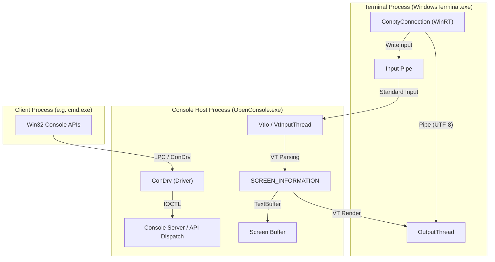
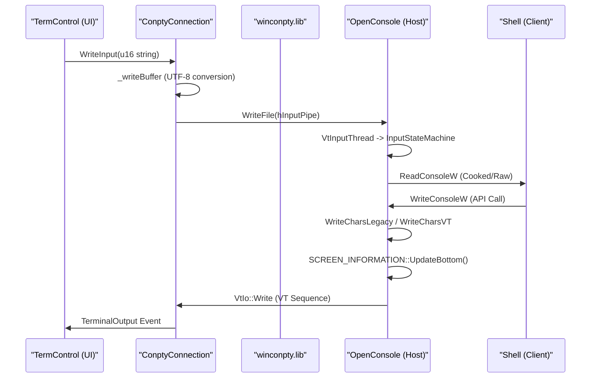

<!-- source: DeepWiki mcp.deepwiki.com · repo microsoft/intelligent-terminal · page 8 Console Host (conhost) and ConPTY · fetched 2026-10-26 -->

# Console Host (conhost) and ConPTY

Relevant source files

The following files were used as context for generating this wiki page:

- [doc/COOKED_READ_DATA.md](doc/COOKED_READ_DATA.md)
- [src/cascadia/TerminalConnection/ConptyConnection.cpp](src/cascadia/TerminalConnection/ConptyConnection.cpp)
- [src/cascadia/TerminalConnection/ConptyConnection.h](src/cascadia/TerminalConnection/ConptyConnection.h)
- [src/cascadia/TerminalConnection/ConptyConnection.idl](src/cascadia/TerminalConnection/ConptyConnection.idl)
- [src/host/_stream.cpp](src/host/_stream.cpp)
- [src/host/_stream.h](src/host/_stream.h)
- [src/host/getset.cpp](src/host/getset.cpp)
- [src/host/getset.h](src/host/getset.h)
- [src/host/inputReadHandleData.cpp](src/host/inputReadHandleData.cpp)
- [src/host/readDataCooked.cpp](src/host/readDataCooked.cpp)
- [src/host/readDataCooked.hpp](src/host/readDataCooked.hpp)
- [src/host/screenInfo.cpp](src/host/screenInfo.cpp)
- [src/host/screenInfo.hpp](src/host/screenInfo.hpp)
- [src/host/stream.cpp](src/host/stream.cpp)
- [src/inc/conpty-static.h](src/inc/conpty-static.h)
- [src/winconpty/dll/winconpty.def](src/winconpty/dll/winconpty.def)
- [src/winconpty/ft_pty/ConPtyTests.cpp](src/winconpty/ft_pty/ConPtyTests.cpp)
- [src/winconpty/winconpty.cpp](src/winconpty/winconpty.cpp)
- [src/winconpty/winconpty.h](src/winconpty/winconpty.h)

The Windows Console Host (`conhost.exe` or its open-source equivalent `OpenConsole.exe`) is the engine responsible for hosting command-line applications. In the Intelligent Terminal architecture, it acts as the "backend" for terminal sessions, providing the text buffer, API implementation, and VT (Virtual Terminal) translation layer. The **Pseudoconsole (ConPTY)** infrastructure bridges these host instances to the modern terminal emulator UI.

## Overview of Architecture

When a new tab is opened, the terminal does not run the shell (like `cmd.exe` or `pwsh.exe`) directly. Instead, it creates a **ConPTY** connection. This connection spawns an instance of the Console Host which in turn launches the shell. The terminal communicates with the host via asynchronous pipes, sending user input and receiving VT-encoded screen updates.

### System Hierarchy
The following diagram illustrates the relationship between the terminal UI and the underlying console host infrastructure.

**ConPTY Infrastructure and Process Bridge**

Sources: [src/cascadia/TerminalConnection/ConptyConnection.h:15-27](), [src/host/screenInfo.cpp:21-39](), [src/winconpty/winconpty.cpp:119-155]()

## Key Components

### ConptyConnection
The `ConptyConnection` class is the primary implementation of `ITerminalConnection` for local shell sessions. It manages the lifecycle of the `OpenConsole.exe` process and the associated pipes. It also handles environment variable injection, including `WT_SESSION` and `WSLENV` interop for WSL sessions.

For details, see [ConptyConnection and winconpty: Pseudoconsole Infrastructure](#8.1).

### Console Host (OpenConsole)
The host maintains the "truth" of the console state. It contains the `SCREEN_INFORMATION` structure which holds the `TextBuffer`, cursor state, and viewport information. Even when running in PTY mode (headless), the host simulates a traditional console environment to remain compatible with legacy Win32 Console APIs (e.g., `WriteConsoleOutput`).

For details, see [Console Host Screen Buffer and I/O](#8.2).

### API Dispatch and Server
The host acts as a server for client applications. When a client calls a Win32 API like `GetConsoleScreenBufferInfo`, the request is routed through the `ConDrv` driver to the host's `ApiDispatchers`. This layer maps these calls to internal host routines.

For details, see [Console Server and API Dispatch](#8.3).

## Data Flow and Code Entities

The bridge between the "Natural Language" concepts of a PTY and the actual "Code Entities" is defined by the `winconpty` library and the `VtIo` subsystem.

**PTY Data Flow: Input to Screen Update**

Sources: [src/cascadia/TerminalConnection/ConptyConnection.cpp:33-62](), [src/host/_stream.cpp:188-195](), [src/host/readDataCooked.cpp:34-51](), [src/winconpty/winconpty.cpp:119-168]()

## Sub-Pages

| Page | Description |
| :--- | :--- |
| **[ConptyConnection and winconpty: Pseudoconsole Infrastructure](#8.1)** | Details on the WinRT connection layer, pipe management, and the `winconpty.lib` helper that abstracts `HPCON` creation. |
| **[Console Host Screen Buffer and I/O](#8.2)** | Deep dive into `SCREEN_INFORMATION`, `TextBuffer` management within the host, and "Cooked Read" (line editing) logic. |
| **[Console Server and API Dispatch](#8.3)** | Explanation of the LPC/ConDrv messaging system and how Win32 APIs are dispatched to `IApiRoutines`. |

Sources: [src/cascadia/TerminalConnection/ConptyConnection.h:13-27](), [src/host/screenInfo.hpp:31-60](), [src/winconpty/winconpty.h:6-10]()

---

