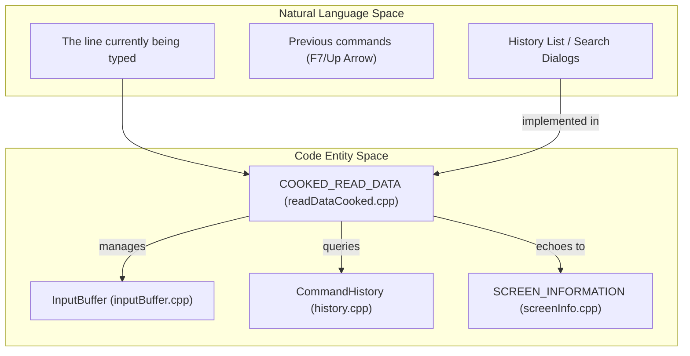
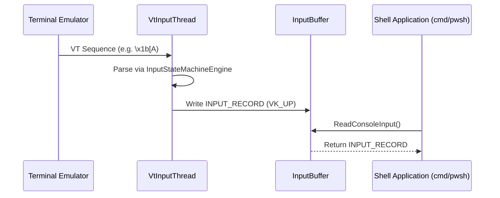

<!-- source: DeepWiki mcp.deepwiki.com · repo microsoft/intelligent-terminal · page 8.2 Console Host Screen Buffer and I/O · fetched 2026-10-26 -->

# Console Host Screen Buffer and I/O

Relevant source files

The following files were used as context for generating this wiki page:

- [doc/COOKED_READ_DATA.md](doc/COOKED_READ_DATA.md)
- [src/host/_stream.cpp](src/host/_stream.cpp)
- [src/host/_stream.h](src/host/_stream.h)
- [src/host/alias.cpp](src/host/alias.cpp)
- [src/host/alias.h](src/host/alias.h)
- [src/host/cmdline.cpp](src/host/cmdline.cpp)
- [src/host/cmdline.h](src/host/cmdline.h)
- [src/host/dbcs.cpp](src/host/dbcs.cpp)
- [src/host/exe/CConsoleHandoff.h](src/host/exe/CConsoleHandoff.h)
- [src/host/exe/exemain.cpp](src/host/exe/exemain.cpp)
- [src/host/exe/sources](src/host/exe/sources)
- [src/host/ft_uia/sources](src/host/ft_uia/sources)
- [src/host/getset.cpp](src/host/getset.cpp)
- [src/host/getset.h](src/host/getset.h)
- [src/host/globals.h](src/host/globals.h)
- [src/host/history.cpp](src/host/history.cpp)
- [src/host/history.h](src/host/history.h)
- [src/host/inputBuffer.cpp](src/host/inputBuffer.cpp)
- [src/host/inputBuffer.hpp](src/host/inputBuffer.hpp)
- [src/host/inputReadHandleData.cpp](src/host/inputReadHandleData.cpp)
- [src/host/proxy/IConsoleHandoff.idl](src/host/proxy/IConsoleHandoff.idl)
- [src/host/readDataCooked.cpp](src/host/readDataCooked.cpp)
- [src/host/readDataCooked.hpp](src/host/readDataCooked.hpp)
- [src/host/readDataDirect.cpp](src/host/readDataDirect.cpp)
- [src/host/readDataDirect.hpp](src/host/readDataDirect.hpp)
- [src/host/readDataRaw.cpp](src/host/readDataRaw.cpp)
- [src/host/readDataRaw.hpp](src/host/readDataRaw.hpp)
- [src/host/screenInfo.cpp](src/host/screenInfo.cpp)
- [src/host/screenInfo.hpp](src/host/screenInfo.hpp)
- [src/host/scrolling.cpp](src/host/scrolling.cpp)
- [src/host/scrolling.hpp](src/host/scrolling.hpp)
- [src/host/selection.cpp](src/host/selection.cpp)
- [src/host/selection.hpp](src/host/selection.hpp)
- [src/host/selectionInput.cpp](src/host/selectionInput.cpp)
- [src/host/selectionState.cpp](src/host/selectionState.cpp)
- [src/host/srvinit.cpp](src/host/srvinit.cpp)
- [src/host/stream.cpp](src/host/stream.cpp)
- [src/host/ut_host/AliasTests.cpp](src/host/ut_host/AliasTests.cpp)
- [src/host/ut_host/HistoryTests.cpp](src/host/ut_host/HistoryTests.cpp)
- [src/host/ut_host/InputBufferTests.cpp](src/host/ut_host/InputBufferTests.cpp)
- [src/host/ut_host/SelectionTests.cpp](src/host/ut_host/SelectionTests.cpp)
- [src/inc/conint.h](src/inc/conint.h)
- [src/internal/stubs.cpp](src/internal/stubs.cpp)
- [src/propslib/DelegationConfig.cpp](src/propslib/DelegationConfig.cpp)
- [src/propslib/RegistrySerialization.hpp](src/propslib/RegistrySerialization.hpp)
- [src/server/IoDispatchers.cpp](src/server/IoDispatchers.cpp)
- [src/terminal/parser/ft_fuzzer/fuzzing_directed.h](src/terminal/parser/ft_fuzzer/fuzzing_directed.h)
- [src/terminal/parser/tracing.cpp](src/terminal/parser/tracing.cpp)
- [src/terminal/parser/tracing.hpp](src/terminal/parser/tracing.hpp)
- [src/types/ColorFix.cpp](src/types/ColorFix.cpp)
- [src/types/inc/ColorFix.hpp](src/types/inc/ColorFix.hpp)
- [src/types/inc/IInputEvent.hpp](src/types/inc/IInputEvent.hpp)

This page details the core data structures and I/O processing logic within the Console Host (`conhost.exe`). It covers the management of screen buffers, the implementation of Win32 Console APIs, the output stream processing pipeline, and the "cooked read" logic used for interactive command-line editing.

## Screen Buffer Management: SCREEN_INFORMATION

The `SCREEN_INFORMATION` class is the central entity representing a console screen buffer. It encapsulates the text data, viewport state, cursor properties, and the state machine required for VT (Virtual Terminal) processing.

### Key Components
*   **TextBuffer**: Managed via `std::unique_unique<TextBuffer>`, it holds the actual character data and attributes [src/host/screenInfo.cpp:87-91]().
*   **Viewport**: Defines the visible window into the buffer [src/host/screenInfo.cpp:82-83]().
*   **Cursor**: Managed within the `TextBuffer`, but controlled via `SCREEN_INFORMATION` methods like `SetCursorPosition` [src/host/screenInfo.hpp:100]().
*   **StateMachine**: Each screen buffer maintains its own `StateMachine` to parse incoming VT escape sequences [src/host/screenInfo.cpp:142-150]().

### Buffer Lifecycle and Types
Conhost supports multiple screen buffers, though only one is "active" and attached to the renderer at a time. It also supports an "Alternate Buffer" mode (common in VT applications like `vim` or `tmux`), where a temporary buffer is created and swapped with the main buffer [src/host/screenInfo.hpp:85-91]().

**SCREEN_INFORMATION Data Flow**
The following diagram illustrates how `SCREEN_INFORMATION` acts as the bridge between API requests and the underlying storage.

| Entity | Role |
| :--- | :--- |
| `SCREEN_INFORMATION` | Primary container for output state [src/host/screenInfo.hpp:31](). |
| `TextBuffer` | Circular buffer for `ROW` and `Cell` data [src/host/screenInfo.cpp:87](). |
| `StateMachine` | Parses VT sequences for the buffer [src/host/screenInfo.cpp:96](). |
| `_virtualBottom` | Tracks the "end" of the terminal content for scrollback management [src/host/screenInfo.cpp:135](). |

Sources: [src/host/screenInfo.cpp:21-110](), [src/host/screenInfo.hpp:31-160]()

## API Implementation: getset.cpp

The `ApiRoutines` namespace in `getset.cpp` provides the concrete implementation for the classic Win32 Console APIs. These functions bridge the IPC layer (LPC/ConDrv) to the internal state of the `InputBuffer` and `SCREEN_INFORMATION`.

### Implementation Patterns
Most implementations follow a standard pattern:
1.  **Locking**: Acquire the global console lock via `LockConsole()` [src/host/getset.cpp:42]().
2.  **Context Resolution**: Operate on the provided `InputBuffer` or `SCREEN_INFORMATION` context.
3.  **State Retrieval/Mutation**: Access members like `InputMode` or `OutputMode` [src/host/getset.cpp:45, 70]().

### Common API Implementations
*   **GetConsoleInputMode / SetConsoleInputMode**: Manages flags like `ENABLE_LINE_INPUT` and `ENABLE_VIRTUAL_TERMINAL_INPUT` [src/host/getset.cpp:37-56]().
*   **GetConsoleScreenBufferInfoEx**: Populates the `CONSOLE_SCREEN_BUFFER_INFOEX` structure with viewport, cursor, and color table data [src/host/getset.cpp:102-147]().
*   **GetConsoleCursorInfo**: Retrieves cursor size and visibility [src/host/getset.cpp:155-168]().

Sources: [src/host/getset.cpp:32-168]()

## Output Stream Processing: _stream.cpp

The `_stream.cpp` file contains the "legacy" output pipeline. This is responsible for taking strings (usually from `WriteConsole`) and rendering them into the `TextBuffer`, handling both plain text and control characters (like `\r`, `\n`, `\t`).

### The Processing Pipeline
1.  **WriteCharsLegacy**: The entry point for writing strings. It checks if `ENABLE_PROCESSED_OUTPUT` is set [src/host/_stream.cpp:188]().
2.  **Control Character Handling**: If processed output is enabled, characters like Tab (`0x09`) are expanded to spaces, and Newline (`0x0A`) triggers buffer scrolling [src/host/_stream.cpp:190-200]().
3.  **AdjustCursorPosition**: A critical helper that handles wrapping at the end of a line (if `ENABLE_WRAP_AT_EOL_OUTPUT` is set) and triggers circular buffer increments when the cursor moves past the bottom [src/host/_stream.cpp:94-151]().
4.  **_writeCharsLegacyUnprocessed**: Performs the actual `TextBuffer::Replace` calls for spans of text that do not contain control characters [src/host/_stream.cpp:154-183]().

### Accessibility Integration
The stream pipeline is hooked into the `AccessibilityNotifier`. Changes to the cursor position or buffer content trigger `RegionChanged` and `CursorChanged` events for screen readers [src/host/_stream.cpp:33-81]().

Sources: [src/host/_stream.cpp:33-200]()

## Cooked Read and Line Editing: readDataCooked.cpp

"Cooked Read" refers to the high-level input mode (`ReadConsole`) where the console host handles line editing, command history, and aliases before returning the final string to the application (e.g., `cmd.exe`).

### COOKED_READ_DATA Class
This class maintains the state of a pending read operation, including the current edit buffer, cursor position within that line, and any active popups (like the F7 history list) [src/host/readDataCooked.hpp:9-40]().

### Key Features
*   **Line Editing**: Supports standard keys (Backspace, Home, End, Arrow keys) to manipulate the local `_buffer` [src/host/readDataCooked.hpp:162-164]().
*   **Command History**: Integrates with `CommandHistory` to allow users to cycle through previous commands using Up/Down arrows [src/host/readDataCooked.cpp:48]().
*   **Alias Expansion**: Checks the `Alias` table when Enter is pressed to replace keywords with defined command strings [src/host/readDataCooked.cpp:7]().
*   **Popups**: Implements the legacy console UI for history (F7), search (F8), and specific character copying (F2/F4) [src/host/readDataCooked.hpp:53-80]().

### Data Flow: Cooked Read Loop
The logic resides in `_readCharInputLoop`, which waits for input events and dispatches them to `_handleChar` or `_handleVkey` [src/host/readDataCooked.hpp:127-129]().

**Cooked Read Entity Mapping**

Sources: [src/host/readDataCooked.cpp:34-130](), [src/host/readDataCooked.hpp:9-172]()

## Input Buffer and PTY Mode

The `InputBuffer` manages the queue of input events (keyboard, mouse, window resize) and handles the transition between Unicode (UTF-16) and ANSI (Codepage) input.

### Input Modes
The behavior of the `InputBuffer` is governed by `InputMode` flags [src/host/inputBuffer.cpp:27]().
*   `ENABLE_VIRTUAL_TERMINAL_INPUT`: When enabled, input is parsed by an `InputStateMachineEngine` and converted into VT sequences (e.g., `\x1b[A` for Up Arrow) [src/host/getset.cpp:25]().

### PTY Mode (VtIo)
In ConPTY mode, the console host does not render to a window. Instead, it uses `VtIo` and a `VtInputThread` to:
1.  Read VT sequences from the terminal emulator via a pipe.
2.  Parse those sequences back into `INPUT_RECORD` structures.
3.  Inject those records into the `InputBuffer` for the attached shell application to read [src/host/_stream.cpp:17]().

**PTY I/O Flow**

Sources: [src/host/inputBuffer.cpp:26-123](), [src/host/getset.cpp:37-56]()

---

